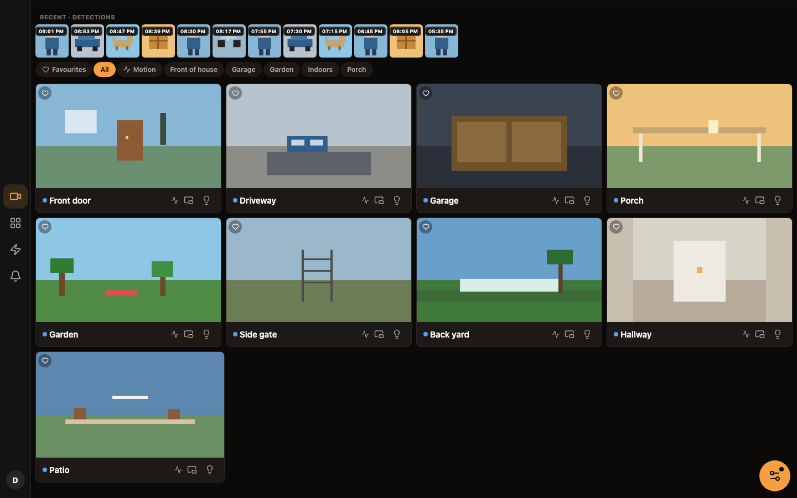
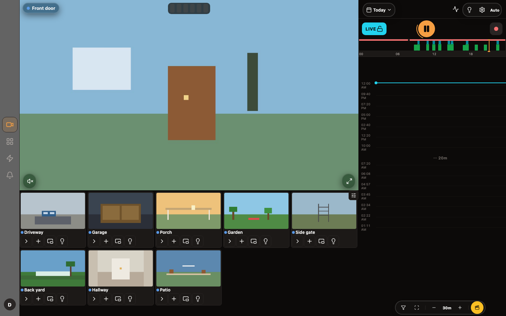
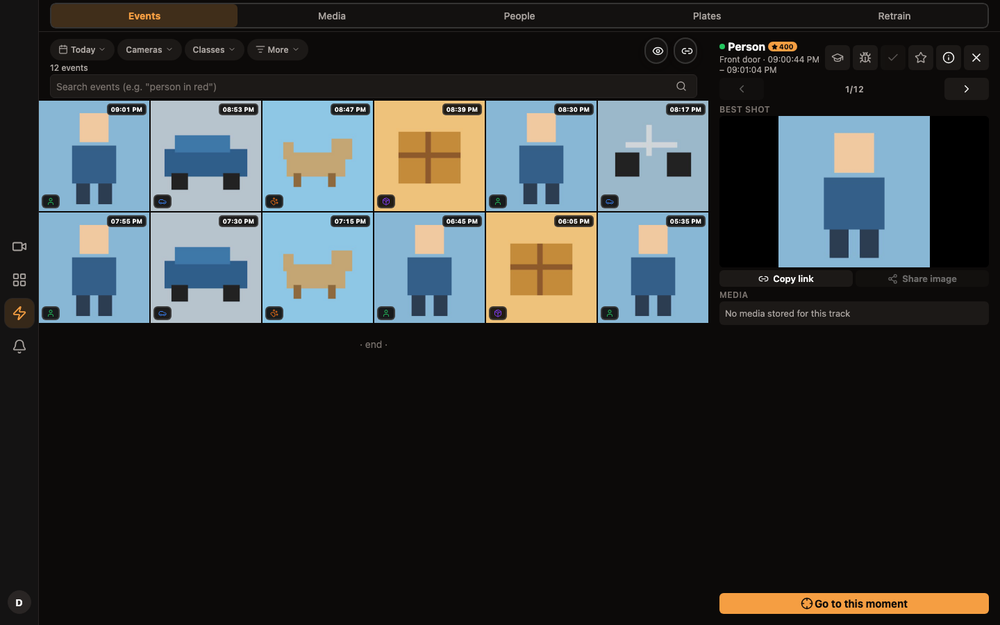
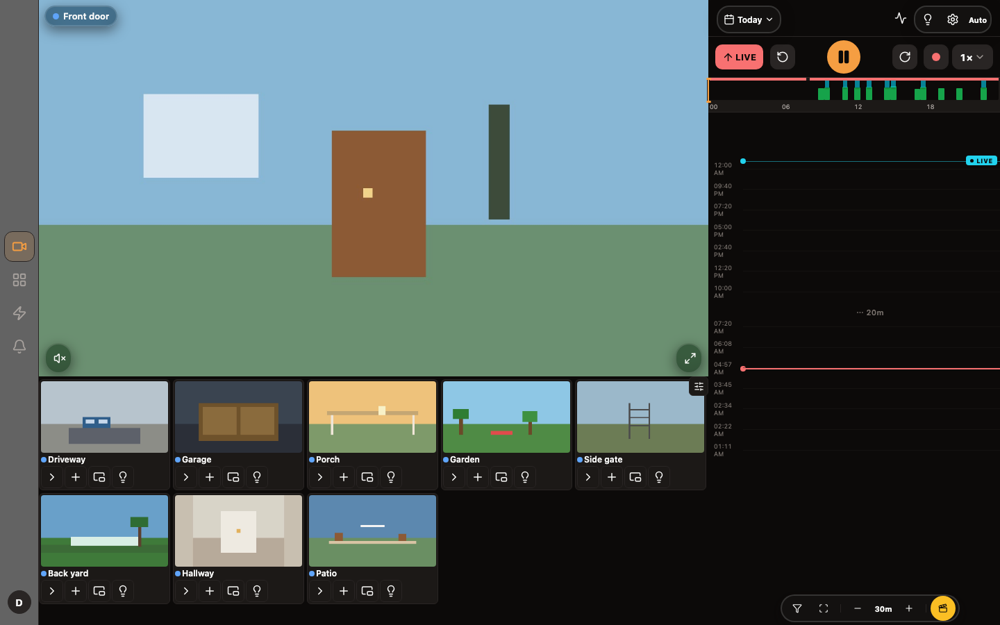
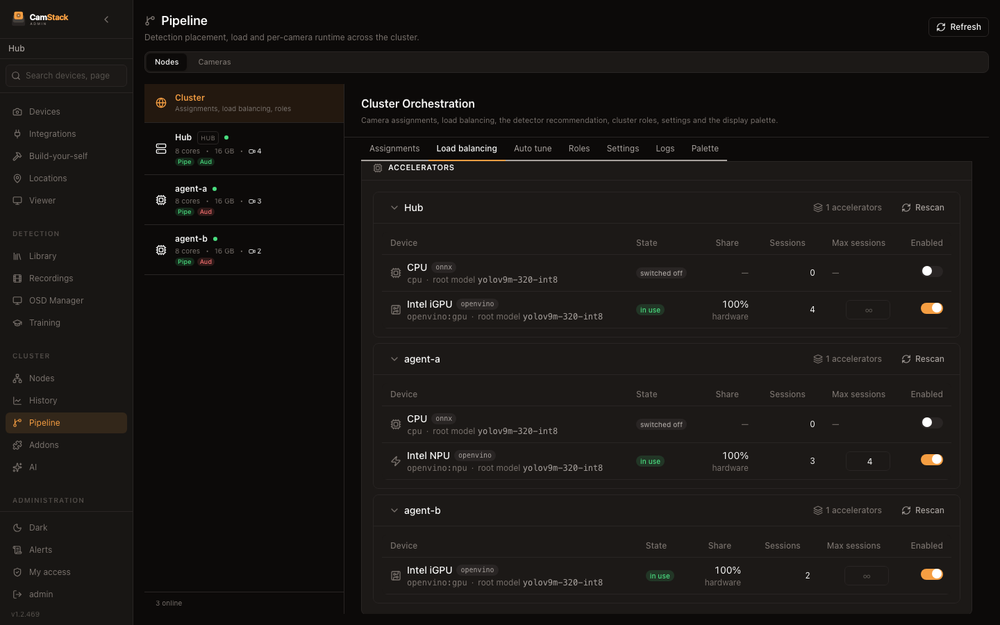
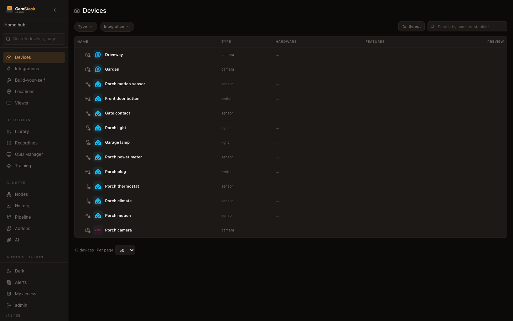
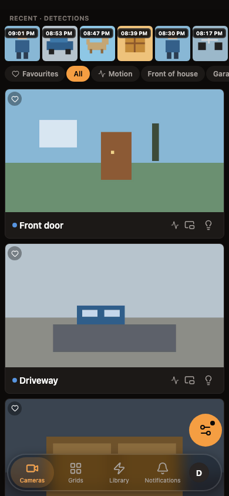

# CamStack

**Your cameras and your smart home, on your own hardware.**

CamStack watches your cameras, records what matters, recognises people, cars,
animals and parcels, and lets you know — without sending your video anywhere.
It runs on a home server, a NAS or a spare computer, and it is free and open
source.

> **0.1 is a beta.** Guides and install steps: **[camstack-docs.zentik.app](https://camstack-docs.zentik.app)**

  

## What you get

- **Live view that just works.** All your cameras in a fast grid — on your
  phone, in the browser or in the desktop app. Talk back through cameras that
  have a speaker.
- **Recordings you can search.** Record all the time or only when something
  happens. A timeline shows you when there was activity, and the event library
  lets you jump straight to the person, the car or the parcel.
- **Smart detection, at home.** People, vehicles, animals, parcels, faces,
  number plates and sounds such as a smoke alarm — analysed on your own
  machine, using whatever it has: a regular CPU, Intel, AMD, Apple or NVIDIA
  graphics, or a Coral stick.
- **Alerts worth opening.** Decide which camera, which area and which hours
  matter. Each alert comes with a picture, and optionally a one-line
  description written by an AI model of your choice.
- **Part of your smart home.** Your lights, sensors, locks, robot vacuums and
  climate units sit next to your cameras, and everything can be shared with
  Home Assistant, Apple Home, Alexa or Google Home.
- **Grows with your house.** Add more computers as you add cameras. CamStack
  spreads the work across them and moves it when one is busy.
- **Make it yours.** Adjust how any device reports its state, combine sensors
  into new devices, write automations, and train the detector on your own
  scenes.

## A look around

| | |
| --- | --- |
|  |  |
| Live view with the activity timeline | Events, filtered by what was seen |
|  |  |
| Recordings and playback | Several machines, balanced automatically |
|  |  |
| Cameras and home devices together | The mobile app |

## Works with

| | |
| --- | --- |
| **Cameras** | Reolink, Hikvision, Amcrest, UniFi, Wyze, and any ONVIF or RTSP camera |
| **Home devices** | Home Assistant, Tuya, Bosch (Smart Home, Home Connect, HomeCom), Homematic, Velux, Dreame, PetKit, VeSync, Gree, Dreo, Ecowitt, Rademacher, MQTT |
| **Share to** | Home Assistant, Apple Home (with HomeKit Secure Video), Alexa, Google Home, Matter, MQTT |
| **Alerts** | Zentik, ntfy, Pushover, Gotify, Telegram, Discord, WhatsApp, email, webhooks |
| **Storage** | Local disks, plus S3-compatible, WebDAV, SFTP and SMB destinations |
| **Remote access** | Cloudflare Tunnel or Tailscale — no port forwarding needed |
| **Apps** | iOS, Android, web, and a desktop app for macOS and Linux |

Each integration is a plugin you add from the admin page. Missing one? Plugins
are ordinary npm packages — see [how to write one](CONTRIBUTING.md#publishing-your-own-addon-to-npm)
and the [examples](https://github.com/camstack/addon-examples).

## Private by design

Everything — video, recordings, detections, faces — stays on your machines.
There is no CamStack account.

Two small hosted pieces exist because the other side requires them: the
**Alexa** skill talks to a small cloud function — ours by default, or your own
if you prefer to deploy it — and the page at [camstack.zentik.app](https://camstack.zentik.app) that lets the
mobile app find your server from a link. It never sees your video.

Updates, plugins and detection models are downloaded from public sources (npm,
GitHub and Hugging Face). Anything else that leaves your house is an
integration you turned on yourself.

## Get started

| How | |
| --- | --- |
| **Docker** | `ghcr.io/camstack/camstack:intel-latest` (or `amd-latest`) — [guide](https://camstack-docs.zentik.app/docs/installation) |
| **Unraid** | Community template — [guide](https://camstack-docs.zentik.app/docs/installation/unraid) |
| **Proxmox** | One-line install script — [guide](https://camstack-docs.zentik.app/docs/installation/proxmox) |
| **Desktop** | macOS and Linux apps on the [releases page](https://github.com/camstack/server/releases) |

Then open `https://<your-server>:4443`, sign in as `admin` / `changeme`, and
pick a new password.

## Community

Questions and ideas: [Discussions](https://github.com/camstack/server/discussions) ·
Bugs: [Issues](https://github.com/camstack/server/issues) ·
Contributing: [CONTRIBUTING.md](CONTRIBUTING.md) ·
Security: [SECURITY.md](SECURITY.md)

CamStack is released under the [MIT licence](LICENSE).
