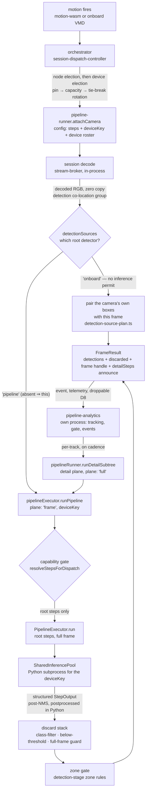
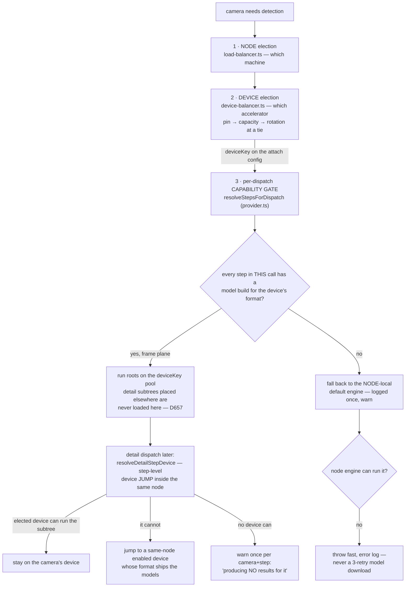

# Detection execution — engines, planes, and how a step reaches a device

The path from a decoded frame to a `FrameResult`, and the machinery that
decides **where** each step of it runs. Companions, not restated here:
[inference-devices.md](inference-devices.md) (how a session is elected onto an
accelerator, pool tuning, overload), [object-detection.md](object-detection.md)
(thresholds and gating), [data-planes.md](data-planes.md) (why frames never
cross a process boundary at frame-rate).

## The journey of one frame



Everything through `FrameResult` happens inside the `detection` co-location
group (one process — [D2](../decisions/adr-0002.md),
[D9](../decisions/adr-0009.md)). `pipeline-analytics` is a separate process and
receives detections + a frame **handle**, never pixels; media is an on-demand
compressed fetch by handle ([D18](../decisions/adr-0018.md)). What happens on
the analytics side is [post-analysis.md](post-analysis.md).

## What "motion fires" means

The first box of that diagram is a filter chain of its own, and it is the
narrowest point in the whole path: nothing downstream can act on a frame the
motion step did not fire on. `motion-wasm` runs blur → diff → threshold →
dilate → connected components on the motion view
(`MOTION_FRAME_VIEW` = content 320×320, **fit contain** — so 320×180 on a 16:9
camera and 320×142 on a 1200×536 one), and then applies an area bar in JS.

That bar judges a **merged subject**, relative to the view
([D394](../decisions/adr-0394-the-motion-area-bar-judges-a-merged-subject-relative-to-the-view.md)):
components are grown to `min(w,h)/6` about their centre, merged transitively
where the grown boxes overlap, and the group — its rectangle the union of the
**original** boxes — passes when its summed changed pixels reach
`minAreaFraction` of the view. A group over `maxCoverageFraction` of the view is
a storm rather than a subject and does not fire, but its components are
re-judged individually so a mover inside the storm is not silenced with it.

**Which rule a camera runs is `minArea`, and the default is the old one.** A
positive `minArea` runs the pre-D394 rule whole — that absolute bar, per
component, no merging, no storm cutoff — and it ships at 1500, so the change is
inert until an operator sets a camera's `minArea` to `0`.

**One `WasmMotionDetector` serves every camera on the node** — motion-wasm is in
the `detection` group, so `resolveRunnerId` gives it one runner per node. The
WASM is sized by `init(w,h)` and must be resized on every frame whose view
differs (`ensureSize`). It was not, and three frame sizes are live on this hub
(320×180, 320×142, and 640×360 whenever motion rides the detection decode
through `registerSharedMotionSink`); a mis-sized detector reported 76.4% of the
buffer changed between two identical frames. D394 has the evidence.

Two consequences worth carrying:

- **`regionCount` counts subjects, not blobs.** `rawRegions` is still every
  connected component, ungated — that is what the debug overlay draws.
- **The bar is relative for a reason.** An absolute pixel count meant 2.60% of
  the frame on one camera of this hub and 3.30% on another, and a camera
  replaced by one with a different aspect ratio silently re-tuned its own
  sensitivity.

Why these values and what they cost in motion duty cycle, per camera:
[motion-region-area.md](../benchmarks/motion-region-area.md).

### Which motion opens a session: `motionSources`, and the camera's sensors (D672, D673)

A motion edge opens a detection session only if its `source` is one the camera
**lists** in `motionSources`. `SessionDispatchController.handleSessionMotion`
checks it twice: before the per-camera lock, for both edges, and again inside the
lock on the re-read config (the list may have changed while the event queued). A
drop is logged as `session motion dropped — the camera does not list this
source`, tagged with the camera, sampled per `(deviceId, trigger)` — the first
drop and every 50th, with `dropCount`. An unknown wire `source` never reaches the
dispatcher: `session motion dropped — unknown source` (`warn`). Before D672 there
was no gate at all, and the bootstrap dropped the trigger, so D392's
activity rate never applied.

**`onboard` is "Camera sensors"**: the camera's own motion **plus** the sensors
the operator attached to it, each in a MODE
([D673](../decisions/adr-0673-a-camera-sensor-has-a-mode-and-one-bridge-emits-the-cameras-effective-onboard-motion.md)).
A camera provider no longer emits `MotionOnMotionChanged`: it pushes its RAW
onboard motion on `ProviderMotion` (`providerMotionEvent`), and the
orchestrator's camera-sensors bridge (`CameraSensorsSource`) is the ONE emitter
of the camera's EFFECTIVE onboard motion. Every consumer — session dispatch, the
recorder's event band, the D475 row, lazy audio, the runner's
`onboardMotionDrivesAnalyzer` side-channel, HAP / Alexa / the HA export — reads
that one stream. The chain for a camera with an attached PIR:

```
camera provider ── ProviderMotion { deviceId: 103, source: 'onboard', detected }   (raw)
DeviceStateChanged (sensor 3299, motion)
  → CameraSensorsSource      (level mirror, effective-motion rule, no I/O)
  → MotionOnMotionChanged { deviceId: 103, source: 'onboard',
                            triggeredBy: { kind: 'camera' | 'sensor', … } }   (effective)
  → the motionSources gate   (103 lists onboard)
  → detection session: dispatched on motion   (meta.trigger, meta.triggeredBy)
```

**The three modes, per sensor** (`camera-sensors/effective-motion.ts`, one pure
function; the status and the bridge both call it):

| Mode | A sensor of this mode, while active |
| --- | --- |
| In addition | is motion by itself |
| Replace | is motion by itself, and while one is READY the camera's own motion no longer counts on its own |
| Confirm | lets the camera's own motion count (and for one window after it fell); while one is READY the camera's own motion counts ONLY while a Confirm sensor is active — with or without a Replace sensor (the controller's ruling on D673 Q1) |

`motion = A ∨ R ∨ (camera ∧ C) ∨ (camera ∧ no ready Replace ∧ no ready Confirm)`.
Only READY Replace / Confirm sensors reshape the camera: an offline one hands
the camera back. A sensor is active only within `maxSessionHoldMs` of its own
last real rise; a stuck one stops counting but stays ready. A camera with no
sensor, nothing resolved yet or nothing forwarded (below) is a PASS-THROUGH: its
raw push goes out verbatim as `triggeredBy: camera`.

The lines, by exact text, all tagged `deviceId` = the camera:

| Line | Level | Means |
| --- | --- | --- |
| `camera-sensors: attached sensor triggered camera motion` | info | a real rise; `meta.sourceDeviceId`, `meta.triggeredBy`, `meta.support` |
| `camera-sensors: camera motion not counted` | info, sampled (first, every 50th) | the camera's own motion dropped by the rule; `meta.reason` = `replaced` or `not-confirmed` |
| `camera-sensors: trigger not forwarded — the camera does not list \`onboard\`` | info (debug for ticks and falls) | attaching a sensor does not add `onboard` |
| `camera-sensors: sensor rise not forwarded` | info | a stale first sighting, or no timestamp |
| `camera-sensors: sensors quiet — false held back, the camera's own motion is still high` | info | the sensors fell while the camera still counts |
| `camera-sensors: sensor high too long — sustain stopped` | warn | `reason: 'sensor-stuck-high'`, no real rise for `maxSessionHoldMs`, once per sensor and episode |
| `camera-sensors: camera clear passed — this instance never saw its rise` | debug | after a respawn the bridge passes a clear it never saw rise |
| `camera-sensors: camera motion arrives unsplit — confirm/replace cannot suppress it` | warn, once per camera and process | a provider still emits `MotionOnMotionChanged` directly (D673 rule 7) |
| `provider motion dropped — not an onboard camera push` | warn, sampled | a `ProviderMotion` payload that is malformed or not `onboard` |
| `session motion: camera clear held back — an attached sensor still sees motion` | info, sampled | UNSPLIT cameras only (the Task-13 hold) |
| `camera-sensors: attachment <state>` / `camera-sensors: mapping <state>` | info / warn | a resolution changed; `meta.reasons` says why it ran |
| `detection session: dispatched on motion` | info | `meta.trigger`, `meta.triggeredBy` — the FIRST trigger, fixed for the session |

What holds, in short (D672 and D673 have the rules and the rejected
alternatives):

- **First trigger wins.** A session keeps the trigger that opened it; a camera
  refire never changes it. Since 2026-10-06 it rides the session attach as
  `sessionTrigger`, ONLY so the runner's `DetectionPhaseTransition` can name it
  (`cause: 'attach'`, `source`, `triggeredBy`, `sensorName`; the events tab
  reads "Detection session started by … motion"); the runner decides nothing
  on it, and a detach emits `cause: 'detach'` (D672, amended).
- **The bridge's edges.** An effective `false` goes out only when an input's own
  `false` (or a removal, or a stuck release) leaves no motion — never on a silent
  cooldown expiry; the level expires one window after its last `true`, the
  camera's `motionCooldownMs` floored at two sustain ticks.
- **No active detection, no sensors.** The bridge reads the camera's ACTIVE
  config: a camera whose detection is stopped (no slot, disabled) or that does
  not list `onboard` forwards nothing from its sensors and is a pass-through for
  its own motion.
- **Re-attached after a provider restart.** An answered bindings read with no
  source cap un-routes a sensor as `unsupported` (what an HA shutdown looks
  like); the sensor's own `native-registered` / online event re-queues every
  camera whose status still names its id, so it comes back by itself.
- **Sustain.** While any attached sensor is high, the bridge re-emits `true` every
  `sustainIntervalMs(motionCooldownMs)`, capped at `MOTION_CLOSE_AFTER_MS / 2`
  (7.5 s) — so the D475 episode stays one row. With no real rise for
  `maxSessionHoldMs` the sustain stops (`sensor-stuck-high`).
- **A camera is never a sensor** (`unsupported`), and a sensor is attached only
  by the operator (D356).
- **Unsplit emitters fail open.** `camera-grid` (deferred: it ships inside the
  server, which cannot assume an orchestrator at the D673 floor — the closure
  re-aligns the orchestrator only when its copy is strictly newer, see
  `update-and-release.md`) and a provider rolled back
  below the split still emit `MotionOnMotionChanged` with no `triggeredBy`. The
  bridge notes it as the camera's level, the session gets it as before, and the
  status says `notEnforced: 'provider-not-split'` — but only while the camera's
  own motion is not `always`, and only after the first such emit since the
  orchestrator started. `scripts/check-onboard-motion-emitters.ts` keeps every
  other emitter out (it reads `createEvent(` / `.emit(` windows; a generic call
  form or an aliased category is a stated blind spot).
- **A camera's `motion` runtime slice is the effective motion**, written only by
  the orchestrator ([D696](../decisions/adr-0696-a-cameras-motion-slice-means-motion-and-only-the-orchestrator-writes-it.md)).

**Where the config lives, and how to write it.** `cameraSensors` sits in the
orchestrator's per-camera device store beside `motionSources`, by stable ref,
one `mode` per sensor:

```bash
node scripts/hub/hub.mjs POST pipelineOrchestrator.applyDeviceSettingsPatch \
  '{"deviceId":103,"patch":{"cameraSensors":{"sensors":[{"addonId":"provider-homeassistant","stableId":"<stableId>","mode":"replace"}]}}}'
```

(The admin UI's Motion card writes the same value through
`pipelineOrchestrator.setCameraSensors`.) `mode` is `in-addition` (the default;
every CS-1 row reads as it), `confirm` or `replace`; anything else is refused by
name (`cameraSensors refused: …`) and nothing in that patch is written. `null`
removes the attachment. The camera status (`CameraStatus.cameraSensors`) names
each attachment `ready | offline | missing | unsupported | unreadable` with its
`mode`, plus `cameraMotion` (`always | when-confirmed | never`, absent from an
older orchestrator), `notForwarded` (`onboard-not-listed | no-active-detection`)
when the bridge would drop every rise, `notEnforced`, and `cameraLevel` (the
camera's own RAW level, which the slice no longer carries; the Motion card shows
it live) — the camera card warns on `notForwarded` and `notEnforced`. Those fields reach the admin UI and `hub.mjs` only
through a `@camstack/server` whose bundled `@camstack/types` has them: the
server's cap routers validate the output and strip unknown keys. The release
order of the whole motion path is in
[update-and-release.md](update-and-release.md#release-order-for-a-cameras-motion-path-d673-d696).

### Motion → attach: where the seconds go, and the one segment that may not hold the dispatch

An on-motion camera is blind from the motion edge until the session's first
inferenced frame, and the pre-roll the attach replays is the only thing that
looks back into that window. `session motion → attach latency`
(`session-dispatch-controller.ts`) is the line that says how wide the window
was, and since
[D440](../decisions/adr-0440-a-dispatch-names-its-segments-and-the-placement-census-may-not-hold-it.md)
it says where the time went:

| field | what it is |
| --- | --- |
| `busLagMs` | provider emit → the orchestrator's subscription (hub event bus; p50 1 ms, p90 381 ms, max 22 s in 12 h — telemetry, D8) |
| `lockWaitMs` | the per-device session lock, held by an in-flight teardown's `detachOn` |
| `dispatchMs` | lock → attach landed, = the five below |
| `reconcileMs` + `reconcileBudgetExceeded` | the placement census (`reconcilePlacementFromRunners`), as long as the dispatch waited for it — capped at `DISPATCH_RECONCILE_BUDGET_MS` (500 ms) |
| `balanceMs` | pin + memoised balancer inputs + `balance()` |
| `deviceSelectMs` | inference-device roster, caps, device pin, the pick |
| `configMs` | pipeline config, per-(node,device) provisioning, zones |
| `attachMs` | the `attachOn` RPC |

The runner's own ramp (`session-decode: detection first frame`: fork to frame,
first decode, dial) is **after** `attachMs` — `attachCamera` returns before the
dial — so the blind window is `busLagMs + dispatchMs + runner ramp`, against
the stream's retained `prebuffer` (5 s by default, `DEFAULT_PREBUFFER_SEC`,
up to 15). The detection dial asks for the 15 s ceiling by design (D382) and is
served what the ring holds; raising a camera's retention is the operator's
lever, and this line's p99 is what to size it against.

What the census cost before D440, and why it is bounded: 2 841 dispatches in
12 h, `dispatchMs` p50 44 ms / p90 1.2 s / p99 6.3 s / max 19 s; 163 over 2 s,
of which 81 had no line at all inside their window because the census asked
every runner in sequence, unbounded, and logged only what it changed. It now
fans out in parallel under `RECONCILE_NODE_BUDGET_MS` (1.5 s) per node, reports
itself with per-node cost when slow (`placement reconcile: runner census was
slow`), and a dispatch waits for it at most 500 ms — the dispatch guard stays
held until the overrunning census settles, so a late runner snapshot cannot
deregister the session it never saw.

### The second detector pass, and WHICH regions it runs on

Motion is also the trigger for a second detector pass at native resolution
(`pipeline-runner/small-subject-recovery.ts`), because a 4K frame reaches a
320 px model at 1/12 scale and a small subject is never emitted. Which regions
that pass runs on is **per camera**, and the default is the shipped rule:

| `motionCropDispatch` on `object-detection` | rule | runs on |
| --- | --- | --- |
| absent / `false` (default) | `uncovered-region` ([D377](../decisions/adr-0377.md)/[D378](../decisions/adr-0378.md)) | a region that is small AND mostly NOT covered by a full-frame box |
| `true` | `motion-crop` ([D396](../decisions/adr-0396-a-camera-may-detect-on-every-moving-region-not-only-on-the-uncovered-ones.md)) | EVERY moving region; an intersecting full-frame box is a SEED, not an exclusion |

Measured on camera 101 over 38 confirmed positive frames from six animal
pass-bys: recall at the animal floor **24%** full-frame, **42%** on
motion-derived crops, **74%** with the motion area bar lowered; 4/6 pass-bys →
6/6. Cost on the node that runs it: mean **0.25** extra detector invocations per
frame at the shipped motion sensitivity, 0.88 at the lowered bar — a crop costs
about the same as a full frame (45.2 vs 40.8 ms p50), it is just better aimed.

Two properties are load-bearing:

- **Additive, never substitutive.** On silent frames the crop arm scores 0% and
  the full frame still scores 5%, and the full frame is the only arm that can
  see a **stationary** subject. `fuseRecoveredDetections` can only append.
- **A crop-derived `person` or `vehicle` must clear 0.80.** Both real false
  positives the crop arm produced on 3 085 quiet frames were night-IR corners
  (`vehicle 0.749`, `person 0.701`); `animal` produced zero at any gate and is
  deliberately not floored. Every floored box is logged per camera.

The pass report (`small-subject recovery: pass report`, per camera, per 10 s)
carries `recipe`, `framesOffered` and `cropsPerFrame` — the invocation cost is
measured from the frames the pass was actually offered, never derived from an
fps that disagrees with the governor's admission rate.

The per-recovery line (`the native crop pass found what the full frame missed`)
carries the class, the score **and the box**
([D430](../decisions/adr-0430-a-track-is-born-with-the-zones-it-crossed-before-it-existed.md)).
Zones cannot be resolved in this process — they live in post-analysis — but the
box is what a zone is tested against, and without it the line cannot answer
"was the subject inside the watched zone at the time?". That question had to be
settled from the operator's video recording on 2026-09-10 because three
recoveries of a cat were logged with a score and nothing else.

## WHICH root detector runs: the pipeline, the CAMERA, or both

Since 2026-09-14 the root detector is a per-camera choice carried on the attach
config as `detectionSources`, the twin of `motionSources`, and read in exactly
one place
(`packages/addon-pipeline/src/pipeline-runner/detection-source-plan.ts`):

| `detectionSources` | what runs |
| --- | --- |
| absent | `['pipeline']` — an attach or a runner older than the field behaves as it always did, byte for byte |
| `['pipeline']` | the step tree on the elected device, as described everywhere else on this page |
| `['onboard']` | the CAMERA is the root step. The inference permit is never taken and the accelerator is never asked |
| a legacy two-root list | truncated to its first element (D507) — a camera runs at most ONE root detector; the schema does it, the UI never offers "both" |
| `[]` | **no root detector at all** — never widened into "everything". Reported once per minute per camera (`onboard root step produced nothing for a decoded frame`, reason `no-source`) so "detection does nothing" has an answer |

**Where the operator picks it.** One control, the first item of the camera's
Detection pipeline → Steps editor (`CameraStepInspector` →
`DetectionSourceControl`): *This node* / *Camera onboard AI* / *None*. It reads
and writes through `pipeline-orchestrator.getCameraDetectionSource` /
`setCameraDetectionSource` — the stored `detectionSources` is the only
authority, and the vendor's boxed-sub-stream flag is the mechanism the pick
drives (D62). The step tree follows the pick: with the camera's own detector the
root step is idle ("Camera AI") and the steps below it stay editable; with
*None* the root and every video step under it are idle. A camera with no onboard
detector shows no control (`getCameraDetectionSource().onboard.available`).

`['onboard']` saves the root INFERENCE, not the decode — the detail subtree
still needs pixels to cut from. `processOnboardRoot` runs **before** the
semaphore for that reason: a camera whose root step is its own must not hold an
inference permit while the accelerator sits idle, and on a saturated node it
would starve the cameras that do need one.

**The camera's boxes enter at the RUNNER**, which is the one place that holds a
decoded frame and its detections at the same instant. The provider's
`DetectionCameraNative` event is admitted there and nowhere else — the gate is
`detectionSources`, never a flag inside a vendor addon, which is what this
replaced (the policy lived on the Reolink cap, no other addon could see it, and
the operator had no way to reach it). A push is held in a single MUTABLE slot
per camera — only the freshest one can describe the frame about to be
processed, and a queue would hand the tracker one subject several times from
several instants — paired within `ONBOARD_PAIRING_MAX_AGE_MS` (1 s, symmetric
because the camera's clock is not this node's), scaled into the **decoded
frame's** real pixel space rather than the old nominal 1000×1000, and then
cleared: the same push must never be pinned onto a second frame.

**A frame with no fresh push produces NO result, not an empty one.** An empty
`FrameResult` is a positive statement — "I looked and there was nothing" — and
this path did not look; emitting it would make every silent frame evidence of
absence and coast every subject to death between two pushes. Each non-pairing
reason is named rather than folded into an empty array (D391) — `none`,
`expired` with `ageMs`, `no-geometry` with the classes — and sampled per camera
per reason at `ONBOARD_ROOT_IDLE_REPORT_MS` (60 s), because on a quiet camera
it fires at detection fps and that is not a fault.

**One door, and the discriminator is a field.** `source` (and `occasion`,
`'session' | 'burst'`) travels explicitly along `ResultCallback` onto the
emitted payload — never inferred from a frame-id prefix, which is one rename
away from being wrong. Everything downstream (subject tiles, birth evidence,
the `detailSteps` announce, the overlay, the tracker) cannot tell which
detector produced the boxes, and that is the whole point: the camera-native
plane used to be a SECOND door — the provider emitted `detection.camera-native`
and post-analysis ingested it on a path of its own, with no frame handle
because that process has no pixels to name — so an onboard-born track had no
face, no plate and no embedding.

> **Trap.** `detectionSources` is OPTIONAL on `RunnerCameraConfig`, so a
> dispatch path that simply omits it gets the cap's declared default
> `['pipeline']` merged into the payload by `withCapInputDefaults` with no type
> error anywhere — the operator's pick vanishes in transit. That is
> [D499](../decisions/adr-0499-an-optional-field-with-a-default-is-a-pick-that-can-vanish.md);
> the runner states what it registered with
> (`camera registered: root detectors`) precisely because the decision crosses
> a settings store, a resolve, an attach payload and a process boundary.

## Engines: every engine is a Python pool

The Node.js onnxruntime raw-tensor path was removed on 2026-08-02 and is gone:
`postprocess/dispatch.ts` throws rather than falling back ("The Node.js
raw-tensor path was removed; there is nothing to fall back to").

Four runtimes, one execution model: a `SharedInferencePool` per
`(node, runtime, device)`, each owning a Python subprocess
(`python/inference_pool.py`) that runs preprocess, predict, **NMS and
postprocess in-process** and returns a fully-postprocessed `structured`
`StepOutput` over a length-prefixed binary pipe. TypeScript never decodes a
tensor.

| Runtime | Model format | Accelerators |
| --- | --- | --- |
| `onnx` | `onnx` | CPU, CUDA |
| `openvino` | `openvino` | Intel CPU / iGPU / NPU — one pool **per** accelerator |
| `coreml` | `coreml` | Apple ANE/GPU/CPU |
| `edgetpu` | `tflite` | Coral USB and PCIe/M.2 — one pool **per** unit, enabled by default and sized by Auto tune ([D912](../decisions/adr-0912-a-coral-is-an-accelerator-like-the-rest-it-is-enabled-by-default-and-auto-tune-sizes-it.md)) |

### Coral units: USB and PCIe

`classifyCoralAccelerator` (`packages/system/src/builtins/platform-probe/coral-accelerators.ts`)
is the one Coral probe — the platform-probe builtin and the kernel's
`probePlatform` both call it, so the probe report and the executor's own
enumeration never disagree. It reports `CoralInfo.units` (usable, per bus) and
`CoralInfo.unavailable` (present but unusable, with a typed reason):

| Signal | Bus | Result |
| --- | --- | --- |
| USB `1a6e:089a` / `18d1:9302` under `/sys/bus/usb/devices` | `usb` | usable |
| `/sys/class/apex/apex_N` and `/dev/apex_N` opens read/write | `pci` | usable |
| `/sys/class/apex/apex_N` but `/dev/apex_N` missing from this view or not openable | `pci` | `device-not-accessible` |
| PCI `1ac1:089a` under `/sys/bus/pci/devices` with no apex unit bound | `pci` | `driver-missing` |
| none of the above, the USB bus NOT observable (`/sys/bus/usb/devices` missing, unreadable or empty), libedgetpu delegate installed | `usb` | one usable unit (assumed) |
| a readable USB bus with no Coral id, delegate installed or not | — | no USB Coral ([D919](../decisions/adr-0919-an-accelerator-is-what-the-bus-shows-re-probed-every-minute-and-a-device-that-left-is-absent.md)) |

The delegate stays installed after a stick is pulled out or moved to another
node, so it is evidence only where the bus cannot be read. Every probe logs
`Coral Edge TPU probe` with `usbBus` (`observed` / `unobservable`) and
`decidedBy` (`usb-ids`, `pci`, `delegate-fallback`, `none`).

**Re-probe (D919).** The full platform probe runs once per process; its
accelerator part (USB ids + PCIe apex units, `/sys` and `/dev` reads, no model
load) re-runs every 60 s and on demand — `platformProbe.rescanAccelerators`
(admin, `{ nodeId }` routes it to an agent; the Load balancing page's
**Rescan**). A changed answer rebuilds the device list `getCapabilities`
serves and logs `inference device appeared` / `disappeared` with `nodeId`,
`deviceKey` and `trigger`; the orchestrator's next device read logs
`inference devices: the live device set changed` and elects without it.

**Absent devices (D919).** A stored device the node's probe answered without
is `presence: 'absent'` in `getNodeInferenceDevices`: its settings are kept, it
is never eligible whatever its stored `enabled`, and
`pipelineOrchestrator.forgetInferenceDevice` deletes its stored entry (refused
for a present device, and when the probe did not answer — then the row is
`unknown`). Topology `engines` is the node's installed RUNTIMES, not its devices.

A present-but-unusable Coral is never reported as absent (D393/D315): it
stays in `platformProbe.getCapabilities().hardware.coral.unavailable` and
the probe WARNs `Coral Edge TPU present but unusable` with `bus`, `count`
and `reason` every time it runs. Only usable units gate the `edgetpu` runtime
and become devices.

Device keys come from `coralUsableUnits` (`packages/types/src/inference/coral-units.ts`),
USB first: `edgetpu:usb`, `edgetpu:usb:1`, …, `edgetpu:pci`, `edgetpu:pci:1`.
The pool opens its delegate on the explicit libedgetpu ordinal that
`edgetpuDelegateDevice` maps the key to — `usb:0`, `usb:1`, `pci:0`, `pci:1` —
because a bare or omitted device means "the first Edge TPU of any bus" and two
pools on a mixed node could open the same unit. The Python side
(`python/edgetpu_device.py`) refuses any other string. Every unit is opt-IN
(D39 keys on the backend), and the capability gate is unchanged.

Live on `agent-b` (2026-10-22, two PCIe units): enabling is
`pipelineOrchestrator.setAgentInferenceDevices` — it REPLACES the node's whole
`inferenceDevices` map, so send back every stored key — and the proof the unit
is in use is the pool's own line, `[w0] EdgeTPU: delegate bound to device
'pci:0'` (`'pci:1'` for `edgetpu:pci:1`), after `EdgeTPU: preloaded
…/libusb-1.0.so.0`. Auto tune sizes an enabled Coral at `yolov9s-320-edgetpu` (D912), so its
automatic share is proportional to its measured speed. Measured step latency, and why a Zen4
CPU on OpenVINO matches it per request:
[2026-10-22-coral-pcie-amd-phoenix.md](../benchmarks/2026-10-22-coral-pcie-amd-phoenix.md).
`/dev/apex_*` must be chowned to `camstack` by the container entrypoint
(`gosu` drops supplementary groups); the image's entrypoint does that only from
the first Docker release after v1.2.583 — until then an install needs a
host-mounted entrypoint carrying `/dev/apex_*` in its chown loop.

### The Coral delegate: where it comes from, per OS

The pool loads libedgetpu (feranick's build against TF 2.17.1, the only one
ai-edge-litert 2.1.6 can invoke). `requirements-edgetpu.txt` carries the line
`# camstack-native-dep: edgetpu-delegate`, and `ctx.deps.installPythonRequirements`
(`packages/system/src/kernel/deps/addon-deps-manager.ts`) stages the pinned set
right after pip, on every call: `ensureEdgetpuDelegate`
(`packages/types/src/deps/edgetpu-delegate.ts`), SHA-256 verified before a byte
is extracted, into `<CAMSTACK_DATA>/deps/edgetpu/lib/`.

| Host | What is staged | Notes |
| --- | --- | --- |
| Linux x64 / arm64 | `libedgetpu.so.1` from `libedgetpu1-std_…ubuntu24.04` (payload `data.tar.xz`) + `libusb-1.0.so.0` from Ubuntu 24.04's `libusb-1.0-0` (payload `data.tar.zst`) | needs glibc ≥ 2.38; the `.deb`s are read in-process (`deb-extract.ts`: ar + zstd via `node:zlib`), no `dpkg-deb` |
| macOS arm64 | `libedgetpu.1.dylib` from the `MacOS_Silicon` zip, `throttled/` (std clock) | libusb is linked in; no Homebrew needed |
| macOS x64 | refused by name | no ai-edge-litert 2.1.6 wheel for macOS x86_64; the Intel delegate links MacPorts' `/opt/local/lib/libusb` |
| Windows | refused by name | no TF 2.17.1 libedgetpu exists for Windows |

The pool and the probe resolve the same file in the same order
(`edgetpu_device.edgetpu_library_path` / `chooseEdgetpuDelegate`):
`CAMSTACK_EDGETPU_LIB` (a path override; followed even when missing) → the
staged copy under `CAMSTACK_DATA` → `/data/deps/edgetpu/lib/libedgetpu.so.1`.
On the hub image `CAMSTACK_DATA=/data`, so the staged copy IS the one
`edgetpu-install.sh` writes and nothing is downloaded. A macOS host has no
`/sys`: the staged dylib is its only Coral signal, so it reads as one USB unit,
and the first staging there needs the edgetpu runtime provisioned by hand
(a probe that sees a Mac's USB Coral is not built).

### YOLOv9 on a Coral: a catalog entry, decoded by `yolo-split-dfl`

The community YOLOv9-s EdgeTPU builds are catalog entries
(`yolov9s-320-edgetpu`, `yolov9s-512-edgetpu`, `model-catalogs.ts`), licence
record `DBRO_YOLOV9_EDGETPU_GPL` (D661): weights GPL-3.0, derived from
WongKinYiu's YOLOv9 code and `yolov9-s` checkpoint, `hosting: 'camstack-hf'` —
a node downloads the file from our Hugging Face mirror, a byte-identical copy of
the publisher's GitHub release (source in `source/yolov9-edgetpu-dbro/`), pinned
by its sha256 (the format's `revision`, D743). They carry the publisher's
17-class labelmap and `postprocessor: 'yolo-split-dfl'`, and the 320 build is the tflite
default (D908, amends D710; the SSD and the 512 build stay selectable and an
explicit pin keeps its model); no hardware rule names them (D39, D912). Any other EdgeTPU YOLOv9 is imported in Model Studio →
Register (format `tflite`, decode `yolo-split-dfl`).

The layout, read from the community plus catalog export's own files
(`dbro/frigate-detector-edgetpu-yolo9`, releases v1.0 and v1.5): input
`[1, S, S, 3]` uint8 (scale 1/255); outputs, int8 with their own scale and zero
point, class LOGITS `[1, N, C]` and DFL boxes `[1, N, 64]` with the three
strides CONCATENATED (8, 16, 32, each row-major: `N` = 2100 at 320, 5376 at
512); v1.5 adds a `[1, N, 1]` tensor that is not the class tensor. The pool
dequantises every output (`edgetpu_dequant.py`); `postprocessors/yolo_split_dfl.py`
splits a concatenated `N` back into strides, takes the widest non-box tensor as
the class tensor, decodes the DFL distances around `(cell + 0.5) · stride`, and
undoes the letterbox. Pinned by `postprocessors/test_yolov9_edgetpu_concat.py`
on tensors quantised with the v1.0 file's real scales. Set the input size to
the file's (`_512_` files are 512): a size that does not match `N` is refused
by name. No benchmark on a Coral yet.

Consequences that have bitten:

- **`EngineOutput` carries `structured`, `inferenceMs`, and optionally
  `dropped`/`shedReason`. Nothing else.** An output without `structured` is a
  defect and `dispatchPostprocess` throws — there is no raw-tensor fallback to
  quietly take over.
- **A shed is flow control, not a failure.** `dropped: true` means the pool
  deliberately skipped the frame (Python per-model bound, or the TS in-flight
  cap). The executor skips it like any dropped frame; `dispatchPostprocess`
  keeps a safety net that maps a shed to empty detections so it can never again
  surface as `runInference failed` (52k bogus error lines/24h, 2026-08-01).
- **Python NMS is invisible by design.** Suppressed boxes are destroyed inside
  the pool; the trace's model-saw count is the only NMS visibility, and `'nms'`
  is deliberately NOT a `DiscardReason` — a reason that can never fire does not
  belong in the union.
- Pool provisioning (concurrency / workers / batch mode) comes from
  `runtimes.ts` `RUNTIME_DETAIL` keyed by the **pool's own runtime**, with the
  operator override layered in `engine/pool-provisioning.ts`. The duplicate
  defaults table in `engine-factory` is deleted — do not reintroduce one.

- **A pool failure line names the CAMERA.** A pool is shared by every camera on
  its `(node, runtime, device)`, so `inference request timed out` and
  `worker saturated` described the pool and named no victim — the question those
  lines always get is "why is 102 worse than 101?". `InferenceInput.deviceId` is
  carried down purely for that tag; it selects nothing, changes no deadline and
  no shed rule, and a caller with no camera (a command, a model load, the
  benchmark, `deviceId: 0`) omits it so the line carries no tag rather than a
  fabricated one.

### WebGPU on AMD iGPU

The ONNX Runtime WebGPU Execution Provider on AMD Radeon iGPU (gfx1103+) registers
a library **once per process** — a second registration within the same process
raises "already registered" and the next inference session in that process
segfaults (D823). **Multiple sessions share one process under a lock** (measured
17.6/18.3/37.9 ms per session on yolov9t-320) rather than each owning a process.
**Multiple processes serialise on the GPU queue** without crashing — GPU-bound
latencies scale roughly linearly with process count (yolov9t-320: 22/33/45 ms at
2/3/4 processes, ~90 fps aggregate).

Measured on Radeon 760M (gfx1103): yolov9t-320 ≈ 11–13 ms, yolov9s-320 ≈ 23 ms,
yolov9m-320 ≈ 48–52 ms, yolov9m-640 ≈ 170 ms (for comparison, CPU ONNX Runtime:
22/62/195/101 ms). ROCm/MIGraphX does not support gfx1103; OpenVINO GPU support
is Intel-only.

### An engine is fetched by (step, MODEL), and the stamp is the variant's

A pool holds up to four warm variants of one step (`PipelineModelManager`,
LRU); one is "active" — the first loaded after boot — and nothing on the
dispatch path may rely on it
([D658](../decisions/adr-0658-a-model-stamp-is-the-variant-that-ran-never-the-model-requested.md)).
`buildExecutableTree` resolves every node through
`EngineFactory.getStepVariant(stepId, modelId)`, which returns the handle of
exactly that pair AND the model loaded at its pool index, and throws when the
pair is not warm — there is no by-step lookup any more. `ExecutableStep.modelId`
is the variant's id, so every stamp the assembler writes (`embeddingModelId`,
a label's `modelId`) and `FrameResult.rootModelId` name the model that ran.

The by-step lookup paired the ACTIVE variant's handle with the REQUESTED id.
On 2026-09-27 a SigLIP2 flip therefore ran MobileCLIP on every node and
stamped SigLIP2 on its 512-d vectors; post-analysis refused all 178 by
dimension. A same-dimension flip (ArcFace ↔ AuraFace) would have been filed
under the wrong model with nothing able to see it.

A cluster-scoped step (`face-embedding`, `clip-embedding`) follows the row on
every dispatch — `resolveInputSteps` overwrites the attach's model, within the
row's 60 s TTL — so a row change reaches running sessions with no re-attach.
Each camera logs the switch once, from the executable tree:
`cluster-scoped step re-provisioned for this camera — now runs the new model`
`{deviceId, stepId, from, to}` (`cluster-model-switch-log.ts`).
`runStatelessStep` takes `rootModelId`, never its pin echoed back: a result
naming no model is refused `execution-failed`, one naming another model
`model-not-servable`. The pool fast paths name their model too:
`getPoolIndex(stepId, modelId)` has no active fallback and
`pipelineExecutor.inferCached` requires `modelId`.

The tree is built from D657's `runSteps` (what survived the per-step loads),
never from the resolved request. A CHILD whose variant is still not warm at
tree-build time (evicted after its load) is the same loss in the same
vocabulary: `model load for dispatch failed` with `state: not-warm`,
`outcome: step-dropped`, once per camera per state — dropped with its subtree
on a live dispatch, the whole call (`DispatchStepsNotLoadedError`) on an
all-or-nothing one. A step whose load failed never reaches the build, so it is
said once. A missing ROOT variant fails the dispatch. `rootModelId` is read
from the built tree's roots.

**A cluster-scoped step runs only a model the owner ANSWERED.** The runner asks
`pipelineOrchestrator.getClusterModelChoice` (stored / absent / unreadable,
D651). Until the first answer the step is refused by name, per camera once
(`cluster-scoped step refused for this camera`), re-asked every 5 s; once known,
no answer keeps the last model. An all-or-nothing call (no camera, or a
replay) naming an unanswered step fails by name (`cluster-model-unknown`). The
refusal sits in the executor's resolution, so it holds whatever the runner's
placement decided (`stepsForElectedPool` keeping the step on the elected pool,
or the detail plane jumping it): no pool loads a model for an unanswered step. Serving the registry default in the owner's
boot window made it the pool's active variant for the process's life — ArcFace
for faces, until D651.

### A model an operator can SELECT must be loadable end-to-end

[D208](../decisions/adr-0208-every-model-resolution-surface-consults-the-custom-registry.md):
every surface that resolves a `(stepId, modelId)` pair — the picker, the
download path, `resolveModelForFormat`, the pool config and the postprocessor
choice — resolves the **static catalog first, then the operator's
custom-model registry**, never static-only. The pool config was the surface
that forgot: `buildPoolModelConfigForStep` (pure, in
`engine/engine-factory.ts`, reached through the `resolveCustomModel` seam)
used to look only in `def.models` and threw
`Model "X" not found in step "Y" catalog`, failing the WHOLE pool
`applyConfig` — selecting a custom model in the UI took the step's pool down.
The other halves of the same gap, all entry-based now:

- **Labels**: precedence is `-labels.json` extraFile → the entry's own
  non-empty `labels` → `def.labels`. A custom model used to decode against the
  step's COCO-80 fallback whatever it declared.
- **Postprocessor**: `resolveEffectivePostprocessorForEntry` reads the ENTRY,
  so a custom model's per-model decode override reaches the pool — a reference detector
  `yolonas` model decoded as `yolo` produces zero detections and no error
  anywhere. The pool ships a `yolonas` postprocessor
  (`python/postprocessors/yolonas.py`, the reference detector's flat `[N,7]` batched-NMS
  export).
- **Input dtype**: the Python pool honours a `tensor(uint8)` ONNX input
  (super-gradients exports bake `/255` into the graph) instead of the
  unconditional float32 `[0,1]` tensor, which was a hard onnxruntime type
  error.
- **Artifacts travel by local convention**: `camstack-local://<id>/<file>`
  resolves against `modelsDir`; a node that does not have the file fails
  FAST naming the missing distribution, never a cryptic `fetch()` URL-parse
  failure after three retries — moving the bytes is `model-distributor`'s job.
- **Picker identity**: `getSchema` forwards `provider` (`camstack` when the
  catalog entry omits it; `frigate` / `scrypted` / `custom` stamped at
  register, or inferred on read for older registry rows). The stepper's
  `ModelPicker` is provider-first — Custom is a catalog chip, not a hidden
  "Use a custom model…" toggle. The persisted value remains the flat
  `modelId`; artifacts stay local. The camera overlay fetches `getSchema` per
  column `nodeId`, not `onlineAgentIds[0]`.

Overload bounds (`POOL_MAX_IN_FLIGHT` = 8, `POOL_LIVE_INFER_TIMEOUT_MS` = 3 s
for live inference, 60 s kept for commands, the load bound + 30 s for model
loads, see below) and what worker
overload looks like from outside are in
[inference-devices.md](inference-devices.md#overload-the-shape-it-takes).
Since [D350](../decisions/adr-0350-a-sheddable-request-carries-its-absolute-deadline-on-the-wire-and-expired-work-is-never-executed.md)
each sheddable request also carries its ABSOLUTE deadline on the wire
(protocol v2, negotiated in the handshake so a version-skewed worker/host pair
keeps working): the Python pool checks it immediately before predict and
answers `{dropped: true, shedReason: 'deadline-expired'}` instead of executing
work its caller has already abandoned — the 2026-09-04 storm burned the
accelerator on exactly that dead work for 4 h 15 m. A live request whose
deadline fires on the TS side resolves as the same shed rather than rejecting;
the timeout rejection is command-only now.
Commands and `cacheFrame` writes are never shed — a dropped command
desynchronizes the worker's model slots. Since 2026-08-18 a pool is bounded by
its RSS as well: a 60 s watchdog restarts one that grows past its own settled
baseline, through the owner's ordinary dispose-and-lazy-recreate
([D177](../decisions/adr-0177-a-python-pool-is-bounded-by-its-own-watchdog-not-the-kernel.md),
and [inference-devices.md](inference-devices.md#the-memory-watchdog)) — in-flight
requests fail once and the frames of the seconds-long re-spin are dropped and
counted, never crashed.

### A model's confidence floor is its own

[D662](../decisions/adr-0662-a-detector-confidence-floor-belongs-to-the-model-and-a-face-lies-inside-its-person.md):
a score is on ONE model's scale, so a catalog entry may declare its own
`defaultConfidence`. The default is `model.defaultConfidence ??
step.defaultConfidence`, resolved only in `registry/effective-confidence.ts` —
the pool floor, the slider defaults `tree-builder` hydrates
(`getConfigSchema(model)`, under the operator's saved slider value) and each
model option of `getSchema` read it there. YuNet shipped on SCRFD's 0.5 for a
day, and a third of the gallery was wheels, hands and clock digits. It then ran
at 0.85, which also kept those faces out of the gallery. Since D741 it detects
at 0.70: re-measured, that gives precision 1.0 and recall 0.83, against 0.53 at
0.85. The face embedding keeps a separate 0.85 gate
(`face-embedding` `defaultMinParentScore`), so the gallery sees what it saw
before. The recognizer applies no second face-confidence bar. The face floor
has NO operator control: it is the model's, changed in code. A per-device
face threshold is a follow-up.
The object-detection per-class floors follow the same rule, and an operator
override of them is bound to the model it was set for
([D738](../decisions/adr-0738-a-class-confidence-floor-defaults-to-the-running-model-and-an-override-is-bound-to-the-model-it-was-set-for.md),
[object-detection.md](object-detection.md#the-floors-belong-to-the-model-that-runs-d738)).

**A model may need f32 on an Intel GPU**
([D740](../decisions/adr-0740-a-model-that-needs-f32-on-an-intel-gpu-says-so-in-the-catalog.md)).
At the GPU's default f16, the YOLO26 FP32 IRs `yolo26s`, `yolo26m` and
`yolo26m-320` returned no valid detection. Their entries, and the unmeasured
entries of the same tiers, set `gpuInferencePrecision: 'f32'`. The pool then
sends `INFERENCE_PRECISION_HINT=f32` to a GPU that lists the key, and only to
a GPU. The pool's compile line names `inferencePrecision=`. YOLO26 compiles
and runs on the Intel NPU since OpenVINO 2025.4: the base IRs at CPU
accuracy, the INT8 IRs with lost recall.

**Replacing or adding a model — checklist item.** Measure FALSE POSITIVES on
stored crops of the step's input class that do NOT contain the target (person
crops without a face, vehicle crops without a plate), not only recall on a set
where the target is always present, and set the entry's `defaultConfidence`
from that measurement. D645 measured 196/204 COCO faces found and nothing else.

### A model load never runs on the worker's loop, and a hung compile costs its model

[D653](../decisions/adr-0653-a-model-load-never-runs-on-the-pool-loop-and-a-worker-that-hangs-is-recycled.md).
On 2026-09-26 one iGPU `compile_model()` of YuNet never returned. It ran
inline on the Python pool's asyncio loop, so the `openvino:gpu` worker stayed
alive and answered nothing for four hours: 786 host-side timeouts, 123 of 123
`mem_stats` lost. Nothing recycled it, because the restart budget only counted
pools that were not ready.

**In the worker.** `load` and `replace` run on a daemon thread
(`ModelLoader`), consumed in order by one task (`CommandRouter`). `mem_stats`
and `uncache_frame` are answered at once, and inference keeps flowing during a
compile. A `replace` keeps the old model serving until the new one is in.

**Two bounds per runtime**, in one table (`POOL_MODEL_LOAD_BOUNDS`,
`engine/pool-worker-health.ts`, with the reason for each value). OpenVINO is
120 s soft / 600 s hard; CoreML is 300 s / 900 s because a load may first wait
180 s for another worker's compile-cache lock. Past the SOFT bound the worker
answers `compile-timeout` naming the model and starts no new load, but the
compile keeps running: a slow one finishes, writes its cache, tells the host
(`compile-finished-late`, on the reserved request id `0xFFFFFFFF`), and the
next load of that model is warm. A compile still running at the HARD bound
recycles the worker as `compile-hung`.

**What a hang costs.** A `compile-hung` death is not charged to the device's
crash budget. The provider counts compile timeouts per (device, model)
(`ModelLoadGovernor`); two within an hour refuse THAT MODEL on that device by
name, and the device keeps serving every other model. A crash stays a crash:
`unresponsive` (a command and the `mem_stats` probe after it both missed, with
no load outstanding) and `infer-unresponsive` (live requests ending without a
result for 30 s, counted from the start of the unanswered streak, so an idle
lull is not silence, and restarting at ready and at every load reply) are
charged to the budget, 3 deaths in 10 min then `failed`, which the health
channel carries to the balancer. Only on CoreML, and only while a load is sent
and not yet answered, neither of those fires: a compile holding the GIL
(unverified for coremltools) freezes the loop and would look wedged. Once the
worker has replied `compile-timeout` its loop is alive and the rules apply;
once a load has missed its host deadline the grace is over until a reply
arrives, so it cannot be chained by the next load. A frozen CoreML worker is
recycled at most 340 s after its first unanswered load, as `compile-hung`,
and that load counts as a compile timeout of its model.

**Loads on the host** are joined per pool and per model set, so a camera
needing another model is never handed this one's failure, and loads on
different pools never wait for each other. A failed load is not re-issued on
that pool for 5 s, doubling to 5 min; a success clears it. Each failed load is
one ERROR, `Step variant load failed`, and each camera that lost a frame gets
one WARN, `model load for dispatch failed`, tagged `{deviceId}`, per state
change.

**A CoreML package is loaded once in a child first** (`coreml_load_probe.py`,
D742). Core ML can abort the process that loads a package (SIGABRT, which
Python cannot catch), and the respawned worker would go straight back into the
same load. So the first load of each package, per device and OS build, runs
the pool's own `_acquire_coreml_model` plus one predict in a throwaway
interpreter. The verdict is kept in `.coreml-cache/<stem>.<device>.probe.json`:

- `ok` loads in-process from the compiled cache the child just wrote.
- A child killed by a signal refuses the load with
  `reason: "native-load-crashed"`. One crash is only `suspect` (D926): later
  loads are refused without probing for a 10-minute cool-off, then probed
  again; a second crash at least a cool-off after the first stores `crashed`,
  refused on every later load until the package changes on disk. An `ok` in
  between resets. The rule is shared with the OpenVINO probe below.
- Anything else is not remembered, and the load runs as before.

The compiled-model cache's fingerprint ignores the mtime of `Manifest.json`.
coremltools rewrites that file on every open, so before this every cache HIT
invalidated the cache for the next spawn.

ONNX **WebGPU** loads already run in a dedicated child per model (D823,
`webgpu_isolated.py`) — not for compile probing, but because a second
in-process WebGPU session SIGSEGVs the pool.

**An OpenVINO GPU/NPU model is compiled once in a child first**
(`openvino_compile_probe.py`, D910). On 2026-10-22 the iGPU compiler took the
hub's `openvino:gpu` worker down three times in 15 s, always on a cold compile
(warm loads never crashed). Before the pool compiles a (model, device request,
compile config) that is not known to be on disk, a throwaway interpreter runs
the pool's own `_load_model` — same PrePostProcessor, candidates, properties and
`CACHE_DIR` — so the pool then loads from the cache. The verdict lives in
`.ov-cache/<stem>.<device>.ovprobe.json`, keyed on the model files, the
compile-relevant config and the OpenVINO build:

- `ok` skips the probe while the blobs it wrote are still on disk.
- A child killed by a signal refuses the load with
  `reason: "native-load-crashed"` (same vocabulary as CoreML), and the worker
  lives. **One crash is only `suspect`** (D926): later loads of that key are
  refused without probing for a 10-minute cool-off, then probed again. Only a
  second crash at least a cool-off after the first stores `crashed`, refused on
  every later load without re-probing; an `ok` in between resets the count.
  Every crash is recorded in the file's `crashes` list with its time, the host
  load average and the child's detail, and logged as
  `OpenVINO probe: <model> device=<d> compiler crash N/2 (load L) -> <verdict>`.
  A v1 file holding one `crashed` (no list) is read as one old crash and
  re-probed. There is no cap method to clear a verdict: delete the
  `.ovprobe.json` file (CoreML: the `.probe.json` file).
- Anything else (a Python error, the 300 s bound) is not remembered and the
  load runs in-process as before. CPU-only loads are not probed.

**A benchmark never loads into the live pool** (D910). A one-shot image call
to `runPipeline` (no `deviceId`, no live frame, no replay — what
`benchmark.runPipelineTest` sends) gets a separate worker per device
(`engine/benchmark-pools.ts`), reused by the next benchmark call so the timed
runs measure a warm model on the same device, reclaimed after 5 min idle. It is
not in `factoriesByDevice`: its death is not charged to the device's budget and
its model-load history is `bench:<deviceKey>`, so a model it could not compile
is not backed off on the live device. The capacity ramp and the synthetic bench
send raw frames and still use the live pool. The one benchmark that uses the
live pool is on an EXCLUSIVE device (D928): an Edge TPU opens in one process
only, so a second pool cannot open a Coral the cameras hold, and its benchmark
queues on the live pool instead (load history still `bench:<deviceKey>`).

**Only an FP16 CoreML package runs on the Neural Engine** (D743). The pool maps
device `all` to `ComputeUnit.ALL` and `ane` to `CPU_AND_NE`, and Core ML
decides the placement. An FP32 package goes to the GPU under `ALL` and to the
CPU under `CPU_AND_NE`. The YOLOv9 packages were FP32 until 2026-10-07 and ran
2.5–5× slower than now. Every CoreML recipe in `scripts/build-camstack-models.py`
is FP16, and `check_recipes` refuses one that is not. The FP16 packages
replaced the FP32 ones under the same names. Every mirror artefact has a
revision (D744), so a node holding the old copy downloads the new one
(`ensureModel`, see [inference-devices.md](inference-devices.md)).

A fine-tuned root goes through the same script: `--checkpoint <local .pt>`
exports it exactly like an Ultralytics id (the path is used verbatim; a local
checkpoint's CoreML package is always static, because its architecture is not
in its name). `--calib-dir` takes a folder walked recursively, or an extracted
retrain export, whose `frames/` are used, so the INT8 IR is calibrated on the
operator's own frames. Calibration letterboxes CENTRED, as the inference pool
does; until 2026-10-08 `convert_lib` padded top-left. Model Studio's INT8 uses
the same `convert_lib`.

## Two planes: per-frame roots, per-track details

The step tree (`registry/step-definitions.ts` is the catalog authority;
`tree-builder.ts` builds the executable tree and hydrates every schema default
— see [object-detection.md](object-detection.md#confidence-floors-are-per-macro-class-and-they-are-enforced))
is executed on two planes with different cost models:

- **Frame plane** (`plane: 'frame'`) — the live per-frame dispatch runs ONLY
  root steps (a step whose definition has `inputClasses === null`:
  `object-detection`, `package-detection`). In `executeChildren` every crop
  child is skipped before any work, including the lazy full-frame JPEG encode.
  A camera may also have no CATALOG root step at all and be its own — see
  [WHICH root detector runs](#which-root-detector-runs-the-pipeline-the-camera-or-both);
  the plane below this one is identical either way.
- **Detail plane** — crop children (face-detection→face-embedding,
  plate-detection→plate-ocr, classifiers, clip-embedding) run **per track**,
  a bounded number of times, via `pipelineRunner.runDetailSubtree` with
  `plane: 'full'`. The runner precomputes a `detailSteps` announce at attach
  time (`deriveDetailSteps`) and stamps it on every emitted frame payload, so
  the track-level consumer (pipeline-analytics) knows what it may dispatch and
  on what cadence without a round-trip.

This split is the two-plane governor that took camera 104's frame time from
726 ms to 32 ms: frame-rate work stays cheap and constant; enrichment cost
scales with tracks, not frames.

A step's cadence is a catalog fact (`StepCadence`):
`trigger: 'once' | 'improve' | 'periodic'`, with `minIntervalMs`,
`maxPerTrack`, `stickyOnConfidence`. Examples as of today: `face-detection` is
`periodic` every 1 s (geometry refresh), `face-embedding` is
`improve, minIntervalMs: 1000, stickyOnConfidence: 0.6`, `clip-embedding` is
`improve`, `plate-detection`/`plate-ocr` are `once, maxPerTrack: 5`. The default
for a step that declares none is `{ trigger: 'once', maxPerTrack: 3 }`.

**A nested child's cadence is not what decides whether it runs — the
DISPATCHER's `steps` list is.** `face-embedding` carries its own cadence, but
the ride is composed by post-analysis's detail dispatcher
(`packages/addon-post-analysis/src/pipeline-analytics/detail-dispatcher.ts`): a periodic tick
on a track that already has an identity label sends `['face-detection']`
(geometry only — re-embedding a known face every second is 250–1900 ms of wasted
ArcFace on an N100 agent), while new-track / improve / retry dispatches send
`['face-detection','face-embedding']`. What makes the omission real rather than
cosmetic is `runDetailSubtree`'s strict-`steps` pruning
(`pruneChildStepsToRequested`); without it the child would ride its detector's
chain regardless.

### The appearance descriptor (D683)

A model-free comparator the tracker (`addon-post-analysis`,
[post-analysis.md](post-analysis.md#tracking-tracklets-deferred-fusion-occupancy-d683))
may use to resolve an L1 ambiguity or judge an L2 link. The RUNNER computes
it, not the tracker, because the runner is the one place already holding the
decoded raster for the frame: `attachAppearanceDescriptors`
(`pipeline-runner/appearance-attach.ts`) resolves a 16×32 RGB view of each
first-level box's crop (`APPEARANCE_VIEW`, `appearance-descriptor.ts`) —
from the frame lease when one exists, else the inline RGB buffer — and folds
it into a 96-integer histogram (hue×saturation, value, and a
magnitude-weighted gradient-orientation block, upper and lower box half
separately). It is attached to the `FrameResult` the SAME callback the root
step already feeds, so it travels with the boxes with no second round-trip.

It costs nothing when the tracker's `appearanceResolvesAmbiguity` default is
off (`APPEARANCE_RESOLVES_AMBIGUITY_DEFAULT`, `@camstack/types` — the ONE
authority both the runner's attach gate and the tracker's own default read,
never two copies of the decision): no crop, no resample, no descriptor. When
on, only CANDIDATE boxes pay for it by default (`APPEARANCE_SCOPE =
'candidates'` — a novel detection or one overlapping another same-class box
this frame), and the per-camera cost line is `appearance descriptors
attached` (info, throttled like the birth-evidence cost line): `attached` /
`tooSmall` / `failed` / `skippedNoPixels` / `skippedScope` counts, `meanMs`,
the `scope` in effect and the reporting `windowMs`. There are no learned
weights — it is a fixed comparator (Bhattacharyya distance per block,
`tracker-v2/appearance.ts`), not a model, so it needs no training pass and no
GPU.

### The detail crop is derived in ONE place

`runDetailSubtree` takes three pixel sources, and the difference between them is
not the pixels — it is **who decides the rectangle**:

| Input | Who cuts | Used by |
| --- | --- | --- |
| `frameHandle` | the runner, from the retained native surface | the live per-track dispatch |
| `frameJpeg` (a FULL frame) | the runner, from the caller's image | the embedding rebuild, over stored key frames |
| `cropJpeg` (an already-cut rectangle — NOT the padded subject tile of the retention tier) | **the caller** — no padding, no squaring, fed verbatim | the dispatcher's one lease-miss retry |

A fourth entry point exists and takes the same rectangle: **`runStatelessStep`**,
which runs ONE catalog step against caller-supplied pixels with no camera
session at all — no attach, no handle, no device affinity ([D56](../decisions/adr-0056.md)).
It reaches the derivation THROUGH `detail-subtree.ts`'s `cutFromFullFrame`, never
directly, so the guard below still sees exactly one importer. It exists because
`runDetailSubtree` resolves its steps from the live ATTACH STATE, which makes it
unusable to anything walking history: cameras run `detectionMode: 'on-motion'`
and a fleet-wide embedding rebuild found most of them detached. Its two other
rules matter as much as the crop: the caller pins a `modelId` and a node that
cannot serve **that exact model** refuses rather than letting
`resolveModelForFormat` substitute the format default; and it does NO device jump
(the jump roster is part of the attach config), so it runs on the node's default
engine — which is the same engine its servability check verified.

All runner-cut branches call the same `deriveDetailCropRect`
(`packages/types/src/pipeline/detail-crop.ts`) with the same convention, so a
vector rebuilt from a stored key frame lands in the same feature space as a live
one. The convention — padding ratio + squaring — is a **cluster-wide**
`pipeline-orchestrator` global setting (Pipeline → Enrichment crop), read by the
runner with no `nodeId` and cached for 60 s. It is single-valued on purpose:
`object-clip` is one shared index, so a per-node or per-device crop margin puts
two incomparable feature spaces in it. That is not hypothetical — it is what the
rebuild did until 2026-08-06 ([D52](../decisions/adr-0052.md)), and
`scripts/check-clip-crop-single-owner.ts` now fails the build on a second
derivation.

Confusing `frameJpeg` with `cropJpeg` is silent: send a full frame as `cropJpeg`
and the model is handed the entire scene; send a tile as `frameJpeg` and it is
padded twice. Neither errors.

The detail plane is also where native pixels enter: leaf crop children read a
native-resolution cut of their ROI when a native crop provider is bound
(`nativeChildCrop`, `buildAlignedFaceCrop`) — a miss falls back to the
downscaled ≤640 crop, never an upscale.

**There are TWO face size gates, and they answer different questions.**
`minFaceSize` (default 28 px) is `nativeFaceShortSidePx ?? detShortSide` — it
asks *does the embedder have enough pixels*, and a native crop may legitimately
rescue a small face there. `minLandmarkFaceSize`
(`DEFAULT_LANDMARK_PRECISION_FLOOR_PX` = 24 px,
`detection-pipeline/pipeline/landmark-precision-gate.ts`) asks *can these
landmarks be trusted*, is evaluated ALWAYS on the **detection** measurement, and
runs BEFORE that substitution — the native size is not an input to it at all.
SCRFD regresses the 5 landmarks in the detection frame (anchors at `x·stride`,
input `(x−127.5)/128` — both fixed 2026-09-26, so the measurements below predate
the fix; D643 stamps samples by alignment) and the alignment warp consumes them, so on a 4K camera downscaled ~4.7× a ±1 px landmark error lands
±5 px off on a 112 px template: a different picture, not a small misalignment.
Measured 2026-08-19 over the 60 most recent stored aligned crops, the detection
size separates aligned from face-free monotonically (28.2 px vs 16.5 px) and the
native size does not separate them at all (113 px vs 83 px) — every row cleared
the old floor, which is why it never caught any of it. Until 2026-08-19 a single
gate did the substitution unconditionally, so a 20 px detection face that cut to
100 px natively sailed through and was embedded from landmarks that could not
align anything.

**The plate-OCR floor is on the LONG side, and it belongs to the READER** — not
20 px on the short one, and no longer one number for the step. A plate's
information lives along its text run, so what decides whether a glyph survives is
the horizontal pixels per character; every cam-102 tile in the 2026-08 audit
cleared 20 px on the short side and not one produced a correct read.

Since [D200](../decisions/adr-0200-the-plate-reader-reads-plates.md) the step
hosts two recognizers whose pixels are incompatible, and all three of the things
that differ live in ONE table keyed by the reader's postprocessor
(`pipeline/plate-ocr-crop-policy.ts`):

| | `vgg_english_g2` (`ctc`) | `cct-s-v2-global` (`plate-slots`, default) |
| --- | --- | --- |
| margin around the ROI | none | +15% |
| rectify (quad-warp → deskew) | yes ([D198](../decisions/adr-0198-a-plate-is-rectified-by-its-own-quad-not-by-its-bounding-box.md)) | no |
| min crop long side | 85 px | 70 px |

The floors mean different things. For the generic text recognizer 85 px is a
CORRECTNESS gate — below it that model produced confident garbage the
plausibility gate could not distinguish. The plate reader's correctness gate is
its per-character confidence floor in `plate_slots.py`, so 70 px only avoids
spending an inference on a hopeless ROI; it reads plates at 59 native px on the
audit set.

Both gates measure the crop actually fed to the model — margin included, since
that is the tile the reader sees — and log why they skipped, throttled per step
+ device.

**Since 2026-08-13 those native pixels usually come out of a retained SUBJECT
TILE, not out of a retained frame** — the decode worker cuts one padded,
JPEG-encoded native tile per surviving detection at `FrameResult` time and then
frees the frame, because by the time the detail plane asks (measured 2.2–9.9 s
later) the frame is long gone. This does not add a second crop convention and
must not be read as one: the tile is a **container**, padded wider (0.35) than
any rectangle the convention can produce, and `deriveDetailCropRect` still
derives the model rectangle once and cuts it out of the tile. A rectangle no
tile contains is reported as a MISS, never clamped into the nearest tile — a
clamp would enrich a different part of the scene, land in the same vector index
and error nowhere ([D52](../decisions/adr-0052.md)). Mechanism, knobs and the
three defects that kept the tier cutting zero tiles until 2026-08-14:
[`decode-path.md`](../design/decode-path.md#the-rungs-that-replaced-the-ttl-2026-08-1314).


The padding is context for the detector, not a wider subject: a FACE whose
centre is outside the UNPADDED person box is dropped on the detail plane
(`pipeline-runner/face-parent-geometry.ts`, D662) and logged per camera, one
line a minute with the count. A car wheel in the padding beside a person on
102 was buffered as a face twice before it.
On a caller-cut tile (`cropJpeg`) the padding is unknown, so the guard cannot
run; those faces pass and a warning per dispatch says they were not judged.

## How a step reaches a device

Three tiers decide placement, and each answers a different question. Tiers 1
and 2 follow the cluster `sessionPlacement` policy (D748, D750): `share`
(default since D750), which holds the node and device shares of PARALLEL
sessions — automatic, from each node's capacity (hardware table or node
benchmark, D755; never from load), unless set to manual — and
yields a full node's turn, or `least-loaded` (the rotation shown) — see
[inference-devices.md](inference-devices.md#share-placement-d748).



Before any of this runs, the ORCHESTRATOR has already decided which steps the
attach carries (`resolvePipelineWithSkips`, [D650](../decisions/adr-0650-a-detail-step-the-elected-device-cannot-run-is-delegated-within-the-node.md)).
Its gate is two gates. A ROOT must have a build for the elected device's
format. A detail step (and `audio-classifier`, which never runs on a pool) is
kept when the elected device OR any device of the node's jump roster has a
build. `audio-classifier` is not format-gated at all: it runs on the
audio-analyzer's own backend, never on a pool. Until 2026-09-26 every step was
gated on the elected format alone. The Coral (tflite: an object detector and
little else) therefore lost faces, plates, CLIP and OCR before the runner could
jump them: 98 `not provisioned on this node` warns on 14 cameras in 3 h.

That decision has ONE owner, `resolveAttachPipeline` (`attach-pipeline.ts`),
and it runs AFTER device election. It builds the roster, resolves the
structure for the elected device plus roster, and provisions both the tree and
every roster entry. Every path that sets or replaces an attach's steps calls
it:
- standing dispatch;
- rebalance migration;
- on-motion session;
- executor-readiness re-attach and its sweep;
- package-zone re-attach.

A skew smaller than the auto sweep's hysteresis (1.5) is never corrected by the
sweep, by design. After a node joins, leaves or changes its roles the
orchestrator waits 90 s, plans a manual rebalance beside the sweep's plan
(`rebalance({ dryRun: true })`, the same loop) and, when only the manual plan
would move cameras, raises the alert `pipeline-orchestrator:rebalance-suggested`
whose action invokes the custom action `rebalanceNow`
([D961](../decisions/adr-0961-an-alert-action-may-invoke-a-custom-action-and-a-rebalance-is-suggested-not-forced.md)).

Only a FIRST placement waits for the node's catalog. The re-place paths
(the pending-retry sweep, the remote-health re-place, a rebalance migration)
use `resolveAttachPipelineIfCatalogCached`: a node whose executor has not
answered leaves the camera pending as `catalog-unavailable:<nodeId>` instead of
holding a serial sweep. The device ELECTION follows the same split: a first
placement waits for the catalog before electing, so the root guard never fails
open; a re-place elects against the node's last completed device probe. An
attach whose elected device cannot run the CAMERA ROOT (`object-detection` —
the same step the election guard judges, one shared constant) is refused
(`root-unrunnable:<node>/<device>`), never recorded; a refused on-motion
session shows the same reason in the camera status. Any other root the device
cannot run (`segmentation`) is a logged skip, as every unrunnable step is.

`dispatchCamera` ignores the steps it is handed. Resolving before election on
the node DEFAULT format is how a tflite-default node's GPU-elected camera
lost its faces.

All three tiers are about the PIPELINE's root step. A camera whose
`detectionSources` is `['onboard']` consults none of them for its root: no
inference permit, no device election to honour, no capability gate — only its
detail plane still places steps, exactly as below.

The load-bearing rules, each of which replaced a silent failure:

- **The gated set is per-plane; the ROOT decides the dispatch device.** A
  frame-plane call gates only the steps that execute in it. Before the
  per-step split, one tflite-less child knocked the whole tree off an
  otherwise-capable Coral.
- **The elected pool loads only what runs on it; ONE placement decides**
  ([D657](../decisions/adr-0657-a-step-loads-on-the-pool-that-runs-it-and-a-step-that-cannot-load-costs-only-itself.md)).
  A detail subtree rides the frame dispatch only to pre-warm its model. The
  runner builds that dispatch with `stepsForElectedPool`, which asks
  `placeDetailStep` — the same call the detail plane makes — about every
  detail subtree, and keeps it only on `no-jump` (or when there is nothing to
  decide). A jumped subtree loads on its TARGET pool, with the target's
  provisioning, when the detail plane sends it there. The provider's own
  frame-plane prune (for callers with no roster) asks the runner's predicate,
  `buildSubtreeCanRun`, on the whole subtree. Pruned work is not dropped work:
  each subtree runs as its own per-track dispatch. Before D657 the provider
  judged the subtree's TOP alone on "any build", the legacy Coral face stub
  passed, `face-detection` resolved to `scrfd-2.5g` (no tflite build) and its
  failed load took the root's with it.
- **A detail dispatch executes its whole subtree on ONE pool**, so its gate is
  whole-subtree (`buildSubtreeCanRun`): it jumps off the Coral when any step in
  it cannot run there. A step can run on a format when the model it names ships
  that build, or a NON-legacy model does. A legacy stub counts only when
  explicitly pinned. That rule is ONE function, `stepModelRunsOnFormat` in
  `@camstack/types`, and every placement reads it: the runner's jump (each
  candidate judged with its own roster provisioning), the executor's dispatch
  gates (`collectZeroBuildIssues`) and the orchestrator's provisioning gate
  and root guard (`addonHasCompatibleModel`).
- **A step whose model cannot load costs only itself** (D657). A dispatch
  loads per step (`loadDispatchModels`); each load is joined, backed off and
  charged on its own model (D653). A step that did not load leaves the tree
  with its descendants, and the rest runs. The dispatch fails only when no
  root survives. That is a camera's LIVE dispatch; every other call (a
  replay — D56 —, a benchmark, a capacity ramp) is all-or-nothing and fails
  naming every step that did not load. A failed step's children are never
  loaded. The per-camera line `model load
  for dispatch failed` says `outcome: step-dropped | root-lost`. An artifact
  failure (no format build, a missing custom model, a failed download) is
  named by step and model, so even a whole-set load (the benchmark batch)
  never backs off a model that did not fail.
- **A stored pin to a deleted model is reset, not resolved**
  ([D725](../decisions/adr-0725-a-stored-pin-to-a-deleted-model-is-reset-to-the-step-default-by-the-orchestrator.md)).
  The orchestrator's `removed-model-pin-reset.ts` drops every per-(node,
  device) and cluster-row `modelId` listed in `REMOVED_MODEL_IDS` (a camera
  carries no model, D927)
  (`@camstack/types`) unless a registered custom model owns it. It runs at boot
  and after each pin write, and each reset is one WARN `model pin reset: removed
  model → step default`. The resolver itself still passes an unknown id through
  as a custom model, and a bulk pass still refuses one (D54).
- **A per-format default ships its build.** `defaultModelIdByFormat[format]`
  must name a model with a `format` build; a format with none has no entry
  (`__tests__/guards/format-defaults-buildable.guard.ts`).
- **Fallback is strictly node-local.** Frames never migrate to another node
  from the gate; cross-node movement is the orchestrator's tier only.
- **An impossible configuration stays loud.** When neither the deviceKey pool
  nor the node engine can run an enabled step, `assertStepsRunnable` throws
  before any download — naming the step, its model, the formats the catalog
  actually ships, and every engine tried. The pre-gate failure mode was a
  doomed 3-retry model download, ~5.5 s per frame, forever (camera 101,
  [D39](../decisions/adr-0039.md)).
- An operator can force a detail step's placement with `step.jumpDeviceKey`;
  otherwise the jump happens only when the elected device *cannot* run the
  step.
- **A jumped subtree runs the TARGET device's provisioning, never the elected
  one's** ([D650](../decisions/adr-0650-a-detail-step-the-elected-device-cannot-run-is-delegated-within-the-node.md)).
  Each roster entry carries `steps`: what the resolved tree would run with had
  the camera been elected onto that device. That is the device's
  per-(node,device) base with the camera's override for THAT device, computed
  by the same `applyDeviceProvisioning`. `placeDetailStep` REPLACES the
  subtree's `modelId`/`settings` with that entry (absent = the target format
  default). The executor then resolves the id against the target pool
  (`resolveModelForFormat`). Before, the elected device's values followed the
  step across, and the target's pin was never read. A roster without `steps`
  (an orchestrator, or a runner NODE whose closure predates D650 — the attach
  is parsed in the runner's process with its own `@camstack/types`) leaves the
  step as sent, with the elected device's provisioning. The jump is logged
  once per (camera, step, target): `enrichment step runs on another device of
  this node`, with `provisioned: true|false`. A MANUAL `jumpDeviceKey` takes
  the target's provisioning too. When that leaves a camera override behind on
  the elected device, the orchestrator warns once per (camera, step).
- **A Coral pool loads ONE co-compiled set** ([D724](../decisions/adr-0724-a-coral-pool-loads-one-co-compiled-set-chosen-from-the-models-placed-on-it.md)).
  Separately compiled Edge TPU files evict each other from the ~6.9 MiB
  parameter cache on every alternation. The edgetpu `EngineFactory` records
  the models each dispatch places on it (`notePlacement`) and, when a
  published set (`registry/edgetpu-cocompiled-sets.ts`) covers two or more of
  them, downloads and loads THAT set's files instead (`entryForPool` swaps only
  the `tflite` URL); resident models move onto a new set when the placement
  grows into one (`reloadChangedPaths`). Root + YuNet has no set on purpose:
  the root would stream on every frame — keep face detection jumping on a
  root Coral. The provider logs the set it chose, or WARNs the models that
  will swap, tagged with the camera.
- **The jump moves no pixels anywhere new.** A detail dispatch is already a
  per-track JPEG crop through `pipelineExecutor.runPipeline`; the jump only
  changes which pool of that executor its `deviceKey` selects (D9, D18).

## The discard stack — model output to what a UI draws

Every box the model returned either reaches the overlay/tracker/events or is
accounted for. Between the two sits this stack, earliest first:

| Stage | Where | Visibility |
| --- | --- | --- |
| NMS + model score floor | Python pool, in-process | trace `model-saw` count only — suppressed boxes never cross the boundary |
| unmapped class (`classMap`) | executor | `discarded[]`, reason `class-filter` |
| `enabledMacroClasses` | executor | `discarded[]`, reason `class-filter` |
| per-macro confidence floor | executor | `discarded[]`, reason `below-threshold` |
| full-frame phantom guard | executor | `discarded[]`, reason `full-frame-guard` + info log; survivors logged too |
| detection-stage zone rules | `zone-gate.ts`, post-assembly | `discarded[]`, reason `zone-gate` |
| tracker / confirmation gate / rules | pipeline-analytics | [post-analysis.md](post-analysis.md) |

> **There is no `emitDiscarded` setting** — it was removed on 2026-08-02 and the
> name appears nowhere in the source. `FrameResult.discarded` is ALWAYS populated
> when at least one box was dropped (absent means "nothing dropped", never
> "diagnostic off"). The set is post-NMS and post-floor: a handful of boxes per
> frame, not the raw candidate flood. This is the server half of the viewer's
> ghost-box overlay, and it exists because 16 silent `continue` sites once
> dropped work with no record (AGENTS.md rule: a branch that drops work logs
> it).

`DiscardedDetection.bbox` is the executor's `[x1, y1, x2, y2]` in **absolute
analysis-frame pixels** — the overlay divides by `FrameResult.width/height`;
nothing re-normalizes on the way out.

## Capacity of an accelerator that was not measured

Auto tune still picks from the measured latency columns
([D745](../decisions/adr-0745-best-settings-picks-one-detector-family-from-static-hardware-and-applies-only-the-confirmed-plan.md),
[D755](../decisions/adr-0755-shares-and-auto-tune-are-sized-by-capacity-never-by-load.md)).
A node benchmark on that device beats the column
([D791](../decisions/adr-0791-the-node-benchmark-is-one-node-at-a-time-in-an-orchestrator-benchmark-mode-and-measured-on-the-node-beats-the-table.md),
[D913](../decisions/adr-0913-balancing-is-automatic-a-new-device-is-measured-and-the-shares-follow-the-live-hardware.md)).
When the node has neither a matching measured class nor its own benchmark,
the estimate is the nearest measured column of the same accelerator kind
scaled by reported compute
([D930](../decisions/adr-0930-an-accelerators-capacity-is-scaled-from-its-reported-compute-when-the-node-has-no-measurement.md)).

The inference worker records the facts while it enumerates OpenVINO devices
(`accelerator_facts.py`): full device name, GPU execution units, `DEVICE_GOPS`
(int8 and fp16), architecture, and NPU name / TOPS when the device answers.
The WebGPU path records adapter vendor, architecture, device and compute
units when it can. A query that fails is null, never 0. The worker publishes
the list to `camstack-accelerator-facts.json` in the system temp directory;
`getHardware` overlays that file onto the cached probe, and the boot probe
runs the same script once when the embedded interpreter and the script are
both present.

`intel-n-series` is the N100 column. An N200 or N305 scales by the compute
it reports. Core Ultra, Apple and Phoenix stay the measured columns. The
scale is clamped to 0.5×–2× the reference (`ESTIMATE_COMPUTE_RATIO_MIN` /
`MAX`). The plan marks those cells `measured: false`, `estimatedFrom` the
reference class, source `estimated`.

Sessions are `⌊fps × factor × (1 − headroom) / camera fps⌋`. `factor` is 1
at 10 fps and above. Below that, an Intel iGPU uses 1.4 — the
aggregate-over-serial ratio measured on the N100 under LATENCY with two
InferRequests ([2026-10-24-n100-capacity.md](../benchmarks/2026-10-24-n100-capacity.md)).
Other kinds stay 1 until they are measured the same way.

## Traps

- **There is no engine override** ([D646](../decisions/adr-0646-a-benchmark-names-a-pool-and-never-swaps-an-engine-a-replay-runs-the-cameras-root-step-pinned.md)).
  `runPipeline` / `runPipelineBatch` used to take an `engine` and honour it by
  re-pointing the provider's shared `currentEngine` / `engineFactory` /
  `executor` for the length of the call, under live cameras. A caller names a
  pool only by `deviceKey`; a smuggled `engine` key is stripped.
- **`replay: true` is the only way to run a camera's structure over STORED
  pixels.** It applies the camera's zone gate and overrides to an `image`,
  emits no live trace, and refuses (`model-not-servable` /
  `device-not-servable`) before any pool is touched when resolution would
  substitute the model or the capability gate would fall off the named
  `deviceKey` — the D56 rule, on the frame plane. Every result names its root
  model in `FrameResult.rootModelId` (post-resolution).

- **There is no "the step's engine".** A lookup by step id alone answered the
  pool's active variant and let a tree run one model under another's name
  (D658). Fetch by `(stepId, modelId)` and take the model id from the result.
- **`plane` defaults to whole-tree.** A caller that omits `plane` executes crop
  children inline. Three callers pass `'frame'` on purpose: the live runner, the
  capacity ramp (`pipeline-runner/capacity/`, whose whole point is to be
  production-shaped) and the synthetic benchmark when the operator asks for it —
  and a benchmark that names `plane` or `deviceKey` REFUSES its cached fast path
  (`bench-dispatch.ts`, `fastPathRefusalReason`), because `inferCached` has
  neither selector and would time the node's DEFAULT pool while reporting the
  chosen one. If you add a dispatch path, decide its plane explicitly.
- **A shed root produces "no detections this frame", a shed child leaves the
  parent unenriched** — both silent by design at the call site; the pool owns
  the authoritative shed counters and its own sampled debug line.
- **`getConfigSchema()` defaults are hydrated by the tree builder**, not by the
  executor. `macroFilterVerdict`'s `if (!settings) return 'pass'` is a bypass
  only for callers that skipped the builder — do not read it as "defaults off".
- **The audio classifier is not part of the video tree.** `tree-builder`
  filters `slot: 'audio-classifier'` out; audio rides its own accumulator path
  in the orchestrator.
- **An audio subscription against a stream with no audio track is REFUSED, and
  nothing is substituted** ([D156](../decisions/adr-0156.md)). The stream is the
  camera's `audioStreamId`, else its motion profile — an operator setting, so a
  silent fallback would make "which stream is my audio on" unanswerable. The
  refusal is one WARN with `tags: { deviceId }` naming the stream, and it is not
  terminal: the next resubscribe re-reads the evidence. That evidence comes from
  ONE classifier (`audio-track-probe.ts`) shared with the watchdog's audio
  stage, because `BrokerStats.audio === null` means both "no track" and "not
  looked yet" and the two consumers need opposite defaults — the subscription
  must not refuse on a cold read, the watchdog must not DISARM on one. It used
  to disarm on one, which is how camera 108 delivered zero audio chunks for four
  days without a single watchdog line.
- **`package-detection` is a `crop-zone` ROOT**, cropped to the union of the
  device's enabled `package`-stage zones and re-projected back to frame space —
  a crop failure falls back to full-frame rather than dropping the frame. Its
  gating chain, its zone-driven enablement (and the mirror that keeps a failed
  read from stripping it) and its `minConfidencePackage` floor are in
  [object-detection.md](object-detection.md#package-detection-has-its-own-step).
