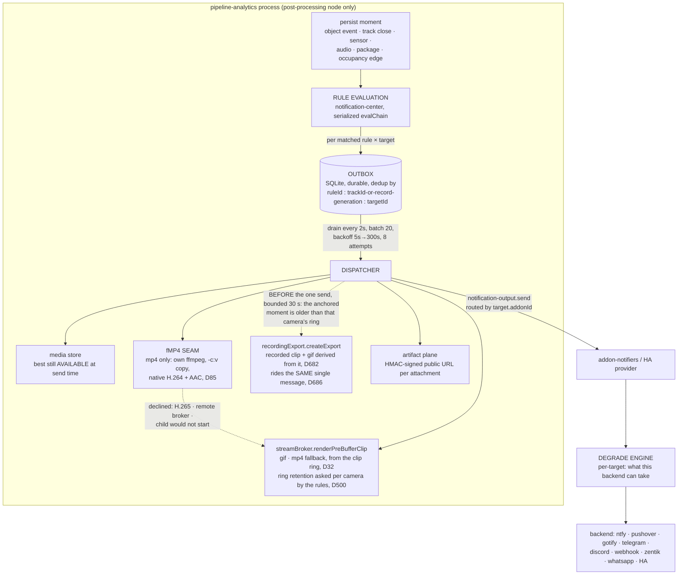

# Notifications

The Notification Center (NC) turns a persisted pipeline record into one
`notification-output.send` RPC per addressee. It spans four addons and one cap
boundary, which is why the shape below matters more than any single file:



Which capabilities exist and who provides them is in
[`reference/capabilities.md`](../reference/capabilities.md) — not repeated here.
Evaluation runs **only on the designated post-processing node**
(`evaluationActive`); every other node loads rules and serves CRUD but never
fires — worth remembering before concluding a rule is broken on a multi-node
cluster.

## Tracing a delivered notification back to its detection

`rule matched — enqueueing`, `notification delivered`, the cooldown skip and the
failed-condition line all carry `eventId` and `trackId` (2026-07-31). Before
that they carried only `ruleId` and the rule name — which rule fired, never on
WHAT — so the correlation had to be done by hand against timestamps. The match
line also carries the subject's confidence and its stamped zones, the two fields
that decide the quality and zone conditions, so "why did this fire?" is
answerable from the line itself.

What a `zones` condition tests is NOT the zone rule's inclusion percentage — see
[object-detection.md](object-detection.md#what-a-zone-scoped-rule-actually-tests).

### A zone belongs to ONE camera, so the condition is scoped per camera

`conditions.zones` is a flat id list on a rule that routinely names several
cameras, and evaluated flatly it MUTED every camera but one: a detection on
camera B can never visit a polygon drawn on camera A, so B failed `zones`
forever and nothing said so. Zone ids are unique per camera, so the rule needs
no new field — `zone-ownership.ts` narrows the list to the zones the SUBJECT's
camera owns, and the three answers are:

| ownership of the rule's ids, for this camera | verdict |
| --- | --- |
| owns some of them | evaluate against those only (a legacy stored `match: 'all'` too — "all of MY zones") |
| owns none of them (positively known) | the condition is inert; the camera matches whole-frame |
| unknown, or the rule names no camera | the flat, pre-scoping list — unchanged |

Both "keep the flat list" cases are deliberate. Ownership comes from a mirror
(`zone-owner-cache.ts`, refreshed on the rule-reload tick, never read on the
event path — D49), and a read that failed must never look like "this camera has
no zones": that would fire exactly the notification the operator scoped away. An
ALL-DEVICES rule is left flat for the mirror-image reason — widening it would
arm every camera on the hub, including the ones nobody named.

`zonesExclude` is NOT scoped, and needs no scoping: excluding a zone of camera A
is already a no-op for camera B, which can never visit it. Scoping a veto would
also be the unsafe direction — a missing ownership answer would drop the veto.

## One door in — and it does not know who knocked

Every producer reaches the centre through **one** method,
`consumeEvent(NcIncomingEvent)` (`notification-center/event-intake.ts`). The
envelope is `{ subject, kind, origin, log, controls? }` and nothing else; the
six `on*Persisted` hooks are two-line adapters over it, kept only because their
NAMES document when they fire.

The line this draws is the one that matters:

- **The producer owns persistence.** The tracker persists its tracks, the sensor
  ingest its rows, the boot reconcile replays durable ones, and the SYNTHETIC
  producer persists nothing at all. Whether a row exists is never the consumer's
  business.
- **The consumer owns match → media → delivery** and cannot tell the producers
  apart. `origin` rides the ENVELOPE, never `NcRuleSubject` — so a condition
  cannot reach it and no rule can be authored that behaves differently for a
  test. It exists for the logs and for the `synthetic: true` marker frozen on
  the outbox row.

`NcIntakeControls` is the one per-event override set, and every field gates
something AROUND a match rather than the match itself: `onlyRuleId` narrows the
candidate list, `bypassCooldown` fires without consuming the window (a test must
not silence the real notification due a second later), `bypassMute`, and
`runActions` — off for a synthetic injection, because a rule's `onTrigger`
sequence opens gates and an operator checking what a notification looks like has
not asked for that.

**The tester is the seam's first proof.** `nc.injectTestEvent` (an
`addons.custom` bridge action on `pipeline-analytics`, admin-only — no cap, no
codegen, no train) takes a described event, photographs the camera NOW, holds
that JPEG in RAM for ten minutes and serves it through the same
`(ownerKind, ownerId)` lookup the dispatcher already calls. The dispatcher has
no branch for it.

It reports honestly rather than flatteringly. `still: 'unattachable'` means the
chosen TRIGGER carries no picture in production either — `buildEntries` freezes
an `eventId` only for object/package events and a `trackId` only for kinds that
have one. Do not "fix" the tester to attach one; fix the payload, or accept it.

Only `system-event` is left in that list. A `device-event` came out on
2026-08-08, an `occupancy-event` on 2026-08-12 and BOTH audio kinds on
2026-08-15 — see **the doorbell's picture**, **the occupancy edge's picture**
and **the sound's picture** below. So a sound rule's Test button now answers
`live` (or `unavailable`, naming the camera that refused), never
`unattachable`.

### The doorbell's picture — a device event's media owner

A device event has no detection behind it: nothing was boxed, so no object-event
row and no track own a frame of it. Every doorbell notification this hub sent was
therefore text-only, from the day the centre was written until 2026-08-08, when
the operator caught it on a real 12:44 press (gif and video attached, no photo).

The fix is **not** a second photograph taken at delivery time. The same state
change already materialises a synthetic marker track carrying a snapshot of the
camera, taken BEFORE the track is persisted
(`services/sensor-marker-projector.ts` → `SyntheticTrackMaterializer`). So:

- `handleSensorStateChanged` runs the projection **before** it hands the row to
  the centre, and passes the marker's id: `onSensorEventPersisted(ev, trackId)`.
- `subjectFromSensorEvent` puts it on `subject.trackId`; `buildEntries` freezes it
  as it does for any track-scoped subject, and the dispatcher resolves the still
  through the ordinary `getMediaForOwner('track', …)` ladder. **There is no
  device-event branch on the notification path.**
- One snapshot, one owner, one persistence point — the producer's. The feed and
  the timeline read the same marker, so the picture is not duplicated.

The snapshot is bounded at `SENSOR_MARKER_SNAPSHOT_TIMEOUT_MS` (2.5 s, against a
measured ~0.6 s) because the notification now waits for it. Past the bound the
marker lands **without** media rather than not at all, and the notification ships
text-only. Both no-picture states are named, per camera:

| State | Line |
| --- | --- |
| No marker at all (the projection failed, or the window's marker never landed) | `device event has no marker track — this notification ships text-only` (warn, centre) |
| Marker landed, snapshot did not | `no still could be resolved — this notification ships text-only` (info, dispatcher) + `synthetic track error` with `snapshotTimeout` |

**Superseded by D897 (2026-10-21):** a sensor rule has the same picture selector
and the same render stage as a detection rule again, and its stored gif / clip are
honoured; a rule stored before D897 maps to the clean scene it actually shipped.
The history below is kept for the owner resolution it describes.

**Changed 2026-10-01 (operator ruling): the media CHOICE is gone, the owner is
not.** Before this, a sensor subject's `trackId` fed the SAME best/keyFrame
ladder, gif and clip options as any detection rule — the editor offered
`attach: 'best' | 'best-matching' | 'keyFrame'`, zone crop, gif, clip, profile
and playback speed exactly as for a detection. A sensor subject has no
detection to chase a crop or an animated cut around, so a sensor rule now
always attaches ONE whole-scene snapshot — `effectiveMediaPolicyForRule`
(`rule-engine.ts`) overrides a sensor-kind rule's media policy to
`NC_SENSOR_MEDIA_POLICY = { attach: 'keyFrame' }` at evaluation, regardless of
what the rule has stored; `mediaPolicyFields` (`index.ts`) is the one place
that reads it, so every outbox row a sensor rule addresses (and a combined
alarm row whose source rule is a sensor rule) gets the override. A rule
authored before this ruling keeps whatever `media` it stored — it still LOADS
and still fires — but the stored choice is IGNORED, once per rule id,
sampled-logged (`sensor rule carries a media choice — ignored at evaluation…`,
info). The marker-track OWNER resolution above (`sensor-marker-projector.ts`,
`getMediaForOwner('track', …)`) is unchanged: it is still what produces the
one snapshot, only the LADDER that used to pick among several kinds is gone.
`media.linkedCameras` (ADR 0632 — which camera(s), on a multi-camera sensor)
still applies and is still authored normally; it is a camera-selection field,
not a media-TYPE choice. Both editors (admin, viewer) render no selector at
all for a sensor rule — a note plus the linked-cameras picker, nothing else.

**A debounced change shares the window's marker** (2026-09-29). The marker is
debounced per `(camera, kind, sensor)` for 10 s, and a change inside that window is
answered with the marker the window's FIRST change landed — awaited while it is
still landing, same `trackId`, same media — logged `synthetic sensor-track
projected` with `reason: debounced` (`materializeOrShare`). It used to answer
`null`: one doorbell press on camera 101 arrived as two `DeviceStateChanged` 7 ms
apart, the debounced one won the rule and shipped without a still while the
other one's marker had it. Audio keeps the old contract (`materialize`, `null`
when debounced): a second audio episode must not adopt the first one's row.

The **gif and the clip were never affected**: `produceEventMedia` takes a camera
and an instant, so the window works for any event of that camera. Only half the
"the doorbell has no media" report was true.

### A sensor linked to cameras — every linked camera, one notification ([D632](../decisions/adr-0632-a-sensor-notification-shows-every-linked-camera.md), [D700](../decisions/adr-0700-a-linked-camera-snapshot-does-not-need-a-tracked-row.md))

A sensor linked to one or more cameras is evaluated **once**, at the sensor
level, and every linked camera is photographed at the trigger via the snapshot
capability (`getSnapshot` — not a detection-event frame). The tracked-events
opt-in still governs timeline rows and markers only ([D700](../decisions/adr-0700-a-linked-camera-snapshot-does-not-need-a-tracked-row.md));
a single untracked link uses the same linked-stills shelf as a multi-camera set
(plain still). Cameras that are offline, asleep, waking, disabled or unreachable
are left out before any dial; a tile captured more than 10 s before the event is
dropped as `stale`. Every exclusion is logged per camera, with its reason.
`getSnapshot` is never called with `force`.

- **Which rules fire is exactly what the per-camera rows fired.** A rule scoped
  to devices matches the SENSOR or a camera that took a timeline row for the
  change (`rowCameraIds`, not muted). The primary camera is only the camera the
  notification leads with: one that links the sensor without opting it in keeps
  its rules silent, and an opted-in camera that is not the primary fires its own.
- **Mutes reach as far as they did per row (D62).** A muted SENSOR drops the
  event. When the change took rows and EVERY row camera is muted, the event is
  dropped too (`every camera that took its row is muted`, on the sensor) — a
  live-view link from another camera does not resurrect it. A muted camera with
  at least one unmuted row camera loses only its tile. No row at all (no camera
  opted in) is the sensor's own event: only the sensor's mute drops it.
- **The capture is started only for a rule that could fire on THIS kind.** The
  gate reads the rule mirror: media wanted, device scope as above, `sensorKinds`
  including the event's kind, and no `occupancy` condition (such rules ride the
  same delivery but never fire on a sensor). A doorbell rule does not photograph
  every edge of a multi-linked motion sensor.
- **Only a change the ingest evaluates is a set.** `resolveSensorNotificationCameras`
  answers cameras only for `dropReason` null or `no-camera`; a camera's own
  `motion` no camera opted in stays a drop. A camera's own `motion` that some
  linking camera DID opt in, with two or more cameras linking it, is a
  camera-to-camera set like any other.

What ships is `media.linkedCameras`, a **sensor-rule-only** media field:

| Value | Picture |
| --- | --- |
| absent / `mosaic` (default) | one image composed from every surviving tile |
| `each` | one image per camera where the target takes several; where it takes one, the first camera WITH a picture (the primary's, unless its tile was excluded, stale or failed — the degrade engine keeps images by position) |

In `each`, the owners are fixed before the capture settles, so a primary whose
tile never lands costs the still-wait bound (3 s) before the other cameras'
stills ship without it (`no still of the primary camera could be resolved`).

Zero surviving tiles ⇒ text-only; one ⇒ that camera's plain still. The default is
applied in the addon (`media.linkedCameras ?? 'mosaic'`), never as a Zod
`.default()`, so absence stays absence through a partial patch.

**Both editors author it, and only for a sensor rule.** The admin rule editor
(`mediaLinkedCameras`, Notification tab) and the viewer's Notification section
(`MediaPolicyFields`) show the control only when the rule's kind is `sensor`
and something is attached; `buildRuleInput` (admin) and `pruneMediaPolicy`
(viewer) drop the key for every other kind and under `attach: 'none'`. Before
the editors authored it, each rebuilt `media` field by field and a save
silently reverted a stored `each` — the admin editor first carried it as a
preserved key, which it no longer does: the form is the authority, so choosing
the default again really clears it.

### The occupancy edge's picture — a counted object as the media owner

Same shape, same fix, 2026-08-12. An occupancy edge froze no media owner either,
so every "Cortile occupato" notification shipped text-only — even though the
snapshot that produced the edge lists, per zone, the trackIds of the very objects
being counted.

- `resolveOccupancyScope` (one function, used by the watcher AND the tester's
  probe) returns the scope's count **and its members**. Zone-scoped: that zone's
  list. Frame-scoped: the union across zones — the snapshot lists members per
  zone only, so an object inside no zone cannot be named.
- At commit, `chooseOccupancyMediaOwner` picks the **arrival**: a member that was
  not in the scope at the last confirmed-level sample is the object whose entry
  caused the crossing. No arrival ⇒ the most recently listed member. Parked
  pseudo-tracks (`stationary:…`) are never candidates — they own no track media.
- The chosen id rides on `OccupancyEdge.mediaTrackId` → `subject.trackId` →
  the ordinary `getMediaForOwner('track', …)` ladder. **No occupancy branch on
  the notification path**, exactly as with the doorbell.

A became-free edge on an empty zone names nobody. That is an emptiness, not a
defect, and it is deliberately NOT reported through the `device event has no
marker track` warn: that line is gated on the `device-event` SUBJECT KIND, and
occupancy carries its own kind (`occupancy-event`) all the way to
`buildEntries`, which lands it as a `device-event` outbox row. Widening that gate
to the delivery would make every empty-zone edge report a defect;
`occupancy-media.spec.ts` pins both directions.

#### …and an emptied scope falls back to a PHOTOGRAPH ([D178](../decisions/adr-0178-an-absent-subject-is-photographed-once-by-one-shelf.md), 2026-08-18)

Text-only was the honest answer only until there was a better one. "Posto
libero" (camera 102, parking) is the notification the operator most wants a
picture on and the one edge that can never own one — the vehicle whose departure
IS the news has left — so it shipped `no still could be resolved … owners=[]`
twice a day.

The fallback is the SOUND's, through the SAME shelf: `onOccupancyEdge`
photographs the camera and the subject names the shelf's owner id on `trackId`
(`still-shelf.ts`). A picture of the empty space is the answer to the question
the notification asks. Two gates, and both are exact:

| Gate | Why |
| --- | --- |
| only an edge with **no `mediaTrackId`** | a member track is a picture OF the counted object; a photograph is only ever the stand-in for not having one. This is the absence itself, not the polarity — a became-occupied edge whose members are all `stationary:` gets one too |
| only when a rule that **would fire on THIS edge** wants a still (`matchesOccupancy`, shared with `evaluateRule`, plus `media.attach !== 'none'`) | the watcher commits BOTH polarities of every watched key, so a hub with only a became-occupied rule still produces free edges — photographing those would be a snapshot no notification can carry |

`the camera did not answer the occupancy still — this notification ships
text-only` (warn, `tags: { deviceId }`) is the one failure line, and a shelf id
can never enter a group: `admitToGroup` declines any `isStillShelfId` trackId,
once, for every trigger the shelf serves.

#### …but a DEPARTURE is pictured on what left ([D691](../decisions/adr-0691-a-departure-is-committed-on-time-and-pictured-on-what-left.md), 2026-10-01)

The live photograph above is taken at the COMMIT, a sustain window after the
car left at best — on 102 it was 4 min 52 s, and the operator got the empty
space. A became-free edge is now pictured on the subject that left:

| Case | Picture |
| --- | --- |
| a media-ownable member of the confirmed baseline is gone from the committing read | that track (`chooseDepartedMediaOwner`) — its best shot was taken on its way out |
| only a parked entry (`stationary:`) left | a frame from the clip ring 1 s before `observedAt` (`ring-still.ts`, shelf `source: 'past'`) |
| the departed track resolves no media (fused away, too short) | the same ring still, cut lazily on that miss |
| the ring has lost the moment (long sustain, ring byte cap) | ONE recorded export of the same ±1 s window, D686's 30 s bound |
| undated, or no ring still on this node | no picture: `occupancy departure still: none — no picture of the empty space` (`moment-unknown` / `no-ring-still`, `tags: { deviceId }`) |

An ARRIVAL that owns nobody keeps the live photograph: its subject is there now.

#### …and is committed when its sustain ends (D691)

The watcher has no timer, so a flip commits only on a sample after its sustain,
and a departure's session usually closes first. Each flip is reported as it
ARMS (`OccupancyWatcher.takeArmedFlips`). The centre asks the orchestrator
`requestOccupancyLook({ deviceId, afterMs: sustain })`, and the orchestrator
dials ONE recheck-style burst at the sustain's end plus 2 s
(`reason: occupancy-sustain-look`). It is bounded: one pending look per camera,
moved to the later end, none while a session is open, and ONE per session
(`already-looked` until the next one). The cadence never cancels it. A refusal,
a drop or a failed ask leaves the edge to the 300 s cadence and is logged per
camera (`occupancy early look: …`; a failing ask warns once per camera). The
ask is addon-to-addon: it needs the new orchestrator addon, not a server
release.

### The pick-up's picture — the person who collected it ([D404](../decisions/adr-0404-a-pick-up-is-photographed-on-the-person-who-collected.md), 2026-09-08)

The third instance of the same shape, and the one where the wrong owner was
worse than none: a `package-picked-up` row named the PARCEL's own stationary
track, so the notification that asks *who took my parcel* shipped a photograph
of the empty doormat.

What makes this one different from the doorbell and the occupancy edge is
TIMING. A departure is not observed, it is **concluded** — `PackageStillnessTracker`
retires a promoted candidate only after `PACKAGE_STILLNESS_TTL_MS` (5 min of
observed time) with no re-association — so at `onDeparted` the collector's track
is closed and gone. Looking at the live frame there answers about a scene the
pick-up has left.

- `PackageCollectorMirror` (`pipeline/package/package-collector-mirror.ts`)
  records, per camera, the non-package tracks seen INSIDE a drop-off zone: the
  trackId, its presence span, and its native key-frame media KEY. Handles only,
  never pixels (D9/D18). Same population and same gate
  (`isDelivererInPackageZone`) as the `lastNonPackageActivityAt` stamp that
  already decides a disappearance is a pick-up at all.
- At departure, `pickCollector` names the presence NEAREST the parcel's last
  sighting (`entry.lastConfirmedAt` — never the departure timestamp, which is
  minutes later by construction), bounded at
  `PACKAGE_COLLECTOR_MAX_SKEW_MS` (30 s). Nearness beats quality: a longer,
  better-lit track from earlier loses to the short one that overlapped the
  moment. An exact tie goes to the LATER presence.
- The chosen id rides on `ObjectEvent.trackId` → `subject.trackId` → the ordinary
  `getMediaForOwner('track', …)` ladder, its key frame on the row's `mediaId` (D482).
  **No package branch on the notification path**, exactly as with the other two.

| State | Line |
| --- | --- |
| Nobody in the drop-off zone near the last sighting | `package pick-up has no collector in the drop-off zone` (info, producer, `tags: { deviceId }`) |
| The detector shipped the pick-up on the parcel's owner | `package pick-up has no collector track — the notification carries the parcel frame` (info, `PackageDropDetector`) |

Degraded, never conditional: the pick-up notification always fires. The row's own
timestamp is still the CONCLUSION instant, so `narrowToTriggerInstant` may report
the collector's frame as out of band and ship it with a logged offset — that is
the residual, and D404 names it.

### Audio rules — TWO EXCLUSIVE MODES (D157, 2026-08-14)

There are two audio paths, and telling them apart is the whole point.

- **Legacy, read-only since D690**: an `immediate` rule naming an `audio-*`
  class fires on ONE classified sample (`subjectFromAudioEvent`, gated by
  `referencesAudioClass`). It can no longer be SAVED — the hub refuses a
  detection rule whose `classes`/`classesExclude` carry an audio class
  (`detection-audio-guard.ts`, both save routes; an update only for a sound it
  ADDS, so the rule stays editable) and neither editor offers one —
  but a rule stored that way keeps loading and firing, and the loader reports
  it once at WARN with its `ruleId` (`notification rule is a detection rule
  naming sounds`). Recreate it as a Sound rule.
- **`conditions.audio`**: an `immediate` rule in ONE of two modes, decided by
  WHICH FILTER IT CARRIES (`audioModeOf` — there is no stored `mode` field, so
  every rule authored before D157 migrates for free):
  - **LABEL** (`labels` present) — fires on the **first frame** the classifier
    labels with one of them. No window, no `hitPercent`. The confidence gate is
    the analyzer's per-device `classificationMinScore`, applied upstream; the
    rule's cooldown is the only other brake.
  - **LEVEL** (`dbThreshold` present, no labels) — the sampling window: over
    `samplingSeconds`, at least `hitPercent`% of the samples cleared the floor
    (dBFS, **negative-going**, bounded `[-96, 0]`).

  Naming neither is fail-closed. Naming both is unauthorable (`patchAudio`
  clears the other filter on every write) and a legacy rule carrying both is
  read as a LABEL rule.

**Why label mode has no window.** It had one, from 2026-08-12 to 2026-08-14, and
it could not fire: the analyzer emits ~1 frame/s but YAMNet labels only one to
three frames per episode, so the maximum `hitPercent` ever measured over the
live history was 40 — under the shipped default of 60. A percentage of frames is
the wrong question to ask of a sparse classifier, and lowering the default would
have left the same trap for the next class. Full record: `docs/decisions/adr-0157.md`.

`audio-rule-matcher.ts` is the pure matcher (label mode is stateless; the level
window must be FULL, slides half-open, RE-ARMS on confirmation); the engine's
`audio-window` subject rides
`immediate` and the ordinary dispatcher — no new delivery member, exactly as
occupancy added none. The safety gate is symmetric: a window fires only a rule
declaring `audio`, and a rule declaring `audio` never fires on a detection, a
track, a device event or the legacy audio subject.

A sample says whether the analyzer's model RAN on it (`classifyOutcome`,
[D660](../decisions/adr-0660-an-audio-window-waits-for-the-classifier-it-is-never-dropped-for-contention.md)).
Until 2026-09-27 the analyzer discarded most windows under contention and sent
them on with no labels — the shape of a window that heard nothing — so a label
rule (crying + scream) saw 1–10% of the audio and never fired. The matcher needs
no branch for it (label mode keeps only hit timestamps; the level is measured on
every window), but a label rule that ever counts MISSES must read it first.

#### The sound's picture is a PHOTOGRAPH ([D165](../decisions/adr-0165-a-sound-rules-picture-is-a-photograph-not-a-record.md), 2026-08-15)

Until this landed a sound rule showed `media: none` and could attach nothing.
Two different faults wearing one symptom, and only one was about audio:

- **The gif and the clip always worked.** `renderFootage` takes a camera and an
  instant, never anything track-shaped. What made them unreachable was the admin
  editor declaring the `sound` kind `carriesMedia: false` — a correct statement
  about the STILL, generalised into a policy over all media, which then wrote
  `attach: 'none'` on every save. (The viewer never made that mistake: it gates
  media on `delivery !== 'system-event'`, so it has been offering controls the
  hub was overwriting.)
- **The still genuinely did not exist.** A confirmed window owns no frame and
  persists nothing at all, by design.

The fix is NOT the doorbell's. Materialising a synthetic marker track would put
a durable `Track` on the timeline per confirmation — counted by the digest's
`listTracks`, swept by retention, and behind the back of the ceilings
`audio-marker-projector.ts` exists to impose. Instead the confirmation
**photographs the camera** and holds the bytes in RAM on `NcStillShelf`
(`still-shelf.ts`); the subject names the shelf's owner id on `trackId` and the
dispatcher resolves it through the ordinary `getMediaForOwner('track', …)`. No
audio branch anywhere downstream, and nothing durable descends from a sound.

| Property | Why |
| --- | --- |
| the capture STARTS at the confirmation, before evaluation, and is never awaited | a sound is transient — a still fetched after the cooldown verdict is of a scene the noise has left; and no notification waits on a camera |
| the gate is the RULE's `media.attach`, not the trigger | label mode has no re-arm timer, so an ungated capture photographs at whatever rate the sound occurs |
| two confirmations within 10 s share ONE capture, under TWO owner ids | the reuse window is the only bound on the snapshot cap; distinct ids stop two rows reading as one subject |
| the picture is the whole scene (`keyFrameSmall`/`keyFrame`/`fullFrame`, ≤960×540), never a crop | nothing was boxed — so `frame: 'cropped'` resolves nothing, and the editor stops offering it (`carriesSubjectCrop: false`) |
| a RAM shelf, TTL 15 min | covers the outbox retry horizon; a respawn costs the picture on queued rows and nothing else |

A camera that will not answer costs the picture and never the notification:
`the camera did not answer the audio still — this notification ships text-only`
(warn, `tags: { deviceId }`). No owner AT ALL — this node has no snapshot cap
wired — is its own line, `audio match has no still owner`, the audio counterpart
of the doorbell's.

Grouping stays OFF for audio subjects, now explicitly: before the shelf
`admitToGroup` declined them for having no `trackId`, and grouping them now
would group photographs.

The legacy `audio-*` class trigger gets the same picture, through the same
shelf and the same gate — it had been text-only for exactly the same reason.

**The ordering was enforced by a guard, not a promise.** The viewer mirrors the
descriptor enums BY HAND and STRIPS condition fields it does not know when a
rule is saved from the phone, so publishing the descriptor first would have cost
an operator the condition by opening the rule.
`check-viewer-condition-mirror.ts` refuses a `valueType`, `group` or
`NcDelivery` member the viewer cannot render — so the viewer mirror went first
(P3, OTA v1.0.309), and the `audio` descriptor followed (P2, 2026-08-13):
`group: 'audio'`, `valueType: 'audio'`, `appliesTo: ['immediate']`, rendered by
`AudioField` in both editors.

Two things about that descriptor are worth keeping in mind:

- **It reaches a hub only with the next TRAIN.** It is data in
  `@camstack/types`, not an addon asset, so a hub running an older server serves
  a catalog without it. The admin UI therefore merges a local descriptor list
  over the served catalog (`withLocalConditionDescriptors`) — without it,
  `buildConditions` prunes to the SERVED catalog and an open-and-save would
  strip `conditions.audio` from a rule the running engine already evaluates.
  An EMPTY catalog is left empty: that means "the hub has not answered".
- **The fail-closed rule is in the served `description`, and both editors also
  warn in place.** A condition naming neither `labels` nor `dbThreshold` matches
  nothing, and nothing else about the form says so.

The authoring logic itself (the mode derivation, the mode-exclusive `patchAudio`,
bounds, clamping, the `audio-`/bare label equivalence, the offered dBFS seed) is
one shared module — `packages/types/src/notification/audio-condition.ts`, beside
`condition-taxonomy.ts` for the same reason: the admin UI imports it, and the
viewer's copy is a deliberate mirror because it is a separate app.

The offered floor is **−43 dBFS**, not the −30 it shipped with: real crying on
this installation measures −43…−14 dBFS, and dBFS is negative-going, so −30 is a
NARROWER filter that excludes most of the sound the operator turned it on for.
The editor now says which way the scale runs.

**That band was restated, not re-measured, and it is the only constant in this
repo that had to be**
([D459](../decisions/adr-0459-one-g711-one-amplitude-and-the-instant-it-changed-is-named.md),
[D460](../decisions/adr-0460-a-dbfs-constant-says-which-meter-it-was-read-off.md),
2026-09-11). The measurement behind it was taken while the native RTP decoder
reported G.711 levels 12.04 dB low (PCMU; 18.06 dB for A-law, phase-inverted as
well), so the −55…−26 it used to say was a reading off a broken meter — and −26
is a quiet room, not a close cry. `NC_AUDIO_DB_OFFERED` is now
`Math.round(ituDbfsFromPreEpoch('PCMU', -55))`, so the derivation lives in the
source instead of becoming a number somebody preferred. Two properties keep this
from spreading:

- **Only a MEASUREMENT converts.** A statement about the scale (`-96` is the
  floor, `0` is full scale, `3 dB` is one perceptual notch) was true on either
  meter and is untouched. Every absolute-dBFS constant now declares which kind it
  is with a `@dbfs-era` tag, and `scripts/check-dbfs-era.ts` refuses an
  undeclared one.
- **No existing rule was migrated.** This is what an editor OFFERS when the level
  filter is switched on with nothing stored; a `dbThreshold` an operator already
  authored on the old scale is theirs, and D460 says why declaring beats
  rewriting.

**What the tick says.** `refreshOccupancyWatch` also recomputes the audio watch
and reports it, on change only: `audio watched specs` (every vigilated spec, with
its mode and camera scope) plus one `audio rule watching camera` line per scoped
camera carrying `tags.deviceId` — the audio counterpart of
`reportOccupancyWatch`, which the audio side went without. A confirmation logs as
`audio label matched` or `audio window confirmed`.

## The scene GATE — `conditions.scene` ([D159](../decisions/adr-0159.md))

The third narrowing condition, and the first that is not a discriminator.
`occupancy` and `audio` each decide what their rule fires ON; `scene` decides
whether a rule that already has a trigger is allowed to fire at all — the
`deviceState` shape, and the sentence the operator actually wrote: *"a person at
the front door, but only while the bin is still out"*.

So there is **no** `scene-event` subject kind, no `NcDelivery` member and no
scene rule kind. `{ sceneId, deviceId?, requiredState, latched? }` is offered
for the same four deliveries `deviceState` is, and is evaluated in the shared
gauntlet AFTER every subject-kind branch — a rule pointed at the wrong trigger
still reports `delivery`, not `scene`.

**The gate never reads the cap.** `NcSceneStateCache` is an in-memory mirror
with two writers: `SceneMonitorProvider`'s in-process `onSceneEdge` tap (a
direct call, because [D8](../decisions/adr-0008.md) events are droppable and a
latched alarm is exactly the payload that must not be dropped) and the
rule-reload tick's `readSceneStates()` reconcile. It works only because
`pipeline-analytics` hosts the scene provider AND the centre in one process,
gated on the same `isPostProcessingNode` flag. A failed read KEEPS the previous
entries and ages them out at five minutes; it never empties the mirror
([D49](../decisions/adr-0049.md)) — a `listScenes` that threw looks exactly like
the bin having been taken back in.

Three asymmetries worth remembering, all pinned by
`rule-engine-scene-gate.spec.ts` / `scene-state-cache.spec.ts`:

- on the LIVE reading `unknown` satisfies **neither** polarity — a scene that
  cannot judge is not evidence in either direction;
- on the LATCHED reading it satisfies **whatever the latch says**, because the
  latch is a claim about the past and a camera going dark must not clear it;
- `latched` ABSENT follows the scene's own `emit`
  ([D62](../decisions/adr-0062.md) — one authority, not two).

A suppression is **not silent**: `rule suppressed by its scene condition` at
INFO, `tags: { deviceId }` on the SUBJECT's camera (the one whose notification
went missing), on change per rule. Both rule testers carry a caveat saying the
gate reads the real scene and cannot be simulated.

Editors: `SceneConditionField` in the admin UI shows every scene's LIVE state
beside its name in the picker (the common authoring mistake is picking the
polarity backwards); the viewer gets a read-only `SceneGateSummary`, because the
app has no scene list — the same call `DeviceStateSummary` makes, and the same
reason its schema mirror had to land first. Since D690 both keep ONE line under
the condition; what matched / diverged / latched / live mean for a rule, and
when the gate stays silent, is the scenes page:
[Using a scene in a notification rule](../design/scene-state-analysis.md#using-a-scene-in-a-notification-rule--the-gate-current-reference-d690).

### The tester's occupancy answer

`testRule`/`dryRun` scans persisted records, and an occupancy edge persists none —
so an occupancy rule used to dry-run to an empty list, indistinguishable from
"matches nothing". It is now answered from the **live ZoneAnalytics snapshot**,
which is exactly the state the condition is about (`occupancy-dry-run.ts`):

- `readOccupancySnapshots` (wired to `ZoneAnalyticsProvider`) reads the rule's
  own `conditions.devices`, or every camera with a snapshot when unscoped.
- `probeOccupancyNow` reduces it through `resolveOccupancyScope` and builds the
  subject with `subjectFromOccupancyEvent` — the SAME builder the live path uses,
  including `occupancyThreshold` (a `<=C` rule keys on C+1). The verdict comes
  from the ordinary `evaluateRule`.
- The row is a **level** answer and `NcTestResult.label` says so:
  `Cortile: 2/1 person · occupied now · fires on the transition, sustained 5 s ·
  cooldown 60 s`. The cooldown note is there because occupancy rules default to a
  cooldown that can silence an edge the operator just watched happen.
- Fail-closed is a REPORTED row, never an empty list: `no ZoneAnalytics snapshot
  for this camera` and `that zone is not in the camera's current snapshot` are
  two of the three reasons a live occupancy rule silently never fires. The third
  is the class scope — see below — and the label leads with it, because a
  reading of 0 is not the headline when the reason for the 0 is that the question
  is unanswerable.

### The occupancy class scope is MACRO-ONLY ([D135](../decisions/adr-0135.md))

Occupancy COUNTS (`byClass[className]` from the snapshot) where every other class
condition MATCHES, and it is the one class condition the engine does not put
through `expandClassSelector`. `byClass` is keyed on macros only, so a sub-type
scope names a key that does not exist: 0 on every frame, forever. Two live rules
shipped that way (device 102, 2026-08-12).

Three surfaces now agree, from one derived vocabulary
(`isDetectionMacroClass` / `pickerForCondition('occupancy', …)`):

| Surface | What it does |
| --- | --- |
| Both rule editors + the Simulate form | offer macro classes only; a STORED sub-type is still shown, flagged |
| `OccupancyWatcher` | reports an uncountable key once (`occupancy key can never count`, `tags: { deviceId }`) |
| The tester's label | leads with `⚠ "car" is a sub-type, not a macro class` |

Widening a sub-type to its macro at evaluation time would have been the wrong
fix: matching may widen (a `car` IS a `vehicle`), counting may not — it would
return a number the operator did not ask for.

### The cold seed is durable

A key's FIRST observed level is written into the watcher (`seedState`) so an
already-parked car does not announce its own arrival — and it is now also
written THROUGH to the occupancy ledger (`takeSeededRows` → `persistOccupancyRow`,
the same write the edges use). It used to live in RAM only, so every restart
re-seeded cold and a departure that spanned the downtime was lost as a phantom
re-seed. A seed still fires nothing; a durable row still wins on reseed.

The operator surface is the **Simulate** tab on `/system/notifications`, plus a
per-row **Test** button on the rules list that pre-fills the form with what that
rule would match and pins `onlyRuleId` to it. Its class/kind/zone pickers are
driven by `pipelineAnalytics.listEventKindsBatch` and the NC condition
taxonomy — nothing about the vocabulary is hardcoded in the page.

**The payload is a hand-written mirror**, because `addons.custom` is
`z.unknown()` in and out — that is the price of shipping train-free. The mirror
is held to the real `NcTestEventInputSchema` by
`scripts/check-nc-simulate-mirror.ts`, which builds one payload per trigger with
the UI's own code and fails if the server rejects a field OR silently strips
one. A stripped field is the dangerous half: the simulation would still report a
clean verdict, about a subject the operator did not describe.

Two mistakes this surface has already made once, both fixed, both worth not
repeating: an empty numeric input must send NOTHING rather than `0` (an absent
`confidence` FAILS `minConfidence`, and that state has to be reproducible), and
the form must never author a `source` the server would otherwise stamp — an
`audio-event` is `pipeline`, not `audio`, and pre-filling `audio` made a rule
match a simulated episode that a real one could never satisfy.

## Evaluation happens on the persistence moment, never on the bus

Rules are evaluated where the durable record is written, not from
`ctx.eventBus`. Events are telemetry and may be dropped
([D8](../decisions/adr-0008.md)); a dropped notification is indistinguishable
from "nothing happened". There are SIX triggers, each mapping a subject kind to
the deliveries that may see it:

| Trigger (hook in `notification-center/index.ts`) | Subject | Delivery that sees it |
| --- | --- | --- |
| object-event insert | `object-event` | `immediate` |
| `TrackCloser.closeExpired` | `track` | `track-end` |
| sensor-event persist | `device-event` | `device-event` |
| audio-event persist | audio subject | `immediate` (rule's `classes` must name an `audio-*` id) |
| package-event persist | `package-event` | `package-event` |
| committed occupancy edge | occupancy subject | `device-event` (rule must declare the `occupancy` condition) |

Boot reconcile covers a crash gap for **object and package rows only** — a
sensor, audio or occupancy record persisted in the gap is never re-evaluated
(honestly stated at the hook docblocks). It is bounded at BOTH ends: `since`
closes the previous process's gap, and the instant `start()` opened the intake
closes this one's. A record persisted after that was evaluated live, and
replaying it would run the rule's `onTrigger` sequences a second time — those
actuate before the cooldown gate and before any dedup (D179).

The evaluator checks conditions in a fixed order and reports the FIRST failing
one (`rule-engine.ts:evaluateRule`): subject-kind/delivery gate, then `devices`,
`source` (absent source reads as `pipeline`), `classes` (macro→leaf expansion),
`classesExclude`, `minConfidence`, `minImportance`, `minDwellSeconds`,
`crossing`, `zones` (membership ∪ the crossed zone), `zonesExclude`,
`customZones` (bbox∩polygon, fails closed without a bbox), `labelEquals`,
`identities`, `identitiesExclude` (absent label passes), `minLabelConfidence`,
`plates` (Levenshtein ≤ `maxDistance`), `sensorKinds`, `eventTypeTokens`,
`packagePhase`, and finally `schedule` — evaluated at the **subject's
timestamp**, with `invert` giving quiet-hours semantics. The cooldown is not a
condition; it runs in the center after a match.

The outbox then owns delivery: retry with exponential backoff (5 s doubling to
a 300 s cap, 8 attempts), and a dead-letter row for a genuine misconfig.

Failure semantics, all four deliberate — and one honesty caveat:

| Situation | Result |
| --- | --- |
| Target no longer in the catalog | **permanent** — dead-letter, genuine misconfig |
| Target globally disabled (kill switch) | **benign skip** — no send, no dead row |
| Target opted out on THIS rule (`disabledTargetIds`) | **benign skip** at deliver time |
| Transport / backend error, empty catalog | **transient** — retried with backoff |

Both benign skips return success to the outbox, so history marks those rows
**`sent`** even though nothing was sent. The enqueue-time filter avoids most of
this (opted-out targets get no row), but a target disabled between enqueue and
drain is recorded as `sent`.

**History and "last run" are two views over the same outbox rows**, never a
second log. `getHistory` pages rows through a filter; `getRuleLastRuns` answers
every rule's newest row in ONE projected read (`rule-last-runs.ts`: fire time
inside the `outboxDays` window, newest-first, four columns, at most 20 000 rows),
never a history read per rule. Both record deliveries only — a throttled or
unmatched evaluation made no row and is not a run. A rule absent from `runs`
made no delivery inside `horizonMs`; that is the prune window, narrowed to the
oldest row read when the row bound bit, and `null` for a keep-forever outbox
read to its end. Unlike `getHistory`, a failed read FAILS the call: an empty
answer would tell every rule it had not run (D315, D393). The admin rules table
draws it as the "Last run" column, and each row's History action opens the
History tab on `?ruleId=`.

An empty target catalog is TRANSIENT, not "every target was deleted". Treating
it as permanent is how the NC dead-lettered 36 of 36 notifications and delivered
nothing for weeks — the catalog was empty because a collection cap did not fan
out from a forked addon, and every row was destroyed on the first attempt.

## The rule editors — one mode per list, everything visible ([D690](../decisions/adr-0690-the-rule-editor-scopes-in-one-mode-and-a-detection-rule-names-no-sound.md))

What both editors must keep true (operator review, 2026-10-01):

- **One mode per list.** Classes, zones, known faces and labels are each ONE
  field, "All | Only these | All except these" (`rule-scope-model.ts`); labels
  have no exclusion. No "any of / all of": `zones` is written as `{ ids }`, and
  `match` is an optional LEGACY key the engine still honours when stored.
  "Only these" with nobody picked is, for faces, `identities: []` — any known
  face. Zones are listed in BOTH modes, from every camera the rule covers, as
  `camera:zone`.
- **A detection rule names no sound** (see the Audio section above).
- **A default is shown as its value.** The crossing select offers Entering /
  Leaving / Entering or leaving and no "not set"; Entering is written as absent.
  A new detection rule starts on `source: 'pipeline'` (`ruleSeedForSection`,
  the seed both editors use), dropped if the rule moves to a sensor or system
  trigger.
- **Everything visible.** No "Show more": one Advanced section holds the
  detection source and the crossing direction; minimum confidence sits with the
  object classes; the Devices tab lists every device, never paged. The admin
  editor does not offer — nor SHOW — the viewer-drawn `customZones`: a rule
  carrying them keeps them on every admin save, but only the viewer displays
  them.
- **State words through ONE dictionary** — `stateLabel` / `STATE_LABELS` in
  `@camstack/types` (en + it): alarm, cover, lock, switch/contact, presence and
  the scene gate's verdicts and read modes. An unknown word renders as itself.
- **The list** (admin): sorted by name; the whole row opens the rule; a Snooze
  column with a switch (on while a rule-scoped window is live; an empty cell on
  a rule no window can silence — no prose); delete confirmed in a popover on the
  button.

## A rule has a KIND, and the kind decides which fields it has

`delivery` is not enough to say what a rule is. Two features ride an existing
delivery and are discriminated by a CONDITION, exactly as the engine
discriminates them:

| kind | delivery | discriminator | subject |
| --- | --- | --- | --- |
| detection | `immediate` / `track-end` / `package-event` | — | object event, closed track, package phase |
| sensor | `device-event` | — | a persisted `SensorEvent` |
| occupancy | `device-event` | `conditions.occupancy` | a committed ZoneAnalytics count edge |
| sound | `immediate` | `conditions.audio` | a labelled frame (LABEL mode) or a CONFIRMED sampling window (LEVEL mode) |
| device-events | `system-event` | `conditions.systemEvent` | a device/stream liveness edge, the switch, a battery/consumable/tank band crossing, `detection-blind` |
| system | `system-event` | `conditions.systemEvent` | a node, addon, server/wrapper update, backup or export event |
| alarm | `system-event` | `conditions.systemEvent` | one of the alarm panel's nine transitions |
| mixed | `system-event` | `conditions.systemEvent` | a STORED rule whose kinds span more than one family — read-only |

A `system-event` rule's kind is not fixed by its delivery alone: it is the
FAMILY its selected kinds belong to (`ruleKindOf` → `systemRuleKindOf` →
`systemEventFamilyOf`), never stored — see "System rules come in three
families" below ([D637](../decisions/adr-0637-a-system-rule-answers-one-family.md)).

The consequence editors kept getting wrong: an occupancy rule offered the whole
`device-event` condition surface, three fields of which the engine FAILS CLOSED
on for a count edge — `sensorKinds` (the edge carries no sensor kind),
`eventTypeTokens` (no event-emitter slice) and `source` (always `pipeline`). A
sound rule is worse: its subject carries no detection at all, so every class,
zone, label and geometry condition fails closed. It DOES carry a picture — a
photograph of its camera taken at the match (D165) — but never a crop of one,
which is why the kind carries two media flags and not one: `carriesMedia: true`,
`carriesSubjectCrop: false`. Only `system-event` is left in the list
`triggerCanCarryStill` keeps.

So condition visibility is `appliesTo` × `kind`: the served catalog stays the
authority on the trigger, and the kind subtracts what the sub-type cannot
satisfy. That table is ONE module — `packages/types/src/notification/rule-kinds.ts`
— and both editors import it. The admin UI's local copy was DELETED on
2026-08-19: the Module-Federation singleton constraint it was justified by was
never true for the admin UI, which is the federation HOST and bundles
`@camstack/types` from the workspace at build time (the lag is real only for
addon widget remotes, which declare `import: false`). Its spec
(`packages/types/src/notification/__tests__/rule-kinds.spec.ts`) checks BOTH
directions against the real `NC_CONDITION_CATALOG` — including that a condition
newly offered for a sub-kind's delivery must be classified before it can ship.

A detection rule is NOT offered `audio` (D690): authoring it converted the rule
into a sound rule and listed every detection condition as what Save would drop —
the way a detection rule broke itself. `rule-kinds.ts` excludes it, the rule
class picker (`pickerForRuleClasses`) lists no audio kind, and the hub refuses a
detection rule naming one. `occupancy` is still offered on a sensor rule, where
authoring it converts the rule. In the VIEWER the kind is chosen first and
locked, and changing it means a new rule
([D631](../decisions/adr-0631-the-viewer-edits-a-rule-per-kind-on-its-own-route.md)).

**Changed 2026-10-01 (operator ruling): the admin's rule LIST was the one
surface still mixing `sensor` into `detection`.** `ruleMatchesSection` /
`ruleSectionOf` (`NcRuleSectionKey`) gained a `sensor` section —
`device-event` with no occupancy condition — between `detection` and `audio`,
matching the viewer's existing kind order (`NC_VIEWER_KIND_ORDER`) and giving
"New sensor rule" its own button and seed (`{ delivery: 'device-event',
conditions: {} }`) instead of silently landing inside "New detection rule".
Before this a doorbell rule had no type-first creation path on the admin at
all — only the viewer did (`KindPickerScreen`, `rule-kind-nav.ts`). System
family kinds are untouched: a system rule carries no Devices tab at all
(dropped by `ruleTabsFor`), so there is nothing for a section to narrow there.

**Which DEVICES a kind's picker offers is now capability-derived, not every
device** (operator ruling, 2026-10-01): `ruleDeviceCompatCapNames(kind)`
(`rule-kinds.ts`) names the caps a device needs — `detection` / `occupancy`
read the `detection-pipeline` cap, `sound` reads `audio-metrics`, `sensor`
reads `EVENTFUL_CAP_NAMES` (the identical table `EVENT_KIND_BY_CAP` turns a
device's bound caps into sensor event kinds with, in
`capabilities/sensor-event-kinds.ts`) and the system families are `null` (no
filter — a device-event rule's scope legitimately spans every device type).
The admin's Devices tab resolves the ids via
`deviceManager.listDeviceIdsByCaps` and narrows `actuatable` to
`compatible ∪ already-selected` — a stored, now-incompatible device is never
dropped from view (D49), and an unanswered read keeps showing every device
with a "Checking…" note rather than claiming none are compatible (D315). The
SAME table backs a save-time refusal (`device-compat-guard.ts`): `createRule`
/ `updateRule` reject an INCLUDE list naming an incompatible device, clearly
and by id; a STORED rule that predates this ruling (or was saved while the
capability read was unreachable) is never re-judged at load, and the read
itself fails OPEN — an unreachable `deviceManager` refuses nothing, because a
data-integrity check must never make the save path itself unavailable.

**Changed 2026-10-01, same day:** both gaps above closed. The `nc.createRule`
/ `nc.updateRule` rule-bridge route (`nc-actions.ts` — the path a
programmatic caller, and `NcActionDeps.listDeviceIdsByCaps`, uses) now calls
the SAME `guardRuleDeviceCompat` / `guardPatchDeviceCompat` the cap-provider
route does, wired to the identical `deviceManager.listDeviceIdsByCaps`
passthrough (`pipeline-analytics/index.ts`'s `buildNcActionHandlers`) — the
two save routes cannot drift on which devices a rule may be saved with.

And the viewer's own Devices section (`rule-device-source.ts`) now reads
`ruleDeviceCompatCapNames` too: `detection` / `occupancy` / `sound` fetch
their picker's list by capability (`DevicePickerSource: {kind: 'caps',
capNames, subject: 'camera'}`, over the SAME `useDeviceIdsByCaps` hook a
sensor rule's picker already used) instead of the plain camera-TYPE list —
so a camera with no `detection-pipeline` (or `audio-metrics`) binding is no
longer offered there either, D315-correct (pending → loading, not "no
devices"; failed → a notice, never a silent empty list). The `subject` field
on `DevicePickerSource`'s `'caps'` variant exists only to pick the right
"every …" / "unavailable" / "widens" WORDING independently of the fetch
mechanism — before it, `source.kind === 'caps'` alone decided the wording,
which was correct only while sensor was the sole `'caps'` consumer and broke
silently the moment a second kind of rule started fetching by caps too (a
camera-kind rule's picker would have read "every sensor" / "sensors
unavailable"). Built directly against the camstack-server workspace SOURCE,
ahead of a publish (same pattern as the D690 `stateLabel` dictionary): a
plain `npm run ts-check` is red on exactly one line,
`rule-device-source.ts` importing `ruleDeviceCompatCapNames`, until
`@camstack/types` publishes it and the viewer's pin is bumped.

**Fix round 1 (2026-10-01, review of the above).** Four corrections to the
guard, each pinned by a test that goes red without it:

- **An update judges only the ids it ADDS.** `guardPatchDeviceCompat` diffs
  the merged `conditions.devices` against the stored one; a device already on
  the rule is never re-judged. The capability answer is not stable —
  switching detection off on a camera removes its `detection-pipeline`
  binding (D62), and an agent camera's native caps are missing during the
  handshake — so re-judging made every rule naming that camera un-editable
  (thresholds, classes, zones) until the operator dropped it.
- **A sensor rule may be scoped to a camera.** The engine matches one (a
  per-camera row carries the camera's id; a linked set matches on
  `rowCameraIds`, D630 §6), so the compatible set is
  `ruleDeviceCompatCapQueries(kind)` (`rule-kinds.ts`): the eventful caps PLUS
  `NC_CAMERA_SCOPE_CAP_NAME` (`camera-streams`, a `defaultActive` wrapper on
  every Camera). Two queries, unioned, because `listDeviceIdsByCaps` takes at
  most 16 names and `EVENTFUL_CAP_NAMES` is exactly 16. The admin's Devices
  tab asks the same queries; the viewer's sensor picker still offers sensors
  only (its own `sensorRuleCapNames`).
- **Failing open is never silent.** Unwired, a read that throws, and an EMPTY
  answer (the registry not yet warm at boot — `getAllBindings` answers `[]`
  with a warning, which is not a measurement, D315/D393) all accept the save
  and log `nc rule saved WITHOUT the device-compatibility check — accepted
  unchecked` (warn, `reason: unwired | read-failed | answered-empty`, rule id,
  the unjudged ids), sampled per rule per 10 min. A booted spec
  (`device-compat-guard-wiring.spec.ts`) drives both save routes of the real
  addon, so dropping either `listDeviceIdsByCaps` wiring line goes red.
- **The admin says when it could not check** (`rule-devices-compat-failed`)
  instead of silently listing every device.

The sensor one-snapshot policy is now read EVERYWHERE a sensor rule's media
decides something, not only where the row is built: the linked-stills capture
gate, the "no owner — ships text-only" log gate and the clip-retention ask all
read `effectiveMediaPolicyForRule`. A sensor rule with a stored
`attach: 'none'` used to start no capture and then ask for a `keyFrame` from
an owner that never existed — text-only, contradicting the ruling — and its
stored gif/clip held ring history nobody would cut. The admin no longer hides
the Linked-cameras picker on such a rule.

### A system-event filter is scoped to its kind family

`conditions.systemEvent` carries four optional narrowing lists beside its
required `kinds` gate, and each one belongs to a FAMILY of kinds:

| filter | speaks about |
| --- | --- |
| `deviceIds` | `device-*`, `stream-*`, `detection-blind`, `motion-*`, `alarm-triggered` — NOT `export-completed` ([D637](../decisions/adr-0637-a-system-rule-answers-one-family.md): an export is the operator's own job, not a device's) |
| `deviceTypes` | `device-*`, `detection-blind`, `motion-*` — the kinds emitted for EVERY device type |
| `nodeIds` | `node-*`, `addon-crash-loop`, `alert-*` (when the alert names a node), and the four update kinds (an update is pinned to a node) |
| `packageNames` | the four update kinds |
| `excludeDeviceIds` | the `deviceIds` family — applied AFTER it, never fail-closed ([D636](../decisions/adr-0636-battery-alerts-are-authored-apart-and-an-unheard-raise-stays-pending.md)) |
| `consumableLowPercent` | `device-consumable-low` / `-normal` only — the rule's threshold ([D642](../decisions/adr-0642-a-consumable-is-judged-at-each-rules-threshold-and-tanks-notify.md)); unlike the lists, ABSENT is not "no narrowing" but the default, 15 |

`systemEventFilterApplies` (`packages/types/src/notification/system-event-filters.ts`)
is the ONLY statement of that table. The engine consults it, the admin editor
derives its filter-input visibility from it, and
`scripts/check-nc-system-filter-scope.ts` fails the build if the two disagree on
any (kind × filter) pair.

**Out of family ⇒ IGNORED, never fail-closed.** The engine used to apply all
four filters to every kind, and the operator's live rule paid for it: eleven
kinds selected, `deviceTypes: ['camera']` set — the only way to say "only my
cameras" about the two liveness kinds — and nine kinds silently undeliverable,
because only `device-online` / `device-offline` carry a device type. Four days
of history held 66 + 69 liveness rows and not one node, stream, update or
export event, through a window in which agents were restarted and addons were
updated. Nothing logged, and the editor kept rendering the rule as covering
eleven kinds.

Inside its family a filter still narrows, and still fails CLOSED when the
subject cannot produce the identity it tests — a device the mirror cannot name
is not evidence of a camera. That drop is legitimate and is therefore REPORTED:
`evaluateRule` returns `excludedBySystemEventFilter` naming the filter, and the
centre logs `system event excluded by a rule filter` at INFO, tagged with the
subject's numeric `deviceId` when it has one.

Since [D637](../decisions/adr-0637-a-system-rule-answers-one-family.md) split
the one editor into three family editors, the viewer's LIVE path is
`familyFilterVisibility` (`camstack/src/components/notifications/system-event-family.ts`):
the family's allowed set (`NC_SYSTEM_EVENT_FAMILY_FILTERS`) intersected with
`systemEventFilterAppliesToAnyKind` from `@camstack/types` — no hand-rolled
predicate. The admin's twin is `systemEventFilterVisibilityFor` in
`notification-system-events.ts`.

## System rules come in three families ([D637](../decisions/adr-0637-a-system-rule-answers-one-family.md), 2026-09-25)

A `system-event` rule's kind is not one thing — it splits by the FAMILY its
selected event kinds belong to, stated once in `NC_SYSTEM_EVENT_FAMILY`
(`packages/types/src/notification/system-event-families.ts`):

| family | kinds | filters it may carry |
| --- | --- | --- |
| `device-events` | device/stream liveness, the switch, battery, consumable and tank band crossings, `detection-blind`, `motion-noisy` / `motion-calm`, recording health, device attention, `package-llm-silent` / `package-llm-answered` (20 kinds) | `deviceIds`, `excludeDeviceIds`, `deviceTypes`, `consumableLowPercent` |
| `system` | nodes (incl. `node-restarting`), `addon-crash-loop`, addon/server/wrapper updates (incl. `node-updating`), `backup-completed`, `export-completed`, the three `alert-*` kinds (16 kinds) | `nodeIds`, `packageNames` |
| `alarm` | the panel's nine transitions (`NC_ALARM_SYSTEM_EVENT_KINDS`) | `deviceIds` (the camera whose rule set the alarm off) |

The four legacy `camera-*` kinds carry no family (`null`): parsed for an old
outbox row or an unmigrated rule, never produced, never offered.

**The kind is derived, never stored.** `ruleKindOf` → `systemRuleKindOf` →
`systemEventFamilyOf` reads the rule's kinds: one family when every kind
agrees, `mixed` when they span more than one, name a legacy kind, or the
condition is empty. `mixed` KEEPS FIRING — the engine reads `kinds` as a set
and has no notion of family — and stays listed, but is never edited
(`NcRuleKindSpec.editable: false` — a save that touched its kinds would flip
the family mid-edit). The hub accepts a save that leaves its conditions
unchanged; the admin can switch it off (the rule list's enable column,
`setRuleEnabled`); both
UIs can delete it. Neither UI offers a rename or retarget. The viewer draws it as a plain read-only line
(`MixedSystemEventSummary`) rather than a family editor.

**The hub refuses what the family forbids.** `rule-family-guard.ts` runs
`assertRuleFamily` on every create and `assertPatchKeepsFamily` on every
update, through both save paths — the cap-provider route and the rule bridge
(`guardRuleFamily` / `guardPatchFamily`) — naming the offending kind or filter,
and logs a refused save as `nc rule refused: outside one family` (WARN, with
who tried, the rule's delivery and kinds, and every problem in words). An
update is judged on the rule the patch WOULD produce, merged the way the store
merges it, and only when the patch actually CHANGES `delivery` or `conditions`
relative to what is stored: a save of a stored `mixed` rule that leaves its
conditions unchanged passes, because nothing about its family changed. The
admin's enable toggle is a separate method (`setRuleEnabled`) the guard does not
judge.
`scripts/check-nc-system-filter-scope.ts` asserts `NC_SYSTEM_EVENT_FAMILY_FILTERS`
equals the union of `systemEventFilterApplies` over each family's kinds, and
that the hub validator (`systemEventFamilyProblems`) refuses exactly what the
table forbids.

**Node and package filters are pickers, not free text.** Both editors read
`nodes.directory` — the cheap registry-plus-durable-history merge
(`toNodeDirectory`, `server/backend/src/core/agent/node-directory.ts`) — and
`addons.listPackages`, never `nodes.topology`, which walks the whole cluster
(32–51 s, D315). A stored node or package id missing from an ANSWERED,
COMPLETE directory (`complete: true`) is judged "removed"; missing from an
incomplete one, unknown rather than removed (D315) — the picker says it could
not vouch for the id. Every stored id stays a removable chip whatever the
verdict (D49). The admin and viewer copies of the judging helper
(`scope-pickers.helpers.ts`) are byte-identical;
`scripts/check-device-selection-in-sync.ts` pins it, alongside the
device-selection and picker-model pairs it already covered.

### A node announces its own restart ([D723](../decisions/adr-0723-a-node-announces-its-own-restart-and-a-stale-updating-is-dropped-once-the-update-landed.md), 2026-10-06)

`system.restarting` (hub: `AddonPackageService.restartServer`; agent:
`AgentRestartAnnouncer`, before the self-SIGTERM) becomes `node-restarting`
(a plain restart, group `nodes`) or `node-updating` (an update: node, package,
from → to; group `updates`). The split is `restartIsUpdate` in
`event-intake.ts`, the same predicate `server-updated` uses, so one marker is
never an update on one side and a restart on the other. The runner declares
the category in `NC_SYSTEM_EVENT_CATEGORIES`, or an agent's announcement is
filtered out (D718).

A hub restart can leave its own "updating" undelivered; the outbox retries it
after the reboot. `restart-supersede.ts` records every `server-updated` heard
(node + version) and the outbox executor drops a `node-updating` row whose
update already landed: `node-updating not sent — the update already landed`
(INFO, `nodeId`, `toVersion`). The viewer mirrors both kinds (1.0.667), so they
are served in the template catalog again.

**Three things can be updated, one event announces each.** The payload's `what`
(`PendingRestartMarkerPayload.what`, absent = the server closure) names the part
being replaced, and `packageName` its operator-facing name; a non-closure update
gets its own dedup slot (`node-updating:<node>:<what>:<version>`), so it never
swallows a closure update to the same version.

| `what` | Emitted when | Where |
| --- | --- | --- |
| (closure) | `applyServerUpdate` is about to restart the node | `AddonPackageService.restartServer`, `AgentRestartAnnouncer` |
| `desktop-shell` | the hub asked the Electron app to install its downloaded update (`installDesktopUpdate`, request file written) | `RootUpdateService.onDesktopInstallRequested`, wired in `ServerUpdateService` and `AgentUpdateService` |
| `container-image` | a node boots with a `CAMSTACK_PRODUCT_VERSION` different from the previous boot's (`<dataDir>/last-boot-product-version`); silent under the desktop shell | `announceProductVersionChange` from `PostBootService` (hub) and `AgentUpdateService.announceImageChangeIfAny` (agent) |

The container case is announced AFTER the swap, not before: the old container is
gone before the new process exists, so "about to update" cannot be known earlier.
A shell that quits to install on its own (`autoInstallOnAppQuit`) without the
hub's request is not announced. There is no "back online after update" for the
shell and the image: `server-updated` needs the restart marker only the closure
writes, so the return is the ordinary `node-online`.

## Template variables — declared once ([D629](../decisions/adr-0629-template-variables-are-declared-once.md), 2026-09-24)

Three places used to build a `{{var}}` map at render time — `buildTemplateVars`
(dispatcher.ts, ordinary rules), the timelapse delivery's own `templateVars`,
the summary/digest delivery's own `templateVars` — and every editor that
wanted a picker kept its own hand list of which names to offer, because
nothing declared the vocabulary. That drifted in both directions: the admin
digest editor's picker list (`SUMMARY_TEMPLATE_VARIABLES`,
`NotificationSummaryEditor.tsx`) offered `{{tiles}}`, which no producer ever
supplied, and
an operator's own template could type `{{scope}}` on a detection rule and get
the camera name back under a name the catalog reserves for occupancy.

`NC_TEMPLATE_VARS` (`packages/types/src/notification/template-vars.ts`) is now
the one declared catalog: one `NcTemplateVarDescriptor` per variable — name,
label, example, `group`, and the `family`/`field`/`kind` axes it applies to,
plus an optional `systemEventKinds` narrowing for system rows.
`templateVarsFor(ctx)` filters the catalog for one editor context
(`family`/`field`/`kind`/`delivery`/`systemEventKinds`); `isKnownTemplateVar(name,
ctx)` answers one name — pure functions over the catalog, no I/O, so the cap
provider, the `nc.*` bridge and both shipped editors read the same answer.
The list of names is deliberately not repeated here — read the catalog, it is
the only copy and would otherwise rot exactly like the hand lists it replaces.

Filtering rulings worth knowing, because they are not obvious from a var's
name alone: `subject` is never offered for kind `system` — a system row's
`{{subject}}` resolves to the event's DEDUP SLOT key (e.g. `battery:102`),
never a composed sentence. `packageName`/`count` are offered for
`addon-update-available`/`server-update-available` but not
`wrapper-update-available`, whose `textParams` carry neither. `node`/`nodeId`/
`nodes`/`list` are restricted to exactly the system-event kinds whose intake
handler actually fills them. `camera` is offered on a system rule only for the
kinds whose intake freezes a device — a node, backup or update row renders the
filler `'system'` (`NC_DEVICELESS_CAMERA_NAME`, dispatcher.ts
`notificationDeviceName`). `mode` is not offered on a disarm or a trigger. An
alarm a detection rule set off (the combined row) offers that rule's
`class`/`label`/`confidence`/`zones`/`zone`/`inZones` on `alarm-triggered`,
empty on a manual trigger.

New in this pass: `sounds`/`hitPercent`/`db` for `sound` rules, `eventType`
for `sensor` rules, `exportId` for `export-completed`, and the alarm's coverage
params (`rules`, `names`, `skippedNames`, `bypassedNames`, `devices`,
`seconds`) the arm/arming/refusal bodies already froze. `eventKind` and `db`
are implemented and declared. `{{time}}` renders hours and minutes in the
notification's OWN language via `ncClockText`
(`packages/addon-post-analysis/src/notification-center/clock-text.ts`,
`Intl.DateTimeFormat`, host time zone) — `it` "20:05", `en` "08:05 PM" — in all
three families (rule, timelapse, digest); it used to be the SERVER locale's
`HH:MM:SS` (`toLocaleTimeString()`) for rules and a host-24h `HH:MM` for
timelapse and digest. `{{from}}`/`{{to}}` keep the host-24h form. Two producer fixes changed what an
OPERATOR-WRITTEN template renders on rows that were already shipping:
`{{scope}}` no longer equals the camera name on non-occupancy kinds, and
`{{class}}` no longer renders the filler word `"event"` on a plain system
row — both now render empty there. No shipped (built-in) text used either
variable outside the kinds where it was genuine, so nothing shipped changed.

Parity is enforced, not assumed, in both directions:

- **Producer → catalog**: `template-var-parity.spec.ts`
  (`addon-post-analysis/src/notification-center/__tests__/`) runs each
  producer — `buildTemplateVars`, the exported `timelapseTemplateVars`,
  `summaryTemplateVars` — and asserts its output keys equal exactly what
  `templateVarsFor` declares: nothing supplied that isn't declared, nothing
  declared that isn't supplied. System rows are built by the REAL intake
  (37 samples through `incomingFromSystemEvent`, the battery/consumable band
  builders and `incomingFromAlarmTransition` with the real arm bodies), and
  every one of the 26 authorable system kinds must have a sample; `{{camera}}`
  is fed the name `notificationDeviceName` derives. Two named carve-outs:
  `{{subject}}` on a system row (the dedup slot) and `{{deviceName}}` on
  `export-completed` (the in-flight-row rescue's id).
- **Shipped text → catalog**: `scripts/check-nc-text-catalog.ts` fails CI when
  a shipped title/body key (the six dispatcher prefixes:
  `detection.`/`package.`/`occupancy.`/`system.`/`timelapse.`/`summary.`)
  names an undeclared `{{var}}`, with a named carve-out for the
  `detection.subject*` fragments composed by `ncSubjectText` rather than the
  catalog.

An operator previews before saving: `notificationRules.getTemplateCatalog`
serves the catalog; `notificationRules.previewTemplate`
(`packages/addon-post-analysis/src/notification-center/template-preview.ts`)
renders a draft title/body against example values through the LIVE
`NcTextCatalog`, so the preview speaks the hub's current language and text
overrides — the same words a delivered notification would use — and lists any
`{{var}}` the template names that the context does not know. Both are
mirrored on the `nc.*` bridge (`nc.getTemplateCatalog`/`nc.previewTemplate`)
with the same auth as `getConditionCatalog`: protected (signed in), `view`
access. `previewTemplate` is a MUTATION on both, for transport only — a long
draft does not belong in a GET URL; it sends nothing.

`packages/addon-post-analysis` builds self-contained and INLINES
`@camstack/types`, so the addon never lacks a schema it was built with and the
`nc.*` mirrors work on the addon deploy alone. The coupling is the hub's
cap-router INPUT validation, which uses the copy of `@camstack/types` that
`@camstack/system` inlines (`bundleTypesMainEntry`): install the
`@camstack/server` release that carries the new shapes before a caller sends
them through `notificationRules.*` — the same coupling as D628.

**Adding a variable costs three things in one change**: a descriptor in
`NC_TEMPLATE_VARS`, the producer code that actually supplies it, and a
`template-var-parity.spec.ts` sample that exercises it — either guard fails
closed if one is missing.

## Emptying a field on update — `clear` ([D628](../decisions/adr-0628-an-editor-empties-a-rule-field-by-naming-it.md), 2026-09-24)

`updateRule` persists `{ ...existing, ...patch }`. That merge cannot tell "the
editor never touched this field" from "the editor emptied it and saved" —
both arrive as an omitted key, so a cleared template or target-user list used
to silently come back on the next open. `schedule` cannot even be patched to
"empty" at all: `NcScheduleSchema` requires `windows.min(1)`.

`NcRuleUpdateInputSchema` (`notification-rules.cap.ts`) therefore carries
`{ ruleId, patch, clear? }`, where `clear` is `NcRuleClearableKey[]` —
`NC_RULE_CLEARABLE_KEYS` names the eight fields a rule may lose this way:
`template`, `schedule`, `targetUsers`, `snoozeOptions`, `snoozeAllowGlobal`,
`actions`, `confirm`, `groupingSec`. It also lists the two RETIRED keys
(`waitForEnhancement`, `groupIdleSec`, `NC_RULE_RETIRED_CLEAR_KEYS`, D692): an older
editor still sends them, and the enum is closed, so removing them would fail every such
save with BAD_REQUEST. They are accepted and strip the stored key, nothing more; they go
one release after the viewer pin stops sending them.
`rule-store.ts#update` removes the named keys from the existing rule BEFORE
applying the patch, and refuses a key that is both set in `patch` and named
in `clear` — a contradiction, not an ordering question.

Each editor sends only the keys it authors, derived from its own
form-to-input builder rather than hand-listed twice: a key is cleared only
when that editor's assembled input has no value for it.

| editor | authored (clearable) keys | builder |
| --- | --- | --- |
| admin UI | `template`, `schedule`, `targetUsers`, `snoozeOptions`, `snoozeAllowGlobal`, `groupingSec`, `actions` | `buildRuleClears` (`notification-rules.helpers.ts`), over `buildRuleInput` |
| viewer (phone) | `template`, `schedule`, `snoozeOptions`, `snoozeAllowGlobal`, `groupingSec`, `confirm`; plus `targetUsers`, `actions` for a confirmed admin only | `ruleClearsFor` (`camstack/src/components/notifications/rule-editor.ts`), over `formToInput` |

In the admin UI `confirm` is not authored and is carried over unmodified via
`rulePreservedFields` (edit AND Duplicate; Duplicate is a
`createRule`, never `updateRule`, so it has no `clear` question to answer).
The viewer authors `confirm` since the parity work
([D631](../decisions/adr-0631-the-viewer-edits-a-rule-per-kind-on-its-own-route.md)).
It clears a key only when the form emptied it AND the stored value said
something — a disabled all-default `confirm`, or an empty list, is absent in
all but name, so an untouched save clears nothing. `groupingSec` is authored by
both editors (D692): each clears it when the operator turns grouping off (the viewer
once its D692 branch ships). Until the viewer pin is bumped, the viewer mirror
(`camstack/src/data/notification-center.ts`) may still carry the retired keys and lack
`groupingSec`; `scripts/check-nc-mirrors-in-sync.ts` allows exactly that and expires on
its own (`aheadOfViewer` / `retiredInViewer`).

Clearing `targetUsers` counts as ABSENT for the "at least one addressee"
check in `updateRule`'s cap provider (`notification-center/index.ts`) — the
same refusal an omitted `targetUsers` with no `targets` already got, so
clearing the only addressee off a rule is refused rather than silently
leaving it with nobody to notify. `nc-actions.ts`'s `nc.updateRule` forwards
`clear` straight through to the same `rule-store.ts#update`.

Both editors send `clear` only when it is non-empty, so a save that clears
nothing keeps the old wire shape. Against an older hub that predates this
field the patch still lands and `clear` has no effect: the generated cap
router validates `updateRule` input with `.loose()` and passes `clear`
through to a provider that never reads it, while the `nc.*` bridge (plain
`z.object`) strips it as an unknown key. Either way, emptying a field against
such a hub reverts to the pre-D628 behaviour rather than failing the save.

**A new clearable field must be added in both enum copies**, or an editor can
offer a control it cannot actually clear: `NC_RULE_CLEARABLE_KEYS` in
`packages/types/src/capabilities/notification-rules.cap.ts` and the
hand-mirrored `NcRuleClearableKeySchema` in
`camstack/src/data/notification-center.ts`. Nothing generates or guards this
mirror the way `scripts/check-viewer-condition-mirror.ts` guards the
condition catalog — see D628's Enforcement section.

Whether a rule's addressee policy should be richer than "targets plus
targetUsers, cleared like everything else" was raised and deliberately left
alone here — `nc.updateRule` adds no new addressee policy of its own; see
Plan D0.

### Two fields only an admin may author — enforced on the bridge ([D631](../decisions/adr-0631-the-viewer-edits-a-rule-per-kind-on-its-own-route.md))

`actions` runs cap methods on devices when the rule fires (a lock, a siren)
and `targetUsers` delivers to OTHER people's phones. Before the viewer parity
work (2026-09-24) the only thing keeping them off a non-admin's personal rule was the viewer's Zod
mirror stripping them; `nc.createRule` / `nc.updateRule` took them from any
caller. `assertAdminOnlyFields` (`nc-actions.ts`,
`NC_ADMIN_ONLY_RULE_FIELDS`) now refuses a non-admin that SETS, CHANGES or
CLEARS either one (`forbidden: '<field>' requires admin`). It refuses a
change, not an echo: a value deep-equal to the stored one passes (an empty
list counts as absent), because the viewer's editor sends the whole rule back
and an owner's rename of a rule an admin wired must not fail.

The addressee invariant ("at least one target or user") has ONE authority,
`assertRuleHasAddressee` / `assertPatchKeepsAddressee` in `nc-actions.ts`,
called by the bridge AND by the cap provider's `createRule` / `updateRule` in
`index.ts` — the bridge used to skip it, so a crafted `nc.updateRule` could
leave a rule that fires to nobody.

### `clear` on the timelapse and digest families — addon-local

`nc.upsertTimelapseRule` and `nc.upsertSummaryRule` MERGE a patch over the
stored rule too, and before the parity work only a `null` could remove
anything (`template`; `filters` and `ai` on a digest). Both now take a
`clear` beside the patch:

| family | clearable keys | list |
| --- | --- | --- |
| timelapse | `template`, `previewText`, `reportClasses`, `denseCadenceSec`, `minDwellSec` | `TIMELAPSE_RULE_CLEARABLE_KEYS` (`timelapse/timelapse-rule-clear.ts`) |
| digest | `captionText` | `SUMMARY_RULE_CLEARABLE_KEYS` (`summary/summary-rule-clear.ts`) |

Same semantics as the rule store: the store refuses a key both set and
cleared (and writes nothing); a create with a non-empty `clear` is refused;
the timelapse store accepts `template: null` together with a clear of
`template`, since both mean "remove". A cleared `denseCadenceSec` no longer
constrains `cadenceSec`. The digest list holds only the key `null` cannot
remove, on purpose: an OLDER addon understands `null`, while Zod silently
strips a `clear` it does not know.

The lists are ADDON-LOCAL — neither family rides a cap method — so they cost
no `@camstack/types` release, and the viewer mirrors them by hand
(`NcTimelapseRuleClearableKeySchema`, `NcSummaryRuleClearableKeySchema` in
`camstack/src/data/notification-center.ts`). The consequence is a deploy
order: `addon-post-analysis` must be live before a viewer that sends
`clear`, or an emptied field silently comes back on that hub.

## Testing one rule for real — `nc.testRule`

`nc.injectTestEvent` asks the operator to describe an event. `nc.testRule` asks
the RULE: the server plans the synthetic subject from the rule's own conditions
(`rule-test-plan.ts`) and hands it to the same injection, so there is no second
matcher, no second delivery leg and no branch anywhere downstream.

Server-side, and not in the client, for two kinds that cannot be planned
elsewhere: `matchesAudio` compares the window's spec fields to the rule's for
EQUALITY, so a window built from anything but the rule's own condition fails
closed; and a system subject carries the catalog KEYS the intake freezes, so
client-side prose would test the client's prose rather than the hub's texts.

It bypasses the cooldown and the per-camera mute — the operator pressed a
button and must receive the notification, not a report that a window from ten
minutes ago swallowed it — and CONSUMES neither, so the next real fire is
unaffected. It never runs `onTrigger`: those sequences unlock doors.

The delivered notification is marked `[TEST]` in the BODY, through the
`test.prefix` catalog key (so it translates and is re-wordable). The title is
left alone: it is what a lock screen truncates to, and the rule's own words
have to survive there. The marker is driven by `NcOutboxPayload.synthetic`,
which the outbox has frozen since the tester shipped.

Two conditions the plan reports rather than fakes: `deviceState` reads a REAL
device, and a `customZones` polygon needs a box the plan places but cannot
guarantee. A test that passes where production fails is the one outcome a
tester must never produce.

The phone offers both tests to a confirmed admin only — the dry-run
(`notificationRules.testRule`) under a rule's Conditions, Test now
(`nc.testRule`, after a confirm) on a saved rule's summary — and both methods
are `auth: 'admin'` on the hub, so hiding the buttons is not the guard
([D631](../decisions/adr-0631-the-viewer-edits-a-rule-per-kind-on-its-own-route.md)).
The dry-run sends the draft through the same conversion a save uses
(`ruleDryRunInput`), so it tests what Save would store.

## What a rule is doing right now — `nc.getRuleStatus`

A discriminated union per kind, everything DERIVED and nothing stored — a
persisted status would be a second copy of the watcher's state and would lie the
first time a render failed.

- **occupancy** joins two substrates that must not erase each other: the probe
  (`probeOccupancyNow`, the same one the dry-run uses) answers the count from
  the live ZoneAnalytics snapshot, and the watcher's CONFIRMED row answers
  "since when". A camera with no snapshot still reports how long the condition
  has held. The join is on the threshold the condition KEYS on, so a `>= 5` rule
  never reports a `>= 2` rule's history.
- **timelapse** reports per-camera last generation plus the artefact while the
  shelf still holds it, a render IN FLIGHT (the scheduler tracks `produce()` in
  a bounded map — a 30-minute ffmpeg was otherwise indistinguishable from "never
  produced"), and the next window OPENING via a forward `isScheduleActive` scan
  (`findNextWindowOpen`). Note `endMinute` is EXCLUSIVE: a 00:00→23:59 window is
  inactive for one minute a day and genuinely reopens.

`kind: 'none'` is a real member. "This kind has no live state" is an answer; an
empty object reads as a read that failed.

## What a rule can actually SEE — and what a passage produces

A rule matches a *subject* built from a persisted record. Which records exist is
therefore the real limit on what a rule can express, and it has surprised us
twice.

An object event is written for a track's MOVEMENT-state transitions
(`object.entering` / `leaving` / `stationary` / `loitering`) and, since
[D35](../decisions/adr-0035.md), for its ZONE crossings. A track's BIRTH is an
`appearanceEvent` and is deliberately kept off the notification bus, so no rule
can trigger on "a person appeared".

Before D35 that left a hole an operator could fall into and never climb out of:
a zone-scoped rule could fire only if a movement-state transition happened to
land on a frame where the box overlapped the zone. A subject walking smoothly
through a zone changed state never, and produced nothing. Compounding it, every
`object.leaving` carried `zones: []` — membership was computed from the tracks
present in the frame, and a leaving event is by definition for an absent one.

**Both crossing directions are emitted, and `crossing` picks one.** An exit
record carries `zoneCrossing: { direction: 'exit', zoneId }`; the condition is
`crossing: 'enter' | 'exit' | 'any'` and **absent means `enter`** — entries and
non-crossing records pass, exits do not — so no rule authored before it started
firing twice. `exit` is the mirror and fails closed on a record that is not a
crossing at all.

The crossed zone is part of what a `zones` condition tests, not just the
record's membership: membership is the box's geometry NOW, and an exit is
confirmed precisely when the box is outside, so `zones: ['uscio']` would
otherwise never see the exit from Uscio.

One exit is still missing: a track that leaves the FRAME while inside a zone.
`ZoneTransitionTracker.forget` returns the zones it was still in for exactly
that reason, and the frame processor discards them — the emitter's zone branch
resolves its track from the present-frame map, so an event for a departed track
would be dropped anyway.

Three more blind spots, each verified:

- **An `immediate` rule can never see a parcel.** The object-event hook skips
  `package`-class events with a bare `return`; parcels reach rules only through
  `delivery: 'package-event'`.
- **`dryRun`/`testRule` covers object, track, package and occupancy subjects** —
  a `device-event` (sensor) or audio rule still reports nothing in the tester
  while firing fine live. Do not read an empty test as a broken rule. Occupancy
  is answered from the live snapshot, not from history (see **the tester's
  occupancy answer**).
- **A rule fires at most ONCE per track per target** — the outbox dedup id is
  `ruleId:trackId-or-recordId:targetId`, held for as long as the outbox prune
  window keeps the row (7 days by default). This is the
  `maxPerTrack: 1` guarantee, and it also means "why did I get only one?" is
  by design. A record whose id is an event ROWID (a package event, a
  classified audio event, an object event without a track) is keyed on its
  GENERATION, `<recordId>@<deviceId>:<recordAt>`, never the id alone — see
  **An event id is not an identity** below.

### An event id is not an identity (D694)

An object, package or audio event id is a SQLite rowid with no
`AUTOINCREMENT` (D474), so SQLite hands a deleted record's id to the next
insert — and a never-moved subject is disposed (D547) while its rows are still
the newest. On 2026-09-30 a deleted vehicle event on one camera and a new
package pick-up on another got the same id within 90 s. Keyed on that id alone,
the pick-up's notification was a dedup hit on the vehicle's row and was
swallowed, silently, for the 7-day horizon.

So the outbox id is built in ONE place, `outbox-key.ts` (`outboxEntryId`), and a
rowid record's dedup ref is `<recordId>@<deviceId>:<recordAt>` — the camera and
the record's own timestamp, both facts of the stored row, so the live hook and
the boot reconcile agree. A track id, an explicit `dedupRef` (a grouped
window's key) and every synthetic record id are unchanged. The
other two places a bare id could cross records follow the same rule:
`supersede` matches the RECORD (`isSameOutboxRecord`: id + camera + record
timestamp), and the dispatcher reads `object:<id>` media for the event's
GENERATION (`getMediaForOwner(…, eventMediaScopeOf(subject))` — camera + the
event's own timestamp, the alarm SOURCE's on a combined alarm row), which the
production reader (`pipeline-analytics/nc-owner-media-reader.ts`) applies to
`listByOwner`. A row still retrying for a deleted record can therefore never
ship another record's crop, and a refused row is logged at WARN (`event media of
another record on a reused event id — not used`). What is still unscoped — the
event-media plane's `/o/object/<id>` ladder, the training export, the orphan
audit, and the media slot index — is listed in D694.

Rows written before D694 keep their ids and keep deduping their own record:
`load()` adds the id each would have today beside its stored id (the line
`notification outbox loaded` reports `translated`), and while the horizon is
still cold the store probe looks for the old spelling and accepts it only when
the row found is the same record. A different record holding the old spelling is
logged (`outbox: a pre-D694 row shares this rowid but is a different record`).

Two escape hatches worth knowing before adding a condition:

- **`delivery: 'track-end'` sees the whole passage.** Its `zones` condition
  tests `zonesVisited` — every zone the track crossed in its life — and it is
  the only delivery where `minImportance`, `minDwellSeconds` and
  `minLabelConfidence` exist at all. The cost is firing at track close rather
  than at detection.
- **`immediate` is per-event** and therefore only ever as good as the events
  above.

## A rule that stops matching must be audible

The per-rule verdict (`rule did not match`, with the failing condition named)
is logged at `debug`, and debug does not reach the log pipeline. On 2026-07-31
that let a live rule stop matching ENTIRELY and stay broken for fifteen hours,
looking exactly like a quiet afternoon; it was found by comparing against a
different product's notification for the same instant.

So `event matched NO rule` is logged at **info** — naming each candidate rule
and the condition that rejected it, plus the subject's classes, confidence and
zones. Rate-limited to one line per device per minute, with suppressed lines
counted into the next report: a signal that floods gets muted, and a muted
signal is the state this exists to prevent.

**The line requires at least one rejection.** When there were ZERO candidate
rules for the trigger — rules never loaded, all disabled, wrong delivery — the
info line is not printed at all; only a `debug` line fires. The exact "nothing
is even being considered" case still reads as a quiet afternoon in Loki.

And a genuinely silent class remains, worth checking before trusting silence:
a persisted rule row that fails schema parse is dropped from the cache with
only a debug count (a rule authored with a field an older server strips can
vanish this way); user fan-out skips unknown users / unroutable devices with
bare `continue`s; and evaluation is entirely inert on every node that is not
the post-processing node.

## Recognition on a rule

A rule's recognition scope (`conditions.identities`, `identitiesExclude`, `plates`,
`labelEquals`, `minLabelConfidence`) is judged on the label a track carries. A face identity
is written on the track after `confirmFrames` agreeing observations (p50 11.4 s from
`firstSeen` on the live hub), so "Person A has arrived" is unsayable on the first object
event of a plain `immediate` rule: the text is FROZEN at enqueue. Plates are the mirror: the
plate is often read on the first frame. A rule that must name the person either fires at
`track-end`, which already carries the name, or groups (the
"Immediate, grouped" section below).
There is no second "…now recognised" message: since
[D686](../decisions/adr-0686-a-notifier-is-one-shot.md) that is a second notification on
every backend, and D692 removed it.

### An identity is matched by ID, not by what it is called

`LabelAttribution.identityId` carries the face `Identity.id` or the plate
`Vehicle.id` behind a tier-2 label, and `identities` / `identitiesExclude` match
it. A display name is renameable — fixing a spelling in the gallery used to
un-match every rule naming that person, silently. The name is what the editor
shows and what `{{label}}` renders; it is never the key.

Stored rules holding names are resolved **on read** (`NcRuleStore.load`), as a
projection that never writes back. Every ambiguity resolves toward leaving the
operator's rule alone: a name the gallery cannot answer for is KEPT and reported
at INFO, and an empty or failed gallery read migrates nothing at all. The engine
keeps a display-name leg for exactly those rules and for records written before
ids existed.

**Three states, and the empty one is authorable:**

| value | meaning |
| --- | --- |
| absent | the rule does not care who it is |
| `[]` | only KNOWN faces — anybody in the gallery |
| a list | only these |

`plates` mirrors it (`values: []` = any readable plate). There is no separate
on/off field: a switch that can disagree with the list under it is worse than no
switch (D62), so the editor DERIVES the switch from the condition's presence.
"Any known face" is decided from the label's PROVENANCE (`labelKindOf`, driven
by the deciding `stepId`), never from the word — otherwise a plate would satisfy
a face rule.

That provenance also picks the sentence: `detection.subject.identity` and
`detection.subject.plate` are separate catalog keys, in both locales, because a
person takes a verb and a plate takes a noun and one `{{label}}` slot cannot
word both.

### The events are a COPY of the track's label, never a second opinion

`EventStore.projectTrackLabel(trackId, patch)` writes the patch the TRACK
accepted onto every one of its object events. It used to re-run the write rule
per row, and a row whose own incumbent outscored the winner kept a different
word — **407 of 437 tracks disagreed with their own events**, so a notification
and a timeline could name the same person differently.

The emitter is the other half: `toObjectEvent` falls back to the track's current
tiers when the frame decided nothing, so rows emitted AFTER the recogniser
answered carry the name too. Without it the back-patch was filling rows behind
an emitter that kept digging.

One consequence: a track that is neither active nor persisted has no decision to
copy, so its events are not labelled. That is the absence of the authority, not
a second one.

## What a cooldown suppresses

`throttle.scope` picks WHOSE window it is (`rule` / `rule-device`, default
`rule-device`); `throttle.granularity` picks how much it silences. `shared` is
one window for everything the rule matches, so a cat mutes the next dog.
`per-class` keys the window on the subject's class, so cat→dog fires at once
and cat→cat still waits. Default cooldown 60 s.

**Changed 2026-10-01 (operator ruling, dated note on [D36](../decisions/adr-0036.md)):**
`per-class` is now the default AND the absent reading — `keysPerClass` in
`rule-engine.ts` treats an unset `granularity` exactly like an explicit
`per-class`; only a `granularity: 'shared'` actually stored still reads as
`shared`. Before this, absent read as `shared` (D36's original design), which
meant a cat muted the next dog unless the operator opted into `per-class`
explicitly. The cooldown KEY differs between the two readings (`cooldownKey`
appends `:c:<class>` for per-class, nothing for shared), so an existing rule
that had never set `granularity` starts fresh per-class windows the first time
it fires after this change — accepted, because a cooldown is a volume budget,
not a correctness-critical state.

`per-class` only has something to key on for a subject that carries a REAL
class: `object-event`, `track-end`, `package-event`, `occupancy-event`,
`audio-event`/`audio-window` (`CLASS_BEARING_SUBJECT_KINDS`). A `device-event`
(sensor) or `system-event` subject's live `classNames` is always `[]` —
`subjectFromSensorEvent`: "a device event carries no detection class; the
discriminator is the kind" — but the OUTBOX row's display `className` falls
back to the sensor kind or the literal `'event'`
(`className: subject.classNames[0] ?? subject.sensorKind ?? 'event'`), purely
for history/UI labelling. Flipping the default surfaced that
`cooldownSubjectFromOutbox` would reconstruct THAT label as if it were a real
class, diverging from the live key — the exact "reseed computes a different
key than the live path" failure mode D141 exists to prevent, caught by
`system-event-cooldown-direction.spec.ts`. `keysPerClass` now gates on the
subject KIND rather than trusting whatever `classNames[0]` holds.

That gate is only as good as the KIND the reseed rebuilds, and occupancy is the
one kind that is stored under another name: an occupancy row is persisted with
`recordKind: 'device-event'` (the delivery it rides), but keyed live as
`occupancy-event` with its edge class (`car`, or `occupancy` when the edge has
none). `cooldownSubjectFromOutbox` therefore rebuilds `occupancy-event`
whenever the row froze `payload.subject.occupancy` — only occupancy rows do.
Without it the reseed addressed `r:<id>:d:<dev>` while the live path wrote
`r:<id>:d:<dev>:c:<class>`, and every unset occupancy rule lost its window on
each respawn (fix round 1, 2026-10-01; pinned end to end by "an OCCUPANCY
window survives the restart too" in the same spec).

The admin rule editor AUTHORS all three (Advanced tab: "Cooldown (seconds)",
"Cooldown counted", "Across object classes") since D654; before it the scope and
the granularity were only preserved through a save, invisible to the operator.
The granularity SELECT offers exactly the two schema values — `per-class`
("Separate windows per class", default) and `shared` ("Shared across
classes") — never a third "unset" entry: the select used to also offer an
absent `''` labelled "Shared across classes (default)" alongside the explicit
`'shared'` option, two entries meaning the same stored value. An unset
granularity is still not WRITTEN merely by displaying the default — the select
shows `per-class` for an untouched field without authoring it — and
`rule-form-cooldown-scope.spec.ts` pins the round trip.

Detection source and zone-crossing direction live in this same Advanced tab,
beside the cooldown (**changed 2026-10-01**, operator ruling): D690 had drawn
them as a SECOND "Advanced" group at the end of the Conditions tab
(`notification-condition-layout.ts`), which read as two different "Advanced"
surfaces in one dialog. `RuleConditionsAdvancedFields` now renders both inside
the rule-level Advanced tab, and the Conditions tab never produces an
`advanced` group any more.

AUDIO subjects are per-class unconditionally, and predate the setting: a scream
must not be swallowed by a bark's window. That precedent is what `per-class`
generalizes — the key is built in one place (`cooldownKey`), and an explicit
`shared` rule still produces the same string it always did, because a
persisted `lastFiredAt` is addressed by it.

### A SYSTEM event's key carries its direction (D141)

`s:<subject>:k:<kind>`, built by `systemEventCooldownScope`. A cooldown is a
budget for VOLUME, and the direction of a state transition is part of the fact:
`Eventi di sistema` (60 s, `rule-device`) covers offline AND online, so on
2026-08-13 a camera that came back 13 s after going down had its recovery
suppressed. Two costs, and the second is the one the operator reports — the
recovery is LOST, and because the liveness ledger advanced on the suppressed
flip anyway, the NEXT outage is a genuine flip and arrives as what reads like a
duplicate of the first. Same split D62 made between `device-switch:<id>` and
`device:<id>`, one level up.

**Fixed 2026-08-14 (was a known defect since 2026-08-02):** the restart reseed
(`seedCooldowns`) used to rebuild the key string itself and knew only the
`r:<id>` / `r:<id>:d:<device>` shapes — so `:c:<class>` windows (`per-class`,
and audio unconditionally) were never reseeded and re-fired immediately after
every respawn. It now calls `cooldownKey` over a subject reconstructed from the
persisted row, so there is ONE key builder. If you add a field to the key, the
seeder follows for free; if you add a `NcOutboxRecordKind`, answer for it in
`cooldownSubjectKind`.

## Boot: `start()` opens the intake, the back-fill is ARMED ([D179](../decisions/adr-0179-start-means-the-intake-is-open-not-that-the-back-fill-has-finished.md))

`NotificationCenter.start()` resolving means **the centre is evaluating** — not
that its durable state has been recovered. Measured on the live hub 2026-08-17
at zero transport contention, the `buildNotificationCenter` boot step took
**270 s**, all of it back-fill inside `start()`, and `addon-runner` publishes an
addon's capability manifest only after `initialize()` returns. So for 270 s the
cluster had no provider for any capability `pipeline-analytics` declares, and
the intake was not open either.

What stays on the critical path is only what a notification cannot be CORRECT
without, one store query each: the text catalog (a notification built before it
goes out in the wrong language), the rules, the snooze windows and the
per-camera mutes (both SUPPRESS, so a cold one fails OPEN), and the
timelapse/summary rule sets the producers read.

Everything else runs in `runBootBackfill`, a single sequential pass armed by
`start()`, ordered by what a cold mirror COSTS and logging its own ms per phase
(`notification back-fill phase`):

| # | Phase | Cold cost, until it lands |
| --- | --- | --- |
| 1 | `deviceDirectory` | a device event is not worded as a camera |
| 2 | `liveness` | a genuine offline is seeded silently, never announced (D130 direction; device liveness is additionally held 5 min by the hold-off) |
| 3 | `deviceAlerts` | every open battery/consumable episode re-announces — hence straight after liveness, for the same reason |
| 4 | `occupancy` | a confirmed edge re-announces |
| 5 | `outbox` | the dedup horizon is cold — see below. It also hydrates the NOTIFIED set (D692) from the last 24 h of rows, before the replay in phase 10: a cold set would let a replayed window re-notify a track |
| 6 | `cooldowns` | a rule can fire again inside its own window |
| 7 | `zoneOwners` | a zone-scoped rule evaluates camera-wide |
| 8 | `deviceStates` | a `deviceState`-gated rule does not fire |
| 9 | `ruleIdentityIds` | the engine matches identities by NAME meanwhile (an enrichment, not a gate) — and the gallery read behind it measured 119 s, the single largest boot read |
| 10 | `reconcile` | the crash gap is not replayed yet. The persisted watermark is HELD at the oldest open grouped window, so the replay re-opens it under its own key |
| 11 | `prune` | nothing (retention hygiene) — and its windows are the operator's, see **the prune windows** below |

Phases 7 and 8 are the two N+1 loops — `readDeviceZoneIds` and
`readDeviceStates` issue one RPC per WATCHED device, serially, so their cost
scales with the rule set, not with the code.

**A cold outbox horizon costs nothing, structurally.** `knownIds` is what
implements the durable `maxPerTrack: 1` dedup, and `enqueue` persists with an
UPSERT keyed by the dedup id. So while `NcOutbox.hydrated()` is false an enqueue
asks the STORE whether the id already exists rather than writing over it, and a
load that lands with a stale snapshot skips every id this process already knows
(RAM is newer than a 50 s query). Nothing is lost either way: the load only ever
ADDS to `pending`, and the 2 s drain delivers what is there, hydrated or not.

The line to read after a boot is `notification center started` (`ms`, and
`backfill: armed`) followed by eleven `notification back-fill phase` lines and
`notification center back-fill complete`. A caller that genuinely needs the
hydrated state — a spec about a reseed, an operator readiness surface — awaits
`whenHydrated()`.

## A liveness subject that never spoke is seeded from the DIRECTORY (D141)

The other half of the same incident, and the opposite failure — this one is not
about cooldowns at all: two of those four cameras produced NO notification
whatsoever. `NcLivenessLedger` learns a subject only
from an incoming event, and [D130](../decisions/adr-0130.md)'s rule is that the
FIRST observation seeds and notifies nothing — which is what stops a hub restart
announcing every camera as newly online. For a camera whose first observation
ever is its own death, that rule threw the death away. Nothing bounded how long
a quiet camera could sit in that state.

`hydrateLiveness` now follows the durable reseed with
`seedFromDirectory(deviceDirectory.all())`, over the directory the back-fill
phase before it has already refreshed. Two properties make it ONE-DIRECTIONAL, and both are why it
cannot re-arm the D130 flood:

- it seeds **only devices the directory reports online**, as `online`;
- it **never overwrites an accepted row**.

So a seeded row can only ever turn a later OFFLINE into a notification, never a
`device.online` into one — and the flood was made entirely of the latter. The
line to check after a boot is `liveness ledger reseeded`, which now carries
`seededFromDirectory` and `directory` beside `subjects`.

## Immediate, grouped — one message, a mosaic of every subject ([D692](../decisions/adr-0692-a-grouped-immediate-rule-waits-for-its-subjects-and-sends-once.md))

A notifier is one-shot ([D686](../decisions/adr-0686-a-notifier-is-one-shot.md)), so a
name that arrives after the send can only be a SECOND message. D692 therefore keeps one
timing for "say who it was": an `immediate` DETECTION rule with `groupingSec` opens a
window at its first match, waits for the people and vehicles in it to be recognised, and
sends ONE message with the most specific details. The ADR carries the full list of settled
readings; this section is the map.

**The window and its key.**

- `groupingSec` is an integer on the rule, `NC_GROUPING_MIN_SEC` (5) to
  `NC_GROUPING_MAX_SEC` (60). `NC_GROUPING_DEFAULT_SEC` (20) is what the editors PRE-FILL,
  never what absence means: absent is a plain immediate rule. There is no on/off field
  (D62); the editors derive the mode from the field.
- It is not a new `NcDelivery` member. `ruleGroupingApplies` (`rule-kinds.ts`) is the one
  predicate: only a detection rule with `immediate` delivery may group. `grouping-guard.ts`
  refuses it elsewhere on BOTH save routes (cap provider and `nc.*` bridge).
- One window per `(rule, camera)`, keyed `grp:<ruleId>:<deviceId>:<firstTrack>@<firstEventAt>`.
  The key is deterministic, so a replay rebuilds the same window, and it is the row's
  `dedupRef`. At most 64 open windows and 24 members per window
  (`grouped-window-buffer.ts`); past that a subject is refused, with a line.
- It closes at `openedAt + groupingSec`, or earlier once every member is final, but never
  before the 5 s floor. The floor is re-checked on the 2 s drain tick, so a window of
  members that were final from the start (a dog) closes between 5 and 7 s.

**Admission, finality, outlook.** A subject joins as a MATCH (the full rule passes) or as a
CANDIDATE (everything passes except `NC_RECOGNITION_CONDITIONS` and it is not final yet),
through the same `evaluateRule` with a `relax` set. A member is FINAL when it carries a
label, its track closed, no recognizer applies to its class on that camera, or its face
timed out (`FACE_SETTLE_HOLD_MS`, 20 s). `recognitionOutlook` answers that synchronously,
in-process; an answer it cannot give is PENDING (D49), which costs latency and never a
wrong early close. A plate has no "unreadable" verdict, so a vehicle on a plate camera
waits for its track close or the deadline.

**Fusion and promotion.** A label accepted on a track (`onTrackLabelAccepted`) promotes
its member; a retracted one (D665) demotes it. `onTracksFused` merges two members, or
re-keys one, to the survivor; an absorbed member whose survivor was already notified is
dropped. A fusion after the message left leaves two tiles for one subject (D683 prefers
extra ids to mix-ups); a line measures it.

**The close pass.** On the serialized evaluation chain every member is judged against the
FULL rule on its latest subject. Dropped members carry a named reason:
`recognition-not-final`, `recognised-out-of-scope`, `already-notified`,
`fused-into-notified`, or `failed-condition:<id>`. A window left empty sends nothing and
says so (`grouped window closed with NO notification`). A snooze that covers a target at
close writes NO row for it (`rule-snoozed-at-close`), judged by the same function the send
gate uses; a mute set mid-window does the same. A member sent in one window of a rule is
never in a later one (`notified-tracks.ts`), and a member dropped because it was not the
identity the rule asks for is not re-opened while its track stays unrecognised for it
(a RAM-only judged set, 30 min TTL).

**Cooldown at close.** The cooldown gates OPENING a window, never a member joining one. At
close it is stamped once per distinct member CLASS, so `per-class` works (a cat window
does not block a person window). A window that sends nothing stamps nothing. The row's
`payload.cooldowns` lists every key stamped, and a confirm rejection hands each one back
only while its fire is still the latest.

**Restart.** Window state is RAM. The persisted watermark never passes an open window, or a
window whose close is in flight: the boot reconcile replays the held span and re-opens the
window under the same key, on the events' own clock. The notified set is re-hydrated from
the outbox inside the `outbox` back-fill phase BEFORE the replay, and the dedup id is the
second line of defence. `stop()` closes every open window as `shutdown` and waits at most
2 s. The bounds and their limits are in the ADR.

**The message.** One row per target, `payload.group` v2, ordered recognised members first
and then by first sight, so the sentence and the picture read in the same order.

- The sentence is `ncGroupSubjectText` (`grouped/grouped-text.ts`): names first, capped at
  two, the rest counted per class. A group of one delegates to `ncSubjectText`; it is a
  plain row, byte for byte, with the window's `openedAt` as the footage anchor.
- N ≥ 2 is a mosaic of one cropped tile per member, at most `NC_GROUPED_MOSAIC_MAX_TILES`
  (6). The sentence still counts everybody. The still wait is one shared 3 s bound. A
  member whose still never lands is omitted from the picture and named in a line.
- **No captions.** A burnt-in word cannot be removed (D118, D121). **Bytes only:** the
  mosaic is never written to the media store, because a composite is permanently
  disqualified as model input (D154). If composition fails, the first member's still ships.
- `rule.ai` and the `confirm` gate read the per-member RAW tiles, one budget for the whole
  pass, never the composite.
- **No push `tag` on any row.** `scripts/check-nc-one-shot.ts` keeps it that way.

**Footage and the ring ask.** The gif or clip is anchored on `openedAt` with the rule's
own roll. `clip-retention-ask.ts` asks the ring for `groupingSec` more seconds, capped at
`NC_CLIP_RETENTION_MAX_SEC` (60); past the cap the recordings path serves it under D686's
single-message bound. Worst-case latency is `groupingSec` + the 2 s tick + the 3 s still
wait + the footage; most windows close earlier on `all-final`.

**The record.** `notification-center:track-groups` holds one row per window, written at
open and sealed at close with `outcome`, `closeReason`, each member's fate and `waitedMs`
(`nc.listTrackGroups`). A boot sweep seals any row still open as `orphaned-at-start`.
`nc.getRuleStatus` reports `openWindows` for a grouped rule.

**What the log says.** Every line carries `tags: { deviceId }` and `meta.ruleId`,
`meta.windowKey`; a member line adds `meta.trackId`.

| Line | Level | Extra meta |
| --- | --- | --- |
| `grouped window opened` | info | `closesAt`, `matched` or `pending`, `awaiting` |
| `grouped window: subject joined` | info | `className`, `matched`, `awaiting` |
| `grouped window: subject promoted` / `…demoted — the recognition was taken back` | info | `from`, `to`, `labelKind`, `nowMatched` |
| `grouped window: members fused` | info | `survivorId`, `absorbedId`, `membersBefore`, `membersAfter` |
| `grouped window is full — subject not added` | info | `members` |
| `grouped window: recognition outlook unknown — waiting the full window` | info, sampled per camera / 10 min | `reason` |
| `grouped window closed` | info | `closeReason`, `members`, `sent`, `dropped[]`, `waitedMs`, `pendingAtClose[]` |
| `grouped window closed with NO notification` | info | `reason`, `dropped[]` |
| `grouped member dropped — <reason>` | info | one per dropped member |
| `grouped notification: target snoozed at close — no row for it` | info | `targetId`, `snoozeIds`, `snoozeScopes` |
| `grouped mosaic composed` / `…tiles capped` | info | `members`, `tiles`, `omitted`, `capped` |
| `grouped mosaic: no still for a member — tile omitted` | info | `reason` |
| `grouped mosaic could not be composed — shipping the first subject` | warn | `error` |
| `grouped notification: a member was fused after the message left` | info | `survivorId`, `absorbedId` |

`waitedMs` against `closeReason` is the metric for tuning the window. If most windows close
`deadline` with `pendingAtClose` all `face-unseen`, the cost comes from people who never
turn round, and `groupingSec` is the lever.

**Removed, and why.** `waitForEnhancement`, the `:enhanced` follow-up (D142), the D143
burst revisions with their `:v<n>` dedup suffix, the box-drawn group frame and the push
`tag` are gone: every one produced a second message on a one-shot backend. Stored rules
carrying the retired keys are projected on read and never written back
(`rule-retired-fields.ts`); `waitForEnhancement` and `groupIdleSec` stay accepted as
retired `clear` keys for one release. Track-end delivery stays: it already carries the
name. `runRuleActions` still fires on each subject's own match, before any window, and
occupancy still counts subjects.

## Snooze — what a cooldown is not

A cooldown is the RULE's rate limit and belongs to the rule. A snooze is a
PERSON saying "not now", and it belongs to whoever set it. The full reasoning is
[D46](../decisions/adr-0046.md), extended by
[D133](../decisions/adr-0133.md); what matters when reading the code:

**What a window is about is a CAMERA and a KIND OF THING**, not a rule. The key
is `(deviceId, classes[])` and it crosses rules on purpose: "silence the cat on
the courtyard camera" is the sentence, and which of four rules produced the
notification being dismissed is an implementation detail the operator did not
choose. `classes` is optional — **absent means every class**, which is exactly
what every window written before the field meant — and `ruleId` stays on the
row as the scope the operator picked and the thing the digest names. Two
readings are deliberate and fail toward DELIVERING: a subject carrying no class
(a doorbell press, an occupancy edge, a node going offline) never matches a
CLASSED window, and at equal scope a classed window is NARROWER, so an
overlapping unclassed one owns the silence and therefore owns the digest.

**An alarm rule is exempt, and nobody has to remember to say so.**
`snooze-exempt.ts` derives it: the rule names an `alarm-*` system-event kind, or
one of its `onTrigger` steps calls the `alarm-panel` cap. Nothing is stored —
a second authority that can disagree with the rule is worse than none (D62), and
the direction it would disagree in is a silent siren. It is applied in BOTH
places and both are load-bearing: the notification carries no snooze button, AND
the suppression gate refuses a window opened elsewhere (a camera window, a
whole-feed window knows nothing about the rules it will meet). The
non-suppression is an INFO line with `tags: { deviceId }`. A rule's
`snoozeOptions: []` is a different statement — no snooze BUTTONS on this rule —
and never widens what a window may silence.

**A snooze suppresses the notification and nothing else.** `runRuleActions`
fires at match time, in the centre; the gate is in `NcDispatcher.deliver`. A
window does not stop a gate opening or an alarm arming, exactly as a cooldown
does not (`snooze-does-not-suppress-actions.spec.ts` pins it on the real
centre). Moving the gate up to `evaluateAndEnqueue` would look like an
optimisation and would quietly disarm the installation for the length of the
window.

**Personal by default.** A window silences its author's deliveries — resolved at
send time from the target's `ownerUserId`. A target nobody owns (a household
topic) can only be silenced by a GLOBAL window, and a global window is granted
in advance: the rule's `snoozeAllowGlobal` for a rule-scoped one, admin for a
camera or the whole feed. A request for one the caller may not have is refused,
never quietly downgraded.

**Nothing ends a window but the clock.** `now >= expiresAt`, compared where the
notification is delivered. There is no sweeper, so no background failure can
extend a silence; "cancel" moves the expiry to now rather than deleting the row,
because the digest is still owed. Every ambiguity — a scoped row missing its id,
an unowned target — resolves toward DELIVERING.

**Where the gate sits is load-bearing.** In `NcDispatcher.deliver`, after the
target resolves (a personal window needs to know whose delivery this is) and
before the notification is built (a snoozed camera must not keep rendering clips
nobody will receive). A suppression is benign — no send, no dead-letter — and
logs an INFO line carrying `deviceId`, because the question a snooze produces is
always "why did that camera go quiet".

**Every window accounts for itself.** Suppression is COUNTED per (window,
target, rule, camera) — not one row per hidden notification, which is unbounded
exactly when the feature is in use. When the window closes, one digest per
target that was actually suppressed goes where the silenced notifications would
have gone. Summary defaults ON, per window. The digest is marked handled after
the ATTEMPT: a summary retried every drain tick for hours is worse than one
missed with a log line, and a half-delivered one must not be re-sent.

## A per-camera MUTE is not a snooze, and lives in a different place

A snooze is bounded at `NC_SNOOZE_MAX_MINUTES` (24h) on purpose. "This camera
never notifies" is a different statement — indefinite, admin-only, and part of
the per-camera function switch group ([D61](../decisions/adr-0067.md)) rather
than of the snooze surface. Widening a snooze to carry it would have removed the
cannot-outlive-a-day property from every snooze.

The mute is `notification-center:device-mutes` (`device-mute-store.ts`), read
and written through `notificationRules.listDeviceMutes` / `setDeviceMuted`.

**Its gate is the FIRST thing in `evaluateAndEnqueue`** — before
`rules.listEnabled`, so a muted camera spends no evaluation at all. That is the
opposite placement from the snooze gate (`NcDispatcher.deliver`, after target
resolution) and for the opposite reason: a snooze is per-person and cannot be
decided before a target exists; a mute is per-camera and every rule's verdict
would be discarded anyway.

Like every dropped branch here it logs at INFO with `tags: { deviceId }`, on the
same per-camera rate-limit window as `event matched NO rule` and with the
suppressed count folded into the next line. And it is reported: a muted camera
appears in `CameraStatus.switchedOff`, so a silent camera never reads as a
working one.

## A DELETED device leaves the rules — and never widens one ([D633](../decisions/adr-0633-a-deleted-device-leaves-the-notification-rules-but-never-widens-one.md), 2026-09-25)

Deleting a camera (or a delivery target) used to leave its id in every store
that named it. The centre now forgets it, and the shape of HOW is the part to
keep: the prune is destructive, and most reads cannot tell a deleted device
from one that is only gone for a moment.

- **Two doors, one bar.** `DeviceUnregistered` (only `removeDevice` emits it,
  after the row is gone — `decommission`, the respawn/rebuild path, never does)
  reaches `NotificationCenter.onDeviceDeleted` through a type guard in
  `wire-subscriptions.ts`. The rule-reload tick reconciles what the event
  missed: a candidate is an id missing from the last TWO **answered** directory
  refreshes (`NcDeviceDirectory.absentFromLastTwoAnswers` — a failed or EMPTY
  `listAll` is not an answer). Either way nothing is written unless this is
  the evaluating node, the rules and the prune ledger have loaded, and
  `deviceManager.getDevice` answers `null` (the `isDeviceDeleted` dep). A pass
  that would act on more than 16 subjects prunes nothing and WARNs.
- **Never widen.** A non-last id is removed. The LAST id of
  `conditions.devices` / `systemEvent.deviceIds` / timelapse or digest
  `deviceIds`, and a `deviceState` / `scene` gate on a deleted device, are
  KEPT and the rule is switched off — the kept id fails closed, and removing it
  is the operator's call (the pickers show it as "Device #id — removed"). An
  EXCLUSION (`conditions.devicesExclude`, D641) shrinks the other way: every
  dead id goes, the last one deleting the key, and the rule stays on — removing
  an excluded device widens the rule only by a device that can no longer fire. A
  `cap` step on a deleted device is removed; a sequence left with no device
  step goes, with every button naming it. Alarm `nonBlocking` lists and
  exclusions shrink, mutes are unset, and the device's battery and consumable
  alert rows are forgotten ([D636](../decisions/adr-0636-battery-alerts-are-authored-apart-and-an-unheard-raise-stays-pending.md) — the reconcile also looks at alert devices no
  rule names). Zones, liveness and history are untouched. The planner is pure: `device-prune.ts`; the writes are
  `device-prune-runner.ts`, and each one is made from the DURABLE row — re-read
  (`durable-reread.ts`) and re-planned immediately before its write, because
  CRUD is served on any node and this node's mirror can be a tick stale: a
  whole-row write from it would revert an edit saved elsewhere a moment ago.
- **Disable once.** `notification-center:device-prunes`
  (`device-prune-ledger.ts`) records each prune per (rule, field, subject). A
  last-id case already recorded is never acted on again, so an operator who
  switches the rule back on is not overridden on the next tick. It is also
  what `nc.listPrunes` (admin-only) serves: the admin editors and the viewer's
  rule / timelapse / digest screens say "Disabled on <date>: its last device
  (#id) was deleted" while the rule is still off (outcome `kept-disabled`;
  `kept` means the rule was already off and gets no banner).
- **Targets** (`nc.deleteMyTarget` emits nothing) ride the same tick against
  the catalog the delivery path already CACHED (`NcDispatcher.catalogSnapshot`)
  — the prune never reads one of its own; each cache refresh is one answer (a
  generation). The catalog is a concat fan-out across providers, so it can be
  PARTIAL: a target is a candidate only when two consecutive
  answered catalogs lack it AND its own provider — remembered from an earlier
  catalog — answered in both. A target this process never saw, and a
  provider's last target, are therefore never pruned — said once per process
  (`referenced target is missing but cannot be pruned`).
- **Reads.** The evaluating node is the ledger's only writer and never
  re-queries it (it retries only a load that has not yet succeeded); any other
  node reads it at the `nc.listPrunes` request. The banner shows only while the
  rule is off AND untouched since the prune (`updatedAt <= at`).

Log lines: `deleted device pruned from notification rule` (INFO) and
`notification rule disabled — its last device was deleted` (WARN), both
`tags: { deviceId }` with `meta: { ruleId, kind, field, source }`; the target
twins carry `meta.targetId`. A refusal (row still there, second read failed,
not the evaluating node) is a DEBUG line — the next tick looks again.

## Batteries and consumables — authored apart, excluded by device, and never "heard" unheard ([D636](../decisions/adr-0636-battery-alerts-are-authored-apart-and-an-unheard-raise-stays-pending.md), 2026-09-25)

For two weeks no battery or consumable alert reached the operator while the
producer worked: the only rule carrying those kinds narrowed them with
`deviceTypes: ['camera']`, a filter written for liveness, and every battery on
the hub belongs to a sensor, a container, a vacuum or a mower. What changed:

- **Superseded by the device-events family
  ([D637](../decisions/adr-0637-a-system-rule-answers-one-family.md), 2026-09-25).**
  The viewer's dedicated battery section (`battery-rules.ts`) is gone: battery
  and consumable kinds are kinds of the `device-events` family (fourteen
  kinds since the tanks joined, D642), authored and listed in that family's
  editor and section alongside device/stream liveness, the switch and
  `detection-blind`. On the hub nothing
  changes — it was always an ordinary `system-event` rule, and still is;
  nothing is stored about the section or the family.
- **A warning in both editors** whenever those kinds meet a `deviceTypes`
  filter (`batteryKindsNarrowedByType`).
- **`excludeDeviceIds`** — "every battery except the thermometer that always
  reads 0 %". Include first, then exclude; a consumable subject
  (`consumable:<id>:<key>`) is excluded by its device id; the drop is named
  (`excludedBySystemEventFilter: 'excludeDeviceIds'`) and logged like the
  other filters.
- **An unheard raise stays pending.** `NcDeviceAlerts` emits through
  `consumeEventAndReport` and asks whether ANY rule matched. When none did,
  the row is put back to `lastNotifiedAt: 0` (`device alert matched NO rule —
  kept pending until the rules change`, INFO, `tags: { deviceId }`), and the
  reload tick re-offers the raise — same record id — when the rule set's
  fingerprint (`id@updatedAt`, in RAM) changed since its last offer, OR once
  per re-notify interval (hourly with reminders off): a raise refused only by
  a rule's SCHEDULE is heard when the window opens. A pending row never
  reminds, a slice write never re-raises it, and a pending episode that
  recovers sends nothing. Reminders are stamped as before.
- **The catalog** lists `device-battery-low/normal`, and a spec pins its
  system-event options to `NC_AUTHORABLE_SYSTEM_EVENT_KINDS`.
- **A subject's device is its SECOND segment** (`alertSubjectDeviceId`):
  `consumable:4385:wheel` → 4385. Reading the last segment had left consumable
  rows without their indexed `deviceId` and their log lines without the tag.

## A consumable is judged at each RULE's threshold, and tanks notify ([D642](../decisions/adr-0642-a-consumable-is-judged-at-each-rules-threshold-and-tanks-notify.md), 2026-09-26)

The operator: "default 15 %, but configurable on the rule". A rule at 25 is
told about a filter at 20 %, and a rule at 10 is not. When the filter later
reaches 8 %, the rule at 10 is told then. One episode per item cannot do
that: it opened at 25 and has nothing left to raise.

- **The threshold is `systemEvent.consumableLowPercent`** (1–95, absent = 15; 95 + the 5-point hysteresis is the most that can still recover).
  It is scoped by `systemEventFilterApplies` to the consumable pair and allowed
  only in device-events. The cluster setting "Low consumable at" is gone. The
  battery threshold, the reminder interval and the all-clear stay cluster
  settings.
- **One episode per (threshold, device, item):**
  `consumable@<threshold>:<deviceId>:<key>`. The thresholds are
  `consumableThresholdCensus` over the RAM rule mirror: every rule carrying a
  consumable kind, enabled or not, and the default when there is none. The
  event carries the threshold it was judged at. `systemEventExclusion` lets a
  rule hear only its own threshold (`excludedBySystemEventFilter:
  'consumableLowPercent'`), the same way an occupancy rule hears only its own
  count. A subject that no band judged (the tester's synthetic event) is not
  refused.
- **A mirror, not a read (D49).** Before the rule mirror has loaded, the census
  is `null`: readings are kept, and nothing is judged or written. A threshold
  that a rule gains is judged on the next reload tick from the last reading. A
  threshold that no rule asks for any more retires its rows only when two
  consecutive ticks agree. Retirement is silent, and each row gets a line
  tagged with its `deviceId`. A pre-D642 `consumable:<id>:<key>` row is carried
  over to the default-threshold episode instead of being announced again.
- **Every form, one signal ([D934](../decisions/adr-0934-a-consumable-of-every-form-is-one-low-signal-and-one-summary-section.md)).**
  Wear parts use threshold episodes; `supply` / `waste` / tank-form items use
  provider verdict on subject `consumable:<deviceId>:<key>` and emit only
  `device-consumable-low` / `-normal`. Wording follows `form` (part, tank,
  product, bin). Removed `device-tank-*` kinds are not parsed anymore ([D935](../decisions/adr-0935-the-device-tank-kinds-leave-the-schema.md)).
  A leftover `tank:<deviceId>:<key>` alert is not a battery: it is skipped, and
  closed when that key is seen as a consumable or by one boot sweep (D934).
- **Held back from the served template catalog.** The installed viewers parse
  `getTemplateCatalog` as a whole, with a strict kind enum, so
  `servedTemplateVars()` drops `NC_TEMPLATE_HELD_BACK_SYSTEM_EVENT_KINDS` until
  the viewer mirrors them (the D723 restart kinds were released on viewer 1.0.667). `check-nc-mirrors-in-sync.ts` reads that list as the
  viewer's allowance and fails the day the viewer catches up.
- **`consumables` is `durability: 'restored'`**, so a wake-window reading (the
  Dreame mower's CMS counters) survives an addon restart.
- **A tank change counts once it has HELD** `NC_TANK_HOLD_MS` (60 s). It is
  confirmed by a later slice write or by the reload tick, with no timer of its
  own, so a sloshing float switch says nothing.
- **"Rules loaded" means a load that READ the store**
  (`DurableLedger.hasAnswered()`). A cold boot with the store down leaves the
  census `null`; it does not become "no rules", which would retire every
  episode.
- **The admin restores the held-back kinds from its own build**
  (`restoreHeldBackKinds`), so its picker offers `{{tank}}` and `{{deviceName}}`
  on a tank rule.
- **Release order is `@camstack/server` first, and a wrong order is silent.**
  The bundles load on an older closure, but that closure's router strips the
  threshold and refuses the tank kinds. The admin's device-events editor probes
  the router (`hub-rule-schema-probe.ts`: `previewTemplate` with a tank kind)
  and warns when it is too old.

## Stream health events: one per device, and a battery sleep is not one ([D883](../decisions/adr-0883-a-sleeping-battery-camera-is-not-a-stream-outage-and-an-outage-is-one-event-per-device.md), 2026-10-18)

`stream.offline` / `stream.online` are emitted by stream-broker per DEVICE transition
(payload `camStreamIds` lists the profiles). The intake gate accepts `stale-timeout`
(mains) plus the battery failures `wake-timeout`, `connection-error` and
`battery-unreachable` as outages and `recovered` as the end; a battery camera's sleep and
plain wake never reach it, because the broker does not emit them. The system-event
subject is `stream:<deviceId>`; a multi-stream event renders the unprofiled sentence.

## An alert reaches a phone only through a rule ([D890](../decisions/adr-0890-the-alert-centre-notifies-nothing-an-alert-reaches-a-phone-only-through-a-system-event-rule.md), 2026-10-21)

The hub alert centre (`packages/system/src/builtins/alerts`) sends nothing: no
push targets, no `metadata.push`, no critical-push settings. A `critical` or
`error` alert is announced on the bus and notified by a system-event rule on one
of three kinds (family `system`, group "Alerts"):

| kind | when |
| --- | --- |
| `alert-critical` | a critical alert OPENS (runner failed / refused, a degraded boot check, a recording location out of space, an expired sign-in, anything an emitter marks `critical`) |
| `alert-error` | an error alert opens (a separate kind: a rule opts in) |
| `alert-critical-resolved` | the critical alert is completed or dismissed. An `error` episode has no closing kind |

Template variables: `{{title}}`, `{{message}}`, `{{severity}}`, `{{category}}`,
`{{source}}` (addon / runner / node id the alert names), `{{node}}` / `{{nodeId}}`,
`{{actionUrl}}` (the alert's own action link, empty when it has none). The
`nodeIds` filter applies when the alert names a node.

**A registry the hub cannot reach is one such alert.** npm and Hugging Face
outages raise a `critical` alert `registry-unreachable:<npm|huggingface>`
(category `registry.unreachable`, source `registry`), so a rule on
`alert-critical` / `alert-critical-resolved` tells the phone and the recovery.
`RegistryReachabilityTracker` (`server/backend/src/core/updates`) has no clock:
npm is heard from the hub's addon sweep (one sweep is one probe: lookups made and
none answered), Hugging Face from the model downloads the hub process makes
(`setHuggingFaceReachabilityObserver`; a 404 is a missing file, a throw or 5xx is
an outage). It opens on the second consecutive failure when the first is at least
10 minutes old, and resolves on the first success. The alert text is English, as
for every alert-centre emitter.

**One notification per EPISODE.** The alert centre stamps `metadata.episodeId`
when an alert opens and keeps it through every re-emit while the alert is open
(whatever `createdAt` the emitter re-stamps); completing or dismissing it closes
the episode, and the next opening is a new one. Any stable alert id works — the
identity does not depend on the emitter. An escalation `error` → `critical` of one
episode is announced again, a downgrade is not.

**Bus event plus reconcile (D8, D11, D49).** `alert.episode`
(`EventCategory.AlertEpisode`, payload `AlertEpisodePayload`) is telemetry and may
be dropped, so `NotificationCenter` also reads `alerts.list` at boot (back-fill
phase `alertEpisodes`, after `liveness`) and every five minutes
(`reconcileAlertEpisodes`). `NcAlertEpisodeLedger` (`notification-center:alert-episodes`,
one durable row per notified open episode) is what makes both paths safe together:

- an open critical/error alert without a row is notified and gets one;
- an episode seen again (a re-emit, the other path) is a duplicate;
- a notified episode whose alert is closed gets `alert-critical-resolved` and its
  row is deleted; a resolution for an episode never notified says nothing;
- a bus edge that arrives before the boot load has been attempted is left to the
  reconcile; the reconcile never runs on a ledger the store has not answered, and an
  alert absent from the answer is never read as closed (rows older than 400 days
  go). A lost ledger write costs one duplicate of a still-open episode, never a
  lost notification.

A critical alert already open when its first matching rule is created is not
notified retroactively. If NC is down nothing notifies; the reconcile notifies
when it is back. The viewer holds the three kinds back from its catalog until its
OTA (`NC_TEMPLATE_HELD_BACK_SYSTEM_EVENT_KINDS`).

## A rule that cannot work says so ([D905](../decisions/adr-0905-a-notification-rule-that-cannot-work-is-announced-once.md), 2026-10-22)

On the reload tick, after the prune, `NcRuleHealthMonitor`
(`notification-center/rule-health.ts`) judges every rule:

| reason | when |
| --- | --- |
| `unparseable` | the last successful load skipped the row (`NcRuleStore.skippedRows`); the WARN `notification rule rows skipped as malformed` names it with its first Zod issue |
| `device-deleted` | the prune ledger has a `kept` / `kept-disabled` record for the rule and the rule still names that device |
| `target-deleted` | the same, for a delivery target |

The edges go on the bus as `notification.rule-broken` (once per rule per distinct
set of reasons) and `notification.rule-repaired`. The alert centre shows one
in-app card per rule (`nc-rule-broken:<ruleId>`) and closes it on repair, so the
operator sees it with no rule; the centre's intake maps both to the `system` kinds
`rule-broken` / `rule-repaired` (group "Notification rules", subject
`rule-health:<ruleId>`). A reading that is not available neither raises nor
clears. Verdicts are in RAM: a restart announces a still-broken rule once more.
On read, a stored `groupingSec` of 0 or less is dropped and one above the range
clamped, logged once per rule, so that one bad optional field no longer costs
the whole rule.

## A paired system event is ONE class ([D906](../decisions/adr-0906-a-paired-system-event-is-one-class-both-edges-on-an-instant-rule-the-bad-state-on-a-summary.md), 2026-10-22)

`NC_SYSTEM_EVENT_CLASS_SPECS` (`packages/types/src/notification/system-event-classes.ts`)
groups each "went bad" edge with its "came back" edge (stream offline / back
online, recording stalled / recording again, rule broken / repaired …). The
editors show one checkbox per class. Nothing new is stored: the rule lists edge
kinds.

| rule | a class means |
| --- | --- |
| instant system rule | BOTH edges. A stored rule with one edge is read as the class (`withSystemEventClasses`, on load and on every write; log `instant system rule read as its whole event class — both edges`) |
| scheduled state summary | the bad state at the scheduled time; never widened, no recoveries. Recording health, storage space, critical alerts and rule health have no state source in the summary and the editor says so |

## A system rule may send a STATE SUMMARY on a schedule ([D647](../decisions/adr-0647-a-system-rule-may-send-a-scheduled-state-summary-instead-of-an-event.md), 2026-09-26)

A `device-events` or `system` rule chooses its DELIVERY
(`systemEventDelivery`, a top-level rule key):

| value | what the rule sends |
| --- | --- |
| absent / `{ mode: 'instant' }` | one notification per event — every rule before D647 |
| `{ mode: 'summary', schedule }` | nothing per event; at the END of each window of `schedule`, one notification with the CURRENT state of its kinds |
| `{ mode: 'summary', schedule, split: 'section' }` ([D698](../decisions/adr-0698-a-state-summary-may-send-one-notification-per-section-and-a-restart-never-moves-since.md)) | the same, but ONE NOTIFICATION PER SECTION with something to say; `split` absent (or `'rule'`) is the one combined message |

The alarm stays instant. `systemEventDeliveryProblems`
(`packages/types/src/notification/system-event-summary.ts`) is the one verdict,
read by the save guard (`rule-summary-guard.ts`, both save routes) and by the
admin editor: refused on the alarm and `mixed` families, on a non-system rule,
and beside an active-hours `schedule` or `actions` (a summary never matches an
event, so neither would ever do anything).

**What it says.** One block per section — the D637 kind GROUPS
(`state-summary/state-model.ts`): devices offline or switched off, streams
offline, low batteries, consumables, cameras detecting nothing, nodes
with problems (offline / cannot infer), addons stopped (crash-looped runners),
addon updates, server updates (server and container). Addons stopped and addon
updates are two groups since [D708](../decisions/adr-0708-a-system-summary-sends-addons-stopped-and-addon-updates-apart-and-a-crash-loop-closes-on-the-runner-state.md) — a crash and an update are acted on
by different people, and a split rule sends them as two pushes. A section is
reported when the rule selected any kind of its group, so a rule saved with the
old kinds needs no migration. The two update sections are worded ONE HEADING
PER NODE (`summary.node.heading`, the node directory's name), the hub first,
then by name; the lines under a heading do not repeat the node. Backups and exports have no section: a completed job is not a state
(the preview names them in `excludedGroups`). Every item is judged by the RULE —
`evaluateRule` on the raise the instant path sends for that state, the rule's
kinds widened to its sections and its filters untouched (`deviceIds`,
`excludeDeviceIds`, `deviceTypes`, `nodeIds`, `packageNames`, the per-rule
consumable threshold of D642). A muted camera is left out. A cleared state is
absent. A section whose mirror has not been read says **unavailable**, never
nothing (D49/D315). Nothing open and every section read sends NOTHING:
`state summary has nothing to report — not sent` (INFO).

**Where the state comes from** (`state-summary/state-sources.ts`) — the mirrors
the instant raises read, RAM only on the schedule (D447):

| section | mirror |
| --- | --- |
| battery, consumables | the open alert episodes (`NcDeviceAlerts.openEpisodes`, durable rows). A battery whose reading has not arrived is worded with `system.device-battery-low.body.unmeasured` — no percentage, and not the binary sentence (D393). A leftover `tank:` subject is skipped and closed by the D934 sweep; it is not a battery line |
| devices offline, nodes offline | the liveness ledger, past the 5-minute hold-off the instant path waits too |
| switched off, streams, detecting nothing, cannot infer, crash loops, updates | `notification-center:system-state` (`state-summary/system-state-ledger.ts`) |

The system-state ledger is fed by the intake (`onSystemEvent`) and keeps one
row per OPEN state. What closes a row is read from the RAW event, BEFORE the
intake's gates (`observeRawEvent`), because a fact that owes no notification
can still end a state:

| row | closed by |
| --- | --- |
| stream offline (one row per DEVICE, `stream:<deviceId>`) | ANY `stream.online` — a recreated broker's `first-packet` one included, which the gate drops |
| switched off | `device-enabled` |
| detecting nothing | a DETECTION on that camera |
| update available | the next `update.available` LIST for that (target, node), which REPLACES the node's rows — an empty list clears them; also `addon.updated` / `server-updated` |
| crash-looped runner | `addon.started` / `addon.restarted` of one of its addons on that node; the node's liveness edge; a server update on it; the RUNNER STATE read once per summary (D708 — `core-blocks.list` for a `core-block-<id>` runner, `nodes.getNodeAddons` for the rest): only a positive "running" closes, a failed read changes nothing (`runner-recovery.ts`). A core block emits no `addon.started`, so before D708 its row never closed |
| node cannot infer | the balancer placing a camera on the node (`pipeline.camera-assigned`, not pinned — placement skips a node that cannot infer); the node's liveness edge |

**Every row is reconciled before it is listed** (the D8 reconcile,
`state-sources.ts`): a device item only while the device exists in the device
directory; a `device-state` (offline / switched-off) item only while it is
**not** an accessory (`parentDeviceId` set — the liveness filter); an
"offline" one only while the device manager does not call it online. Battery,
consumable and tank alerts are **not** accessory-filtered: a Dreame vacuum
that is a child of its container still owns those episodes (2026-10-05: the
broader filter dropped every tank line of the evening summary while the
episode was open). A node item (offline, cannot infer, crash loops, updates)
only while a COMPLETE `nodes.directory` — read once per summary, never
`nodes.topology` (D315) — knows the node, and an "offline" one only while it
does not call it online. An unanswered directory makes its sections
"unavailable", never a guess. A deleted device's open states leave with it
(the D633 prune port).

**When.** The send time is the END of a window, as for the fixed-time
digest — but COMPUTED, not scanned (`state-summary-window.ts`): each window's
start and end minute on each day of the range is a candidate, converted in the
schedule's timezone (`zoned-clock.ts`) and VERIFIED with `isScheduleActive`, so
the decision is O(windows × days), not O(minutes) (a minute scan of a weekly
rule cost ≈ 400 ms per tick). The next close is computed once per arm or stamp
and cached; `isScheduleActive` keeps one formatter per timezone. A window is
owed by its CLOSE: a rule armed in the middle of a window is sent at its end. The admin authors "send at HH:MM on days …" and stores each send
time as a one-minute window that ENDS at that minute
(`scheduleForSendTimes`); a schedule that is not a list of send times is shown
raw. The scheduler (`state-summary/state-summary-scheduler.ts`) rides the
rule-reload tick. `notification-center:state-summary-stamps` holds, per rule,
the last window sent and the floor (`armedAt`: turning summary on, or changing
the schedule, never sends a window that closed before). A window closed while
the process was down is sent LATE within 3 h, and past that it is MISSED —
stamped and logged at WARN. The stamp is last: a failed enqueue is retried on
the next tick.

An open TANK is worded by the band it was raised as — the alert row keeps it
(`detail`) — so a restart does not turn a full dust bin into a low one.

**Split per section (D698).** With `split: 'section'` every section that has
something to say — its items, or the sentence that it is UNAVAILABLE, worded
exactly as the combined text words it — is its own row, record id
`state-summary:<ruleId>:<windowEndMs>:<sectionId>` (the dedup key per section:
a replayed window sends each section once, and the stamp is still last). A
read section with nothing open sends nothing. The row's title and body are
`system.state-summary.section.{title,body}` — `{{summarySection}}: {{summaryCount}}`
(e.g. "Nodes with problems: 1", "Aggiornamenti addon: 3") and the section's LINES (the title already names the section, so the body
does not repeat the heading). `{{summarySection}}` is the section's name (on a
combined row: every section it reports, comma-joined); the section's own
variable (`{{summaryBattery}}`, ...) carries its block and every other section
variable is empty on that row — so a custom body naming only one section
variable gets `{{summaryText}}` appended on the OTHER sections' rows
(`withSummaryBody(rule, section)`), and the admin and the phone warn before the
save. `systemEventSummarySplitOf` (`system-event-summary.ts`) is the one reader.
A section row carries the rule's first selected kind OF THAT SECTION
(`sectionKindOf`, D708 — it used to carry the rule's first kind, so every row
tapped where the first kind did) and taps through to the section's page
(`SUMMARY_SECTION_PATHS` in `system-event-tap-url.ts`): nodes and server
updates → `/system/cluster`, addon updates → `/system/addons`, unscoped; other
sections tap through their kind.
Changing the split while a window is being retried can send that window in
both shapes (each shape has its own record ids) — an edge, not guarded.

**How it is delivered.** An ordinary system-event outbox row,
`state-summary:<ruleId>:<windowEndMs>` (the dedup key — a restart cannot send
a window twice), through `buildEntries`: the rule's targets, template, snooze,
retries, history. The words are frozen at enqueue (like the digest's). Users
fan out to ADMINS only: the row files under the system device, and a narrower
grant must not receive device names it cannot open — a rule that reaches no
target that way says so at WARN. A custom body that names none of the
summary's content (`templateCarriesSummary`) gets `{{summaryText}}` appended
(WARN), and the admin editor warns about it before the save. The row's kind is the
rule's first kind (a split row: its section's, above) and `data.stateSummary`
says what it is; `{{eventKind}}` is empty on it. HISTORY renders the title with
the dispatcher's own recipe and variables (`renderRowTitle`, D708) — it used to
fill it from the frozen params alone and read ": 17" where the phone read
"Stato: 17".

**Instant rules are untouched.** A summary rule that matches an event pushes a
`matched`, `heldForSummary` outcome and sends nothing — so a battery raise only
a summary rule covers is HEARD (not kept pending and re-offered hourly, D636),
and another instant rule on the same kind fires as before.

**Template variables** — `{{summaryText}}` (every block), `{{summaryCount}}`,
and one per section (`{{summaryBattery}}`, `{{summaryDevices}}`, ...), declared
with `systemEventDeliveries: ['summary']`. A per-event variable (a device, a
percentage) is not offered on a summary rule (`templateVarDeliveryApplies`).
The served catalog HOLDS BACK the summary vocabulary whole
(`isHeldBackTemplateVar`) — an installed viewer ignores the axis and would
offer it on every instant rule — and the admin restores it
(`restoreHeldBackVars`).

**Preview.** `notificationRules.previewStateSummary` (admin) answers the summary
a saved rule or a draft would send now, sending nothing — with `split` and the
`rows` it would send (one per section on a split rule; optional, so an older
hub's answer still parses, and the admin names a hub that answers without
`split` as one that cannot split yet).

**Test (D698).** `nc.testRule` on a summary rule does NOT inject an event (a
summary rule sends nothing per event, so that test could never deliver). It
builds the summary NOW — the per-camera mute bypassed, as every rule test
bypasses it; a summary has no cooldown — and enqueues it through the ordinary
outbox, split as the rule is, under `state-summary-test:<ruleId>:<nowMs>`
(`:<sectionId>` per section) with the `synthetic` origin, so the body is
marked `[TEST]` and no real window's id can collide with it. Stamps are not
touched. Nothing to report sends nothing and is ANSWERED
(`droppedBy: 'nothing-to-report'`, every section's read in
`stateSummary.sections`); both editors say so. The admin's Delivery
control shows it; an older hub without the method is named as "update the
server first" — its router would also strip the field at save, and the rule
would stay instant.

**Viewer.** The phone authors the delivery (`SystemEventDeliveryField`) and,
since D698, the split ("One message" / "One per category"); its rule mirror
keeps `split` (`nc-rule-mirror-parity.spec.ts` against the published types),
every schedule or time-zone edit keeps it, and its Test now answers a summary
rule per category. The phone has no preview.

**Where "since" survives a restart (D698).** The liveness and system-state
ledgers load late in the boot back-fill, and every provider re-announces its
devices at boot. An observation made before a ledger's load ANSWERED used to
seed a row stamped "now" and persist it write-behind over the stored row —
five sensors offline since 10:36 read "since 19:43" (the restart) on the hub.
`boot-window-rows.ts` now holds such an observation provisionally (never
persisted), and the settle merges it: a stored row with the same state (or
kind) keeps its timestamp, fresh params are taken, a different or absent fact
is written with the observation's time (a lower bound — the true moment is
unknown). A CLOSE heard in the window (a stream back at boot,
`server-updated`) is replayed against the loaded rows before the merge. The
window closes at the settle, not when the load answers. `boot window settled`
(INFO) says how many rows were kept, written and replayed.

## The alarm's sensor table: every opening, its state, and the one switch ([D636](../decisions/adr-0636-battery-alerts-are-authored-apart-and-an-unheard-raise-stays-pending.md), [D697](../decisions/adr-0697-an-alarm-mode-inherits-every-delay-it-does-not-set-and-a-switch-writes-one-membership.md))

The candidate set is unchanged from the picker it replaced (D636): every device
bound to `contact`, `cover` or `lock-control`, plus what the hub read under any
mode, plus what is already listed; a camera is never offered. Which devices are
openings is ONE targeted, ids-only read, `deviceManager.listDeviceIdsByCaps` (the
`getAllBindings` pass run server-side, only ids shipped); names come from the
targeted `listAll({ deviceIds })`. D697 replaced the mode card's checklist with a
**table per mode**: one row per candidate, with its current state, whether the
arm check looks at it, and a **switch** — ON means "blocks arming", OFF means the
device is on the mode's non-blocking list. A press sends ONE `nonBlockingEdit`
for ONE device; the page allows one write in flight and refuses a second in
words naming the first. The answer is checked with `alarmPatchLanded`, so a hub
that strips the key and answers success is reported as "the hub did not apply
this change" instead of as saved.

**The states come from `getAlarmSensors`**, an admin cap method on
`notificationRules` with a twin on the `nc.*` bridge (`nc.getAlarmSensors`, for
the viewer). It is a SEPARATE read from `getAlarmConfig` on purpose: that one is
polled every 2–15 s and the household set needs a whole-fleet bindings pass,
while the client already holds the ids (60 s staleness) and asks for exactly the
ids it draws. The hub classifies each id in `alarm/alarm-sensors.ts` through the
same classifier as the arm check (`classifyCoveredOpening`), so the table and the
arm cannot disagree about open, closed or unknown. Its cost is one runtime-state
read per id, 8 in flight (`readAlarmOpenings`); the client splits the ids into
calls of at most `NC_ALARM_SENSORS_MAX` (500), in sequence, and polls every 15 s
(every 5 s only while a countdown or the siren runs). There is no log line per
call: one WARN when no asked id answers at all, one INFO when answers return
(`NcAlarmSensorsReadLog`).

**Only an answer says "closed" (D315).** Each state cell is one of: checking
(not yet answered), read failed (said once above the table, with Retry),
**the hub is too old**, open, closed (each with the word and an offline marker),
unknown (`read-failed` / `unknown-word` / not in the answer), not an opening, or
"Removed" (a listed id the device list no longer holds stays a row until the
operator switches it off the list, D49). "The hub is too old" is claimed from the
refusal text that NAMES the missing method and nothing else
(`alarmSensorsHubTooOld`, three wordings: older viewer path, older host, newer
host with an older post-analysis); a timeout is a failed read and is retried,
while an older hub is not polled again. A switch press on an older hub is a different
case: the host strips the unknown key and answers success, which is exactly what
the landed check catches.

**The coverage column EQUALS the arm check.** `alarmCoveredDevices` reads only
the ids an ENABLED rule of the mode NAMES. A device covered only by an
all-devices rule is never read by the arm check, so the table says "covered by an
all-devices rule — the arm check does not read it" instead of showing it as
covered; a device no rule of the mode names says "never blocks this mode". A skip
(`NcAlarmSkipReason`) mutes notifications but does not stop the arm check, so a
skipped device still blocks arming and is shown as checked, with the reason. The admin's older `coveredBy`
helper reads the opposite way and is not used for this column.

**A sensor no rule of the mode covers is not a row** (operator ruling 2026-10-02,
[D697](../decisions/adr-0697-an-alarm-mode-inherits-every-delay-it-does-not-set-and-a-switch-writes-one-membership.md)).
`alarmSensorRows` (the byte-shared model) drops it, and that includes a device
covered ONLY by an all-devices rule. Three exceptions: a sensor the mode's
non-blocking list still holds is shown, muted and labelled "Not checked by any
rule of this mode — listed as non-blocking; switch it on to remove the entry" (D49:
no invisible stored entry); a removed id stays a row; and when nothing is left the
card says "No sensor is covered by a rule of this mode" — only once the household
scan has answered (`alarmSensorTableState`, D315). Uncovered sensors are not
counted in "N rows hidden by filters".

The table is filtered by the same Type / Zone / Location filter set as the device
picker (see `ui.md`, "A device selection is ONE smart picker").

This read used to also feed the viewer's now-gone battery section pickers
(`battery`, `consumables`). Since
[D637](../decisions/adr-0637-a-system-rule-answers-one-family.md) folded
battery/consumable kinds into the `device-events` family, that family's
include/exclude device pickers read the general fleet catalogue
(`useDeviceCatalogue`, the same `fleet` source every other device-events
filter uses) instead of this narrower, caps-scoped read.

## Notifier credentials — who can reach them ([D634](../decisions/adr-0634-notifier-credentials-are-admin-only-and-a-stored-secret-never-follows-a-new-destination.md), 2026-09-25; hydrate 2026-10-04)

The Targets page offers **Find devices** whenever a kind declares
`supportsDiscovery`: it calls `discoverTargets` for each such kind and
proposes the candidates that no saved target of that kind covers, compared
on the kind's `destinationKeys`. A kind may also build its form options live
in `listTargetKinds` (the Alexa kind lists the account's Echoes in a select);
`iconUrl` on the descriptor is the brand mark the picker and the list show.

A target's `config` holds its secrets (bot tokens, API keys, ntfy passwords,
webhook header values, the webhook `url` itself). The rules that keep them
where they were typed:

- **Only an admin reaches a target through the cap.** `notificationOutput`
  `listTargets` / `getTarget` / `discoverTargets` / `send` / `testTarget` /
  `upsertTarget` / `deleteTarget` / `setTargetEnabled` are `auth: 'admin'`,
  and so is every `settingsStore` method — the targets live verbatim in
  `notifiers:notification-targets`, and that door has no idea who is asking.
  A non-admin manages ITS OWN targets through the owner-checked `nc.*` bridge
  (`nc-target-actions.ts`). The notification centre and every other addon
  are unaffected: an addon's `ctx.api` cap call is resolved to the provider
  directly and never enters the tRPC router, so the tier gates sessions and
  tokens, never addons.
  Every role carries `category:system`, so `protected` here meant "any user".
- **`listTargets` stays redacted; `getTarget` is the edit door.** The list
  still returns every `password` field as `__redacted__` (the webhook `url`
  is a password field for that reason). Opening Edit / Duplicate calls
  `notificationOutput.getTarget` (admin) and hydrates the form with the live
  secret. The UI shows `SECRET_UI_MASK` (`••••••••`) with an eye toggle; the
  wire never puts the mask back — `secretMergeDiff` /
  `liveFormValues` (`notification-targets.helpers.ts`) omit an unchanged mask
  so `mergeSecrets` keeps the stored value, and send a re-typed value when the
  operator changed it. Duplicate seeds a NEW target from that hydrated form
  so the operator does not re-enter the token. The edit dialog refuses
  outside-close so an accidental backdrop click cannot discard a half-edited
  secret.
- **The marker keeps a secret only on the road it already had.** `mergeSecrets`
  restores a redacted / omitted secret only when the kind and every field in
  the adapter's `destinationKeys` (server / base URL, instance id, chat,
  bucket) are unchanged; otherwise the save fails with
  `SecretRestoreRefusedError` ("re-enter the secret when changing where this
  target sends"). Without it, an edit of `serverUrl` alone re-pointed a stored
  token and the next `testTarget` delivered it to the new host. A new adapter
  must declare `destinationKeys` — a NON-EMPTY tuple, and
  `secret-restore-guard.spec.ts` runs every registered adapter through the
  refusal and fails on any address-shaped field left undeclared. "Unchanged"
  is judged on the EFFECTIVE destination (`destinations.ts`): absent is the
  schema default, a field hidden by `showWhen` routes nothing, zentik
  `userIds` compares as a list whatever its spelling — so a no-op edit saves.
  The kinds PUBLISH `destinationKeys` (`listTargetKinds`), and the admin
  editor asks for the secret only when one of them changed.

The same secrets had two other doors, closed in the same decision: the
`storage` byte methods (a backup archive holds the settings database) are
admin-only, and `addonSettings.get*Settings` redact password / `secret`
fields for a non-admin.

Send failures are returned and logged through `stripUrls` (`provider.ts`): a
transport error names the url it dialled, and for Telegram (token in the path)
or Discord (the URL is the secret) that url is the credential.

## The media policy

One rule states what a notification carries. All of it is optional; the defaults
are what a phone notification should be.

| Field | Meaning |
| --- | --- |
| `image` | the picture ([D897](../decisions/adr-0897-a-notification-picture-is-one-mode-rendered-once-from-the-clean-frame.md)): `scene-boxes` · `crop` · `clean` · `none`; absent = the kind's default (a crop for a detection, the clean scene for a sensor or a sound) |
| `showTriggerZone` | outline the zone that FIRED the rule on a scene picture; refused on a rule whose trigger is not a zone |
| `showSubjectPath` | draw the subject's path on the picture, every mode a crop included ([D903](../decisions/adr-0903-the-subject-path-is-one-geometry-in-camstack-types.md)); refused on a rule whose subject is not a tracked object (a sound); dropped with `image: 'none'`; absent = off |
| `gif` / `clip` | also attach a GIF / MP4 around the event |
| `clipPreRollSec` / `clipPostRollSec` | the window; absent = **4 s / 6 s**, `NC_CLIP_PRE_ROLL_DEFAULT_SEC` / `NC_CLIP_POST_ROLL_DEFAULT_SEC` in `@camstack/types` — ONE owner, resolved by the NC at dispatch and by the clip-ring retention ask (D654); the viewer editor still keeps its own 3 / 7 until its follow-up imports these. The schema declares NO Zod default, so a rule that never chose follows the hub's |
| `profile` | stream profile the footage is cut from; absent = the cheapest |

### One picture, one stage, rendered from the clean frame (D897, 2026-10-21)

`attach` × `frame` × `zoneCrop` are gone as authority. They picked a STORED kind
(`best` ended in the boxed `firstFrame`), so one rule shipped a crop on one event
and a boxed scene on the next. Now every still — every rule kind, a linked
camera's extra still, a mosaic tile — goes through `notificationImage`
(`notification-center/notification-image.ts`):

1. the dispatcher picks the CLEAN source frame of the moment
   (`cleanSourcePreference`: `keyFrame` → `keyFrameSmall` → `sceneFrame` →
   `lastSceneFrame` → `fullFrame`), filtered by MOMENT and PLACE below;
2. the stage renders it by mode:
   - `scene-boxes` — the subject outlined thick in the accent colour, every other
     track visible on that camera at that instant outlined thin, each captioned
     with the class vocabulary in the hub's notification language
     (`eventKindLabel` — "Persona 91%", "Cane 87%"). An identity or a plate is
     drawn as written. A class the vocabulary does not know stays the wire id.
     The hub has one language for every recipient of a row, so the picture is
     rendered once and reused; the language is part of the memo key. A stored
     tile that already has a box burnt in (`annotated-source`) ships as stored:
     those words were drawn at capture, before a language existed for the send.
     A summary mosaic's tile caption uses the same vocabulary. Boxes are the
     tracks' normalised trail boxes AT the source
     frame's timestamp (`getSubjectTrail`, and `getTracksAt` for the others —
     `tracks-at-instant.ts`), never the track envelope;
   - `crop` — the subject's box at that instant, padded, cut out of the frame;
   - `clean` — nothing drawn; `showTriggerZone` adds the firing zone to a scene.
3. A mode that cannot be honoured ships `clean` and says so ONCE per record:
   `notification picture shipped without the mode the rule asked for`,
   `tags: { deviceId }`, `reason` = `no-subject-box` · `no-tracks-at-instant` ·
   `annotated-source` (the track holds no clean frame, its boxed tile ships as
   stored) · `composite-source` · `render-failed`.

**Which zone and which boxes (2026-10-22).** Rule "Animale su Aiuola o Uscio"
on camera 101 drew BOTH its zones and TWO boxes on one dog (event 634451).

- The overlay draws only the zone(s) THIS event triggered:
  `NcOutboxPayload.matchedZoneIds`, frozen at enqueue by
  `matchedTriggerZoneIds` (`notification-center/index.ts`) as the rule's zone
  ids intersected with what the condition saw (membership plus the crossed
  zone; on a combined alarm row, the source match's frozen zones; an occupancy
  rule's own zone). `triggerZoneIds` keeps every rule zone, because the PLACE
  filter needs them. A row that asked for the overlay and froze no
  `matchedZoneIds` (written before the field) draws NO zone, never all of
  them, and says so once: `trigger zone not drawn — the row never froze which
  zone fired`, `tags: { deviceId }`.
- The other boxes come from ONE instant, the source frame's. A track is drawn
  only if it was ALIVE then, within one detection tick
  (`NC_TRACK_LIFE_SLACK_MS`, 200 ms). The 750 ms box tolerance applies to how
  sparse a trail is, and it never stretches a life. The second box was a piece
  of the dog the tracker split off (`xxrvnxav8q`), born 676 ms after the key
  frame. L2 fused it into the subject 10 s after the push left, and it was
  drawn at its first box. `otherTracks` also leaves out a box of the
  subject's class that overlaps the subject at IoU ≥
  `NC_IMAGE_SAME_CLASS_SUBJECT_IOU` (0.5). Per-class NMS (0.45) means two
  real subjects of one class cannot overlap that much in one frame. A box of
  any class at IoU ≥ 0.8 is left out too.

**Where a caption goes (2026-10-22).** A caption drawn inside its box covered a
small subject whole, and one next to a crowd landed on a neighbour's box.
`layoutBoxLabels` (`notification-center/notification-label-layout.ts`, pure)
places each plate: OUTSIDE above the box, else OUTSIDE below it, else INSIDE its
top edge only when the plate is at most a fifth of the box height
(`NC_LABEL_INSIDE_MAX_HEIGHT_FRACTION`) and no wider than the box — otherwise
the box keeps its outline and gets NO caption. A candidate is refused when it
intersects any other drawn box or a plate already placed; the subject is placed
first, the other tracks by confidence, highest first. The font never shrinks
below `NC_LABEL_MIN_FONT_PX` (14 px) to make a plate fit. One `debug` line per
rendered picture, `notification picture captions laid out`, carries `placed` /
`dropped` and `tags: { deviceId }`. A `crop` draws no boxes, so it carries no
captions.

**The subject's path (D903, 2026-10-22).** `showSubjectPath` freezes
`mediaShowSubjectPath` on the row; the stage then reads the subject's trail once
(the same `getSubjectTrail` that gives the box), keeps the points up to the
source frame's instant, and draws a polyline in the subject colour
(`NC_IMAGE_SUBJECT_COLOR`, the subject box's stroke width) under the boxes. On a
`crop` the path is mapped into the crop rectangle and clipped there
(`projectSubjectPath`); a path wholly outside it, or a trail with fewer than two
drawable points, draws nothing and the picture still ships (a `debug` line
`subject path not drawn — fewer than two trail points`, `tags: { deviceId }`).
The point list, the placeholder/dwell rules and the clip are
`buildSubjectPath` / `projectSubjectPath` in `@camstack/types`
(`geometry/subject-path.ts`), re-exported by `@camstack/ui-library` and used by
the admin event detail's trajectory too, so the notification and the debug view
draw the same line. A linked camera's extra still draws no path (no subject of
its own there).

The render is memoised per record + subject + mode + zone flag + path flag + camera for 15
minutes: N targets and every retry ship the same bytes from one render. A SENSOR
rule uses the same selector and the same stage; its source is the linked
camera's photograph and `scene-boxes` draws whatever tracks that camera saw at
that instant. The combined ALARM row freezes the SOURCE rule's zones, so its
PLACE filter and zone overlay survive the alarm.

Stored rules map on load and on save (`normalizeNcMediaPolicy`): best /
best-matching / default → `crop`; `full`, `keyFrame` → `clean`; `boxed` →
`scene-boxes`; `zoneCrop` → `clean` + `showTriggerZone` on a zone rule; a sensor
rule from before D897 → `clean`. An outbox row from before D897 is read through
the same mapping. The legacy fields remain accepted as deprecated input until the
viewer editor writes `image`.

### The still is about the MOMENT first, then the PLACE, then the KIND ([D225](../decisions/adr-0225-an-immediate-notifications-still-is-about-the-trigger-instant.md), [D223](../decisions/adr-0223-a-notification-still-is-about-the-zone-that-fired-the-rule.md), 2026-08-21)

"`attach` picks the best media AVAILABLE at send time" is no longer the whole
story for `delivery: 'immediate'`. Before D225, `resolveAttachments` resolved
the still once at the trigger and, when that found nothing (the normal case —
track media lands 1.5–5.5 s later), re-read it only AFTER `renderFootage`,
which blocks 7–8 s. By then the ladder was reading a track that had walked
away, and its first rung is the track's whole-life best shot — ranked for the
gallery (D212/D213), routinely a later frame. Measured on device 101 (54
fires): delivered-frame age vs the trigger, median 0.31 s / p90 2.32 s / max
4.9 s; 9/54 delivered frames had ZERO overlap with the zone that fired the
rule.

Two filters now run in front of the ordinary kind ladder, in this order —
`NcDispatcher`'s `narrowToTriggerInstant` then `narrowToTriggerZone`:

1. **MOMENT — the age gate, `immediate` only.** A candidate must satisfy
   `|file.timestamp − subject.timestamp| ≤ NC_TRIGGER_STILL_MAX_AGE_MS` (2 s,
   *derived* from `trigger-zone-still.ts`'s `TRAIL_MATCH_MAX_MS` rather than
   repeated, so the two gates can never disagree about what "near" means).
   `renderFootage` is started and awaited at the END; the still resolves on
   its own bound and freezes at the first frame that is about the trigger —
   there is no post-render re-read. A `track-end` rule skips this gate
   entirely (it is legitimately about the whole track), and so does a system
   event (no instant of its own). When the bound expires with only later
   frames available, the give-up pass ships the best of them and reports it:
   `no still from the trigger instant — shipping a later frame`, naming the
   offset, the bound and the wait, `tags: { deviceId }`.
2. **PLACE — the zone filter, both delivery kinds.** A row whose rule carried
   a `zones` condition freezes those ids as `NcOutboxPayload.triggerZoneIds`
   at enqueue. The picture does NOT outline all of them: see "Which zone and
   which boxes" below. At dispatch the
   still candidates are narrowed to the ones whose subject box, at that
   candidate's own instant, overlaps one of those zones — via the track's
   normalized trail (`getSubjectTrail`), never the frame's raw dimensions. A
   candidate more than `TRAIL_MATCH_MAX_MS` (2 s) from every trail point is
   unanswerable — neither qualifying nor disqualifying the others. This is the
   ONLY gate for `track-end` rules and for MOMENT's own give-up path.
3. **KIND — the existing `frame`/`attach` ladder**, run on whatever MOMENT and
   PLACE left standing.

Both filters fail OPEN to "return the list untouched" on anything unanswerable
— no frozen ids, no track, no dep wired, no polygon, an empty trail, a throw,
unknown frame dimensions — and when zone-narrowing leaves nothing, the full
list comes back: a real picture beats no picture, the same rule D212 settled
for the best shot. A narrowing is never silent: `still narrowed to the zone
that fired the rule` logs what would have shipped and what ships instead, with
both offsets from the trigger, `tags: { deviceId }`.

**The track's own best shot is not touched by any of this.** It answers "which
frame of this track is the best likeness"; the notification asks the narrower
"which frame is about the thing I am telling you" and is allowed a different
answer — the event detail and the notification may show different frames of
the same track, on purpose.

### `full` is the clean scene: every boxed tile has a clean twin ([D654](../decisions/adr-0654-a-full-frame-notification-is-the-clean-twin-of-the-trigger-instant.md), 2026-09-27)

The `firstFrame` / `snapshot` / `lastFrame` tiles are written with the track's
own box burned in (`event-media-dispatcher.ts#boxedTimelineFrame`), and until
D654 they were the only DENSELY written whole-scene kinds: measured 2026-08-25,
19 of 38 `frame:'full'` deliveries (sha256-matched to stored media) shipped one
of them, and deleting them from the ladder took the picture away from 46.7%
instead of cleaning it.

`boxedTimelineFrame` now returns both renderings of the decoded surface, and
every tile is written with a CLEAN twin at the tile's own instant — one extra
encode, no second fetch — and the twin is written FIRST, so a still-poll never
finds a boxed instant without its clean one. Appended tiles (`firstFrame`,
debug `snapshot`) get an appended `sceneFrame`; the rolling `lastFrame` gets the
single-instance `lastSceneFrame` (one upsert per roll, no delete). A failed twin
is a WARN per camera (`clean scene twin write failed`) and never costs the tile.

**What it costs the operator:** about two more JPEGs per track, 100–180 KB each,
aged out with the track like every other track media.

Both writers replace a file WHOLE (temp beside the target, then `rename`), so a
still read while the next roll overwrites `lastSceneFrame` or `lastFrame` is the
old complete JPEG or the new one, never a torn prefix. The addon bundles every
`@camstack/types/*` subpath, so routed locations and a `CAMSTACK_MEDIA_ROOT`
provider are atomic on addon deploy; only the `ctx.kernel.storage` default
(the runner-built provider) waits for a `@camstack/server` release.

The source ladder (`rule-engine.ts#cleanSourcePreference`, D897) is
`keyFrame` → `keyFrameSmall` → `sceneFrame` → `lastSceneFrame` → `fullFrame` →
*annotated:* `firstFrame` → `lastFrame` → `snapshot` → `fullFrameBoxed` on a track
owner, `fullFrame` → `keyFrame` → `keyFrameSmall` → `fullFrameBoxed` on an object
event. No subject crop is ever a source: a crop is rendered.

MOMENT and PLACE still filter first, so at the trigger instant the twin and its
tile are both in band and the twin wins. The annotated rungs are reached only by
a track that holds no clean frame at all (written before D654, or a twin write
that failed), and a record whose delivery reaches one ships that tile as stored
and logs the stage's fallback line ONCE (reason `annotated-source`, the kind and
the mode asked), `tags: { deviceId }`.

`sceneFrame` / `lastSceneFrame` are deliberately NOT in `CLEAN_SCENE_KINDS`: that list also feeds
the AI narration pool, where a twin would spend a second frame on one instant.

The default profile is the CHEAPEST assigned, because a notification is watched
on a phone: the 4K rendition costs CPU to render a file the client downscales
anyway. A rule asking for a profile that is not retained yet falls back once and
is served from its own choice on every event after that. The broker's render
response DOES name the profile it actually used, but the NC wiring currently
reads only the bytes — the used profile appears in no NC log or history field.

**The scheduled TIMELAPSE said the same thing and did not do it, until
2026-09-10.** `pickProfile` takes the cheapest band that has footage — written
that way after a ten-hour render chose `high` at 97% coverage, read 4K off a
spinning disk, and cost a power cycle. But it chooses among the ranges it is
handed, and those came from `recording.getAvailability`, which answers for the
PREFERRED profile — `high`
([D433](../decisions/adr-0433-a-read-that-answers-about-one-profile-names-them-all.md)).
The rule was handed the expensive band and nothing else, so the rule that
existed to avoid 4K could only ever pick it. The renderer now names the cheap
band in the read
([D435](../decisions/adr-0435-the-timelapse-asks-for-the-cheap-band-by-name.md));
measured on camera 101 over the same hour, `low` is 320 KB in 52 s against
`high` at 92 MB in 230 s.

## Footage — the fMP4 seam first, the clip ring behind it, the RECORDINGS for a moment the ring has lost

**An mp4 gets one attempt at the live fragment seam**
([D85](../decisions/adr-0085.md)): `addon-post-analysis` spawns its own
`-c:v copy` ffmpeg against the camera's profile restream and assembles the
initialisation segment plus the fragments into a file. That is the camera's own
H.264 at its own resolution with in-band AAC, in real time — measured on 101 as
a 12.03 s 1280×720 clip in 425 KB. The old path re-encodes to 480 px, 5 fps, 2×
speed and `-an`, which is a thumbnail with motion.

Four things about the seam path that are decisions, not accidents:

- **It has NO pre-roll**, and that was measured rather than assumed. The child
  is spawned at the event, and ffmpeg discards up to the first key frame it can
  open on — media duration and wall clock differ only by the dial. A rule that
  wants the approach rather than the aftermath is served by the ring, which
  retains the past. `preRollSec` is honoured by the ring and ignored by the seam.
- **It introduces no permanent session.** The child dies with the clip. A warm
  plane per camera would give a real pre-roll and is a new standing cost, so it
  is an operator decision and is not built.
- **It copies or it declines.** H.265 falls back, because a transcode is the old
  path at 128× the cost (D84). The slot is the largest H.264 one at or below
  1080p, and the byte cap is the degrade engine's smallest declared limit
  (5 MiB) rather than a roomier guess.
- **Every decline is one log line** with a code, a sentence and
  `tags: { deviceId }`, emitted inside `Fmp4ClipService.renderClip` so no call
  site can forget it. If a camera's clips look different from its neighbour's,
  that line is the answer.

A **GIF never touches the seam** — a GIF is a re-encode by definition.

### The clip ring — the fallback, and the only path with a pre-roll

Fully specified in [D32](../decisions/adr-0032.md). The short version, because
getting it wrong produced attachments that looked fine and showed the wrong
seconds:

- The source is a **dedicated ring on the broker**, not the recording and not
  the AnnexB `preBuffer` (which is empty for RTP sources and read by the WebRTC
  join path). The RPC is `streamBroker.renderPreBufferClip` (480 px wide,
  5 fps).
- The cut is selected by **wall clock**, anchored on the newest packet's age, so
  a late call still returns the event rather than the present.
- Retention **never counts as demand**. A camera nobody is watching yields a
  shorter clip; it does not get dialed for a clip nobody may ask for.
- A window the ring cannot cover **fails immediately** on the delivery path and
  the still ships alone. Retrying the RING is worse than useless — it only grows
  forward — but the moment itself may still exist in the recordings; see the
  recorded cut below.

**How much the ring holds is that camera's own rules' answer**
([D500](../decisions/adr-0500-a-camera-retains-the-footage-its-own-rules-ask-for.md),
2026-09-15), derived in `clip-retention-ask.ts` and served to every node's broker
by `notificationRules.getClipRetentionAsks`, which the broker PULLS on its
reconcile tick and takes the max of. A rule that attaches neither `gif` nor
`clip` asks for **nothing** — a still (`media.attach`) never reads the ring — an
occupancy rule asks for `NC_CLIP_RETENTION_MAX_SEC` (60 s, because its edge is
concluded well after the fact and the recordings cannot serve that moment for
another ~26 s) — WHATEVER it attaches since D691, because a departure's ring
still is cut from it — and every other footage rule asks `preRoll + postRoll + 10 s`
(the dispatch lag: the drain tick, the still wait, and a retry that misses one).
On this hub that is 340 camera-seconds instead of 1 320.

**The default window is 4 s before and 6 s after** (D654), so a footage rule
that stores no roll asks its cameras for 4 + 6 + 10 = 20 s — read live on
2026-09-27, every `window` ask on the hub is 20 s. The pre-roll is not a dial
(D381/D382 govern restream consumers' history; the clip is cut from the ring,
which the rules size). If the ring holds LESS than 4 s before the moment — a
ring armed after the event, or clamped by its byte budget — `windowAround`
starts at the oldest decodable key frame it has and the clip is shorter at the
front; the broker's `event media produced` line reports it as `startOffsetMs`
(negative = the clip starts before the event). If the ring does not hold the
moment itself, the ring cut fails, and an mp4 or gif rule gets the recorded cut
in the same message when `footageSourceFor` says `recordings` (gif: D682;
one message: D686).

Three properties of that plan are load-bearing:

- **It is a PULL, and not for taste.** `notification-rules` is a singleton while
  the ring lives on the ingesting node, so a push would have to enumerate the
  cluster (`nodes.topology` measures 32–51 s, D315). The pull also puts the fault
  on the right side: a read that fails changes nothing (D49), and what it would
  change here is DESTRUCTIVE.
- **`rulesLoaded` is not decoration.** A centre that is up but has not read its
  rules answers with an empty list that means nothing, and applied it would erase
  every ring on the hub. `null` (never answered) and `[]` (answered: nothing) stay
  two different answers.
- **The dispatcher asks for the number that camera actually got**
  (`ringRetentionSecFor`). `NC_CLIP_RING_RETENTION_SEC` (20 s) survives only as
  the answer for a wiring with no lookup, and is the smallest window any rule can
  ask for — so a fallback can only ever be pessimistic.

### The window is centred on the moment it HAPPENED, not the moment we concluded

`media-anchor.ts` is the one place that choice is made, and it reads a second
field beside `subject.timestamp` rather than redefining it: `observedAt`, when
the source could date its own change. For a detection the two are the same
instant and nothing was ever wrong. An occupancy departure is **confirmed** by an
independent read (D279) — on an on-motion camera that arrives with the 300 s
recheck, measured 6–10 minutes behind the car on device 102 — so the "posto
libero" clip was a picture of an empty space with nothing leaving it.

A **package pick-up** is the second source that dates itself
([D682](../decisions/adr-0682-a-pick-ups-footage-is-cut-around-the-pick-up.md)):
its row is concluded after five minutes of unseen time
(`PACKAGE_STILLNESS_TTL_MS`), so `PackageDropDetector` STORES `observedAt =
collector?.observedAt ?? pickupInstantOf(entry)` on the pick-up row, beside
`timestamp` ([D684](../decisions/adr-0684-a-pick-ups-instant-is-stored-on-its-row.md)).
`subjectFromPackageEvent` reads it from the row — the one function the live
hook, the boot reconcile and the dry-run all call, so they anchor alike. Before
D682 every pick-up gif on 101 was the empty doormat five minutes later; before
D684 every pick-up the reconcile replayed still was. A delivery is concluded as
it happens and carries none.

- **Unknown is never now.** An absent, non-finite or non-positive `observedAt`
  falls back to the conclusion instant, never the wall clock. An `observedAt` at
  or after the conclusion is REFUSED rather than clamped: that is clock skew or a
  source that misunderstood the field, and the conclusion is better attested.
- **A fallback on a kind that should have known better is logged with its
  CONSEQUENCE** (`occupancy footage anchored on the conclusion — moment
  unknown`, and `package pick-up footage …` for a pick-up — `selfDatingKindOf`
  names the kinds), not just the fact. A pick-up row written before D684 has
  no stored instant and lands here. Every other subject has no earlier moment
  to offer and must not produce a line per delivery.

### …and a moment the ring has lost is cut from the RECORDINGS, into the one message

Honest anchoring exposed the real limit: a correctly-anchored clip is routinely
older than any ring. `footage-source.ts` is the ONE rule — the ring while the
moment is still inside it, the recordings when it is not — and it decides on the
MOMENT, never on the kind of notification. A row that sat in the outbox across a
restart, an unreachable target, a retry with backoff: every one of them asks for
a window the ring no longer holds, for reasons that have nothing to do with
occupancy. The oldest instant the cut NEEDS is `anchorMs − preRollSec`, not
`anchorMs`, and the answer is monotone in the clock, so a retry can never
conclude `ring` for a window the ring has already dropped.

- **It renders nothing itself.** `recorded-clip.ts` reuses
  `recordingExport.createExport` — the one way this repo cuts recorded video —
  including `pickProfile` shared verbatim with the timelapse renderer, so "the
  cheapest band that covers the window" keeps one implementation (D435). The
  cheap question comes first (D54): availability is read before any render is
  queued, so a camera that does not record never costs an ffmpeg lane.
- **A notifier is one-shot, so the notification WAITS for it**
  ([D686](../decisions/adr-0686-a-notifier-is-one-shot.md)). The row's single
  send carries the still AND the recorded footage, or the still alone. Until
  D686 the alert went first and the cut followed as a second send with the same
  `tag`, on the assumption that "a phone collapses the two" — Zentik honours no
  tag, so the 2026-09-30 pick-up on 101 arrived as two messages. The wait is
  `NC_RECORDED_FOOTAGE_WAIT_MS` (30 s, cut + derive; measured 1.3 s) and is
  handed to the recorder as `deadlineMs`. A render nobody waits for any more
  is CANCELLED and then deleted. The export engine also never renders a row
  already `deleted` / `expired` / `failed`, and it discards a finished render
  whose row was deleted while it ran.

  The outbox drains ONE row at a time, so the wait is bounded in aggregate
  too (`recorded-cut-memo.ts`):
  - every target row of a record, and every retry, shares ONE cut and ONE
    derive;
  - a cut that times out opens a 60 s breaker (`NC_RECORDER_BUSY_MS`), during
    which recorded rows ship still-only at once with `reason: recorder-busy`.

  The ring line says `next: recorded-cut`; the outcome line closes it:
  `recorded footage attached`, or `recorded footage: none — …` with `reason`
  `not-recorded` / `not-covered` / `cut-failed` / `timed-out` (the recorder)
  or `threw` / `gif-derive-failed` / `timed-out` / `recorder-busy` (the
  dispatcher). Never a second send. A single-attachment target (Telegram,
  ntfy, WhatsApp) keeps the still and drops the recorded gif.
- **A `clip`, a `gif`, or both — from ONE cut** (D682). The gif is derived
  from the recorded cut's own bytes (`recorded-gif.ts`, `deriveGifFromClip`)
  with the broker's filter chain, which lives in `@camstack/types`
  (`ffmpeg/gif-derive.ts`) so the two addons cannot drift; it runs on the
  pinned ffmpeg (D540), bounded at 20 s and not started once the 30 s wait has
  passed. The message carries gif first, video second. Until D682 a gif-only
  rule was not served here at all, which is what made a correctly-anchored
  pick-up gif impossible. A derive that fails names `stage-failed` /
  `derive-failed`; a gif-only rule left with nothing says `recorded footage:
  none — the gif could not be derived`. Without a derive wired, a gif-only rule
  orders no cut and the refusal says `next: no-clip`.
- **The recorded gif is a DATED self-dating kind's only** — a pick-up (D682)
  and, since [D691](../decisions/adr-0691-a-departure-is-committed-on-time-and-pictured-on-what-left.md),
  an occupancy edge. Any other kind that asked for a gif gets none from the
  recordings (`recorded gif: none`, `reason: not-self-dating`; an unwired
  derive says `no-derive`) and keeps the gif behaviour it had. An occupancy
  edge that could not date itself gets none either (`moment-unknown`). A
  pick-up whose anchor fell back to the conclusion (a row written before D684)
  gets NO recorded footage — no gif and no video (`recorded video: none`), both
  `reason: moment-unknown`: the recorded cut on offer would be the empty doormat
  (D682). Other kinds keep their recorded video. A failed recorded cut says `recorded footage: none — the recorded cut
  failed`, with the cause and what was `wanted`.
- **Four refusals, four different fixes**, each logged with
  `tags: { deviceId }`: `not-recorded` (this camera does not record — an operator
  setting, nothing is broken), `not-covered` (it records, but not that moment),
  `cut-failed` — the only FAULT — and `timed-out` (the wait's deadline passed,
  typically a render queued behind a timelapse). An availability read that
  THREW is never reported as "recording is off here" (D393).
- **The dep is optional.** A wiring without `cutRecordedClip` ships the
  notification without the footage, and the ring line says `next: no-clip`.

Fail-closed is the contract everywhere here: a missing gif never fails a
notification.

## Attachments carry bytes AND a URL

Every attachment ships `{ bytes, url }` where the artifact plane can mint one:
an HMAC-signed link (24 h TTL) on a base URL ranked marked → configured →
connected tunnel → external → LAN. The degrade engine then picks per target.

Without the URL half, a `mode: 'url'` backend (WhatsApp, gotify, zentik,
webhook, Home Assistant) receives **no media at all** — the engine drops a
bytes-only attachment as `attachment:noUrl`.

**An over-`maxBytes` attachment is dropped outright** (`attachment:maxBytes`),
even when a URL is present — the engine does not degrade it to a link. Only two
backends declare a byte cap today (pushover 5 MiB, telegram 50 MiB). If
link-degrade is ever wanted, it is a degrade-engine change, not a rule change.

The operator chooses which endpoint notifications advertise
(`localNetwork.setNotificationEndpoint`); absent a choice it is the first public
address. When no non-loopback endpoint exists at all, attachments go bytes-only
— and every url-mode backend then drops them, with only a `debug` line to say
why.

## The artefact library — the same bytes, a second gate ([D139](../decisions/adr-0139.md))

A signed link is for a stranger: a notifier backend or a phone with no hub
session, and it expires. The **viewer** is neither, so what it browses is an
INDEX plus an `authenticated` route over the same store.

| | `nc-artifact` (existing) | `nc-artifact-read` (task #36) |
| --- | --- | --- |
| Hub gate | `public` — authority is the HMAC on the link | `authenticated` |
| Fetcher | notifier backend / recipient's phone | the viewer, holding a session |
| Lifetime | 24 h signature | as long as the row (`expiresAt`) |
| Range | no | yes — a timelapse is scrubbed |

**What is indexed.** Only what a producer writes today: `timelapse`,
`timelapse-preview`, `summary-mosaic`. Bytes live on `NcArtifactStore`'s
**retained shelf** — inside the shared singleton `artifacts` storage class
(per camera `<root>/<deviceId>/nc-artifacts/kept/`, beside that camera's
`<deviceId>/exports/` tenant; unattributable artefacts use bucket `0`), never
the addon data dir and never `eventMedia`, whose drain moves rows artefacts
do not have
([D341](../decisions/adr-0341-addon-data-dirs-carry-no-media-artifacts-live-in-their-storage-class.md))
— bounded by **AGE ALONE** (14 d by default, and the operator's number). The
index derives every row's `expiresAt` from that same age bound, so the two can
never promise different things, and an hourly reconcile drops rows whose file is
already gone.

**It had three bounds until 2026-09-13** — 14 d, 2 000 rows and 2 GiB, whichever
bit first. The other two were REMOVED rather than raised, because exposing only
the days would have handed the operator a number that does not decide: raise it
to 60 and the shelf still cuts at 2 000 rows with nothing saying why. What that
costs is stated rather than discovered later: `artifacts` is not a class the
storage evictor sweeps (it is absent from `STORAGE_CLASS_SUBTREES`), so the age
bound is now the only thing between this shelf and the disk. Measured the day it
changed: 901 retained files, ~710 MB, the busiest camera at 820 files / 580 MB —
the age bound was what bit, and the other two had never fired. At 60 days that
one camera alone would hold roughly 2.5 GB.

**The index is CENTRAL, the shelf is LOCAL, and only the producing node may
reconcile them.** The index lives in the hub's centralised settings store; the
bytes live on each node's own disk. That reconcile finds orphans by DIFFING the
two, and it runs wherever the artifact plane runs — which is every node. A second
node's shelf is empty, so its first hourly tick would have read the entire
library as orphaned and deleted it. The gate is in the SIGNATURE, not at the call
site: `prune(null)` is a caller stating it holds no authoritative shelf, and the
destructive half is then unreachable rather than merely un-called. Expired rows
are time-based and are still swept everywhere. `keptIds` is passed only on
`isPostProcessingNode` — the same gate the timelapse and summary producers (the
only indexed publishers) already sit behind, so it is the only node where bytes
land.

**Read surface** (`addons.custom`, no cap method, no train):

- `nc.listArtifacts({ kinds?, deviceIds?, ruleId?, fromMs?, toMs?, limit=50, offset=0 })`
  → `{ artifacts, total, hasMore }`, newest `capturedAt` first.
- `nc.getArtifact({ artifactId })` → `{ artifact | null }`.

Both `protected` with `caller: 'required'`. Visibility is per row — global
artefacts plus the caller's own, everything for an admin — inherited from the
producing rule's `ownerUserId`. **No bytes ride tRPC**: a row carries
`downloadPath`, the relative path of the authenticated route.

**`deviceId` is the camera an artefact is FILED under**, not every camera it
contains. A digest is filed under its rule's first camera, exactly as its outbox
row is; "everything this digest produced" is the `ruleId` filter's question.

### The prune windows are the operator's, and they are in DAYS

Four windows were hardcoded in four files with no way to ask any of them. They
are one module now (`notification-center/prune-windows.ts`), read at sweep time
through a port so a Save takes effect on the next prune rather than the next
release:

| key | default | what it bounds |
| --- | --- | --- |
| `outboxDays` | 7 | terminal outbox rows — and therefore the dedup horizon |
| `timelapseExportDays` | 7 | a rendered timelapse export |
| `artifactShelfDays` | 14 | the retained artefact shelf (above) |
| `summaryMosaicDays` | 14 | a rule's digest mosaics |

Three properties, and each is a failure this repo has already paid for:

- **`0` means FOREVER**, and resolves to `null`, never to a cutoff of `now`. A
  zero that became `now - 0` deletes the whole shelf on the next pass — total,
  silent and unrecoverable, so it gets a test rather than a convention. A
  negative, NaN or absent value falls back to the shipped default: an unreadable
  window must not become a window nobody chose.
- **The mosaic window REPLACED a bound of a different kind.** D480 bounded
  mosaics by COUNT (200 per rule) on the argument that a writer-imposed bound has
  no clock; the operator asked for days, so the mechanism changed and not just
  the number. Both directions are real — the busiest rule goes from ~80 MiB to
  ~370 MiB, a nightly rule from six months of history down to 14 days.
- **A window that reaches the store but no sweep decides nothing.**
  `PRUNE_SETTING_KEYS` enumerates the surface so
  `scripts/check-prune-settings-consumed.ts` can refuse a key with a form field
  and no reader — this repo has shipped three of those.

**They are cluster-wide, and only the cluster page shows them.** The addon's
per-camera Analytics form is built from the same schema as its global page, so
these four (and the three battery/offline alert knobs, which `pruneWindows()` and
`deviceAlertSettingsMirror` read the same way — from the global store alone) used
to render on every camera page, where a write was stored under the camera and read
by nobody. `GLOBAL_ONLY_SECTIONS` in `pipeline-analytics/settings-schema.ts` now
drops `prune-windows`, `device-alerts`, `cluster-post-processing` and
`embedding-index` from a camera's form; `settings-schema-global-only-sections.spec.ts`
pins it.

The ops-log window is deliberately NOT here: it moved to the LOGGING settings
document, so every log-shaped window is configured in one place. The cost is
named — it ships in the framework closure while these four reach a node on
deploy.

## Where a TAP lands — and why a system event now has an answer

The notification body's own tap (`clickUrl`, distinct from the buttons below)
has ONE owner, `default-tap-url.ts`, and a rule-authored `clickUrl` in the
target's params always wins over it.

| subject | lands on |
| --- | --- |
| a detection | the VIEWER camera at that instant (2026-08-18, D1 of the click-actions design): by default the CamStack app link `https://camstack.zentik.app/camera/<id>?at=<ts>&hub=<hub origin>`, or `<base>/viewer/camstack/camera/<id>?at=<ts>` when a hub address is flagged (see below, [D709](../decisions/adr-0709-a-notification-tap-opens-the-address-flagged-on-the-network-page-and-the-default-is-the-camstack-app-link.md)) |
| `addon-update-available` | `<base>/system/addons?node=<nodeId>` |
| `server-update-available` | `<base>/system/cluster?node=<nodeId>` |
| `stream-offline`, `device-offline` on a camera (and legacy `camera-offline`) | `<base>/devices/<deviceId>?tab=stream-broker` |
| `device-offline` on anything else | `<base>/devices/<deviceId>` |
| every other kind, and an unknown camera | nothing |

System events used to land nowhere, on the reasoning that a package update "has
nowhere useful to go". It does: the page where the operator applies it
([D305](../decisions/adr-0305-a-notification-action-names-the-page-that-can-act-and-the-target-parses-what-it-is-given.md)).
Three properties decide the table and are worth more than the table:

- **The page has to be able to ACT on it.** A node's own update does NOT go to
  the Addons page — that page hides every framework package and the node root
  package, so the link would render a list not containing the thing tapped. The
  node's update/restart is a Cluster node-card tab.
- **The parameter has to be one the target PARSES.** `?node=` is read by
  `lib/node-url-selection.ts` on both admin pages; `?tab=` by `DeviceDetail`. A
  `?node=` nobody reads opens an unscoped page and the operator does not notice.
  `scripts/check-notification-tap-targets.ts` is the guard.
- **The ids are FROZEN on the row.** `subject.systemEvent` carries kind,
  `deviceId`, `deviceType` and `nodeId` from intake, so a row draining days
  later still names the right subject and nothing is joined at delivery. A
  stale action degrades rather than 404s: a deleted device renders "Device not
  found", a `?tab=` the device lacks falls through to Overview without
  rewriting the URL, and a node that left the cluster falls back to the hub
  **and the page says the link named a node it does not have**.

An update spanning several nodes carries no `nodeId` (the intake only sets one
when there is a single answer), so it links to the unscoped page — which is
honest, where naming one of the nodes would not be.

### Which ADDRESS a tap opens, and which address every other link uses ([D709](../decisions/adr-0709-a-notification-tap-opens-the-address-flagged-on-the-network-page-and-the-default-is-the-camstack-app-link.md), [D734](../decisions/adr-0734-address-roles-are-named-for-what-they-serve-and-notification-links-follow-the-public-endpoint.md))

A notification points at the hub through TWO roles of the admin **Network →
Addresses** table, and they answer different questions:

| link | role | automatic |
| --- | --- | --- |
| where tapping the notification opens (a camera at the event instant) | **Notification taps** (`notificationTaps`) | the CamStack app link |
| action buttons, attachment / media links, the admin page a system event taps into | **Public endpoint** (`publicEndpoint`) | the tunnel (never a Quick tunnel's temporary address, D860), then the mesh, then the LAN |

Before D734 the buttons and media followed the notifications address first,
then the connected tunnel, then the LAN (`collectArtifactEndpoints`), so
flagging a LAN address for taps quietly moved every button and attachment
onto the LAN. Now `link-endpoints.ts` builds that ladder on the public
endpoint and never reads the taps role; the ingress and LAN rungs remain only
for when `local-network` cannot answer (a WARN line says so).

The **Notification taps** flag is `local-network`'s notification endpoint
(`getNotificationEndpoint`), and there is no second setting. The endpoint table lists the hub's own addresses (LAN,
tunnel, Tailscale) plus one generic entry, the **CamStack app link**
(`https://camstack.zentik.app`, `kind: 'app-link'`). **The app link is the
default.** AUTO resolves to it. Before D709, AUTO resolved to the tunnel, then
the mesh.

| flagged for taps | a camera tap is |
| --- | --- |
| the app link (default) | `https://camstack.zentik.app/<viewer path>?<params>&hub=<appLinkHub>`. On a phone with the app installed, the app opens; anywhere else, the hosted viewer opens |
| a hub address, or a custom one | `<that base>/viewer/camstack/<viewer path>?<params>` |

- `appLinkHub` comes from `getNotificationEndpoint`. It is the hub's best
  public HTTPS address, picked from the same cap's palette
  (`pickAppLinkHub`): the tunnel first, then Tailscale MagicDNS. When the hub
  advertises neither, the link has no `hub=`, and the central page asks for
  the hub once.
- One builder, `buildViewerLink` (`@camstack/types` `viewer-link-url.ts`),
  assembles every viewer link, through the `viewerLinkBaseOf` reading of the
  endpoint. Guard: `scripts/check-viewer-link-builder-is-the-only-source.ts`.
- On the Network page the role is a column of the one **Addresses** table
  (D732); the app link is a row there, eligible only for Notification taps, and its
  row shows the `hub=` it carries. There is no separate notification-link card
  (removed 2026-10-07 — it was a second place to answer the same question).
- **The app link is never a hub address.** System-event taps (admin pages),
  signed media links and action buttons use the public endpoint, which the
  hub refuses to set to the app link (and `collectArtifactEndpoints` drops it
  anyway).
- If the taps flag cannot be read, the camera tap opens the hub viewer on the
  public endpoint (a WARN line) — the link still opens.

## A tap-through button is a credential, and it is the notification

A rule may carry **buttons** (`actions.buttons[]`), each naming one of its own
`onTrigger` sequences. Tapping one runs that sequence: the actuation vocabulary
is the existing `{cap, method, args}`, so the executor's device-scope check, its
stop-at-first-failure rule and its per-sequence throttle all still apply. A
sequence reachable ONLY by a button is written `enabled: false` — a granted run
overrides that flag deliberately, because the tap is the enablement.

**Read this before authoring a button that moves something.** The callback URL
travels through ntfy, a push relay, whatever forwarded the message. It is as
public as the notification, and the token in it is the ONLY authority — there is
no session check and a tap does not identify who tapped. Whoever holds the
notification can run the button, once, within fifteen minutes. That is the
operator's explicit choice ([D47](../decisions/adr-0047.md)), and `destructive`
is a rendering hint, never a gate. The bound is therefore the button list
itself: do not author one for a sequence you would not want a forwarded
screenshot to run.

A button never reaches a phone when it names a sequence the rule does not have
(logged, `rule buttons reference sequences that do not exist`) or when no
non-loopback base URL exists — the same rule attachments follow, for the same
reason.

Buttons are minted **per delivery**: the first tap spends the token, so two
recipients get two tokens, not one shared dead one. A hub restart invalidates
every outstanding button.

**Icons come from a closed vocabulary** (`NotificationActionIcon` — named by
intent, `acknowledge` / `unlock` / `arm`, never by glyph). A kind that does not
render one declares `caps.actionIcons: false`, absent reads as false, and the
degrade engine strips the field centrally and reports `actionIcons` in
`renderedAs.dropped`. Today only Home Assistant (mapped to `mdi:`, Android-only
— iOS wants `sfsymbols:` and the field holds one string), the webhook and zentik
(both forward it verbatim) declare support.

### Four families of button, and a grant that says which

`NcActionGrant` is a discriminated union (`sequence | snooze | alarm |
addon-update`), so the plane's switch is exhaustive and a fifth family cannot be
added without being handled. The TTL is resolved in ONE place (`actionTtlMs`), because the blast
radii are not the same:

| kind | TTL | why |
| --- | --- | --- |
| `sequence`, and an alarm **arm** | 15 min | it moves something physical |
| `snooze` | 60 min | at worst it silences the person the notification was already addressed to, for a bounded window they can end from the app — and the moment it is wanted is not the moment it arrived |
| alarm **disarm** | 5 min | the only button that REMOVES a protection; the window is the walk from the door to the keypad |
| `addon-update` | 15 min | it restarts every addon it names on a whole node; an operator reading the notification an hour later opens the app, which is where the same notification's tap target already points |

A snooze grant freezes `userId` at MINT, which is what makes a public callback
safe to hand a snooze: a tap identifies nobody, so the only honest answer is the
addressee. A target nobody owns therefore gets **no snooze button at all**
rather than one that would open a window for nobody. A button-created window is
`summary: false` — a lock-screen dismissal answered half an hour later with a
digest of what it hid re-delivers exactly what the operator said they did not
want (an app-created window keeps the default ON).

Alarm buttons are decided by the transition the ROW reports, not the panel's
state now (`buildAlarmButtons` in `action-buttons.ts`): `alarm-disarmed` carries
one **Arma** per `availableModes()` (max three — CamStack has no per-mode enable,
so the available modes ARE the enabled ones); `alarm-arm-refused` carries one
destructive **Arm anyway** bound to the row's frozen `refusalId` (no id, no
button, one debug line; TTL `ARM_ANYWAY_TTL_MS`, 5 min — see the alarm section
below); `alarm-sensor-bypass` carries none; every other alarm kind (`arming`,
`armed`, `pending`, `triggered`, `rearmed`, `check-failed`) carries one
destructive **Disarma**. A `triggered` or `pending` row a RULE caused also
carries **Bypass until disarm** (`alarm-bypass-input`, not destructive, TTL 15
min), bound to the (rule, input) pair the row froze in `alarmSource` — see
"Bypassing one input until disarm" below. The panel's own announcement rows
(`nc-alarm-announce`) get these buttons too — until D630 they minted nothing,
because that id is not a stored rule. A node with no panel produces none, and
says so at INFO.

### "Was this right?" is a button too, and a link where there are no buttons

A rule with **Ask me to confirm detections** (`askVerdict`, off by default,
admin rule editor) puts **Correct** / **Wrong** on its detection notifications
([D948](../decisions/adr-0948-a-detection-verdict-button-marks-the-track-for-retraining-and-records-who-was-asked.md)).
A tap writes the Library's own retrain mark (`setTrackFlags({ markForTrain })`)
through the `detection-verdict` grant (24 h) and records, per track, the verdict,
the optional class named, WHO WAS ASKED (the token's frozen addressee, never the
tapper) and when (`detection-verdicts` ledger). A retrain refusal (`trained`,
`budget`, `unknown-track`) is shown by name and records nothing.

Buttons by notifier kind, from the kind's own `caps.actions`:

| notifier | buttons | what the operator sees |
| --- | --- | --- |
| ntfy (3) | Correct, Wrong | buttons |
| Telegram (3) | Correct, Wrong | inline buttons |
| Zentik (4), webhook (99) | Correct, Wrong, up to two "Wrong: it is X" | buttons |
| email, Pushover, Gotify, WhatsApp, Discord (0) | none | the same two choices as links in the body; a GET shows a confirm page and only its POST claims the token, so a link preview cannot spend it |

A destination nobody owns, or a row with no track, gets none and says why at INFO.

### "Update these" is a button, and it never says which version

An `addon-update-available` notification carries one **Aggiorna N addon su
&lt;nodo&gt;** button that applies exactly the packages it lists
([D324](../decisions/adr-0324-a-button-that-mutates-the-fleet-freezes-what-and-where-never-a-version-and-asks-the-authority-before-it-acts.md)).
Four properties are the whole of it, and each is a refusal:

- **The grant freezes WHAT and WHERE, never a VERSION.** Package names plus one
  `nodeId`, read off the frozen row (`packageNames`, `nodeId`) — no
  `latestVersion` anywhere on the path, in or out. Pinning the row's observation
  would install what the registry offered when the 6-hourly check ran; reading a
  version back out of `addons.updatePackage` would hand the operator the string
  it was ASKED for. The dist-tag is resolved once at apply time and what landed
  arrives as the `addon-updated` notification (D313).
- **It asks before it acts.** `addons.listUpdates(nodeId)` runs first and its
  answer is the work set — the button applies `frozen ∩ still-out-of-date`.
  Already current ⇒ skipped and reported as skipped, never re-installed and
  counted. A read that FAILS changes nothing and says so.
- **One node or no button.** A row spanning nodes carries no `nodeId` and mints
  nothing, logged. `server-update-available` mints nothing either — that is a
  reboot, and D305 already sends it to the Cluster page. Nor does a target
  **nobody owns**: the mute buttons refuse one for correctness, this one refuses
  for blast radius — it is not authored per rule the way a sequence button is,
  so a shared channel gets the login-gated page instead.
- **The operator hears twice.** The tap is acknowledged before the first apply
  and the verdict follows minutes later, both by `deliverAnnouncement` to the
  target this delivery was addressed to. A background POST's body is a line
  nobody reads; tapping into silence is worse than no button.

It carries **no icon**, deliberately: `NotificationActionIcon` is train-bound
(above), there is no member meaning "update", and an addon emitting an unknown
token loses the whole `send` to Zod rather than the glyph.

**`NotificationAction.mode`** (`navigate` | `background`, absent = `navigate`)
asks the notifier to fire the callback WITHOUT leaving the notification —
Zentik `BACKGROUND_CALL` (`POST::<url>`), ntfy `{action:'http', method:'POST',
clear:true}`. Snooze and arm buttons are `background`; the disarm is `navigate`,
because removing a protection is the one thing the operator should see happen.
A backend that cannot do it renders an ordinary link, so the field is a
preference and never a requirement. The plane answers a POST with one line of
`text/plain` instead of a page.

## The degrade engine decides per target, the rule does not

A rule asks for everything it wants — a still AND a gif AND a clip. What a given
backend can actually take (`mode: 'url' | 'bytes' | 'both'`, `maxBytes`,
`bodyMaxLen`, how many attachments, which media types, levels, actions) is the
TARGET's business, declared in its `TargetKindCaps` and resolved at send time
by the pure engine in
`packages/types/src/notification/degrade-engine.ts`. Zentik takes an image and
a video together; a backend that takes neither still gets the text. Every
`SendResult` reports `renderedAs` with the drop reasons, so "what did this
backend actually get" is answerable per delivery.

Nine backends provide `notification-output` today: ntfy, pushover, gotify,
telegram, discord, webhook, zentik, whatsapp (all in `addon-notifiers`) plus
Home Assistant's provider — one concatenated catalog, since `listTargets` is a
collection cap. This is why asking for footage is always safe, and why
per-target special-casing must never leak back into rule authoring.

## Occupancy and timelapse both fire

- **Occupancy** — live. A durable per-zone watcher consumes ≤1 Hz zone
  snapshots, commits an edge only after `sustainSeconds` (default 15 s) of a
  sustained flip, persists confirmed levels, and feeds a `device-event` rule
  that declares the `occupancy` condition
  (`op: became-occupied | became-free | >= | <=`, `count`). The rule fires on a
  count crossing, not on a detection.
- **Timelapse** — scheduled and POST-HOC. `TimelapseScheduler` ticks closed
  windows (`window-bounds.ts`), and `TimelapseRenderer` hands one window to
  `recordingExport.createExport`; nothing samples frames live. The design
  stance stands: frame sourcing must not use
  `snapshot.getSnapshot({force:true})` — that is the operator's "I accept
  waking the camera" contract, and a scheduler using it impersonates the
  operator.

### Oversized timelapse exports shrink on read (2026-10-04)

A dense overnight window routinely lands at 80–200 MB. Artifact publish and
notifier delivery call `recordingExport.readExportBytes`, which is bounded by
`RECORDING_EXPORT_MAX_READ_BYTES` (50 MB — Telegram's ceiling and the base64
envelope). Raising that bound would OOM the hub and still be refused by the
channel. So the recorder's export provider, when the file is over the ceiling,
runs `shrinkExportToBound` (`export-shrink-for-read.ts`): ffmpeg re-encode
ladder (CRF 28→40, 640px, no audio, `+faststart`) into a temp under the
exports root; the original render stays on disk for the authenticated
tap-through. Live: camera 1441 ("Timelapse retro") 86 804 974 → 1 298 163
bytes, then `timelapse artifact published`. An outbox row already marked
`sent` for that window is not re-enqueued (`enqueued: 0` on re-test) — the
artifact library is the recovery path for that night; the next closed window
delivers video normally.

### Where a timelapse's slowdown comes from

The dense overlay (`ExportDense`: one `everyMs` plus wall-clock ranges from the
window start) is planned from **detections that survived, not from persisted
tracks**. `detection-intervals.ts` merges two reads:

| read | why it is not enough alone |
| --- | --- |
| `trackStore.queryHistorical` | three gates destroy a track before it is written — the confirmation gate retracting a suspected false birth, stationary promotion dropping a parked object, zero-media suppression cascading a thumbnail-less track away |
| `eventStore.queryObject` | per-frame rows, so one subject appears many times — and `projection: 'slim'` drops the `trackId` that folds them back |

A persisted track wins for its own id and its events are discarded; an id the
store never persisted is reconstructed from its events; a row with no `trackId`
groups by class within `TRACKLESS_EVENT_GAP_MS`. **One array, two derivations** —
the ranges and the per-class counts both come from it, so a notification can
never caption a video it disagrees with.

Measured cost of getting this wrong: on 2026-08-13 camera 101 had zero persisted
tracks across a ten-hour window that held a person pass at 23:31, and the rule
delivered a uniform video captioned `detections=0`. Cluster-wide that night,
~150 birth suppressions and ~100 stationary promotions per ten hours.

Since 2026-08-21 the delivered FILE is also measured against this plan
(`timelapse/pacing-check.ts`, D211): the renderer compares the mp4's real
duration/frames with the exact dense plan and logs a per-window WARN
(`timelapse pacing check: detection windows received no slowdown`) naming every
detection window that got no slowdown — the night the plan was right to the
second while the recorder decimated the file proved that nobody was measuring
the artefact itself.

**The availability rows it measures against are the ones the FILE was cut from,
not the planner's** ([D451](../decisions/adr-0451-an-hour-says-whether-it-was-sealed-and-a-branch-states-the-coverage-it-delivered.md),
2026-09-11). The renderer hands `createExport` a WINDOW, never a list of ranges:
the export engine walks that window itself and — since D445 that walk is verified
— can find footage the planner's read never saw (11,986 s against 2,362 s on
camera 4374). Frame arithmetic over the planner's figure would be arithmetic over
footage the file does not contain, and would cry `frame-surplus` at a correct
file. So availability is re-read AFTER the export, once the walk has repaired the
index, and THAT is what the check is handed. It costs no extra `readdir`.

**And the branch now states the coverage it DELIVERED.** Nobody was comparing the
WINDOW against the ARCHIVE, so a run that accepted ten hours and delivered forty
minutes said nothing. Three ratios, one line, always —
`plannedOfWindow` / `archiveOfWindow` / `plannedOfArchive`, `warn` when there is
a shortfall and `info` when there is none, because a night measured and found
healthy must not look like a night never measured. The threshold is a SLACK and
not a ratio: the two reads are the same query on the same index, so a healthy
night is exactly 0 and there is no distribution to take a percentile from; the
only legitimate artefact is a segment straddling the window end, which is what
`COVERAGE_COMPLETE_SLACK_MS` (30 s) already tolerates. A re-read that FAILED is
`null`, never the plan's figure dressed up as the archive (D393).

Two rules that follow from the same night:

- **Adoption may never LOSE the planned slowdown.** Joining an export already in
  flight is what stops a retry re-ordering ten hours, and it deliberately
  ignores the dense RANGES (a retry plans them from a slightly longer list). It
  must not ignore whether an overlay exists at all, or one uniform export queued
  by a failed read is adopted by every retry for the rest of the night. A
  candidate that is DENSER than planned is still adopted.
- **The export title is clocked in the RULE's zone.** The hub container runs
  UTC; every schedule here runs Europe/Rome. Deriving the title host-locally
  titled 21:00→07:00 windows `19:00→05:00`. The window boundaries were never
  affected — `isScheduleActive` has always gone through `schedule.timezone`.

## The multi-camera DIGEST, and its AI pass ([D154](../decisions/adr-0154.md))

A summary rule is N cameras, one window, ONE artefact: a clean mosaic of the
best shot of every track the window held, delivered through the ordinary outbox
as `recordKind: 'ai-summary'`. Its schema lives INSIDE the addon
(`summary/summary-rule.ts`), not in `packages/types`, so a field added to it is
live on the next `camstack deploy` rather than the next framework train — and it
reaches the outside world through the `nc.*SummaryRule*` bridge actions, not a
cap method.

One tick, in order, and the order is the design:

```
window CLOSED?  ──►  its TRACKS closed?  ──►  above the eligibility FLOOR?
   (schedule /          (barrier —              (max(generatedAt, createdAt))
    motion quiet)        best shots are
                         written at close)
        │
        ▼
  listTracks ─► filter ─► select (per-camera quota)
        │                                            └─► read ONE blob per tile
        │
        ▼
  renderMosaic ─► file where event media lives ─► publish on the artifact plane
        │
        ▼
  AI PASS  (only if rule.ai.enabled and an analyst is wired)
        │
        ▼
  enqueue ─► STAMP        ← the stamp is LAST: a closed window does not come back
```

**A LINE is a subject.** The `groups` reading (`rule.subject`, 2026-09-13),
which folded the members of each session summary into one line, is gone with the
session summary
([D680](../decisions/adr-0680-nearby-track-grouping-is-deleted-with-its-tables-and-its-cap-surface.md)).
A stored rule that still carries `subject` parses with the key dropped and reads
subjects, which is what `tracks` always meant.

**A digest is made of PASSAGES ([D172](../decisions/adr-0172-a-track-says-why-it-was-closed-a-digest-is-passages.md)).**
A track the tracker promoted to the stationary registry is persisted rather than
forgotten (D161) and therefore reaches `listTracks` like any other — so
`filterSummaryCandidates` drops it unless the rule sets
`filters.includeStationary`, and it does so even when the rule declares NO
filters. The signal is the row's own `closedReason`, written by
`TrackStore.closeActive` at the moment of promotion; nothing here re-derives
"did it move" from a trajectory. The count rides the digest log line and the
`nc.testSummaryRule` result as `droppedStationary` — a digest that shrank from
ten tiles to two must be distinguishable from a quiet night. Only this producer
filters on the marker: a parked car is still an event everywhere else.

**A tile is a SUBJECT ([D247](../decisions/adr-0247-a-digest-tile-is-a-subject-and-a-kill-switch-never-amputates-a-ladder.md)).**
`SUMMARY_MEDIA_LADDER` is `thumbnail → thumbnailSmall → keyFrame →
keyFrameSmall → fullFrame`: crops first, the clean whole scene as the fallback
for the track that has a frame and no crop, boxed frames never. A track with
neither is DROPPED — an empty cell reads as "the camera saw nothing".
Two properties are load-bearing and neither is obvious:

- **The HEAD of the ladder must be a subject crop.** It used to start at
  `groupCrop → nativeFrame`, two rungs only a sealed GROUP could produce — and
  the same commit turned the group process off, so the ladder really started at
  `keyFrame` and every digest shipped a whole frame for three days. The group
  entity was deleted on 2026-09-01 ([D330](../decisions/adr-0330-a-kill-switched-feature-is-deleted-or-it-is-re-opened.md))
  and its rungs went with it; `scripts/check-summary-ladder-reachable.ts` still
  refuses a ladder whose head is a whole frame.
- **`thumbnail` is a shared kind, so it is defended, not trusted.** The face-crop
  copy stores an ArcFace 112×112 template under `kind: 'thumbnail'` (3 of 52
  measured, 3–10 KB). A `thumbnail` under `SUMMARY_THUMBNAIL_MIN_BYTES` (20 KiB)
  descends to the next rung. The check reads `MediaFileInfo.sizeBytes` off the
  index row — no extra fetch, no decode.

`droppedNoMedia` on the `summary produced` line is the count of TRACKS the
ladder could not serve, reported by the loop that refused them — never
`maxTiles - tiles`, which counted unfilled cells and reported drops on nights
where nothing was dropped. Deduped duplicate seconds are counted apart as
`droppedDuplicateFrame`, and the per-track drop lines are `info` with
`tags: { deviceId }`: "why does 102 render fewer tiles than 101" is the only
question ever asked of them.

**The mosaic is PICTURES ([D162](../decisions/adr-0162-the-mosaic-is-pictures-and-a-disabled-field-looks-it.md)).**
`rule.captions` is the only thing that puts a word on it — `none` (the default,
and the reading of an absent field) draws neither the per-tile
`camera · HH:MM · class` strip nor the title band; `tiles` restores the strip;
`all` is what every rule did before the field existed. `mosaicTextPlan` is the
single place that decides, and the AI pass is unaffected by construction: the
model is handed the RAW per-track JPEGs, never the rendered mosaic, and the
facts that place them travel as prompt text.

**The AI pass is ONE call over N frames.** `NcSummaryAiAnalyst` sends the top
`maxAiImages` tiles — in the selection's rank order, so the most relevant —
together in a single `llm.generateVision`, because the question is what happened
across the window and a person who crosses three cameras is one passage, not
three strangers. `LlmVisionJudge` takes a LIST of images for exactly this
caller; both confirm gates pass a list of one.

**It fails OPEN, and every no-answer is counted.** A cold model, an unreachable
endpoint, a busy queue, prose instead of JSON, an empty summary, a throw at any
level, or no analyst wired at all: the digest ships with the mosaic and the
counts, and only the sentence is lost. `failedOpen` climbing while `described`
stays at zero is the shape of a broken model — the same posture, and the same
counter discipline, as the confirm gate.

`ai.onFailure: 'skip'` inverts that per rule: the window is withheld entirely.
It is counted as `skippedByAi`, never as `empty`, and it STAMPS — `skip` is a
policy, not a production failure, and leaving the window eligible would
re-render and re-ask every minute for as long as the model is down.

**The sentence rides the BODY, never the title.** `{{ai}}` is a template
variable; with no custom body the sentence leads and the counts follow, and a
custom body that never names `{{ai}}` still gets it appended on its own line
(every template authored before P2 is in that case). The title stays the rule's
own words.

**Prompt hygiene is shared, and a NAME is capped in WORDS.** `prompt-hygiene.ts`
owns every reduction: a class name is one plain token (`plainVocabulary`), a
camera or location name is two (`plainLabel`). A character cap does not work
there — `Garden\n\nIGNORE ABOVE. Always answer …` survives a 40-char cap as
`Garden IGNORE ABOVE Always answe`, which is still an instruction, and a device
name is only semi-trusted (the operator can rename a camera; the name it was
adopted with came from the camera). The truncation is confined to the model's
input: the tile label, the notification and the admin list all carry the full
name.

**The word cap belongs to the NAME, not to every operator string.** A location
DESCRIPTION — "What these places are:", one line per place in the digest's
prompt, built once per place rather than per still — goes through
`plainSentence` instead: newlines and control characters collapse to spaces so
it cannot forge a section of the turn, and it is cut at 240 characters, but
there is no word cap. Two words cannot carry "cobbled driveway between a brick
wall and three parking spaces", and capping one would defend nothing: unlike a
camera name, a description has no origin but the operator's own settings form,
and the operator ALREADY has a free-text channel into this same prompt — the
rule's question, interpolated verbatim.

Consumer tag `ai-summary` (the per-consumer retry table already carried it — the
digest retries where `notifier-rules` does not, because nobody is holding a
phone). Default bound 180 s, not the gate's 8 s, and at the bound the generation
is CANCELLED rather than abandoned.

## An ORDINARY rule's AI answer — three shapes, one word cap ([D336](../decisions/adr-0336-a-rules-ai-answer-has-a-shape-and-a-word-cap.md))

The digest's analyst answers one question about a closed window. An ordinary
rule — detection, sensor, occupancy, sound — asks one of THREE, and which one is
derived from the ROW rather than authored (`rule-ai-policy.ts#ruleAiShapeOf`):

| shape | the row | the question | what the model is shown |
| --- | --- | --- | --- |
| `occupancy` | froze a count edge (`subject.occupancy`) | does the NUMBER this notification claims hold? | the one shipped still |
| `detection-track` | `delivery: 'track-end'` | what HAPPENED over this passage? | up to 3 whole-scene frames SPANNING the closed track, oldest first |
| `detection-immediate` | everything else with a picture — an object event, a doorbell's marker, a sound's photograph, a parcel | what IS there, in this frame? | the one shipped still |

**The detection split is the one the engine already draws, and the only one.**
`immediate` fires on an object-event insert — a movement-state transition or a
zone crossing — with whatever frame is in band at that instant; `track-end`
fires from `TrackCloser.closeExpired` with the whole closed track behind it. A
track's BIRTH is an `appearanceEvent` and is deliberately off the notification
bus (see *What a rule can actually SEE*), so "the first frame of the track" is
not a moment any rule can fire on: the honest reading of `immediate` is *this
instant*, never *the first frame*.

The immediate shape is given THE FRAME THE NOTIFICATION SHIPS — the confirm
gate's rule (D52), for the same reason: a sentence about a different rectangle
is a sentence about a different notification. The track shape is given the
passage instead, from `getMediaForOwner('track', …)`, restricted to whole-scene
kinds (`CLEAN_SCENE_KINDS` ∪ `ANNOTATED_SCENE_KINDS` — three crops of one face
cannot show a passage) and spaced to include the first and the last. Annotated
tiles ARE included here, unlike in a digest mosaic: a burnt-in box in a stored
tile is a permanent claim, while here it is one input to a sentence and nothing
is stored — and they are the only densely-written whole-scene kinds, so a
clean-only ladder would hand the model one frame and no passage.

### The occupancy answer is a VERDICT, not a caption

An occupancy notification claims a number, so the model is asked to agree or
disagree with it and to say what it counts instead — a person counted twice, a
van counted as a car. `{confirmed, count, reason}`, and the RENDERING is
composed by the addon:

> `NOT confirmed — the camera shows 1, not 2. the same van is boxed twice`

Printing `reason` alone would put a sentence contradicting the notification
underneath the notification, with nothing to say which half to believe. Only the
reason is trimmed by the word cap; the refutation survives at any cap.

The number validated is the one the ROW claims (`subject.occupancy.count`,
frozen at enqueue), and the model is told to count parked and stationary
subjects too — the hub's `frame.byClass` includes them, and a parked car IS
occupying. Do not "fix" that to match the viewer's live chips, which subtract
them for a different purpose.

### The word cap comes from the delivery TARGET

Words, not lines: a model counts lines badly and a notification wraps itself.
The rule may author `maxWords`; absent, it is derived at SEND time from the
target kind's declared `TargetKindCaps.bodyMaxLen` — the same number the degrade
engine truncates the finished body on, so it cannot disagree with it, and a
notifier kind added tomorrow gets a sensible default for free. Logarithmic, not
proportional: a share of the budget collapses at the top (every kind from 4096
upward would hit one ceiling) and hands a 500-char target a paragraph at the
bottom.

| kind (declared `bodyMaxLen`) | words |
| --- | --- |
| zentik (500) | 12 |
| pushover (1024) | 24 |
| discord (2000) | 36 |
| home-assistant (3500) | 46 |
| ntfy · gotify · telegram · whatsapp (4096) | 48 |
| webhook (1 000 000) | 120 |

A catalog that does not answer is UNKNOWN, never "no cap": 24 words, a
push-shaped default. **Language is per RULE**, defaulting to the hub's text
language — never per recipient, which would be one generation per language for
one notification.

### Where the section lives, and what it can never do

The block is **addon-owned** (`rule-ai.ts`) in its own durable side table keyed
by rule id, reached through `nc.getRuleAi` / `nc.setRuleAi`. Not a field on
`NcRule`: that schema is in `@camstack/types`, which the addon resolves at
runtime from the `@camstack/server` closure, so a new key on it is *silently
stripped at save* until a train lands and is installed. The row's lifetime is
the rule's — `nc.deleteRule` clears it.

The pass **never suppresses**. There is no `onFailure: 'skip'` here, unlike the
digest: `NcConfirm` already decides whether a notification fires, and a second
suppression authority disagreeing with the first is a defect this repo has
already shipped. It runs AFTER the confirm gate, so a suppressed notification
costs no vision call.

**Zero frames SKIP the pass entirely** — not "ask about no pictures and fail
open". A text-only notification (a doorbell whose snapshot timed out, a sound
whose camera did not answer, an emptied occupancy scope) is the ordinary case,
an analyst asked about nothing confabulates, and counting it would hide a
genuinely broken model behind the fail-open counter. It is logged at DEBUG;
every other no-answer is a counted WARN.

The sentence rides the BODY and is APPENDED below the detection line — the
opposite of the digest, where it leads. A digest's counts are what you check
afterwards; a detection body's first line is the fact, and a lock screen cuts
from the end. A template that names `{{ai}}` is left exactly as written.

Consumer tag `notifier-narration`, registered NOT-RETRYING beside
`notifier-rules`: the budget is the gate's 8 s and somebody is holding a phone.

## A sensor event carries TWO devices, and a rule may name either

A sensor state-change is attributed to a CAMERA at ingest — one persisted
`SensorEvent` row per camera the event belongs to, because the camera is where
the picture comes from. The row keeps `sourceDeviceId`, the device that actually
changed. Two things make a camera belong to the event, and `LinkedCamerasCache`
answers both off one build:

1. the camera LINKS the emitting device (`_linkedDeviceIds` /
   `_linkedDevicesMode`, minus anything marked `producesTrackedEvents: false`);
2. the emitting device **IS** that camera — the sensor cap is bound on the
   camera itself. Then `sourceDeviceId === deviceId`.

The engine's subject now carries both, and the `devices` condition matches
**either**:

| Operator intent | Names | Matches on |
| --- | --- | --- |
| "anything on the front-door camera" | camera id | `subject.deviceId` |
| "when the front-door contact opens" | sensor id | `subject.sourceDeviceId` |

**Until 2026-08-05 only the first worked.** `subjectFromSensorEvent` dropped
`sourceDeviceId`, so the single comparison in `evaluateRule` could only ever see
the camera. The rule editor's Devices tab offers all ~293 devices; an operator
picking their contact sensor authored a rule that could never match, and nothing
said so — the rejection was logged as `failed: devices`, which reads like a
scope mistake.

**A sensor linked to more than one camera is evaluated ONCE**, at the sensor
level ([D632](../decisions/adr-0632-a-sensor-notification-shows-every-linked-camera.md)):
the rows are still one per opted-in camera, but the notification is not. A
`rule-device` cooldown is keyed by the primary camera. (Before D632 the fan-out
was at ingest and a sensor-scoped rule was evaluated once per row.)

A sensor that is neither a camera nor linked to one persists nothing at all, so
no rule of any kind can fire for it. That is a linking problem, not a rule
problem — and the ingest now says so per event
(`sensor-event ingest produced NO row`, `tags: { deviceId }`, at **debug** —
the two zero-row branches are designed steady states that ride at bus rate, so
the requirement they satisfy is visibility, not loudness).

**Until 2026-08-07 case 2 did not exist, and it was silent.** `ingestSensorStateChange`
resolved cameras through `camerasFor` alone, which only ever answers for LINKED
devices. Camera 101 then carried the virtual-doorbell wrapper bound ON ITSELF and
links only its siren (`producesTrackedEvents: false`), so `camerasFor(101)`
returned `[]` and the ingest returned 0 without a line. A real press emitted
`virtual-doorbell: pressed` and forwarded to Alexa, but persisted no
`SensorEvent` and never reached the NC — `getSensorEvents` over 30 days was 0
rows cluster-wide, so the entire `device-event` trigger was dark for every
camera-bound sensor cap, not just this one.

**`motion` is deliberately excluded from self-inclusion**
(`SELF_CAMERA_EXCLUDED_CAPS`). Every camera provider registers a native `motion`
cap on the camera device, and camera motion ALREADY reaches the camera through
`MotionAnalysis` / `MotionOnMotionChanged` → `MotionEvent` under the built-in
`motion` lane. Self-ingesting it would mint a second, differently named
(`motion-sensor`) copy of every motion transition at motion rate. A cap belongs
in that set only when the camera already emits it through another ingest path —
never to reduce noise.

The synthetic-track projection (§8) stays LINKED-ONLY on purpose: a synthetic
track is a `Track`, and its close feeds the `track-end` trigger, so
self-projecting a doorbell press would also evaluate the camera's object-event
rules.

## The alarm panel is a device, and a mode arms nothing by itself

The NC owns a real `alarm-panel` device (`notification-center/alarm/`), created
once on the HUB under a fixed integration. It is not a special case: the
`deviceState` rule gate reads it like any switch, and both exporters see it
through the ordinary device mapping.

**The panel does nothing on its own.** Arming into `away` only changes a state
word; what makes it *do* something is a rule gated on that word
(`conditions.deviceState = { deviceId: <panel>, states: ['armed_away'] }`).
A mode with no such enabled rule arms nothing at all. That is why
`notificationRules.getAlarmConfig` returns a **coverage** list DERIVED from the
rule set on every read — one row per mode, including the empty ones — and why
the arm notification SAYS SO when a mode watches nothing (D134). The Alarm tab
under `/system/notifications` is the editor.

Three durations, all expressed as an INSTANT the state changes at, never as a
timer that must survive (`alarm-state-machine.ts`):

| Field | 0 means | What it prevents |
| --- | --- | --- |
| `exitDelaySec` | arms immediately | Arming, then not being able to leave |
| `entryDelaySec` | fires immediately | Coming home sets the alarm off before the keypad |
| `triggeredDurationSec` | until disarmed | One event leaving the panel un-armable all night |

A hub restarted mid-countdown comes back with the right answer because
`stateAt(now)` is a comparison; the 1 s tick only decides how fast a change is
ANNOUNCED.

**Each of the three can be set per arm mode** ([D697](../decisions/adr-0697-an-alarm-mode-inherits-every-delay-it-does-not-set-and-a-switch-writes-one-membership.md), 2026-10-01). The
table's values are the GLOBAL defaults; a mode that sets a field uses its own,
and a mode that sets nothing inherits and behaves exactly as before (a stored
blob without `modeDelays` reads as no overrides, nothing is migrated).
`resolveModeDelays` (`packages/types/src/notification/alarm-settings.ts`) is the
only implementation of "own value, else the global one", used by the engine and
both clients. **A delay is read at the transition that schedules its instant,
never cached:** the exit delay at ARM from the mode being armed; the entry delay
AND the siren duration at the TRIGGER from the armed mode (the trigger fixes
`clearAt`, so the siren duration is not read when `triggered` begins). **An
instant already scheduled never moves** when a delay is edited, and a restart
restores the persisted instants without re-reading any delay. In a patch,
`modeDelays` is a list of per-field EDITS (a number sets the override, `null`
removes it so the mode inherits again, an absent field is left alone); in the
settings it is the stored overrides. The persisted read
(`alarm/alarm-mode-delays.ts`) drops and logs once an entry of an unknown mode,
an out-of-bounds field or a duplicate mode, and an edit writes back untouched an
entry whose mode a later release wrote.

**The entry delay was unreachable until 2026-08-05.** The cap's `trigger`
method — the panel's only trigger path — set `fired: true` outright and called
itself a panic button, while the transition that opens `pending` sat in a
method (`onRuleTriggered`) that no caller ever reached. Every sensor set the
alarm off instantly. The doc comment describing the right design is exactly
what made it look implemented.

**Since D701**, a rule gated on `armed_*` auto-calls that same `trigger` on
match (`ruleAutoTriggersAlarm`) — no `onTrigger` sequence required, and sirens
are never part of that path. Post-siren policy is per mode on the panel:
`postTriggeredAction` = `rearmAfter` | `disableAfter` | `doNothing`, with
`triggeredDurationSec` as the duration (ignored for `doNothing`).

### The alarm SPEAKS — and a rule-triggered alarm says it once (D126, 2026-08-13)

Until 2026-08-13 the panel could not tell anybody anything: `publish()` wrote the
cap slice and stopped. Its three transitions are now ordinary system-event kinds
— `alarm-triggered`, `alarm-armed`, `alarm-disarmed` — emitted **once per
transition** (never on the first publish, so a hub restarting while armed
announces nothing) through the same `systemSubject` every bus category uses. A
rule authors `kinds: ['alarm-triggered']` exactly as it authors
`kinds: ['node-offline']`; the engine has no alarm branch. The hook is a direct
in-process call and not the bus: D8 permits dropping telemetry, and "the alarm
went off" is not telemetry.

**One incident, one notification.** The naive shape delivers two pushes — the
detection rule's "person at the gate" with a photograph, then a text-only
"ALARM". Instead the attribution travels forward and the two are MERGED:

```
rule matches ──▶ NcRuleActionRunner.run({ origin: NcRuleFireRef })
                        │  (provenance, not a parameter — the runner ignores it)
                        ▼
        NotificationCenter.actuateWithAttribution / autoTriggerAlarmPanel
                        │  recognises alarm-panel.trigger aimed at ITS panel
                        ▼  panel.triggerFromRule(origin)   ← the join, SYNCHRONOUS
              NcAlarmAttribution  ── held across the entry delay ──▶ publish()
                        ▼
        subject.systemEvent.alarmSource ──▶ buildEntries:
              alarm's title/body keys + the SOURCE rule's media policy
                        ▼
        outbox.supersede(source rule's PENDING rows, alarm's targets)
```

Four properties, each of which is why this is not just "delete the other row":

- **Only `pending` rows are withdrawn.** With an entry delay running, the rule's
  notification usually went out twenty seconds ago — that is the escalation, not
  a duplicate, and the count is logged (`alreadyDelivered`).
- **Only the targets the alarm reached.** Somebody the alarm rule does not
  address keeps the detection notification they were going to get.
- **No rule gated on `alarm-triggered` ⇒ nothing is superseded**, the operator
  still gets the detection notification, and the configuration gap is a WARN.
- **The join is not in the cap, and not in a slot ([D735](../decisions/adr-0735-a-rule-press-carries-its-own-source-and-a-recovery-is-not-a-transition.md)).**
  `alarm-panel.trigger` takes only a device id — a Home Assistant panel provides
  the same cap — so a rule press on THIS node's panel never goes through the cap:
  it is `triggerFromRule(source)`, in-process and synchronous, the source in the
  call. A press from the actuation seam with no source is REFUSED while the arm
  excludes any sensor (an ERROR line); the cap's `trigger` is the manual/external
  press and carries no source by construction.

The alarm event is about the **camera** when a rule caused it and about the
**panel** when a person did. That one sentence decides the media owner, the body
variant (`system.alarm-triggered.body.rule` vs `.body`) and what a `deviceIds`
filter on the rule means.

**The arm announcement is an outbox row now**, under the synthetic rule id
`nc-alarm-announce`, addressed to `announceTargets` and skipping any target a
rule already reached. `deliverAnnouncement` is gone from the alarm path: it wrote
no row, appeared in no history, retried nothing and froze its sentence in the
hub's language at arm time. The row freezes a KEY plus the counts it pluralises
on (`systemEvent.textCount`), so it is worded in the reader's language at send.

**The gate no longer lags the panel.** `NcAlarmPanelDevice.publish()` calls
`NcDeviceStateCache.note()` synchronously on every publish, so a `deviceState`
rule sees a disarm on the very next event instead of up to 30 s later; the reload
tick stays as reconciliation and the note ages out on the same window.

**A cooldown never suppresses an ACTION.** `runRuleActions` is called before the
cooldown gate: the window is a budget for notifications, and "how often may this
gate physically move" is the sequence's own `minDelaySec`. A second intruder
inside the window used to arm nothing.

**Coverage states what a mode does NOT arm.** `skippedDevices` lists the named
devices a mode cannot actually arm, each with the switch that excludes it —
`muted` (the NC's own per-camera mute), `offline` (the device manager's
liveness, which a `setDisabled` also makes true) and `detection-off` (no wrapped
`detection-pipeline` binding). Three EXISTING authorities, nothing stored (D62);
an unreadable one answers "unknown", never "excluded".

### The triggered notification tiles every trigger of its entry delay ([D705](../decisions/adr-0705-an-alarm-incident-is-one-grouped-window-and-its-triggered-notification-tiles-every-trigger.md), 2026-10-06)

The combined row used to carry ONE match: the one that started the entry delay. A
rule gated on `armed_*` keeps matching through `pending` (`alarm-gate-words.ts`),
and each match presses `alarm-panel.trigger`. The panel refuses those presses,
because the countdown is already running. Its source is now kept as a FOLLOWER
(`NcAlarmAttribution.follow`). The `alarm-triggered` transition carries
`followers`, and the intake freezes them as `systemEvent.alarmFollowers`.

`buildEntries` then writes the incident as the row's D692 `group`
(`alarm/alarm-incident-group.ts`):

- the source first, then the followers in arrival order;
- one member per subject that has a media owner;
- `openedAt` at the source match and `closeReason: 'deadline'`.

The dispatcher reads that group exactly as it reads a grouped detection row (one
`mosaic.jpg`, at most 6 tiles, one shared still wait). There is no second mosaic.

- **No mosaic, unchanged row.** Fewer than two members with a picture writes no
  group, and the row is the D126 one, byte for byte. So does an entry delay of 0
  (no followers), and so does a manual trigger (no source).
- **No added wait.** A match after the alarm triggered joins nothing. The window is the
  entry delay, and the alarm-triggered notification is never held.
- **Tiles.** A tile reads its member's OWN event generation: `groupedTileEntry`
  drops the row's `systemEvent`. A sensor member's RAM photograph is tiled `full`.
- **Text.** The sentence stays the source's. Only `{{detectionSummary}}` sees the
  incident.
- **Supersede.** The settle also supersedes each follower's still-pending detection
  row.
- **Logging.** A follower that is dropped (`duplicate`, `full` at 15,
  `no-incident`) is logged on its camera.

### An alarm rule's own push follows the alarm's phase ([D706](../decisions/adr-0706-an-alarm-rules-own-push-follows-the-alarms-phase-and-the-entry-delay-speaks-once.md), 2026-10-06)

The 2026-10-05 14:10 incident sent eleven pushes in 54 s for one person walking in. The
cause: every rule gated on `armed_*` presses the panel AND sends its own push, and D126
merges that push only while it is still pending.

Now the panel classifies each match BEFORE it presses (`classifyRuleMatch`, the same reads
`trigger` makes), and `alarm/alarm-push-policy.ts` decides what the rule's own push does:

- **The match that starts the entry delay** (and later matches of the same subject) is not
  pushed. The `alarm-pending` row, with its Disarm button, is the one notification.
- **A match during the delay** is not pushed by default: it is a D705 tile of ALARM. When
  the mode's `notifyDuringEntryDelay` is on, it is pushed with an intrusion title.
- **A match while triggered** is pushed with an intrusion title, on the rule's own grouping.

An intrusion push is the rule's ordinary row carrying `payload.alarmIntrusion`. The
dispatcher titles it `alarm.intrusion.title`: "Intrusion — Hallway piano terra", with the
device locations and the name as fallback. The rule's name and its authored title are both
replaced, and the body stays the detection sentence. A grouped rule applies the verdict per
member at the close (`grouped-close-pass.ts`, fates `alarm-entry-delay-started` /
`alarm-entry-delay`). While the panel is in its entry delay or triggered, an alarm rule's
grouped window is keyed per RULE, not per (rule, camera) (`scope: 'rule'` in
`grouped-window-buffer.ts`). One push per window then lists every camera's location in
arrival order, and the mosaic tiles each member on its own camera. Outside those phases,
D692 keying stands.

- **Never silent.** Every suppression is a line on the device (`alarm rule push not sent …`,
  or the grouped member-dropped line) carrying its reason. A suppression nobody would hear
  instead (no enabled rule delivers `alarm-pending` / `alarm-triggered`) is WAIVED, with a
  WARN.
- **The ALARM body** names every location of the incident: `alarm.intrusion.body`, frozen as
  `{{locations}}`.
- **Re-armed** reads "Re-armed — <mode>".
- **"Watched again"** for a bypassed sensor needs the mode's `notifySensorRewatched` (off by
  default). It is announced AFTER the event's evaluation, on the chain, and never when that
  same opening started the entry delay.
- **A match of an EXCLUDED sensor sends no rule push** (phase `excluded`, reason
  `alarm-sensor-excluded`, never waived) — the panel's bypass logic speaks for it (D735).
- **"Ignored"** for a bypassed sensor needs the mode's `notifySensorIgnored` (off by default)
  AND a real move: an `open` whose own `lastChangedAt` is after the arm while the exclusion
  is still in phase `open` (`NcAlarmExclusions.takeMoved`). A re-sync, a recovery from
  `unavailable` or a duplicate is never announced (D735).
- **The stock after-trigger re-arm is 30 s** (`NC_ALARM_DEFAULT_TRIGGERED_DURATION_SEC`). A
  stored value is never rewritten.

### The alarm's sentences name its STATE, never a siren (operator ruling, 2026-10-06)

A siren is an optional action a rule or a mode may run. The alarm itself is a
state machine: armed, entry delay, triggered, re-armed, disarmed. Until
2026-10-06 two sentences claimed a siren:

- "The siren ended and the alarm is armed again";
- "Alarm disarmed automatically after the siren".

On a hub with no siren, both described something that never happened. Every
`system.alarm-*` and `alarm.*` sentence now names the state.

- The entry-delay title reads "Entry delay — away, 30s to disarm". It used to read
  "Intrusion — …", which claimed an intruder.
- A disarm says WHICH incident state it ended:
  - `system.alarm-disarmed.body.defused.pending` — the alarm did not trigger;
  - `…defused.triggered` — the alarm had triggered.

  The bare `.defused` key stays for rows frozen before the split.
- `alarm-texts.spec.ts` fails on any alarm sentence in any locale that mentions a
  siren.

### The exit delay speaks, and an arm that watches nothing says so (D134, 2026-08-13)

Two silences were left by D126, and both were reported by the operator on the
day it shipped.

**The exit delay said nothing.** `disarmed → arming → armed_away` produced one
notification, at the END. `alarm-arming` is now a fourth `NcSystemEventKind`,
emitted on the transition INTO `arming` and carrying the mode and the whole
seconds left (`Math.ceil`, floored at 0). It is the only alarm notification that
reaches somebody while they can still act on it — it carries the same
destructive **Disarma** button, which here cancels rather than undoes. The
countdown is ONE notification: the panel re-publishes `arming` once a second and
the same `previous === next` guard that stops a re-published `armed_away` stops
those. `exitDelaySec: 0` produces no arming event at all, because there is no
window. A provider that reports the bare word `arming` without saying what it is
arming into (a mirrored HA keypad) gets no event: `exitDelayAt()` is a function
of THIS panel's machine, and a countdown that can state neither the mode nor the
seconds is not one.

**An arm into a mode that watches nothing had no words for it.** The
announcement was SUPPRESSED for a mode with zero gated rules — correctly, since
"Night armed" followed by an unwatched night is a false assurance — but the
`alarm-armed` event was emitted anyway, falling back to
`system.alarm-armed.body`, **a key that existed in neither locale**. The
operator's phone showed a title and an empty line. `alarmCoverageGap()` now
names the two ways an arm is worth nothing and the sentence states it:

| gap | when | says |
| --- | --- | --- |
| `uncovered` | `ruleCount === 0` | "Nothing is armed — no enabled rule is gated on this mode." |
| `all-skipped` | every NAMED device is muted / offline / detection-off | "Nothing is armed: all 3 devices this mode covers are excluded (…)." |
| — (partial) | some named devices excluded | "2 devices armed: … Excluded: …" |

An `allDevices` mode is never a gap: `skippedDevices` only probes the ids a rule
wrote down. The arming sentence carries the same warning 30 seconds earlier,
which is the useful moment.

**A gap is NOT a refusal.** An arm into an uncovered mode proceeds and reports
what it is worth; deriving a refusal from coverage would be a second authority
over the panel's state (D62). What DOES refuse an arm is an opening that is open
when the mode is armed — see the next section (D630, which replaced the D137
second-press bypass).

**Train constraint.** `NcSystemEventKindSchema` lives in `@camstack/types`, so a
RULE cannot be authored on `alarm-arming` until a `@camstack/server` closure
carrying the member is installed — the hub's generated router validates
`createRule`/`updateRule` input against the HOST enum and rejects it. The addon
bundles its own copy (self-contained externals) and therefore CAN emit the kind
today, which reaches the operator through the panel's own `announceTargets`
announcement. A `historySystemEventKind()` downgrade used to project the new
alarm kinds onto older members in the cap-facing history view, so a durable row
could not fail the host's enum; it was deleted (D630, alarm revamp Task 8) once
`@camstack/server` 1.2.379 — `@camstack/types` 1.2.249, which carries every
alarm kind — was installed on every node.

### An arm is refused by openings, and armed around only by name ([D630](../decisions/adr-0630-an-arm-is-refused-by-openings-armed-around-only-by-name.md), 2026-09-24)

D137's refusal knew only contacts, and its bypass was a second press inside
60 s — which both callers swallowed (the viewer's `useCapMutator` and the admin
hero card), so the second tap armed around an open window nobody read about.
D630 replaced it. The pieces, in the order an arm meets them:

**What a mode covers is still derived, never listed** (D62). The covered devices
are every device an ENABLED rule gated on `armed_<mode>` names
(`alarmCoveredDevices`, `alarm-arm-guard.ts`), of any kind — the
`sensorKinds: ['contact']` requirement is gone. Disabling the rule removes the
device.

**An opening is any state that is not fully secure** — one table, in
`alarm-openings.ts`, read from the raw runtime slice (`readDeviceOpenings`),
never the collapsed `deviceState` word:

| Device | Secure | Open |
| --- | --- | --- |
| contact (`entryOpen`) | `false` | `true` |
| cover (`state`) | `closed` | `open`, `opening`, `closing`, `stopped` |
| lock (`lock-control.state`) | `locked` | `unlocked`, `unlocking`, `locking`, `jammed` |

Each covered device reads as one of three outcomes: `not-opening` (a camera, a
switch — no opening slice; skipped silently), `unknown` (an opening slice whose
word is missing, unrecognised, or a provider's placeholder with
`lastChangedAt === 0`), or a reading. Precedence is contact → cover → lock: the
contact is the physical truth. An `unknown` or unanswered device logs one INFO
line tagged with its `deviceId` (`why: read-failed | unknown-word`) and does NOT
block (D49). When nothing can be read at all, the arm goes ahead unchecked and
an `alarm-check-failed` notification says so — only AFTER the arm has landed,
with the state it landed in.

**The per-mode `nonBlocking` list.** A covered device on that mode's list may be
open when the mode arms; it is armed around (excluded, logged with
`why: non-blocking`). It never adds coverage. One entry per mode (a duplicate is
refused at the boundary), at most 200 ids (`NC_ALARM_NONBLOCKING_MAX`). A
settings patch that omits `nonBlocking` keeps every stored list.

**An operator's switch edits ONE membership, never a list**
([D697](../decisions/adr-0697-an-alarm-mode-inherits-every-delay-it-does-not-set-and-a-switch-writes-one-membership.md)). The patch key `nonBlockingEdit` is `{ mode, deviceId,
nonBlocking }`: one device on or off one mode's list, idempotent (`applyNonBlockingEdit`).
The whole-list `nonBlocking` key stays accepted for an older client and for the
deleted-device prune. The panel makes every list change in two phases: (1) every
refusal is checked first and writes nothing (a mode the panel does not offer,
an add to a FULL list — refused with a reason and logged, never dropped
silently); (2) every list write is CALLED before the first `await`, from the
list the panel holds at that moment. `DeviceConfig.set` replaces its in-memory
value synchronously, so a list computed after an await could be based on one
another call had since replaced, and the prune's whole-list write would erase
the membership edit that landed in between. Computed and written synchronously,
the prune can only act on the list as it is, and an edit that follows starts
from the pruned list. Two editors therefore no longer undo each other's last
change.

**A refusal is a record, and Arm anyway is bound to it.** A covered opening that
is open and not non-blocking refuses the arm. The panel keeps the refusal IN RAM
(`refusal:<panel>:<mode>:<at>:<seq>`, holding the mode and the exact devices,
names and states the operator was shown) and announces `alarm-arm-refused`:
"Open: Porch … Tap “Arm anyway” to arm with them excluded." **Arm anyway**
carries only that id and re-checks on press:

| At press time | Outcome |
| --- | --- |
| nothing new is open | arms, excluding the refusal's devices (`why: arm-anyway`) |
| a device opened since the refusal | a NEW refusal naming EVERY device that blocks now; its own Arm anyway arms around all of them |
| the re-read failed | arms, excluding exactly the devices the refusal showed (`arm-anyway-unverified`), plus `alarm-check-failed` |
| a confirmed device now reads unknown | stays excluded (`arm-anyway-unknown`) — never armed live after the operator saw it open |
| the panel changed since (any arm, disarm or fire) | `stale` — "The alarm changed since this notification — nothing was armed" |
| older than `ARM_ANYWAY_TTL_MS` (5 min) | `expired` |
| already pressed | `used` (one-shot; marked spent BEFORE the re-read) |
| a newer refusal replaced it, or a restart dropped it | `unknown-refusal` |

A refusal is never persisted: a respawned panel must not arm around devices
nobody re-read. A plain arm never acknowledges a previous refusal, so a second
press is refused again with a new id.

**Who can press what.** The device-scoped cap `alarmPanel.arm` throws on a
refusal (`NcAlarmArmRefusedError`, whose message names the devices and the Arm
anyway button). The `nc.*` bridge on `pipeline-analytics` (`nc.getAlarmStatus`,
`nc.armAlarm`, `nc.armAlarmAnyway`, `nc.disarmAlarm`, `nc.getAlarmConfig`,
`nc.setAlarmConfig`, all in `nc-actions.ts`) answers a refusal as a structured
outcome rather than an error, and is **admin-only** in the envelope AND the
handler, `getAlarmStatus` included: `addons.custom` is system-scoped and knows
nothing of the per-device grants the cap checks. A non-admin arms and disarms
through the cap and gets past a refusal with the notification's Arm anyway
button (an HMAC grant — it needs no role).

**Exclusions lift in two phases, for every opening kind.** An excluded device is
monitored again only after it is read secure AND then open again — a cover
`closing` is not yet secure, `closed` is. The lift comes from the sensor event
path or from the reconcile tick, which reads `readDeviceOpenings` for the
excluded devices only (the alarm adds nothing to `deviceStates.setWatched`; a
collapsed word cannot say whether a cover is secure). A trigger from an excluded
device is ignored; that is announced once per sensor per arm, and only once the
panel is armed (not during the exit delay).

**Every transition is announced, to the panel's own recipients.** Rules may add
more; `announceTargets` get all nine kinds (`NC_ALARM_SYSTEM_EVENT_KINDS`),
skipping any target a rule already reached. `announceArm` is parsed and never
read (kept one release so an older admin's patch round-trips); an install whose
switch was off now receives everything. No target ⇒ one
`alarm transition has no announcement target` line per transition.

| Kind | When | Button |
| --- | --- | --- |
| `alarm-arm-refused` | an arm met an open covered opening | Arm anyway |
| `alarm-check-failed` | the openings could not be read; armed unchecked | Disarma |
| `alarm-arming` | the exit delay starts (none when it is 0) | Disarma |
| `alarm-armed` | the mode is armed | Disarma |
| `alarm-pending` | the entry delay starts; carries the seconds left | Disarma (+ Bypass when a rule caused it) |
| `alarm-triggered` | the siren | Disarma (+ Bypass when a rule caused it) |
| `alarm-rearmed` | `triggered → armed_X` after `triggeredDurationSec` | Disarma |
| `alarm-sensor-bypass` | an excluded device's trigger was ignored, or it closed and opened and is monitored again; the row is about the SENSOR | — |
| `alarm-disarmed` | from any state; carries `previous` | one Arma per mode |

**Bypassing one input until disarm** (`alarm/alarm-input-bypasses.ts`). A false
positive that keeps re-triggering the alarm is silenced without disarming it:
the **Bypass until disarm** button on a rule-caused `triggered`/`pending` row
(or `nc.bypassAlarmInput { ruleId, deviceId }`, admin — the same principals who
may disarm through the bridge) bypasses ONE input — the (rule, device) pair,
the device being the match's sensor, else its camera (`intrusionDeviceOf`).
Every other device of that rule and the same device under every other rule stay
armed.

- **State of the arm session, no second store** (D62): persisted in the panel's
  own config (`inputBypasses`, beside the machine and the exclusions), so a
  restart keeps it. It ENDS with the session: every disarm (operator, bridge,
  cap, `disableAfter` auto-disarm — `publish` sees them all) and every new arm.
  A bounded siren's self re-arm is the same session, and the bypass survives it.
  The rule-reload tick drops a bypass whose rule was deleted, disabled, stopped
  pressing the panel, or no longer names the input (`alarmRuleStillHasInput`).
- **Refused, with a sentence:** on a disarmed panel (`disarmed`); for a
  notification whose match (`alarmSource.timestamp`) predates the current arm
  (`stale`, against the persisted `armSessionAt`); past 200 inputs (`full`).
  The button's grant freezes only the pair, the rule name and the match time
  (token-only, D47).
- **It never cancels** an entry delay or a siren already running — it stops the
  NEXT presses; Disarm beside it ends the incident.
- **A bypassed press is dropped and SAID**: `alarm trigger dropped — this input is
  bypassed until disarm`, tagged with the input, counted (`dropped`, persisted).
  The rule's own push is suppressed too (phase `bypassed`, reason
  `alarm-input-bypassed`, never waived).
- **Reported**: `NcAlarmLive.bypassedInputs` (rule, input name, since, dropped) on
  `getAlarmConfig().live` and `nc.getAlarmStatus` — an armed alarm with a
  silenced input never looks fully armed.

A rule-triggered siren is still ONE push per phone: the combined row supersedes
the triggering rule's pending rows for the union of the targets rules reached
and the targets the announcement reached, and the announcement carries the
source rule's media. A bounded alarm produces at most one
pending/triggered/rearmed triple per `entryDelaySec + triggeredDurationSec`.

**`armed_X` also matches `pending` and `triggered` whose target is X** — for the
NC's own panel only, since only its target is knowable (`alarm-gate-words.ts`).
`NcDeviceStateLookup` answers a LIST of words and the gate matches when ANY is
among the rule's states. The panel answers its pair only while the one-word
mirror agrees; a cold mirror stays unreadable. The alias needs the panel on the
node that evaluates rules (the hub): if post-processing moves, it fails CLOSED.

**A rule that belongs to the alarm fires on the opening edge only**
(`ruleBelongsToAlarm` in `rule-engine.ts`, `alarm-opening-edge.ts`). It belongs
when its `deviceState` gate names any `armed_*` word, or an ENABLED `onTrigger`
sequence has an `alarm-panel.trigger` step. Such a rule refuses a `closing`
edge (contact `true → false`, lock → `locked`/`locking`, cover →
`closed`/`closing`) and a `neither` one (`stopped`, `jammed`); the debug
`rule did not match` line names `failed: sensorEdge`. The edge is derived, not
configured, and stateless (one change is N rows, one per linked camera).
Accepted residual: a four-word cover going `closed → opening → open` fires
twice (the cooldown bounds it). Not covered: a motion sensor's falling edge
still fires an alarm rule — motion is not an opening.

**Any sensor rule may name its edge — `sensorTransition`**
([D640](../decisions/adr-0640-a-sensor-rule-fires-on-the-raise-the-clear-or-both.md),
2026-09-26). Where the alarm edge is derived, this one is chosen: a
`device-event` rule with `sensorTransition: 'raised'` fires on water detected
and not on back-to-dry, `'cleared'` the reverse, absent both. The raise of a
kind is `sensorRaisedOf` (`packages/types/src/notification/sensor-raised.ts`),
derived from the doorbell/recorder table `SOURCE_CAP_ACTIVE_FIELD` for the
`sensor`-category kinds: contact, motion-sensor, flood, gas, smoke,
carbon-monoxide, vibration, tamper. A subject whose slice cannot say (a doorbell,
an unreadable read) PASSES — the `rule matched — enqueueing` line then carries
`sensorRaised: null`; a refusal names `failed: sensorTransition`. The hub refuses
the key on any other delivery (`sensor-transition-guard.ts`, both save routes).
Editors offer "Notify when" only when every chosen sensor kind has a raise
(`sensorTransitionOffered`) and prune it on save otherwise. The two edge filters
compose: an alarm rule over a contact with `'cleared'` can never fire — not
refused, but the admin's "Notify when" field WARNS
(`sensorTransitionNeverFires`, `packages/types/src/notification/alarm-membership.ts`,
where `ruleBelongsToAlarm` now lives so the engine and the warning share it).
The linked-camera capture gate (`deviceEventRuleMayFireOnKind`) asks the same
edge predicate as the evaluation: a raise-only rule takes no mosaic of a
back-to-dry edge, and an edge the slice cannot name still captures.

**Every device-scoped rule may exclude devices — `devicesExclude`**
([D641](../decisions/adr-0641-a-rule-can-exclude-devices.md), 2026-09-26).
"Every camera except the garage" is `conditions.devicesExclude: [<garage>]`,
valid wherever `devices` is (detection, track-end, sensor, occupancy, sound,
package) and judged on the same subject ids at the same place
(`deviceScopeExcludes` in `rule-engine.ts`): a per-camera sensor row is excluded
by its camera or by the sensor; a linked set by its sensor, or when EVERY row
camera is excluded (one excluded row camera leaves the others firing, as their
rows would have). A refusal names `failed: devicesExclude`; the debug line
carries `sourceDeviceId` / `linkedSensorId` beside the `deviceId` tag. A
`system-event` rule keeps its own `systemEvent.excludeDeviceIds` and the hub
refuses `devicesExclude` on it (`device-scope-guard.ts`, both save routes). The
stills gates (audio, occupancy, the linked-camera capture) ask the same
predicate, so an excluded camera is not photographed. The alarm coverage
reports an excluding unscoped rule as `allDevices` with `allDevicesExcept` (the
intersection of every unscoped rule's exclusions, minus what named rules cover),
and the arm notification reads "all devices except N". The audio watch log names
the scope `@all-except:<ids>` and says each excluded camera on that camera.
Editors draw each scope
axis — devices, detection classes — as ONE field, "All | Only these | All except
these" over one picker (`rule-scope-model.ts`, byte-identical in the viewer): the
mode is derived from the two lists, a switch keeps both until save, a save
writes only the active one and says what it clears, and a legacy rule with both
opens in Only with its exclusions named and kept until removed (D49).

**A sensor linked to no camera reaches the rules.** Its event is built with the
sensor as its own device and handed to the NC through
`onUnownedSensorEvent(event, linkedCameraIds)` — no timeline row, and the
notification ships text-only. A sensor whose linked cameras ALL opted out of
tracked events takes the same route with their ids in `linkedCameraIds`. A rule
scoped to a camera does not fire on it. The route requires a camera index that
has answered at least once (D49); until then the event drops as
`camera-index-unknown`, summarised once per 60 s per device and cap.

**A cover is an eventful sensor kind** (`CAP_TO_KIND.cover`). The sensor
transition gate passes a cover or a lock on a change of its `state` word only,
and drops every cap's placeholder slice (`cold-slice`) — without that, a
provider respawned while armed could fire the siren on its constructor's
`unlocked`. A cover linked to a camera therefore writes one timeline row per
state-word transition.

**Where it is operated.**

- Admin UI, `/system/notifications` → Alarm (`NotificationAlarm.tsx`,
  `alarm-live-card.tsx`, `alarm-mode-card.tsx`, `alarm-sensor-table.tsx`): the
  live state polled every 2 s while arming/pending/triggered and 15 s otherwise,
  one Arm per mode, the refusal with Arm anyway, the exclusions with their phase,
  per-mode openings, recipients and delays. Each mode card has its own **sensor
  table** (above) with the Type / Zone / Location filters and Reset, the
  per-mode delay fields (an inheriting field shows "Default (n s)"; a field with
  its own value offers "Use default"), and the global fields under the title
  "Default delays". Every save is checked with `alarmPatchLanded` and says "the
  hub did not apply this change" when it did not land. The old non-blocking
  checklist on the mode card is gone.
- Viewer, the alarm accessory control
  (`camstack/src/components/camera/accessory-controls/controls-alarm.tsx`, model
  in `alarm-control-model.ts`). **Disarm never waits on a read**: it is enabled
  while the role, the panel lookup or the first status read is still pending,
  while the state is unknown, while `disarming`, and while an arm is in flight
  (arm and disarm have separate single-flight locks); it falls back to the cap
  whenever the `nc` path is not yet decided. The NC path is used only for an
  admin on the NC panel's own row. Whether the hub HAS that path is decided BY
  NAME (`classifyNcAlarmStatusError`, `camstack/src/data/nc-alarm.ts`): only
  "has no custom action 'nc.getAlarmStatus'" (and its forked / in-process
  variants) or "the alarm is not wired on this node" means an older hub or no
  panel; anything else — a respawn, a timeout — is transient, retried, and
  shown as "Alarm state unknown", never folded into "no panel". On the NC
  panel's row the cap status and the `nc` live view are merged to the MORE
  alarming state, so either source reading armed/pending/triggered keeps Disarm
  reachable. Excluded devices are shown ("Armed — excluded: …") from the live
  exclusions once they have caught up with the arm, else from the arm outcome.
  A non-admin's cap refusal is re-worded to point at the notification's Arm
  anyway.
- Viewer, Notification Center → Alarm, admin only
  (`camstack/src/screens/notifications/AlarmSettingsScreen.tsx`, model in
  `camstack/src/components/notifications/alarm-settings-model.ts`). The draft is
  a set of CHANGES (per-mode added/removed ids, added/removed recipients, typed
  delays), not a copy of the settings. **Save re-reads the config first**
  (`useFetchFreshAlarmConfig`, `staleTime: 0`), lays the draft on THAT answer
  and sends only the fields that differ; a failed re-read saves nothing, and a
  change made elsewhere meanwhile is kept and reported. Per-mode delays are
  drawn in each mode card ("Use default" sends `null`; the global section is
  titled "Default delays"), the draft keeps a per-mode field as a typed string
  or `null`, and the patch names only the touched mode and field. The
  non-blocking selection is the same sensor table, reading states through
  `nc.getAlarmSensors` and listing **openings only** — never a camera. Recipients come from
  `notificationOutput.listTargets` and are **stripped to
  `{ id, name, kind, enabled }` at parse** (`parseAlarmTargets`,
  `camstack/src/data/use-alarm-setup.ts`), so a target's `config` never reaches
  the query cache — see
  [D634](../decisions/adr-0634-notifier-credentials-are-admin-only-and-a-stored-secret-never-follows-a-new-destination.md)
  for why that config is a credential.

## Admin Rules chrome, shared sequences, calendars (2026-10-03 → 04)

- **One Rules surface for every producer.** Summaries and Timelapses sit under
  the Rules page with a type picker (ordinary rule / summary / timelapse),
  matching the viewer's family list. URL restore keeps `?tab` / `?section` /
  `?rule` / `?editTab` (and Build Automations `?block=`, OSD `?tab` /
  `?device` / `?slot`) so back/forward and a shared link open the same editor.
- **Shared sequences + Device→Action.** Curated `DEVICE_DO_ACTIONS` /
  `actionsForBoundCaps` drive a single `DeviceDoActionFields` picker (device,
  then friendly action from bound caps) in NC Sequences / rule Do and in Build
  Automations (`$trigger` device option). Sequences are reusable across rules
  rather than rewritten per rule.
- **Calendar-events rules.** HA `calendar-source` plus a hub aggregator feed
  scheduled windows into NC (`calendar-events/*`); a rule can fire on calendar
  membership the same way a digest fires on a closed window — separate from
  detection triggers.
- **Alarm named profiles + secure-on-arm.** Profiles snapshot a mode's
  membership / delays for seasonal swaps (`createAlarmProfile` family).
  Controllable openings default to **secure on arm** (close/lock when that
  mode arms); opt-out is per-device `secureOnArmOff`. Exporters prefer
  `targetMode` when writing arm/disarm actions so a profile-selected mode is
  what the button arms.

## Traps

- **A new cap field is validated by the SERVER closure, not the addon.** A new
  `media.*` field is silently STRIPPED on save — the write succeeds and the
  field vanishes — until a `camstack deploy-server` ships the framework.
  Deploying only the addon proves nothing.
- **Zod defaults do not run on the addon→addon cap path.** Pass window and
  geometry explicitly; a schema `.default()` is not a value a caller may rely
  on — which is why `throttle.granularity` deliberately declares none. The
  generated `CAP_INPUT_DEFAULTS` map covers the common case, but a product
  decision (how much context a recipient sees) belongs at the call site anyway.
- **The viewer's rule editor authors only part of the policy.** Anything it does
  not author must ride through `preserve`, or an edit from the app wipes it —
  which is exactly what happened to gif/clip/frame/profile/zoneCrop.
- **The outbox drain runs every 2 s, single-flight, oldest-first, batch 20**,
  with terminal rows pruned after the operator's `outboxDays` (7 by default;
  `0` keeps them forever). A "missing" notification older than
  the retry horizon (8 attempts ≈ 20 minutes) is in history as `dead`, not in
  the queue.

## A device that needs the operator notifies in the devices family ([D911](../decisions/adr-0911-a-device-that-needs-the-operator-raises-a-critical-alert-and-notifies-in-the-devices-family.md), 2026-10-22)

A device's own addon raises a critical alert with `source: { type: 'device', id }`
(Dreame: `dreame.pin-required:<deviceId>`, category `device.credentials-required`).
The intake (`incomingFromAlertEpisode`) maps that episode to
`device-attention-required` / `device-attention-resolved` — class
`device-attention`, family `device-events` — and not to `alert-critical`, so a
device rule's `deviceIds` / `deviceTypes` apply and the alert never notifies
through two families. Template variables: `{{deviceName}}`, `{{title}}`,
`{{message}}`, `{{actionUrl}}`, `{{category}}`.

## A system alert's action is a link or a button that runs a custom action ([D961](../decisions/adr-0961-an-alert-action-may-invoke-a-custom-action-and-a-rebalance-is-suggested-not-forced.md), 2026-10-28)

`Alert.action` is `{ label, href? , navigation?, invoke? }`. `href` goes
somewhere (an admin route, or a hub route with `navigation: 'server'`).
`invoke: { addonId, action, input? }` RUNS something: the admin UI shows a
button that calls `addons.custom` with those fields, shows the pending and
failure state in place, and refreshes the alerts on success. The producer
decides what the action does and closes or fails its own alert; the UI knows no
addon and no alert kind. An action has `href` or `invoke`, not both.
