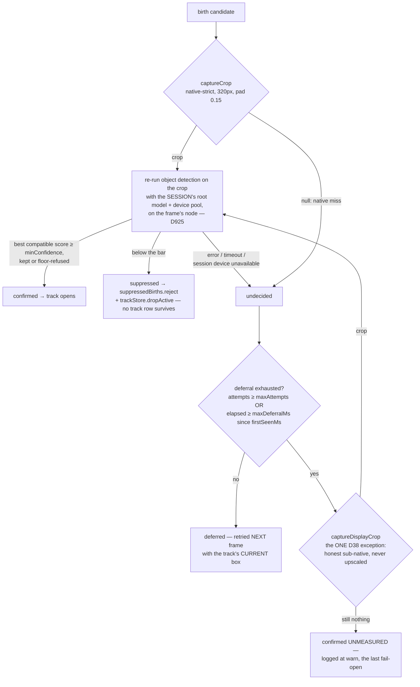

# Post-analysis — tracking, the confirmation gate, media capture, and the knobs

What happens to a frame result after it leaves the detection process, and where
every operator-tunable threshold actually lives. Companions:
[detection-execution.md](detection-execution.md) (how the result was produced),
[object-detection.md](object-detection.md) (detection-side thresholds),
[notifications.md](notifications.md) (what fires on the records written here).

## Tracking runs HERE, not in the detection process

Worth stating first because it keeps being mis-remembered: `detection-pipeline`
produces **stateless per-frame detections**. All track state — tracker v2
(`pipeline/tracker-v2/`, D683), the movement-state machine
(`pipeline/tracker/state-analyzer.ts`), births, closes — lives in
`pipeline-analytics`, one `FrameProcessor` per `${deviceId}:${source}`, so the
ML plane and the onboard plane never share tracker state.

### Tracking: tracklets, deferred fusion, occupancy (D683)

Eighteen ADRs in 33 days each repaired a rule the previous one had moved —
D258 → D535, D283 (unpatched), D399 → D665 → D678, D436, D442 — because every
one of them was a patch on an **online, single-hypothesis** tracker forced to
commit an identity the instant a box arrives, from geometry alone, on cameras
that deliver 56 ms–2135 ms between stored positions. Camera 103 produced 80
tracks for one person sitting in one seat. [D683](../decisions/adr-0683-identity-is-decided-late-tracklets-split-when-in-doubt-a-deferred-linker-fuses-them-and-a-still-subject-belongs-to-the-registry.md)
replaced the tracker rather than add a 19th rule. Read it for the Context
table (which record moved what, and what came back) and the full rationale;
this section is the architecture of what runs today, under
`pipeline/tracker-v2/`.

```
  frame ──▶ L1 TrackletTracker ──confident/split──▶ tracklet emission ──▶ rest of the pipeline
              (online, per-frame,                        │
               never merges)                             │ ended / coasting pieces
                                                           ▼
                                                 L2 deferred linker (every 5 s
                                                 sweep, and on each frame)
                                                           │ commit (final, earliest id)
                                                           ▼
                                                 TrackFusionService.fuse
                                                 (residents, recognizers, store,
                                                  aliases, every leaf — §6.2)

  parked-object registry (D547) ──promotion──▶ ends the track (moved: closes
  (independent of L1/L2;                        normally; never moved: disposed,
   the only stillness authority)                 D547, unchanged)
```

**L1 — conservative online tracklets** (`tracklet-tracker.ts`). One frame:
expire what the coast budget no longer covers (a tracklet unseen past
`MAX_PREDICTION_MS` demotes to `coasting` even with no frame recording the
miss — the motion gate stopped the frames); Hungarian minimum-cost
association; an **ambiguous** group (a `swap`, `rival` or `competitor` test)
**ends every tracklet in it and lets its detections spawn new pieces** —
doubt never becomes a guess, and L1 never merges, resurrects or grows one
box into another's identity. Sub-floor boxes (below the per-class score
floor) may continue a MOVING `person`/`animal` tracklet only
(`LINGERING_CLASSES`) — a vehicle's sub-floor box follows nothing, because a
parked car is the registry's and a sub-floor box on it must never carry a
passing car. A cross-class read (a bending person scored `animal` for a
frame) still **votes** the reported label without renaming the tracklet's
own class (`classVotingEnabled`/`classVoteMinFraction` — the D439 rule,
restated: the flip is a claim on the subject's OWN box, weakly read, never
widened to every pass that binds the pair). A split piece's doubt is bounded
(`CONTESTED_MAX_MS`): past it the piece is confirmed and emitted anyway, but
it keeps `contestedHits` so L2 may still join it on appearance alone.

**Frame order and the frame clock** (`tracker-v2.ts`, follow-up 102). A
frame's time is its runner's wall clock. Some frames arrive out of capture
order (~1 %, up to 1.2 s back), and a runner clock can STEP back: an NTP
correction, or a camera moved to a runner whose clock is behind. The facade
classifies every frame against the latest frame time it took
(`classifyFrame`, which does not mutate). The frame processor asks it FIRST:

- **Out of order.** The frame is either `lastFrameT − t ≤ maxMissedMs` (4 s;
  nothing older can belong to a live tracklet's present), or further back but
  not yet the `CLOCK_STEP_CONFIRM_FRAMES`-th (3) such frame in a row. The
  frame is dropped whole, and `process()` returns at once. It never reaches
  the stationary gate (whose persisted `lastConfirmedAt` it would rewind),
  the zones, tripwires, events or the state analyzer. The result carries
  `droppedOutOfOrder` and the tape observation (a replay drops it the same
  way). The addon stops at the tape record, so no registry clock, TrackStore
  upsert or media reads its stale timestamp. `outOfOrderFrames` counts it,
  and a sampled INFO logs it with `pendingClockStep`.
- **Clock step.** The 3rd consecutive frame past the bound, each in order with
  the one before. This follows D49: a read that destroys work needs others to
  agree, and one 4.5 s-late frame or two interleaved runner clocks must not
  end every track. On a step:
  - L2 commits what it has decided;
  - every live tracklet ends at its own last sighting (`clock-step`);
  - every piece still undecided is decided `new`, so no fusion crosses the
    step;
  - the internal clock resumes past `LINK_MAX_GAP_MS` of silence, so nothing
    later continues anything earlier;
  - the frame is tracked on the new clock, and the processor's clock is
    rebased with it.

  `clockSteps` counts it, and a WARN logs it (the first ten always, then one
  in 50, with the count). A forward jump that is corrected later takes this
  path on the correction. Facts and fusions leave the facade in the caller's
  clock.

An unbounded drop once blinded a camera for the whole step: 60 s back meant
461 frames, with a new subject never tracked.

**L2 — the deferred linker** (`linker.ts`). L1's output is pieces, not
subjects. Seconds later, with the future already in hand, the linker decides
whether two pieces are one: an arc "B continues A" is only considered once A
has ended (or is coasting) and B is confirmed, and only COMMITS once every
piece that could compete for A is also known — every relaxation the old
tracker made ON THE SPOT (D665's reach, D678's size bar, D399's time-scaled
budget) is now a feasibility bound or a cost term of ONE function, decided
with hindsight. A face-bearing piece holds L2's decision open until the
FaceRecognizer's verdict settles or `FACE_SETTLE_HOLD_MS` (20 s, the
operator's cap) runs out; the identity cannot-link reads ONLY that settled
verdict, never an operator assignment or a rescore pass. A commit is
**final**: the survivor is the chain's EARLIEST id, and a later disagreement
is reported, never undone (`tracker: a fused track now carries two
identities — fusion is final`, WARN). A competitor that was refused keeps
competing — a predecessor two pieces could have continued never goes to the
second after the first is refused.

**A still subject is the registry's.** L1 carries no presence or stillness
state at all — the parked-object registry (D547) is the only stillness
authority there is. The instant it promotes a subject, that subject's track
closes: if the track ever MOVED (`planPromotion`, scale-relative to the
subject's own box — `DEFAULT_STILL_SPAN_FRACTION`, 0.35× the first box's
short side), it closes `stationary` at its last sighting and keeps its row,
so a later return within the link window may still be linked to it; face
recognition, plate reading, the detail plane and best-shot evaluation stop
with it. If it NEVER moved, D547's disposal is unchanged — deleted, row and
media — because the registry does not want a parked object persisted as a
track too. See "A promotion ends the track (D683)" below.

**The constants, with where each came from** (`tracker-v2/constants.ts` —
none is a per-device setting; a camera that needs its own value is shown by
a case first):

| constant | value | source |
| --- | --- | --- |
| `MAX_PREDICTION_MS` | 1000 | D399's 1 s prediction ceiling; past it a tracklet demotes to `coasting` before association |
| `MAX_PATH_LENGTH` | 300 | the old tracker's trail-length bound |
| `SWAP_MARGIN` | 0.2 | crossed pairs cheaper than this over the chosen pairs are doubt |
| `RIVAL_MARGIN` | 0.1 | a second box, or a second tracklet, this close in cost is doubt |
| `APPEARANCE_COST_WEIGHT` | 0.5 | weight of appearance distance in the L1 cost, when appearance is calibrated on |
| `APPEARANCE_SEPARATES` | 0.15 | margin by which appearance alone may resolve an L1 ambiguity |
| `COAST_MAX_AREA_RATIO` | 2.5 | D678's size bar, applied to a coasting re-bind as to a link |
| `CONTESTED_MAX_MS` | 3000 | a split piece's doubt is bounded — past it, confirmed and emitted anyway |
| `FACE_SETTLE_HOLD_MS` | 20 000 | the operator's cap on the recognition wait (verdict settles p50 11.4 s after first sight; never raised above 20 s without a measured p90) |
| `LINK_WINDOW_MS` | 60 000 | how long both layers keep an ended piece; every arc must be DECIDED before either end is pruned (the invariant and its 55 s/5 s-headroom budget are asserted by `constants.spec.ts`) |
| `LINK_MAX_GAP_MS` | 10 000 | longest gap an arc may bridge, from the predecessor's last sighting (D665's graveyard band) |
| `LINK_EVIDENCE_MS` | 3 000 | evidence the later piece needs before its arc may commit |
| `LINK_DECIDE_MAX_MS` | 10 000 | an arc still undecided this long after the later piece started is refused |
| `LINK_DECIDE_MARGIN_MS` | 5 000 | slack past that deadline so the 5 s sweep never refuses a ready arc |
| `LINGERING_CLASSES` | `{person, animal}` | classes whose sub-floor boxes may follow a MOVING tracklet (D665) — never a vehicle |
| `APPEARANCE_DIFF_EPSILON` | 1e-9 | below this a block's Bhattacharyya `diff` is float noise, not signal |

(`LINK_MAX_COST`, `LINK_AMBIGUITY_MARGIN`, `LINK_MAX_AREA_RATIO`, the
`LINK_REACH_*` diagonal-per-second reach terms, `LINK_APPEARANCE_REJECT`,
`LINK_NO_APPEARANCE_COST` and the `LINK_WEIGHT_*` cost weights are the
linker's cost function itself — read them beside `linker.ts`, not as a
tuning surface.)

**Reading it in the log.** `tracker: tracklet split — a bind was in doubt`
(info, per split, the cohort's tests and the boxes it refused);
`tracker: pieces linked` / `tracker: link refused` (info, per L2 decision,
with every candidate arc it weighed and its cost or rejection reason); once a
minute per processor, `tracker: v2 summary` (tracklets ended by reason,
splits, links committed/refused — never one line per frame, and a camera
producing nothing stays silent on the sweep path). A fusion is
`tracker: a fused track now carries two identities — fusion is final` (WARN,
never sampled) when recognition disagrees with an already-committed chain.

**Resident lifecycle.** `TrackResidentState.open` (a birth) is the only call
that creates a resident on purpose; `close` leaves a bounded tombstone, and every
get-or-create mutator an async completion can reach (`retainRasterFallback`,
`mark*Landed`, `setLastFrameAt`, `noteKeyFrameAttempt`, `setKeyFrameMediaId`)
refuses a tombstoned id with a sampled "late work after close refused" line —
a batch settling after its track closed otherwise re-created a resident nothing
closes. `observeBestFrame` is one of those mutators: it never calls `open`, so a
birth the gate suppressed — whose id the tracker keeps carrying for seconds —
cannot re-create its resident (the second leak, ~250 residents/day/runner). The
frame path also drops a rejected id from `result` once the gate has run
(`SuppressedBirthRegistry`), so no best-shot/park/detail work is spent on it.
A rejected id never emits an object or appearance event either, and never
counts toward zone occupancy. Events are judged on their own `trackId`, not
through `tracked`, because a `leaving` or zone-exit event names an id that is
absent from the frame. The registry keeps a bounded memory of the rejected ids
the tracker already let go (`suppressesEvents`), and each dropped event is
logged as "object event dropped — the track birth was suppressed". Before this,
on cam 101 on 2026-10-21, the `leaving` events of a suppressed person→animal
birth fired a person rule.
The first birth verdict wins both ways: a rejected id is never offered to the gate again, and a confirming verdict from another in-flight frame that lands after the suppression is ignored ("late birth verdict ignored — the birth was already suppressed"), just as a suppression after a start is.
The `analytics resident heartbeat` line compares residents to live tracks and
reports `orphans` (residents neither active in the TrackStore nor carried by the
tracker, idle > 2 min, with up to 3 sample ids); healthy is 0.

**The fusion sequence** (§6.2, `track-fusion-service.ts`). Both rows are
checked active BEFORE any step — a refusal leaves two tracks outstanding,
never a half-fused one. Then, synchronously, before the frame's own upsert:
residents adopt (best shot by the same `compareBestFrame` ranking, D400);
both recognizers adopt (face identities disagree → WARN, survivor's kept;
plate reads vote together); live dispatcher/overlay state forgets the
absorbed id; if the absorbed piece had a row, its lifecycle `end` carries
`fusedIntoTrackId` and the store row merges (`TrackStore.adopt`, one rule per
`MutableTrackState` field — `track-merge.ts`). Then, on a per-device serial
queue (so the frame path never waits on storage and two fusions of one
camera never interleave): the alias is recorded (an absorbed id resolves to
its survivor FOREVER, reached by every read the addon exposes by track id);
every leaf re-points (`fuseTrackLeaves` — events, media, faces, plates, the
CLIP vector, aliases: one registry, both deletable and fusible). Right
before the survivor's row closes, `sweepUp` re-runs the leaves once more for
every absorbed piece, so a write that landed under an absorbed id AFTER the
fusion (a queued capture, a late detail result) still moves, pinned to the
survivor's CURRENT best shot rather than the ranking fusion time chose.

**Where a track was detected** ([D924](../decisions/adr-0924-a-track-keeps-where-it-opened-and-closed-and-a-fused-track-spans-its-pieces.md)).
Every row keeps `openedPlacement` (the birth frame) and `closedPlacement` (the
last MATCHED sighting) as `{ nodeId, deviceKey?, modelId? }` — the payload's
runner node plus the frame's `rootDeviceKey` / `rootModelId`
(`trackPlacementOf`). A session that hopped node or device mid-track (D916)
shows two different values; a fused track spans its pieces (opened from the
piece born first, closed from the piece seen last, `track-merge.ts`). The
admin track detail renders them as "Detected on" / "Opened on" + "Closed on".

**The close gate.** A row's 30 s TTL is necessary but not sufficient: it
closes only once `TrackerSweep.canClose` also agrees — no processor of its
camera still holds the chain LIVE, and the tail is FINAL (L2 could still
choose it as a predecessor). See "Track close" below.

### A stored position says which pass measured it

`positions` is written by **two** detectors — the full-frame pass and
`small-subject-recovery.ts` (D377/D378) — and carries `source: 'frame' |
'recovery'` plus the detection score to say which. Before D399 the only way to
tell them apart was that full-frame boxes are exact multiples of 1.2 (an integer
box on a 3200-px raster, ×1.2 to 4K) and recovery boxes are full-precision
floats. The array is **appended in arrival order** and the two passes interleave,
so it is returned **sorted by timestamp** at every read boundary; a row written
before D399 carries neither field, and absent means unknown, never `frame`.

Since [D646](../decisions/adr-0646-a-benchmark-names-a-pool-and-never-swaps-an-engine-a-replay-runs-the-cameras-root-step-pinned.md)
a track also names **which model** produced it (`modelId`, the
`FrameResult.rootModelId` of its BIRTH frame) and the **detection-frame size**
its boxes are measured in (`frameWidth`/`frameHeight`, the birth frame's, else
the camera's latest analysis frame at persist time — the envelope's
denominator). Both are birth facts, never rewritten by a later frame, and
absent means "not known", never a model: an onboard-detector track has none.
The benchmark's session replay compares against exactly these rows.

## The handoff

The detection process emits `EventCategory.PipelineInferenceResult`
(telemetry, droppable — [D8](../decisions/adr-0008.md)) carrying the
`FrameResult` (boxes, scores, labels, embeddings — **no pixels**), a
`frameHandle` (the only pixel reference; resolved later by
`pipelineRunner.getNativeCrop` pinned to `handle.nodeId`,
[D18](../decisions/adr-0018.md)), and the `detailSteps` announce (what the
camera's detail plane can run, and on what cadence).

One thing gates consumption, and it has produced "post-analysis is dead"
misdiagnoses:

- **All processing subscriptions install only on the designated
  post-processing node** (`postProcessingNodeId`, default `hub`). Every other
  node ignores the stream.

The second thing that used to be listed here was the onboard plane's missing
pixels, and it is no longer true:

- **There is no second door for the camera's own detector any more.** Until
  2026-09-14 the provider emitted `detection.camera-native`, post-analysis
  ingested it on a path of its own, and that path set no `frameHandle` —
  because in this process there are no pixels to name — so an onboard-born
  track had no media, no face, no plate and no embedding. The decision moved to
  the RUNNER, the one place holding a decoded frame and the camera's boxes at
  the same instant: the boxes are paired with that frame inside
  `ONBOARD_PAIRING_MAX_AGE_MS` (1 s, `addon-pipeline`
  `pipeline-runner/detection-source-plan.ts`) and handed to the SAME callback
  the root step feeds — same `FrameResult`, same handle, same `detailSteps`
  announce, with `source` on the payload. So an onboard detection now arrives
  here indistinguishable from an ML one and gets media like any other.
  `nativeDetectionsToFrame` and the subscription behind it are deleted; nothing
  in this addon listens to `detection.camera-native`. A decoded frame with no
  fresh push produces NO result rather than an empty one, so a silent frame
  never reads as evidence of absence. Which detector is a camera's root is
  `detectionSources` — see
  [detection-execution.md](detection-execution.md).

Every native-crop reply is requested **as JPEG, even same-node** — raw RGB
replies through the UDS parent relay once ballooned hub-main to 2–4 GB RSS
(`runtime/native-frame-transport.ts` records it).

Because of that, a reply's arrival shape is chosen by its **destination**, not by
the transport. A consumer whose destination is a **stored JPEG** gets the
runner's bytes handed on untouched — the runner already encoded at the same
quality, so decoding to re-encode bought a second generation of loss and five
allocations. Every stored crop is now literally the runner's JPEG: subject crops
and best-shot thumbnails (`captureCrop`, `getNativeCropJpeg`) and the face/plate
gallery tiles and track thumbnails (`captureDisplayCrop`'s native-ROI leg).

Exactly two consumers still take pixels, and each needs them for a stateable
reason: the 960 boxed timeline tile (`getNativeFullFrameRgb`), which draws ON
the surface; and the display crop's **fallback** leg, which is handed a whole
frame and still has to cut the region out of it. (The third, the summary group
shot, went with the session summary —
[D680](../decisions/adr-0680-nearby-track-grouping-is-deleted-with-its-tables-and-its-cap-surface.md).) So `captureDisplayCrop` is both at once — its two
legs are documented in `pipeline/display-crop.ts`, which is the one place that
split is written down.

**A track's best frame is not fetched at all — it is PARKED**
([D422](../decisions/adr-0422-a-relevant-frame-is-parked-when-it-becomes-relevant.md)).
The instant `BestDetectionTracker` accepts a frame as a track's best,
`buildSnapshotTargets` orders the node that owns the handle to keep two
parcels under `(deviceId, trackId, kind)` — the whole frame at the native cap
(`keyFrame`) and the 16:9 central-square subject window (`thumbnail`) —
through `runtime/parked-frame-client.ts` (`pipelineRunner.parkTrackFrame`,
pinned to `handle.nodeId`, while the handle is a few hundred ms old). The
`keyFrame` + `keyFrameSmall` write (`pipeline/key-frame-persist.ts`), the
best-shot `thumbnail` pair (`services/event-media-dispatcher.ts`) and the
detail plane's full-frame rung (`detail-dispatcher.ts` `captureParkedFrame`)
then read by track — a lookup that cannot miss on age. A retry parks a LATER
frame only for a kind that has no parcel; it never replaces one the ranking
preferred. Nothing keyed by a track falls back to a handle
(`scripts/check-parked-frame-no-handle-fallback.ts`). What still asks by
handle does so inside the same frame's window: the ≤640 batch resolve, the
960 boxed timeline tiles, the display children, the confirmation gate and the
detail dispatcher's first rung.

**History — the group shot's gate**
([D470](../decisions/adr-0470-a-running-argmax-over-a-continuous-score-never-orders-pixels-on-its-own.md)).
(the session summary and its group shot are deleted, D680; the lesson
stands). `SummaryFrameScore.quality` was a continuous blend, so a bare running argmax over
it ordered a 4096-px full frame on essentially every frame of an approaching
subject — measured at ~95–100 calls/min, ~97 % of this addon's
`getNativeCrop` bytes, while the ROI coalescer beside it was guarding 13/min it
could never hit (its keys carry `seq`, and a frame exists once). The fix was to
materialise only when the candidate beats what was **delivered**, past a
0.05 hysteresis and a 2 s gap in frame time, with only a landing advancing that
baseline — the same three numbers `pipeline/key-frame-retry.ts` carries for the
track key frame.

A second distinction in the same file is load-bearing and easy to "tidy" away:
the full-frame fetch **throws** on a transport failure while the ROI fetches
return `null`, so a routing failure is never mistaken for a retention miss —
the 2026-08-06 finding that one offline node owned 388 key-frame misses
depended on it (the key frame was fetched there until D422; it now reads a
parked parcel). The throw's consumers today are `event-media-dispatcher.ts`
(via `getNativeFullFrameRgb`), the debug crop (`offerDebugCrop`'s catch), and
the display crop's fallback leg, which translates it to `null` at its own
wiring.

## What one frame goes through

Condensed from `index.ts:processFrame` + `FrameProcessor.process`; the order is
load-bearing (several stages read what the previous one wrote):

1. binding-active guard → detector-dropout skip → per-frame push of live
   zones, detection-stage zone rules and `zoneMembershipMinOverlap`.
2. **FrameProcessor**: detection-stage zone filter → **rider pairing** (a
   person overlapping a two-wheeler is folded into ONE vehicle subject,
   [D34](../decisions/adr-0034.md)) → **stationary gate** (before the tracker,
   so before `minHits`) → `tracker.update` → movement-state machine
   (`entering` → `moving`/`stationary` → `loitering` → `leaving`) → zone
   stamping per track (with last-known-zones memory so `leaving` is not
   zone-less) → zone crossings → event emission.
3. stationary registry frame-note + occupancy (`zoneAnalytics.recordFrame`,
   registry entries counted as pseudo-tracks).
4. track-store upsert. Births split into **resurrection** (a fresh id with
   position history — re-seeded, not re-born; this killed the 41% respawn rate
   on 104) vs **birth candidates**.
5. **confirmation gate** on the candidates (below).
6. stationary promotion — the generic registry for parked objects, and since
   2026-08-14 a **separate `PackageStillnessTracker` pass** for the package
   classes, which runs on every pipeline frame (an empty sighting list still
   advances its clock) and is not gated on the registry's master toggle
   ([D144](../decisions/adr-0144.md)); **detail-plane scheduling** (`detailDispatcher` →
   `pipelineRunner.runDetailSubtree` per track, on the announced cadence — see
   the crop ladder below).
7. persist object + appearance events → Notification-Center hooks → zone
   membership diagnostics (`zone membership stamped on event`).
8. media: build capture targets, ONE batched `captureScheduler.request`,
   `persistKeyFrames` deliberately after the batch, face/plate recognizers in
   the same live-frame window.
9. emit the tracked-frame overlay event.

### Tracks are not grouped

There is no entity above the track. The session summary — tracks grouped by
proximity at birth (D489) and split when they walked apart (D490) — never
behaved as the operator wanted, was switched off on 2026-09-16 and was deleted
on 2026-09-29 with its tables, its group shot and its three cap methods
([D680](../decisions/adr-0680-nearby-track-grouping-is-deleted-with-its-tables-and-its-cap-surface.md)).
Its tables were dropped on every hub and its media rows are
reclaimed by the orphan audit as a retired owner kind. The notification
center's grouped window (`groupingSec`, D692) is a different mechanism — one message per
window of a rule's subjects on one camera — and is untouched.

## Where a detection dies between the frame and a position

Start here when a detection demonstrably existed — the runner logged it — and
no track, position or event carries it. Every branch below is a place a
detection ENDS, in the order it is reached, and every one of them now says so
under the same line, `tracker: detection dropped — nothing downstream received
it`, with `tags: { deviceId }` and a `reason` from `SpawnRefusalReason`
([D391](../decisions/adr-0391-a-track-that-never-emitted-is-a-dropped-detection-and-reports-as-one.md)):

| # | Where | `reason` | Refuses or consumes |
| --- | --- | --- | --- |
| 1 | `processFrame` binding guard | — (`inference frames dropped — binding inactive`, throttled warn) | whole frame |
| 2 | `processFrame` detector-dropout skip | — (`detector dropout skipped`, **debug**) | whole EMPTY frame only — no detection and, since D665, no continuable sub-floor box (`dropoutEvidenceCount`) |
| 3 | `ZoneEngine.filterDetections` | `zone-filtered` | refuses |
| 4 | rider pairing | — (the fold ships on the result, `trackId` absent when unlanded) | consumes |
| 5 | stationary gate | — (roll-up `stationary registry absorbed detections`, `suppressed`; the weak slice, `continuable`, goes on to the tracker) | consumes |
| 6 | tracker spawn gates | `stationary-hold` (a weak hold no confirmed track claimed, D410), `score-floor`, `area-floor`, `dedup-iou`, `animal-over-person` | refuses |
| 7 | tracker association | `cross-class-absorbed` | consumes |
| 8 | tracker emission filter (`minHits`) | `unconfirmed-spawn-lost` | consumes |
| 9 | `TrackStore.upsert`, `matched === false` | — (deliberate: a coasted frame is not a sighting) | consumes |
| 10 | confirmation gate | `suppressed` / `undecided` verdict lines | refuses |

(D683: `occlusion` and `merged-duplicate` are retired with the old tracker —
L1 never deletes a live track to resolve an ambiguity. **A split ends
tracklets; it is not a row in this table** — it is not a drop at all, in
doubt the detections spawn new pieces, so nothing here loses them. A split
piece that is later decided `new` with `reason: 'unconfirmed'` is what row 8
also describes: it never reached `minHits`.)

Two properties of that table are the whole point of it. **Rows 4–5 and 9 are
roll-ups or by-design silences**, and they are the only ones: everything else
names the individual box. And **row 8 is a branch that ACCEPTS a
detection and then produces nothing** — it was the last silent one, it is
not a refusal, and a vocabulary that only described refusals could not see it.
A spawn that dies before `minHits` emitted nothing, ever,
so from inside the tracker nothing was refused and from outside nothing
happened. That is what ate two native-recovered `animal` boxes on 101 at
18:29:21–22 while the track they belonged to was still alive and coasting.

A refusal that falls INSIDE a watched zone is additionally reported to an
observer the addon logs (`detection refused inside a watched zone — not
notified`), carrying the class, the zones with their overlap percentages and
the refusal reason. It is **diagnostic only — it never becomes an
`ObjectEvent`**, so no rule can alert on a box the confirmation gate threw
away. It briefly did, between 2026-09-09 and 2026-09-10, and the ten hours in
[D426](../decisions/adr-0426-a-refused-detection-is-observed-never-alerted-on.md)
say why that was wrong: 1473 of 1511 such events were one stationary parcel
re-offered every frame, both alerts it raised were phantoms, and
`object-events.trackId` is `notNull` so none of them could be stored at all.
Identical refusals collapse for a throttle window, and the counter behind
`zoneRefusalEventsEmitted()` counts every one BEFORE the collapse.

Row 2 is worth one warning: it is at **debug**, i.e. below the Winston file
level, so an absorbed dropout run is invisible in practice. It absorbs only
frames with ZERO detections, so it can never explain a missing detection — but
it can explain a missing frame. Until D665 it also absorbed a frame whose only
box was under the class floor; `dropoutEvidenceCount` now counts the boxes the
low-score tier may continue on, so such a frame reaches the tracker.

**And read the docker log, not `logs.query`, for anything older than ~25
minutes.** The ring holds ~5 000 rows per addon. A "zero refusal lines in
three hours" measured through it on 2026-09-10 was the ring's horizon, not the
camera's — `docker logs CamStack` on the hub still held the
`unconfirmed-spawn-lost` line for the animal in question.

## The confirmation gate

A birth candidate is re-detected on a crop of its own box before it is allowed
to become a track. Since 2026-08-01 the verdict is **three-valued**
(`confirmation-gate.ts`): `confirmed` / `suppressed` / `undecided`, where
`undecided` means "no measurement happened" (`no-crop`, `redetect-error`,
`session-device-unavailable`, `timeout`, `below-min-crop`) — the value whose absence let ~45% of births ship
unmeasured and a brick wall persist as a `vehicle` (camera 636,
[D38](../decisions/adr-0038.md)).



The details that keep being re-learned:

- **The birth is re-judged by the detector that claimed it**
  ([D925](../decisions/adr-0925-a-birth-is-re-judged-by-the-session-detector-at-the-gate-bar.md)).
  The frame result carries the root the executor RAN (`rootStepId`,
  `rootModelId`, `rootDeviceKey`); the gate re-detects the crop with exactly
  that step, model and pool, pinned to the frame handle's node. There is no
  node-default detector: a frame that names none, a device in backoff or
  failed, or an executor that would run another model or pool is
  `session-device-unavailable` — deferred, then admitted when the deferral is
  exhausted. And the gate's OWN bar (`minConfidence`, after the phantom-cell
  hook) decides every compatible box, including one the detector's per-class
  floor refused (read back from `FrameResult.discarded`, `below-threshold`).
  Boxes under the model's pool floor (D662) never reach JavaScript, so the
  gate cannot see below it. Every verdict logs `modelId`, `deviceKey`, `node`,
  `bestScore`, `appliedMinConfidence`, `reason`, `attempts` and `cropSource`
  with `tags: { deviceId }`, and the birth ledger row keeps the detector
  (`detectorModelId` / `detectorDeviceKey` / `detectorNodeId`).

- **`firstSeenMs` is never refreshed** — refreshing it defers a hopeless birth
  forever. Attempts AND elapsed both bound the deferral, each against a
  different failure mode; a test fails if you "fix" either.
- **No in-attempt retry.** An earlier draft slept ~60 ms between crop fetches
  on the synchronous frame path; the deferral already retries on the next
  frame with a fresher box.
- **A handle-less frame confirms immediately** (info log:
  `confirmation gate: no crop path — births allowed unmeasured`). That is
  decode starvation, not a crop miss — deferring there delays EVERY birth on
  an already-struggling camera. Re-learned against the e2e suite the day the
  deferral landed.
- **The bar is per-candidate**
  ([D204](../decisions/adr-0204-a-phantom-cell-outlives-the-tracks-that-made-it.md)):
  `minConfidence` is the floor, and a birth inside a recurrent **phantom cell**
  (below) faces a RAISED bar via `ConfirmationGateDeps.minConfidenceFor` —
  ceiling 0.9, never 1.0, so a real subject can always re-detect its way in.
  The hook can only ever raise, is read synchronously from the in-RAM mirror
  ([D49](../decisions/adr-0049.md)), and every verdict logs the bar it actually
  faced (`appliedMinConfidence`) — without that field, "was 0.62 a pass?" is
  not answerable from the config.
- **A rejected birth leaves nothing behind**: the in-RAM track
  row is dropped, the rejection is remembered until the tracker stops carrying
  the id, and the upsert loop skips it. Worst measured phantom persistence
  before the fix: 27 s.
- Every verdict — including confirmations — logs at **info** with the scores.
  The undecided line was `debug` once, which is why 45% unmeasured stayed
  invisible.
- Stale docblock alert: `confirmation-gate-settings.ts` still contains a
  paragraph describing the gate as fail-open on any error. The code is
  fail-DEFERRED; only the exhausted-no-crop path fails open. Delete that
  paragraph when you next touch the file.

## The stationary registry — one parked object, one entry

An object seen REPEATEDLY IN THE SAME PLACE is promoted
([D264](../decisions/adr-0264-an-object-becomes-stationary-by-repetition-not-by-one-track-surviving.md),
`pipeline/stationary/`): the tracker drops it, the store CLOSES it
([D161](../decisions/adr-0161-a-track-is-never-forgotten-only-closed.md)), and a
registry entry takes over. The entry suppresses the detections that keep
matching it, so the object stops re-spawning a track and re-paying the detail
plane, while still counting toward occupancy. No `end` key-event fires.

**The promoted object keeps its entity and its key frame; the tracks it minted
on the way there are DISCARDED, media and all** (D547). "Closed, never
forgotten" (D161) is the rule for a track that was a subject; the twenty-odd
fragments one parked car mints before the registry catches up were never
subjects, and keeping them is what cost 102 ~0.45–0.5 GB/day — about 44% of its
daily tracks. `TrackCloser.discardTracks` is the cascade that takes the media,
events, crops and vector with them, and a closer built WITHOUT that hook keeps
persisting instead and says so once, because a discard with no cascade is
exactly the orphan D161 measured. A short motionless PERSON is exempt: no entity
holds it, and its face read is the only record there will ever be.
Appear and depart still emit `pipeline-analytics.stationary-changed` (the
occupancy total is unchanged on promotion, so `occupancy-changed` is not
enough). The viewer overlay follows that category; a 15 s poll is not the
mechanism.

### A promotion ends the track (D683)

The paragraph above is the whole rule only for a subject that was **already
sitting there** on its first sighting. Since tracker v2 (operator decision
2026-09-30), a subject is a track while it MOVES, and `planPromotion`
(`pipeline/stationary/promotion-plan.ts`) decides what a promotion does to
the track it promotes, from the tracklet's own confident path: did any box's
centre move farther from the first box's centre than
`DEFAULT_STILL_SPAN_FRACTION` (0.35) × the first box's short side (the same
scale-relative test the state analyzer already used for stillness — no new
constant).

- **Never moved** — the object was already standing there when first seen
  (a parked car, a seated person at session start). D547's disposal is
  unchanged: the live track is discarded, media and all, as above.
- **Moved** — the subject arrived (walked in, drove up) before it stopped.
  Its track is a real track of a moving subject: it closes `stationary` at
  its LAST sighting, through the ordinary close gate, keeping its row — a
  later return within the link window may still be linked to it by L2. Face
  recognition, plate reading, the detail plane and best-shot evaluation stop
  with the track, same as any other close.

Either way, face/plate recognition, the detail plane and best-shot capture
for that subject stop the moment it is promoted — they resume only if the
subject later moves away from the registry's entry and a new tracklet is
born for it.

**ONE authority says an object is still — per occasion**
([D494](../decisions/adr-0494-one-authority-says-an-object-is-still.md),
[D508](../decisions/adr-0508-stillness-has-one-authority-per-occasion-and-size-is-answered-by-reach-not-by-birth.md)).
An observation AGREES with a candidate only when it overlaps the anchor at
`agreeIou` **and** its occasion vouches for its stillness: on a `session`
frame the TRACKER's `TrackState` travels on the observation and only `idle`
agrees (an absent verdict on a session frame is a producer that forgot the
field, and does not agree); on a `burst` frame no verdict travels — the runner
admits a recheck only while its motion gate says the scene is still, and a
four-frame burst cannot carry a tracker verdict anyway. `observationAgrees` is
the only place that conjunction is written and the ledger has no geometry
rule and no clock of its own. `idle` costs the per-device
`stationaryThresholdSec` for every track: the analyzer's never-moved shortcut,
which granted it after five frames and let a 1–6 s scene flicker on 102 mint
an entry on ten agreements, is gone. A coasted frame offers no observation at
all, a binding is class-bound, and **only an agreeing observation may mint** —
a disagreeing fold can still rotate the ratio window into a promotable state,
and the one-position `entered` track that did so used to be torn down as
"promoted".

**An observation votes three ways, and UNDECIDED counts for neither side**
([D547](../decisions/adr-0547-a-parked-object-is-an-entity-and-its-census-has-a-producer.md)).
`observationVote` answers `agree | disagree | undecided`, and
`observationAgrees` is now the narrow reading of it. The two-valued version
folded every not-yet-still frame into the DENOMINATOR, and a 36 s motion
session guarantees each track spends its first seconds undecided while many
never decide at all — so on 102 the ledger read 0.493 against a 0.6 bar and
refused to rebuild its census for eleven hours, while suppression was enabled
and working the whole time. One car, 27 tracks, 14 of them reaching `idle`.
`entered` and a settling `moving` are the undecided states; below `agreeIou`
is still a flat disagreement.

**Every class is promotable, and the per-class numbers are the difference.**
There is no class gate, no `promotesByDefault` and no `promotePersons` switch —
an opt-in nobody turns on produced nothing. What separates a person from a car
is `PERSON_EVIDENCE_POLICY`, measured: N ≥ 40, N/M ≥ 0.95, span ≥ 30 min
against the vehicle/default N ≥ 8, N/M ≥ 0.6, span ≥ 120 s. Promoting a car
SAVES work; promoting a person BLINDS the camera to them, which is why the two
read D49 in opposite directions — for a car the destructive read is the
RETIREMENT, for a person it is the BIRTH.

**Evidence follows the track, and a wrong binding is corrected**
([D280](../decisions/adr-0280-evidence-follows-the-track-a-binding-is-re-matched-when-it-is-wrong.md)).
A track binds to a candidate and from then on every observation it offers counts
toward M, agreeing or not — that dilution is what keeps a car that merely drove
through a spot from promoting it. But the binding was made at the track's FIRST
emitted frame, which is by construction its worst (the box is still settling),
and never re-matched, on a camera holding ~497 candidates. Measured on 102: a
promotion carried `agreed:240 / seen:240` — one track's 239 observations plus
the candidate's birth — while another track's **267 observations of the same
spot** sat on a different row. Folded together they would have promoted **3.3
minutes earlier**. A track now re-binds when its bound row's overlap has fallen
to ~0 (`EVIDENCE_REBIND_MAX_BOUND_OVERLAP`, 0.05) *and* another candidate
reaches `agreeIou` — a merely poor fit still dilutes, because that is the whole
discriminator. A re-bind moves the TRACK and never a tally: total M across a
device's candidates always equals the observations offered.

The gate is class-first: matching only ever considers same-class detections, so
a person crossing in front of a parked car cannot be absorbed by it. Two
properties of that comparison are load-bearing
([D275](../decisions/adr-0275-stationary-suppression-is-per-detection-not-per-entry.md)):

- **Suppression is per DETECTION.** The matcher's first pass is entry-driven —
  it asks which detection is this entry's object, and that answer is what
  confirms, arms or wakes. Dropping only that one detection is what it used to
  do, and it leaked: over 2 h on device 102, **13 of 23 tracks sat on one of the
  three stationary boxes at IoU ≥ 0.5**, i.e. detections that cleared the
  association floor and the centroid test and reached the tracker anyway because
  a better box existed on the same car. A second, detection-driven pass applies
  the identical predicate to everything the first pass left. A woken entry is
  skipped, so a departure still hands its object back.
- **The class token is normalised, never compared raw.**
  `normaliseStationaryClass` lower-cases and maps through `COCO_TO_MACRO`. Both
  sides are supposed to be a macro and nothing enforces it on the way in
  (`rowToEntry` accepts any string, `load()` validates only the box), and the
  live 102 registry held `vehicle`, `Car`, `vehicle`. Under a raw compare that
  `Car` entry could never be confirmed, suppress or wake — a blind spot lasting
  until the TTL sweep, which on the operator's bound is 30 min of observed time.
- **A hold may CONTINUE a track; only a strong read is the parked object**
  ([D410](../decisions/adr-0410-a-stationary-hold-may-continue-a-track-but-never-opens-one.md)).
  Suppression is two-tiered by the boundary the gate already had: a read at
  IoU ≥ `suppressIou` is the parked object and never reaches the tracker; a
  weak hold (a swallowing box, a jitter read, a departing read) reaches it
  flagged continuation-only on `TrackerFrameContext`, and the tracker may use
  it to CONTINUE a track already at `minHits` through the strict predicted-box
  pass — never a spawn, a rescue or a resurrection. The failure this answers:
  on 102 the parked cars sit at the frame edge, so a car driving across their
  front was held on every frame until it left the frame; four tracks 1.7–3.5 s
  old coasted `maxMissedMs` on nothing and died. The bound on the wrong
  direction is structural — a held box has no spawn path — and a track cannot
  settle on a parked car because the parked car's own box never arrives.

### The window is only reachable because the SESSION now waits for it

On an `on-motion` camera the track exists only while the orchestrator holds a
detection session open, and until 2026-08-27 it did not hold one long enough —
ever. Measured on device 102 over 24 h, 503 sessions: median duration
**10 221 ms** against a 10 000 ms floor, **502/503 closes on the camera's
explicit `motion_cleared` low edge**, and **4/503 sessions ≥ 30 s**. The hold,
the cap and the freshness read all lived inside the cooldown TIMER's body,
which a falling edge never entered — so the 30 s stillness window was
unreachable by construction and **223 of 312 tracks (71.5%) died in the exact
instant of a teardown**, having been motionless for a median 6.27 s.

Two things changed, and the pair is what makes this section true at all
([D261](../decisions/adr-0261-a-session-lasts-as-long-as-the-subject-and-promotion-is-what-ends-it.md)):

- every close path (falling edge, cooldown, the re-ask of a floor-deferred
  close) goes through one rule that may answer **hold**;
- the liveness signal it consults means a subject is **PRESENT**
  (`PipelineAnalyticsFrameTracked.hasLiveTrack` = `result.tracked.length > 0`),
  not that a subject is MOVING. A moving-only predicate cannot hold a session
  for a subject that has stopped, which is the only subject this registry is
  about.

**A STILLNESS test is what ends the hold** (D264). `hasLiveTrack` is
`result.tracked` — the post-suppression set — minus every track `trackIsStill`
reports as stopped, so a parked car stops holding its session open after
`sessionStillnessWindowMs` even though it is still tracked on every frame. It
does not become an entry at that moment: birth needs repeated evidence, which
takes minutes. The two decisions are separated on purpose — ending a hold
destroys nothing (the next motion re-opens the session) while creating an entry
SUPPRESSES the object. Once an entry exists the registry also filters the
object's detections before the tracker, so it stops reaching `result.tracked` at
all. `maxSessionHoldMs` is the unconditional ceiling behind both.

**Diagnostics beside the hold: `liveTrackCount`** (D652). The same event
carries the tracker's own count, `result.tracked.length`, still subjects
INCLUDED. It decides nothing. It exists because a session that closed on a
parked car and one that closed on an empty street both saw `hasLiveTrack:
false` last, and the orchestrator's close line could not tell them apart; it
now reports `liveTracks` (`null` = unknown) and a close with `liveTracks > 0` is
a WARN — its live tracks end there. The close policy itself is unchanged.

**Deleting the stillness test along with promotion would be a 70%-uptime
regression**, which is why it was demoted rather than removed: a parked car
would stay present forever and pin every session to the 120 s cap (102 runs 504
sessions/24 h; 104/103/1443 are already above 50% uptime).

The arithmetic between the two packages — which never import each other — is a
build guard, `scripts/check-stationary-promotion-reachable.ts`, not a comment.
An operator who raises `sessionStillnessWindowMs` on one camera must raise that
camera's `maxSessionHoldMs` too; that pair is not statically checkable and the
guard says so.

Two rules keep an entry hard to DESTROY
([D174](../decisions/adr-0174-a-parked-object-is-hard-to-forget.md)) — both
learned from a measured cycle, not from theory:

- **The reference box follows its object.** An unambiguous confirmation
  (IoU ≥ `suppressIou`) re-anchors `bbox`; a weak jitter match confirms but does
  not re-anchor. The box used to be frozen at the promotion instant forever, so
  the object's own drift accumulated against a fixed reference until an ordinary
  frame read as a departure.
- **A departure needs an INDEPENDENT read**
  ([D279](../decisions/adr-0279-a-departure-is-confirmed-by-an-independent-read-not-by-counting-to-two.md)).
  One departing frame only ARMS the entry — the detection stays suppressed and
  nothing is destroyed. This is [D49](../decisions/adr-0049.md) applied to the
  registry, and until 2026-08-28 it was satisfied by **counting to two**, which
  is not the same thing: the two reads it counted were consecutive frames of the
  same optical event, so the rule held and meant nothing. Measured on 102 that
  day: the same two parked cars promoted **five times in 17 minutes** and
  retired three times as `departed`, while the stored images prove neither
  moved. One retirement fired on a session's first two frames, **0.9 s apart**,
  off a cold h265 decode; another off a passing car occluding the parked one
  (IoU 0.36, centroid outside).

  Four properties now make the confirmation independent, all required:

  | property | value | why that number |
  | --- | --- | --- |
  | separation before a confirming read counts | `DEPARTURE_CONFIRM_MIN_GAP_MS` 3 s | the false pair was 0.9 s apart; at the measured 5.9–7.9 fps, 3 s is 18–24 frames, and it outlives a vehicle's transit across a parked car's footprint |
  | an unconfirmed strike decays | `DEPARTURE_STRIKE_TTL_MS` 30 s | sessions here close at `openForMs` ≈ 36 000, so a strike can never outlive the session that armed it. It used to wait forever and be settled 17 minutes later |
  | a confirming read CANCELS | any confirm; IoU ≥ `suppressIou` is the strong form | the object is demonstrably still there |
  | a MISS never confirms alone | `DEPARTURE_ABSENCE_MIN_READS` 5 consecutive, past the gap | "I saw nothing" is the absence of a read. Media capture on 102 fails ~25% of the time; a short absence belongs to the TTL sweep |

  A departing read within `GATE_WARMUP_MS` (2 s) of a session opening — a gap
  over `GATE_SESSION_GAP_MS` (5 s) in gate frames — is **discarded and
  counted**, never acted on. Confirmations, re-anchoring and suppression still
  run there, so a warm-up frame can only fail to destroy something.

  Cost: a genuine departure retires up to 3 s later. Both wake paths stay live
  and are tested — a car whose box slides off its spot retires on the
  contradicting read; a car that drives out of frame, which stops overlapping
  its old box within a frame or two, retires on the sustained absence. The
  strike is committed inside `StationaryObjectRegistry.filter`, not carried
  through the FrameProcessor: a frame whose only outcome was a strike used to
  need a special case upstream or the strike was lost.

  **An armed strike can ASK for its independent read.** Waiting works only while
  the camera keeps looking, and an `on-motion` camera is usually about to stop.
  So arming schedules one out-of-band look — `requestConfirmationLook`, injected
  into the registry and served by `pipelineRunner.requestOccupancyBurst`, pinned
  to the node whose frames this process has been analysing (an unpinned call is
  answered by whichever runner replies, and one that does not hold the camera
  refuses it correctly and uselessly). The split is deliberate: the registry owns
  the decision that a look is WARRANTED and the two numbers that shape it, while
  whether a camera CAN be looked at — attached here, asleep on battery, already
  bursting — belongs to the runner. An entry that re-arms while a look is pending
  keeps the first timer; a refusal names which of the four reasons it was, since
  three are protections working and one is a routing fault. Fire-and-forget by
  construction: the path already terminates on its own through the TTL, so a
  failure here costs one debug line.

### One spot, one entry — and it is an INVARIANT, not a birth check

Those two rules keep an entry alive; they do not stop a SECOND one being minted
on a spot that already has one, and on 2026-09-14 device 102 reported eight
parked vehicles where there were about four objects — one car with four rows
carrying the same box to the decimal, born 14:30 / 16:32 / 17:16 / 18:00, all
four alive and all four confirmed by the same frame. The weak-continuation path
(D410) keeps feeding the ledger from a track riding a parked object, so a
candidate re-forms on an occupied spot roughly once an hour. Three rules answer
it, and none of them is "check at birth"
([D495](../decisions/adr-0495-a-spot-is-censused-once.md)):

- **`promote()` is the only place that decides a spot is taken**, and it decides
  with the SAME predicate the per-frame filter uses (`findParkedOccupant` →
  `parkedEntryHoldsDetection`): a box the filter would suppress as a parked
  object's own can never become a second parked object. A promotion onto an
  occupied spot is ABSORBED — it advances the tenant's clock, adopts an identity
  the tenant lacks, never overwrites one it has, and logs per occurrence.
- **The invariant is re-established every sweep** by `collapseDuplicates`, which
  keeps the OLDEST row (it carries the object's real `becameStationaryAt` —
  "parked since 14:30" is the fact the operator reads), folds the losers'
  identities into it and deletes their rows outright. A birth check alone could
  never have got there: every row on the spot is re-confirmed by the same
  detection on the same frame, so a duplicate cannot age out. A retirement would
  announce a departure that never happened, which is why they are deleted.
- **An entry swallows its own fragments.** `entrySwallowsDetection` mirrors
  `detectionSwallowsEntry`: a detection much smaller than the entry and mostly
  inside it is held weakly, like jitter. A 34×137 box sitting wholly inside a
  452×420 motorcycle entry scored IoU 0.024 — under `wakeAssocIou` — so the
  filter read it as "nothing overlaps this entry" and let a fragment of the
  motorcycle become an object of its own. The scene-sized guard is checked
  FIRST, or an entry covering the view would swallow the frame.

**The birth bar is the artifact rule, and size is answered by REACH**
([D508](../decisions/adr-0508-stillness-has-one-authority-per-occasion-and-size-is-answered-by-reach-not-by-birth.md),
superseding [D497](../decisions/adr-0497-a-birth-has-its-own-plausibility-bar.md)).
A candidate whose box is near-full-frame or spans a whole frame dimension is
refused INSIDE the evidence verdict (`implausible-box`, asked of `bestBbox`
with the frame every observation now carries), so it keeps its evidence
instead of being forgotten and re-tipped every half hour, and it is reported
once per candidate. 3836's insistent full-height "person" is a white quilted
jacket on a coat stand, detected at 0.65–0.88 day and night; it is refused by
this rule (97 % of the frame height, 40 486 agreements) and by nothing else.
Nothing else is refused at birth: D497's area bar could not separate the
operator's car on 102 (0.360) from the dawn ghost that motivated it (0.361)
and refused the car twelve times in twelve hours, and the "burst door" written
through it was measuring a runner label that filed every live session frame as
a burst. The damage an oversize ENTRY does is its reach, so that is where it
is answered: at or above `OVERSIZE_AREA_FRAC` (0.30 — formerly
`SCENE_BOX_AREA_FRAC` at 0.55, which 3829's 0.78 SUV is far above either
way) an entry holds a detection on a STRONG read only, no jitter hold and no
fragment hold, and a weak overlap on it is a miss and never a departing read.
Measured on 102 before the number moved (03:26–06:50, the 0.353 car as the
only entry): 1 717 reads absorbed, `continuable: 0`. The registry keeps no
list of who may absorb whom — the same predicate that stops an oversize entry
holding a fragment stops it absorbing one.

**The occasion is named by the runner, and the recheck runs while watching.**
Until 2026-09-16 the runner stamped every LIVE session frame `'burst'` and only
the pre-roll history `'session'`, so `burstAgreed` on the whole fleet was
session frames; and a genuine recheck frame, admitted only in `watching`, was
never dispatched until the next session opened — minutes stale, after the
burst had reported `found: false` and disarmed its own timer. Both are fixed
in the runner (`DetectionQueueEntry.occasion` is required; a watching
camera's queue is dispatched), and the honest tallies are the first thing to
read after the deploy.

That was not the whole of it. `burstAgreed` stayed **0 fleet-wide** afterwards,
for a reason one layer down: the recheck's TIMER was armed by the runner's
on-motion gate, and every real registration arrives always-on with no motion
sources, so the gate never fired and the recheck had **no producer at all**
(D547). It now lives in the orchestrator — `OccupancyRecheckController`, armed
by the session CLOSE, which only the orchestrator sees — so it works the same on
every camera regardless of how that camera was dispatched. A controller built
without the burst producer arms no recheck and SAYS SO at boot, because a
recheck that silently never runs is the defect this exists to close.

The same controller serves ONE **early look** per pending occupancy flip
([D691](../decisions/adr-0691-a-departure-is-committed-on-time-and-pictured-on-what-left.md)):
the notification centre asks `pipelineOrchestrator.requestOccupancyLook` when a
flip arms, and the orchestrator dials a burst at the sustain's end plus 2 s
instead of leaving the commit to the 300 s cadence — a departure's session
usually closes before its sustain (102: 1.3 s before, committed 4 min 52 s
late). The look neither folds into the disarm streak nor re-arms, the
cadence never cancels it, and it is ONE per session (`already-looked` until the
next one) — its own burst can re-arm a flickering flip.

**A node sweeps only the cameras it analyses**
([D498](../decisions/adr-0498-a-node-sweeps-only-the-cameras-it-analyses.md)).
`load()` hydrates the whole shared table on every node, so the collapse pass ran
for every hydrated device everywhere: 102's collapse was logged by
`MacMiniAgent.localdomain` AND `agent-a`, the same rows, seven seconds
apart. TTL retirement AND duplicate collapse now act only where this node's own
observed clock (`noteFrame`) says it has seen a frame — never cleared per
device, so an idle camera stays ours and one we have never framed never becomes
ours. Skipped devices are counted and reported at `debug`; another node owns
them, so this is not dropped work. The TTL pass was already safe by accident
(expiry counts OBSERVED time and a device with no `noteFrame` has no clock); the
collapse pass had no such guard. Reads (`list`, `listViews`, `deviceIds`) stay
available on every node — only MUTATION is scoped.

**Expiry counts WATCHED time.** An entry's TTL is judged on the time the camera
actually watched since the entry's last confirmation: each processed frame adds
its gap from the previous one, capped at `WATCHED_GAP_CAP_MS` (10 s), and a
confirmation resets it. The silence between two on-motion sessions therefore
counts as one bound, not its length — comparing frame timestamps used to retire
a car parked 3.3 h seconds into the next session (`unconfirmedForMs` 316 052)
as soon as a passing vehicle let the detector prove itself. A hydrated entry
starts at zero. The retirement line carries `unconfirmedForMs` (watched) and
`wallGapMs` (the old span, for diagnosis); the 12-TTL unproven backstop uses the
same watched time.

Cost of getting this wrong, measured over 24 h on the live hub while promotion
was still anchored to track survival: 119 promotions, 65% of the entries retired
inside 300 s (below the TTL, so by a wake), and **38% of the tracks promotion
then re-created had never moved in their entire life** — 77% on device 108.
Median promoted-track life was 30.1 s, i.e. exactly the promotion window: born
already stationary, promoted at the earliest legal instant, retired, re-born.
That criterion is gone (D264); the flood it produced is the reason.

Retirement used to be **silent** — an event-bus emit and no log line — so the
operator saw a stream of promotions with nothing explaining what ended the
previous one. It now logs `stationary entry retired` at info with
`tags.deviceId`, `reason: departed | ttl` and, on a wake, `cause`
(`contradicting-read` | `sustained-absence`) plus `strikeAgeMs`: the three
retirements that produced D279 would have been recognisable on sight from a
`strikeAgeMs` of 900.

Two roll-ups, both one line per device per sweep, because both count events that
fire on the frame path:

- `stationary registry absorbed detections` — `absorbed` (confirmations),
  `suppressed` (detections actually dropped before the tracker) and `reach`, the
  D275 slice: detections on a parked object that were not its entry's best
  match. `reach` is the field that says whether that fix does anything on a
  given camera — an operator still reporting tracks on parked cars with
  `reach: 0` has a leak somewhere else. `continuable` is the weak slice of
  `suppressed` handed on to the tracker and `continued` how many of those a
  confirmed track consumed (D410); `suppressed − continuable` never reached the
  tracker, and a `continuable` far above `continued` on a camera whose passing
  cars still lose their tracks says the hold is landing on unconfirmed ones.
- `stationary departure strikes` — `armed`, `cancelled`, `expired`,
  `warmUpIgnored`, `wokenByRead`, `wokenByAbsence`, `pending`. `armed` far above
  the two `woken*` fields is D279 working: reads that used to retire a parked
  car now arm and are cancelled.

Reading the state directly: **`debug.stationary`** on `addons.custom`
(`addonId: 'pipeline-analytics'`) returns each camera's entries, its PENDING
departure strikes with their observed age, its evidence candidates with ratio
and span, and the live track→candidate bindings. It is a pure read off two RAM
mirrors. It exists because the 2026-08-28 audit could not ask either question —
which candidate captured a track, and what was waiting to retire — and both
turned out to be the defect.

Still open: the ~35% of cycles compatible with the TTL — an object that stops
being DETECTED on its spot, is retired, and then spawns again. A promotion onto
a spot that is still held is absorbed (D495 above), but nothing re-instates an
entry the TTL has already removed; a detection matching a recently-retired one
still spawns a track and starts a fresh candidate.

What is NOT open any more, and used to be listed here: 90% of the measured
promotions being `person`, standing still indoors. Person promotion is now a
decision rather than an accident (D494) — the class is promotable like every
other, with its own measured thresholds, and a person who merely PAUSES inside
an anchor dilutes the candidate instead of confirming it.

### Phantom cells — the recurrence the registry cannot see

There is a class of phantom whose tracks die within seconds (dead grass on 101: 3.8–19.0 s lives,
~15/day, all at the same spot; 9310d1ff on 104 was the same class at 9.7 s /
30 px of bbox jitter). `MOTIONLESS_MAX_PX` is 40 **for person** so those stamp
`stationary-promotion` and leave the Events feed, while a 28 s door-stander
still lists. Vehicles stay at 8 px: 86918072 on 102 (Car, 10.9 s, net 15 px,
walk 435) is a real car whose Events path and crop were the car, not scenery.
Each track is innocent
alone — the signal is the RECURRENCE, and until
[D204](../decisions/adr-0204-a-phantom-cell-outlives-the-tracks-that-made-it.md)
nothing survived a track's death to notice it. The registry now also decides on
recurrence (D264), and the two stay separate: a phantom cell raises the BIRTH
BAR for a spawn and is forgotten the moment a real subject moves through it,
while an evidence-backed entry SUPPRESSES its object. A cell is a property of
the scene; an entry is a claim about a thing.

A **phantom cell** (`pipeline/stationary/phantom-cells.ts`) is a coarse
quantisation of a track's birth point per `(device, class)`, remembered
durably. Repeated short-motionless closes in one cell raise the confirmation
gate's spawn bar for births born inside it — never close it (ceiling 0.9).
`person` is INCLUDED, by operator decision, and it is safe because **one
moving subject revokes the cell immediately**: a track born there that
actually goes somewhere deletes it. The measurement pass came first: 32 cells
with ≥3 short-motionless closes in 24 h, the worst at 31 — the constants come
from those numbers. The collection is classified `never-orphaned` (a cell is a
property of the SCENE; the tracks that made it are dead by construction) and
is bounded by its own mechanics — 24 h close window, 512 cells per device,
enforced on write, no age sweep (that would be a second retention clock,
[D61](../decisions/adr-0067.md)).

## Media capture

### Buffers on the capture path (D867)

A per-track capture path never copies a buffer it owns. The rules, each a
measured cause of `pipeline-analytics` external-memory GC pressure:

- A frame returned by `getRemoteFrame` / `resolvePinnedFrame` is private to its
  caller and read-only to its consumers — no `Buffer.from` of it.
- A destination that is a stored JPEG (the boxed `firstFrame` / `snapshot` /
  `lastFrame` tiles and their clean twin) gets the wire JPEG
  (`getNativeFullFrameJpeg`) and `drawBoxedJpeg` draws and encodes inside one
  libvips pipeline. Only a consumer that needs pixels (the display-crop
  fallback, the debug crop) takes `getNativeFullFrameRgb`.
- An in-process read of a stored blob is `MediaStore.getBytesById`; `getById`
  (base64) is for a caller that crosses a wire.
- The face gallery is a `Float32Array` per sample, built once at
  `loadGallery`; `face-matcher.ts` scores it by identity.

The `[mem]` line also now names the GC trigger flags (`gcFlags=`), prints every
V8 space on the first line after boot, and the resident heartbeat carries
`mapSizes`. Numbers and the verification plan: D867.

### How a media row is ADDRESSED

A media row is addressed by its own id — `pipeline-analytics:media.id`, an
`INTEGER PRIMARY KEY`, so the address names no owner, no kind and no instant
([D482](../decisions/adr-0482-a-media-row-is-addressed-by-its-own-id.md)). It
used to be a composite key, `<ownerType>:<ownerId>:<fileKind>[:<timestampMs>]`,
which embedded a FOREIGN id: once D474 made event ids per-table rowid aliases,
`motion:101314` and `object:101314` were two different rows spelling the same
number, and the plane served whichever it probed first. Read that record before
changing anything on this path — the failure produced no error and no log line,
only a picture that did not belong to the row it was shown on.

Two consequences worth knowing before you touch media:

- **The row's uniqueness rule lives in `slotTsFor`, not in its id.** One
  derived column (`slotTs`) plus `UNIQUE (ownerKind, ownerId, kind, slotTs)`
  carries what the old key's shape carried: a `SINGLE_INSTANCE_KINDS` write
  collapses onto one row however many captures race, everything else
  accumulates per frame. Writes are `settings-store.upsert` against that index,
  one statement, and the id comes back from it.
- **The plane has two forms, and neither guesses.**
  `/addon/<addonId>/event-media/m/<mediaId>` serves ONE row — the address every
  wire row carries. `/addon/<addonId>/event-media/o/<ownerType>/<ownerId>`
  answers "the best media of this owner" through the ladders in
  `event-thumbnail-resolver.ts`, for the list and reel surfaces that hold an id
  and no media row. The bare-id form the plane used to accept is gone: a bare
  number could name a media row or an event, and an event id could name one of
  three rows. **Event owners may carry a generation** (D694):
  `/o/<eventType>/<id>/g/<deviceId>/<recordAt>` names one holder of a reusable
  rowid; bare `/o/<eventType>/<id>` still means "the current live holder". New
  slim / search stamps mint the scoped form via `mediaOwnerUrl`.

### The two crop contracts

Two crop contracts, and the distinction is a rule with exactly one exception:

| | `captureCrop` | `captureDisplayCrop` |
| --- | --- | --- |
| contract | **native-strict**: native ROI or `null`, never an upscale | native ROI → retained-full-frame ROI (keyframe tier or ≤640 RAM tier), honest sub-native, never an upscale |
| consumers | model inputs (face/plate/CLIP/classifiers), keyFrame, the confirmation gate | gallery display tiles, the body-crop fill after a live face/plate capture, and the gate's exhausted fallback (the D38 exception — no other model input may) |

The **capture scheduler** (`runtime/capture-scheduler.ts`) is the single funnel
for native fetches — the stampede it replaced was "the emergent sum of 5
in-flight Sets + 1 FIFO + 1 bucket trick across 8 uncoordinated call sites":

- per-device budget **3** in flight; under budget a request runs synchronously,
  so the uncontended path is unchanged;
- priorities: firstFrame/confirm 0 → keyFrame 1 → thumbnail 2 →
  timeline/lastFrame/snapshot 3 → enrichment 4;
- identical requests coalesce on `${deviceId}:${kind}:${trackId}` and share one
  promise; a queued enrichment request older than 3 s resolves `null`
  (`droppedStale`) — this staleness decimation, not a TTL bump, is the answer
  to the ~50% native-lease miss rate (retry-by-design; see memory
  `native-lease-miss-economics`). **That note is true only of a kind that
  actually retries.** Until 2026-08-06 `keyFrame` did not, and "a miss is fine,
  it retries" was quietly false for the one kind a rebuild depends on — 21.7% of
  stored tracks ended with no key frame ([D58](../decisions/adr-0060.md)). Before
  reasoning about a miss rate, check what re-fires the capture;
- a closed track's queued requests are cancelled; running ones are never
  interrupted;
- **since 2026-08-25 the per-device QUEUE is also bounded**
  (`maxQueuedPerDevice`, default **24**) — before that fix `staleAfterMs` was
  only evaluated in `pump`, and `pump` only touches the queue while
  `inFlight < budget`, so a saturated lane never expired anything: the
  per-frame batch dispatch pins a ~0.7 MB frame copy BEFORE queueing, and an
  unbounded queue of those pinned the runner past its heap limit (measured on
  the hub: rss 3911 MB, arrayBuffers 2281 MB, ~3200 pinned frames, against a
  1216 MB heap limit). Admission now expires on the way in, then sheds from
  the TAIL — the lowest-priority work, by construction — down to the cap; a
  shed is a throttled WARN naming the device, never silent;
- one metrics line per device per 60 s.

Per-kind rules that answer "why does this track have / not have X":

- **snapshot** — the periodic filmstrip. Its gate advances SYNCHRONOUSLY when a
  capture is decided (the anti-burst debounce: at 10–25 fps several more frames
  would clear `evaluatePeriodicSnapshot` during the 50–200 ms encode), and since
  2026-08-07 the advance is REVERSIBLE — a capture absent from `storedSnapshots`
  gives its interval back so the next frame re-evaluates. Bounded at three
  consecutive non-landings, reset only by a landing, and a conceded slot
  deliberately does NOT reset the count (that would hand a dead camera three
  fresh per-frame retries after every conceded slot). It was the only kind with
  no retry at all: 197 lost in 3 h ([D73](../decisions/adr-0073.md)).
- **firstFrame** — scheduled at confirmed birth; the pending mark is set
  unconditionally so a later handled frame retries; cleared only when the
  write actually landed. **Confirmed birth is not the track's first frame**: the
  confirmation gate defers an undecided birth by up to `maxDeferralMs` (2 s), so
  the capture can land seconds after `firstSeen` — and, on a short track, after
  `lastSeen`. Since
  [D408](../decisions/adr-0408-a-tracks-first-frame-is-never-newer-than-its-last.md)
  the birth push is refused on a COASTED frame (`decideBirthFirstFrameCapture`,
  the rule `collectFirstFrameRetries` already enforced and the birth path did
  not), the refusal is logged with the `deferredMs` that caused it, and a
  `firstFrame` that still ends up newer than the `lastFrame` has the two slots
  SWAPPED at close. That inversion — the "primo" tile post-dating the "ultimo"
  one — was filed by hand three times on device 3829 before anything measured
  it; the debug analysis now reports it as `FIRSTFRAME_AFTER_LASTFRAME` /
  `FIRSTFRAME_AFTER_TRACK_END`.
- **thumbnail** — best-shot policy with hysteresis 0.05 / min-gap 2 s /
  edge-, size- and DELIVERED-CANVAS-aware scoring; retried every frame until ONE
  lands. The ranking is a strict cascade in `pipeline/edge-clear.ts`, and
  `compareBestFrame` is the only copy of it (`isEdgeAwareNewBest` is its
  `accepted` bit): **square containment → semantic → edge-clear →
  effective score → canvas-fill tie-break → centeredness tie-break**. Two things
  changed on 2026-09-08 ([D400](../decisions/adr-0400-the-picture-is-judged-on-what-is-delivered.md)):
  the clipping penalty is scaled by the SUBJECT'S own surviving aspect rather
  than by its span across the frame (a person clipped at the head used to lose
  5.2 %), and the fraction of the delivered 16:9 canvas that is synthesized
  lateral fill (`canvasFillFraction`) enters as a bounded within-tier factor —
  deliberately not a tier, because fill is anti-correlated with subject size and
  a tier would hand every camera's best shot to its most distant subject. Every
  promotion ATTEMPT is logged (`best shot promotion`, `tags: {deviceId}`) with
  the term that decided and whether a capture was dispatched, and a dispatched
  capture that does not land says so (`best shot capture did not land`) — before
  that, a promotion that fired and missed was indistinguishable from one that
  never fired. Since
  2026-08-20 the subject-crop fetch (`crop` / `thumbnail` / `faceCrop` /
  `plateCrop`) is native-or-nothing at the TIER too: `getNativeCropJpeg` reads
  the reply's tier and refuses an explicit `ram-fullframe` (an absent tier is
  accepted), because the runner classifies a request as
  full-frame from its BBOX and a 16:9 window covering the whole raster was
  served from the ≤640 RAM store — a best shot pinned at detection resolution,
  indistinguishable from a native one unless the tier is read. The refusal is
  a warn with `tags.deviceId`; an ABSENT tier is still accepted (pre-tier
  runner in a mixed cluster), and the close-time keyFrame derive covers the
  track.
- **keyFrame** — native-strict (cap 4096 px, `CAMSTACK_KEYFRAME_NATIVE_MAX_WIDTH`),
  plus a 960 px `keyFrameSmall` encoded from the SAME native surface; a RAM-tier
  reply is a MISS for keyFrame and is dropped with a warn rather than persisted.
  Fires on a genuine new best AND, since 2026-08-06, on a **bounded catch-up
  retry** while none has landed — 3 attempts, 2 s min gap, scheduler priority 3
  (below the thumbnail, above enrichment). It used to fire on the peak alone,
  which for 80% of the tracks that missed meant exactly one attempt, ever
  ([D58](../decisions/adr-0060.md)). Per-device outcomes land in one
  `key-frame capture (window)` info line per minute — `retryLanded` is the
  number that says the retry is earning its cost.
- **the SEMANTIC tier is armed by the RECOGNITION, not by what the record
  kept** ([D406](../decisions/adr-0406.md)). A face fires it as soon as it
  clears `recognitionMinFacePx` and produces an embedding — identified
  (`kind: 'face'`) or not (`kind: 'face-visible'`); a plate fires it on the
  READ, beside `observePlateRead`; a fine classification alone keeps the
  label-write gate, because a class the track refused is not something the
  record keeps. Which moment applies is `detailSemanticTrigger(className)` —
  one total function consulted at both `index.ts` call sites, so no detail
  promotes twice and none promotes never. A face that resolved but matched
  nobody (`face-visible`) raises the best-shot tier and nothing else. Until
  2026-09-08 both gates sat on something other than the recognition and the
  tier was effectively unreachable — measured on tracks `acad3a3e` (a stored
  face crop, no identity, best shot 4.3 s later from the torso) and
  `718acf29` (plate DNJE230 attributed at `…992717`, best shot from
  `…987020`).
- **a folded rider is INSIDE the subject box** ([D407](../decisions/adr-0407.md)).
  `pairRiders` drops the person and keeps the machine; `riderSubjectBox` makes
  the surviving box the UNION of the two, before the tracker, so the crop paths
  (the thumbnail, `wideCentralSquareLayout`'s central square, the close-time
  keyFrame derive, `deriveDetailCropRect`'s subject input) all frame one
  subject and no second rectangle is derived anywhere ([D52](../decisions/adr-0052.md)
  intact). The widened box inherits the machine's bbox-object-keyed side tables
  through `adoptSubjectBox`; a new side table that is not added there silently
  strips folded riders of that fact.
- **captures are not dispatched at all** when the cluster registry says the node
  owning the frame handle is offline: the handle is treated as absent, one warn
  line names the camera and the node, and births on that camera confirm
  immediately (the documented handle-less path). The liveness mirror is fed by
  `cluster.topology-snapshot` and needs two agreeing snapshots before it gates
  ([D49](../decisions/adr-0049.md), superseded by
  [D72](../decisions/adr-0072.md) / [D58](../decisions/adr-0060.md)).
- **lastFrame** — bucket-aligned to a shared 2 s wall clock so all tracks on a
  device share one capture per interval; at close the newest snapshot is
  promoted into the single lastFrame slot, or `keyFrameSmall` bytes are copied
  for a sub-interval track. **With neither, there is no honest source** — the
  birth frame is deliberately not shown as "Ultimo" — so
  `decideLastFramePromotion` names the decline (`no-key-frame` / `no-source` /
  the healthy `already-last`), the close logs it (`no lastFrame at close`,
  `tags: {deviceId}`), and the per-kind debug findings say the missing lastFrame
  is a CONSEQUENCE of the missing keyFrame rather than repeating one capture
  failure as three defects
  ([D400](../decisions/adr-0400-the-picture-is-judged-on-what-is-delivered.md)).
- **A coasted track (unmatched this frame) gets nothing** — no snapshot
  targets, no raster retain, **and since
  [D397](../decisions/adr-0397-a-coasted-frame-is-not-a-frame-the-subject-was-in.md)
  no detail-plane frame association either.** That last one was the sibling
  that did not honour the rule: `TrackDetailDispatcher.onFrame` overwrote a
  track's `{frameHandle, bbox}` on EVERY frame, so a coasting track was
  associated with a frame that had carried no detection of it — a frame for
  which no subject tile and no scene tile was ever cut. That is **78.8%** of the
  hub's `native crop miss` lines (383 of 486 in one hour, against 10 that said
  "no tile contains the rectangle"). The invisible half was worse: when such an
  ask HIT, because another subject in that frame had earned a tile, the
  enrichment was cut from an instant the subject was not in and landed in the
  same vector index, erroring nowhere. `matchedThisFrame` now rides
  `TrackDetailFrame`, absent still reads as matched, and every ignored frame is
  counted per camera (`detail dispatch: coasted frames ignored`).
- **A track whose ROW the store already closed gets nothing either** — the same
  loop skips it, so all four kinds above are refused at one point
  ([D220](../decisions/adr-0220-a-closed-track-row-never-receives-media.md)).
  The answer comes from the store's in-RAM record of a close it performed
  (`rowClosedAt`), never from `active` and never from the track's age (that
  bound is the tracker's). No record means WRITE. The refusal logs `track
  media refused: row already closed` with `tags.deviceId`, sampled one line
  per track per minute. (D683 review M3: `TrackStore.upsert` itself now
  checks `rowClosedAt` too and refuses to re-create an active entry for a
  closed id — a sighting used to recreate one, which was the INCIDENT's
  mechanism, not `D220`'s own defect (that is the capture path writing media
  onto a closed row without ever asking); `canClose` (D683 §6.4) makes the
  race unreachable in every measured scene, and `upsert`'s own check is the
  structural backstop for the residual edge `canClose` cannot structurally
  close — `frameNow` extrapolates wall time, so a frame queued behind
  pipeline latency can still arrive after the gate released. See
  [D220](../decisions/adr-0220-a-closed-track-row-never-receives-media.md)'s
  2026-10-01 amendment.)

## The detail plane's crop ladder

A per-track enrichment dispatch resolves its pixels in this order, and the
difference between the rungs is which side derives the RECTANGLE:

| Rung | Pixels | Who cuts | When it is reached |
| --- | --- | --- | --- |
| `frameHandle` | the decode worker's native surface | the runner | always tried; free when it hits, and the ONLY rung that yields a `nativeCropRef` so leaf children re-cut at native resolution |
| `frameJpeg` | the runner's `RetainedFrameStore` full raster (≤640, honest sub-native, never upscaled) | the runner, same `deriveDetailCropRect`, same convention | the lease has expired — the ORDINARY case |
| `cropJpeg` | a pre-cut tile from `captureCrop` | the CALLER already did | last, and rarely useful: `captureCrop` is native-strict and empties on the same miss |

Rung 2 exists because rungs 1 and 3 are the same failure wearing two hats. The
lease TTL was 1 200 ms against a 1 000 ms tick plus a 500–900 ms inference, so
the handle usually missed; `captureCrop` then asked the same lease for the same
ROI and returned `null`. **Since 2026-08-13 rung 1 also resolves from the
retained SUBJECT TILES** — cut at native resolution when the frame's result
arrived, kept compressed for 30 s — so the ordinary late ask (measured 2.2–9.9 s
after the frame) can hit rather than fall to rung 2. A rectangle no tile
CONTAINS is still a miss, never a clamp
(`docs/design/2026-08-13-native-lease-two-tier-redesign.md`). Three consecutive misses abandoned the step
for the track permanently — ~3 600 drops per 3 h cluster-wide until 2026-08-07
([D73](../decisions/adr-0073.md)).

The full frame is requested at the frame's OWN width, and a reply at any other
scale is REFUSED: the runner reads `parent.bbox` as pixels of the image it is
handed, so a mis-scaled frame would enrich a rectangle elsewhere in the scene.
Do not "fix" the lease TTL or `MAX_CONSECUTIVE_FRAME_MISSES` in its place —
both were considered and rejected in D73.

**Reading a miss.** The runner's `native crop miss` line is a warn when the
request is an ROI (`servedTier: miss` — no rung left, the caller retries) and
debug when the request is full-frame (`servedTier: ram-fullframe`); it carries
`reason` and `handleAgeMs`, and `runDetailSubtree: no crop source resolved`
repeats them as `nativeMissReason` / `nativeHandleAgeMs`. **`servedTier:
'ram-fullframe'` on that line is a PERMISSION, not an outcome** — it is logged
by `resolveNativeCropPixels` from `(isFullFrame, nativeHit)` alone, BEFORE
`getNativeCrop` has attempted `RetainedFrameStore.cropAsync`. A doc or a reader
taking it as "the RAM rung covered" is wrong; if that RAM lookup also misses, a
*separate* warn fires — `native full-frame miss — the retained store no longer
holds this frame` — and only that second line is the actual outcome. The
`servedTier`/`nativeMissReason` pair is the answer to "is the window too small
or is the ask too late" — it existed before, with one half at debug, and was
therefore never once visible whole in production.

## The two label slots, and the one rule that writes them

A track / ObjectEvent / KeyEvent carries **two** label slots ([D89](../decisions/adr-0089.md)):

| Slot | Tier | What it says | Who fills it |
| --- | --- | --- | --- |
| `label` | 1 | the SUB-CLASS — `dog`, `bird`, `van` | `animal-classifier`, `vehicle-classifier`, the root detector's raw class |
| `subLabel` | 2 | the INSTANCE — `Turdus migratorius`, `Alice`, `DWRO309` | `bird-classifier`, `face-embedding`, `plate-ocr`, the face/plate galleries |

Each carries its own `…Score` and a `…Meta` attribution (`stepId` / `modelId` /
`decidedAt`). The macro class is NOT a tier — it is `className`, and a macro
token offered for either slot is refused.

**What a human is shown is `subLabel ?? label`.** Every read surface asks
`displayLabel` (or `rowDisplayLabel` in the admin UI); nothing renders a tier
column directly. A surface that reads `label` alone shows nothing on a
species-only row, which after the migration below is every row that had a label
before 4g.

### The write rule

`resolveTieredLabelWrite` (`pipeline/label-tier.ts`) is the ONLY thing that
decides whether a label reaches a row, for all four writers — the frame path at
track birth, `applyTrackEnrichmentLabel` (classifier / plate OCR, which also
back-patches every already-emitted event), the FaceRecognizer's identity, and
the two gallery providers' operator assignment. In order:

1. Blank text, and the opaque `embedding:*` marker — out.
2. **A MACRO class is never a label**, whatever produced it. Checked BEFORE the
   tier question, because a macro token is refused at every tier and this is the
   more informative diagnosis. The rule is not pedantic: `className` is the
   tracker's confidence-weighted LIFETIME vote, `originalClass` is the class of
   the detection matched into the track THIS frame, and outside
   `verbosity: 'full'` the runner ships no `debug.originalClass` at all, so the
   FrameProcessor substitutes `det.macroClass`. A person track that one animal
   detection matched into arrived as `{ className: 'person', originalClass:
   'animal' }` and got `label: 'animal'` — five such rows across 592/104/103/637
   in one week.
3. Text identical to the row's `className` — it adds nothing the class did not
   say.
4. **An UNDECLARED tier.** See below.
5. Within the tier, a **strictly higher score** wins. Equal keeps the incumbent,
   so a step re-offering the same answer every frame writes once.

Two exceptions, both explicit. An `operatorAuthority` candidate (a face named in
the gallery, a plate bound to a vehicle) takes its tier without a comparison —
arcface routinely answers at 1.0, and without it a hand correction would
silently do nothing. And an incumbent attributed to `migration:4g` loses to ANY
declared write of its tier.

**A tier-1 write can never regress a species.** Not by rule — by shape: the two
tiers are different columns, so the patch a tier-1 decision produces names no
tier-2 column at all.

The importance scorer reads the tiers SEPARATELY
([D203](../decisions/adr-0203-a-sub-class-is-not-an-identity.md)):
`ScoringInput.label` is the caption (`subLabel ?? label`, identity weight
0.05), `ScoringInput.identityLabel` is tier-2 alone — and identityLabel is the
ONLY exemption from the anti-static 10× demotion. `displayLabel` returns the
tier-1 sub-class when no identity exists, so feeding the caption to the gate
let the vehicle-classifier's "Car" read as a recognised subject and undo the
demotion on 68 furniture tracks a day. Both call sites (`track-close.ts`,
`key-event-query.ts`) pass the tiers separately.

### The tier is DECLARED

`StepDefinition.labelTier` says it once, in the step registry, and it travels on
the wire: `ScoredLabel.tier` (the frame path), `DetailResult.labelTier` (the
detail plane), `DetectionDebug.originalClassTier` (the root detector's raw
class, riding the same `verbosity: 'full'` bag as the value it qualifies).

Nothing downstream derives a tier from the step's name, its `outputClasses`, or
the shape of the text — a string cannot tell `Bird` the surname from `bird` the
sub-class. A label that arrives with no declaration is refused, which is the
correct behaviour against an older runner and is why **addon-pipeline is
deployed before addon-post-analysis**. `packages/addon-pipeline/src/__tests__/guards/label-tier-declared.guard.ts`
fails CI if a label-bearing step forgets the line.

### Reading a refusal

Every refusal is reported — a branch that DROPS work says so. The macro-class
case keeps its original line, `label tier collapse refused` (`tags: {deviceId}`,
`meta.trackId` / `className` / `rejected`); every other refusal is
`label write refused` with `meta.refusal` naming the kind. Deduped per (track,
token) and cleared when the track leaves, because the same wrong candidate
re-offers itself on every frame a track keeps matching it. The original five
rows were found by reading the rows a week later, because nothing said a word
while it was happening.

### The 4g migration, and the order it must run in

`store/label-tier-migration.ts` moves pre-tier values into the slots, once, at
addon initialize. Stateless, paged (500), bounded (200 k rows/collection/run),
resumable and idempotent — it answers from the row alone and needs no media, no
model and no node. Two rules and no guessing beyond them:

- a value that IS a macro class is CLEARED (a proven collapse);
- everything else moves to **tier 2**, attributed to `migration:4g`.

The asymmetry is the decision. Moving a genuine `dog` DOWN costs nothing —
display reads `subLabel ?? label` and the tier-1 slot stays free for the
sub-class classifier. Moving a genuine species UP would park it in the coarse
slot AND block the `bird` that belongs there, making the defect permanent. And
because the value carries the migration sentinel, any properly-attributed write
of its tier replaces it outright: a camera that keeps seeing the subject heals
its own rows.

**Deploy sequence — do not reorder.** The six new columns reach SQLite only when
`declareCollection` re-runs `ensureTable` with a CHANGED fingerprint. Before
2026-08-08 `ensureTable` memoised on the table NAME, so a redeployed addon's new
column never arrived — and a missing column does NOT error, `compileFilter`
skips a predicate it cannot express and the query returns everything.

1. `applyServerUpdate` with a `@camstack/server` carrying the fingerprint fix
   (and this `@camstack/types` — the cap schema is what makes the new fields
   survive the backend's Zod output parse).
2. `camstack deploy packages/addon-pipeline` — the tier declarations.
3. `camstack deploy packages/addon-post-analysis` — the columns, the write rule
   and the migration.

Out of order, the migration writes columns the table does not have and the
writes are silently dropped. Verify after step 3 with
`PRAGMA table_info('pipeline-analytics:tracks')` (or by reading one row's
`subLabelMeta`) before trusting the `label tier migration` log line.

### Why `alternateLabels` is still not persisted

The result assembler computes the per-step top-N, but only under
`verbosity: 'full'` — gated alongside `mask` and `stepLatencyMs` precisely
because it is expensive on every frame. Persisting it is not a schema question:
it needs a new emission path that is not the per-frame debug gate, per-track
storage for a list, and a consumer. None exists today, and this repo has twice
shipped a field nothing read. If one appears, the cheap version is a top-N
sampled from the DETAIL plane only (per track, not per frame) — never a
per-frame emit.

## Track close

**The `canClose` gate (D683).** A row's 30 s TTL is necessary but no longer
sufficient. `TrackStore.expireStale` asks `TrackerSweep.canClose(track,
wallNow)` for every track past its TTL, and holds a row open — past TTL,
indefinitely — while either half says no: some processor of the row's
camera still carries the id LIVE (`FrameProcessor.isLive`), or tracker v2's
tail is not yet FINAL for it (`isTailFinal` — L2 could still choose this
track as a predecessor to link). Only once both release does `closeExpired`
run, and the fusion service's `sweepUp` runs as part of release, BEFORE the
row persists (`beforePersist`), so a write that landed under an absorbed id
after its fusion still moves before the row closes. A silent camera is the
reason the addon's 5 s close sweep exists at all: `TrackerSweep.run` advances
every processor's frame clock by elapsed wall time first, so a row on a
camera producing no frames still reaches tail-final and closes.

The 5 s TTL sweep (single-flight — one hung native RPC once produced ~20
parallel closes of the same track) expires tracks at 30 s since `lastSeen`,
then `closeExpired` runs: zero-media policy → lastFrame promotion →
**first/last ordering repair** → thumbnail-from-keyFrame derivation (and a second raster spend if that still
missed) → importance scoring → resident close (which
cancels queued captures) → detail/overlay teardown → end events → the
Notification-Center track-end hook, with `importance` and the zone envelope
threaded explicitly because the expired clone predates both.

Zero-media policy, exactly: a track with a best shot persists; other-media-only
falls back to the retained detection-raster crop (never suppressed); zero-media
under 1 s and never-confirmed is suppressed; zero-media with no raster under
1.5 s is suppressed regardless of confirmation (a low-`minHits` camera confirms
phantoms in a few hundred ms); otherwise raster-fallback or persist.

A `keyFrame` counts as a best shot, which used to *skip* the raster spend and
then fail the keyFrame→thumbnail derive: the derive passed the latest
`bestSeen.timestamp` into `createKeyFrameCrop` (`maxSkewMs = 1500`), the
keyFrame is often the birth frame, and a walking person rejects the crop.
On 2026-08-24 that was "fixed" by timestamping the derive at the
**keyFrame media instant** — which compares the keyFrame with itself, `skewMs`
0 by construction, so nothing could be refused and `ba12ed7b` stored a
thumbnail of pavement. Since 2026-08-30 the derive is timestamped at the
**best-seen instant** again and the guard is on subject MOTION first
([D303](../decisions/adr-0303-a-rectangle-measured-on-one-frame-is-cut-from-another-only-when-the-subject-did-not-move.md)):
a subject the position trail shows standing still is cropped at any skew (which
is the real answer to the walking-person rejection above), a subject that moved
is refused at any skew, and only a track with no usable trail falls back to
`maxSkewMs`. A failed derive still commits the retained raster so the gallery is
not handed a full-scene `keyFrame` as its only chance at a body crop
([D229](../decisions/adr-0229-a-crop-forced-tile-is-a-subject-or-it-is-absent.md)
close path, restated in
[D230](../decisions/adr-0230-an-events-tile-is-any-stored-image-never-a-class-icon.md)).
The Events tile itself never shows the class icon while any image exists:
body crop → face/plate crop → keyFrame/lastFrame. A face crop persisted from
a live handle also dispatches the person thumbnail (display-crop surface)
and native keyFrame from that same handle — face rows live under
`ownerKind: 'face'` and are not track media; the hierarchy is what gives the
track a body and a scene. Copying the tight face JPEG onto the track remains
last-resort.

The raster fallback cuts with the SAME `wideCentralSquareLayout` the real
thumbnail uses — the same function, not a second copy of the rule. It used to
cut `squareSafeCropRegionNormalized`, so the same track looked like two
different subjects depending on which path produced its preview; `cropPadding`
no longer applies here because the layout owns its own ×1.2 expansion, which
is exactly how the two had diverged.

**The ordering repair runs AFTER the promotion, never before**
([D408](../decisions/adr-0408-a-tracks-first-frame-is-never-newer-than-its-last.md)).
The promotion is what fills an empty `lastFrame` slot on a sub-interval track,
and it is that `keyFrameSmall` copy — stamped at the birth instant — that a late
`firstFrame` post-dates; ordering a pair one of whose halves does not exist yet
finds nothing to repair. `decideFirstLastFrameOrder` is pure and its repair is a
SWAP of the two slots' bytes: both rows are the track's own pixels and the only
thing wrong is which slot they sit in, so nothing is deleted, re-fetched or
re-encoded. `first === last` is explicitly not an inversion. The swap logs at
warn with `tags.deviceId` and the `inversionMs` — a silent correction would hide
the rate at which captures arrive out of order.

**A close that leaves no thumbnail says why.** Every branch that drops the
track's last chance at a preview logs `track closed with no thumbnail` at
info, with `tags.deviceId` and a single `reason`
(`TrackCloseThumbnailMissReason`: `no-best-seen-bbox` / `no-key-frame` /
`derive-returned-null` / `derive-threw` / `derive-not-wired`) — the 13.5% of
tracks ending without one used to produce not one line. A track that HAS a
thumbnail stays silent: silence must mean healthy.

## Enrolling an identity from a PHOTOGRAPH

The face gallery has two sample sources and they survive different things.

A **detected** sample is a face a camera caught. Its stored pixels are the
112×112 aligned template the embedder was fed — the right thing for matching
(1:1 with the vector), and the wrong thing for surviving: the source frame it
was cut from ages out on ordinary retention, and until
[D197](../decisions/adr-0197-an-exemption-from-retention-is-void-on-the-footage-volume.md)
the template itself sat on the footage volume. When that volume was wiped on
2026-08-17, 28 of 32 samples lost their bytes while their rows survived, and the
re-embed pass of [D199](../decisions/adr-0199-a-model-choice-has-a-scope-and-a-scope-change-has-a-workflow.md)
can only answer `noPixels` for them. Since
[D207](../decisions/adr-0207-a-gallery-reference-without-a-blob-is-a-deleted-reference.md)
such a row no longer stands forever: stage 2 of the boot media reconcile
(`retention/gallery-reconcile.ts`) walks the enrolled gallery and a sample
whose blob is gone — row or file — is REMOVED through the operator's own
delete path (blobs, row, cover heal). Bounded: a grace window, abort on probe
error, a per-run reclaim ceiling; keyless rows are counted, never touched.

The re-embed pass itself is now reachable two ways: invokable
(`embedding.reembedFaces` / `embedding.reembedFacesStatus`, over
`addons.custom` like the photo gestures), and AUTOMATIC on a cluster face
model flip — `shouldAutoReembed` triggers one pass whenever a sample with
pixels has not yet been stamped with the current model, converges and goes
quiet, so whichever surface flips the row (the settings form, the API)
there is no per-UI hook to forget. `restampSample` claims success only after
read-back. The identity COVER heals with the samples: `removeSample` promotes
a surviving sample's media to cover (or clears it), and `addSample` overwrites
a stale cover left behind by a full sample cleanup.

The default face model is `auraface-r100`
([D651](../decisions/adr-0651-auraface-is-the-face-recognition-default-and-no-vector-is-compared-outside-the-model-that-made-it.md)),
and a switch between models can make a face unknown for the length of one
pass, never mis-identified. Two gates hold that. `loadGallery` serves a sample
only when the model its VECTOR carries (the index metadata) equals its ROW's
stamp, so a restamp torn between the two writes sits out until the next pass.
A probe that names no model (a runner that predates `embeddingModelId`) is not
compared at all against a gallery holding two models. The threshold moves with
the model: `similarityThreshold` defaults to 0.45 for AuraFace, and the live
value comes from `scripts/face-threshold-calibration.ts` (genuine/impostor
pairwise cosines of one model's samples, threshold at a stated false-accept
target, read through GET queries only). A pass that rewrites an index (the face
re-embed, automatic or the operator's, and the CLIP rebuild) pins only a
cluster model the OWNER reports (`pipelineOrchestrator.getClusterModelChoice`,
a three-way read of the orchestrator's own store once its boot has settled),
read twice in a row and agreeing; never the hydrated view, which answers
defaults while the orchestrator restarts. A key nobody wrote is the default by
absence; an owner that is not ready, an invalid value, a failed call or an
orchestrator without the method changes nothing, and the same refusal for 30
reads is logged once at warn. The steady state asks once.
An automatic face pass rewrites at most 200 samples before the next tick
resumes it.

A **photo** sample keeps the original ([D201](../decisions/adr-0201-a-gallery-sample-keeps-the-original-it-was-cut-from.md)).
Two blobs are written, both `ownerKind: 'identity'` so both land on
`galleryMedia`:

| blob | kind | pointed at by | what it is for |
| --- | --- | --- | --- |
| aligned template | `faceCrop` | `identity-samples.mediaId` | the exact model input; what a re-embed pass sends as a whole frame |
| the photograph | `fullFrame` | `identity-samples.sourceMediaId` | the reloadable master — why a photo gallery survives a model change |

### Two alignments in one gallery (D643)

The SCRFD fix of 2026-09-26 moved every aligned template, so the gallery now
holds samples cut by two alignments. `identity-samples.alignment` names it:
`'scrfd-v2'` on everything written since, NULL (v1) before. It is audit-only —
matching reads every sample, because the old ones carry the match rate until
new ones exist ([D643](../decisions/adr-0643-a-gallery-sample-names-its-alignment-and-old-ones-leave-only-when-replaced.md)).

- A **detected** sample is stamped from its face's CAPTURE time
  (`face-alignment-version.ts`), never the enrol time — a buffered pre-fix face
  assigned today is still v1.
- A **photo** sample is re-derived from its original by
  `face-photo-reenrol-pass.ts`, through the same analyze path as `photo.analyze`:
  face chosen by IoU with `sourceBbox` (the box a photo sample now keeps), else
  by cosine to the old vector, floor 0.5; ambiguous or weak picks are refused
  and logged; add the new sample, then remove the old; the original is shared
  and never deleted. `embedding.reenrolPhotos` runs it on demand, and
  `dryRun: true` reports each pick without writing anything. The re-embed
  timer finishes the pass only once it is ARMED, and it is armed by the first
  completed real admin run that has no `maxSamples`. It then stops scanning
  once the photo samples have converged. Face choice is `face-photo-choice.ts`:
  a face that analysis refused still counts as a rival.
- **Old detected samples** go per identity once it has 10 v2 DETECTED samples
  (`face-gallery-prune.ts`, hourly and after every detected enrol), only where
  a second read agrees, never the last sample, never a photo sample. The read
  is served by the covering index `idx_sample_identity_prune`. Removing a
  sample (prune or Remove) detaches the buffered faces that name it, and a row
  that is already gone is never counted out twice.
- `embedding.faceAlignmentStatus` reports photo/detected × v1/v2 per identity,
  the last photo pass and the last prune.

### Every buffered face keeps its source frame (D644)

Behind `keepSourceFrames` (face settings, default OFF — measured first with
`faceGallery.sourceFrameStats`), every face that ENTERS the buffer names the
full frame it was detected on ([D644](../decisions/adr-0644-a-buffered-face-keeps-its-source-frame-and-the-gallery-restarts-from-a-core.md)):

- when a face becomes its track's held best, at most once per 2 s per track
  (`FACE_SOURCE_PARK_MIN_INTERVAL_MS`), the hub references the track's own
  `keyFrame` if that parcel shows the same instant, else PARKS the frame on the
  node owning the handle (`runtime/face-source-park-port.ts`, key
  `face-src:<trackId>`, the `keyFrame` native cap; the newest park wins over
  one still in flight);
- on the runner, `face-src:` parcels have their OWN store
  (`PartitionedParkedFrameStore`, 16 MB/node, 4/camera): they can never evict a
  track's keyFrame or thumbnail parcel;
- only when the face is BUFFERED is the parcel taken, checked to show the
  parked instant, and stored as a `face`-owned `fullFrame`, one per face
  (`face-source-frame.ts`); the frame is the last PARKED best face;
- the face row carries `sourceFrameMediaId`, `sourceFrameBbox` and
  `sourceFrameLandmarks` in the STORED frame's pixels (landmarks arrive on
  `DetailResult.landmarks` once the framework closure carries the field);
- enrolment re-owns the face's frame into the sample's `sourceMediaId` (a
  referenced track keyFrame is copied, the face then names the copy),
  `removeSample` deletes it and detaches the face, unassign gives it back — or
  deletes it when it cannot come back, so no identity-owned frame is left
  unreferenced;
- the photo re-enrol pass also re-derives DETECTED samples that name a source,
  through a window 4× the face cut on the hub (`face-source-window.ts`). This is
  NOT the live path (the live plane lets the runner cut around the person,
  D52); it is to move to `runDetailSubtree({ frameJpeg })` later.

| blob | kind | pointed at by | what it is for |
| --- | --- | --- | --- |
| a face's source frame | `fullFrame`, owner `face` (or the track's `keyFrame`) | `faces.sourceFrameMediaId` | the frame a future alignment re-derives from |
| the same frame after enrolment | `fullFrame`, owner `identity` | `identity-samples.sourceMediaId` (+ the face) | as above, out of retention's reach |

Bounds: face-owned frames by the unassigned buffer's row cap (they leave with
face and track); enrolled frames by the sample count, one per detected sample.

### Resetting the gallery to a core (D644)

`faceGallery.resetToCore { dryRun?, keepPerIdentity? = 3, realignDetected? }`
(`face-gallery-reset.ts`) keeps, per identity: photo v2 → detected v2 →
photo v1 → detected v1, each tier ranked by cosine to the identity's centroid.
Everything else goes through the Remove path (faces naming a removed sample
are detached), and every PENDING face — unassigned and naming no identity,
suggestions included — is deleted with its media after a re-check right
before the delete. Re-aligning a v1 detected pick from its template
(`face-template-realign.ts`, 2.5× on a 512 canvas, then the photo analyze
path) measured cosine 0.83 against the true new alignment. Replacements are
added and read back before anything of that identity is removed, name the v1
they replace (`replacesSampleId`, so a rerun finishes instead of redoing), and
a refused or unwritable one keeps the old sample. The gallery refresh runs in
a `finally`. It refuses while a photo pass, re-embed, prune, backfill or
another reset runs.

### The two gestures

Both ride `addons.custom` on `pipeline-analytics`, NOT the `face-gallery` cap:
a cap method's wire schema lives in `@camstack/types` and is therefore not
callable until a server train ships, while an action's schema travels inside the
addon's own dist. `camstack deploy` is the whole delivery.

- **`photo.analyze`** first bakes the photo's EXIF orientation into the raster
  (`photo-orientation.ts`) — the decoder reads pixels and ignores EXIF, so an
  un-normalised phone photo was analysed upside-down: faces missed, crops
  shown inverted. It then sends the photograph to
  `pipelineExecutor.runPipeline` on
  the `'full'` plane as a `face-detection` ROOT with `face-embedding` nested
  under it, node-pinned, trying each online node until one answers. That is the
  same executor path the live detail plane runs, so SCRFD's five landmarks and
  the canonical warp stay a SINGLE implementation ([D52](../decisions/adr-0052.md))
  and nothing on the post-analysis side cuts a rectangle. **No `modelId` is
  sent**: `face-embedding` is `modelScope: 'cluster'`, so `resolveInputSteps`
  overwrites any id with the cluster row's — the enrolment reads back
  `embeddingModelId` and stamps THAT. It returns the faces and enrols nothing.
- **`photo.enroll`** takes `(sessionId, faceIndex, identityId)` and enrols
  exactly the face the operator named. Creating a person is still
  `faceGallery.createIdentity` — the photo bridge is deliberately not a second
  authority over who exists.

The vectors never cross the wire. `photo.analyze` holds them in
`PhotoAnalysisSessions` — bounded (16) and expiring (15 min) because the value
held is a whole photograph — so confirmation enrols the exact vector whose crop
the operator looked at rather than re-running inference and hoping it lands the
same way. The bound is 16 because the dialog batches up to 12 photos per review
(`MAX_PHOTOS_PER_BATCH`, `addon-admin-ui/src/lib/photo-enroll-batch.ts`) and
every analysed photo is a live session until the operator confirms — a bound
below the batch would evict the batch's own first sessions.

### What refuses, and where

| gate | where it lives | what a refused face looks like |
| --- | --- | --- |
| landmark-precision floor (24 px), min-face floor, cluster model refusal | the RUNNER (`executor.ts`, `landmark-precision-gate.ts`) | no `embedding` on the detail → `refusedReason: 'no-embedding'` |
| a vector that does not name its model | `photo-enrollment.ts` | `'no-model-id'` ([D196](../decisions/adr-0196-a-face-probe-names-its-own-model-or-the-gate-is-a-tautology.md)) |
| no aligned template came back | `photo-enrollment.ts` | `'no-aligned-crop'` — a sample with no pixels is the row this feature exists to stop creating |
| `maxEmbeddingMagnitude` | `embedding-magnitude-gate.ts` | `'magnitude'` |
| enrollment promiscuity | `face-matcher.ts`, on CONFIRM, before any byte is written | the confirmation throws, naming the foreign identity and the cosine |

The 24 px floor is **not** relaxed for photographs and must not be: it is
measured in the space the detector ran in, which for a photograph is the
photograph, so a normal photo clears it by construction. `maxEmbeddingMagnitude`
is read as the schema default (0 = off, the live value for every camera whose
operator never set one) because the knob is per-camera and a photograph has no
camera — a photo-only bound would be a second knob disagreeing with the first.

### The operator flow

Detection Intelligence → People → **Enrol from photos**. Upload up to 12
photos at once (the wire contract stays per photo: one `photo.analyze`, one
session each, analysed 2 at a time) → all the faces appear as their aligned
crops in one review grouped by photo → assign each to a person, a new person
(one identity per unique name across the whole batch), or leave it ignored →
confirm once. A photo with no faces, a failed photo (with per-photo retry) and
an expired session (healed by re-analysing that one photo) are each reported on
the photo's own section. The dialog states the recommendation where it is
actionable: **at least 3 photos per person**, different times, poses and
lighting; several frames of the same moment count as one. A photo sample is
marked on its tile in the samples grid, because after 2026-08-17 the difference
between the two sources is the difference between a gallery that survives a
model flip and one that does not.

## Refreshing every suggestion against the current gallery (D866)

A face's `suggestedIdentityId` / `suggestedMatchScore` is a photograph of the
gallery at detection time. `face.rescoreTrack` refreshes one face; the
whole-archive rescore refreshes every unassigned face (assigned or
auto-recognised ones are not pending and are never touched).

- **Methods** (both `addons.custom` on `pipeline-analytics`, admin):
  `face.rescoreAll` starts the job and returns its status at once (a second call
  while one runs returns the running job); `face.rescoreStatus` returns the
  running job's progress, else the last report. The viewer's single
  "Recompute suggestions" button calls `face.rescoreAll` and polls
  `face.rescoreStatus` until `state` is `completed` or `failed`.
- **Same rules as the single face**: `buildFaceRescoreReport` +
  `persistRescoreResult`; never an assignment, a `model-mismatch` face is never
  written. Unlike a "never lower" policy, a suggestion that no longer follows
  from the gallery is LOWERED or CLEARED.
- **Pacing**: pending ids snapshotted once, 200 per batch, one `transact` of
  narrow two-column updates per batch (changed faces only), a pause of 2x the
  batch's store time (25 to 500 ms). `maxBatchStoreMs` in the report is the
  number to watch.
- **Hourly job**: `faceRescoreIntervalMinutes` on the orchestrator's global
  settings (section "Face suggestions"; default 60, 0 = off, 1 to 9 run as 10),
  re-read every minute. It runs the job only when the fingerprint (cluster face
  model + every gallery sample id/identity/model + unassigned-face count and
  newest timestamp) differs from the last completed run's; otherwise it logs
  `face rescore skipped, unchanged`. The first run is one interval after the
  addon starts. Per-device matcher thresholds are not part of the fingerprint:
  after changing one, press the button.
- **Logs**: one info line per run with the counts; per-face lines are debug and
  carry `tags: { deviceId }`.

## The semantic-search index, and how the rebuild reaches the whole fleet

### One index per CLIP feature space (D649)

A CLIP model is a catalog entry with a `clip` block — text model, dimension,
index, tokenizer file, token window, pad id, search floor
(`packages/types/src/types/clip-model.ts`) — and every consumer reads it through
`shared/clip/clip-model-registry.ts`; an id without one is not a CLIP model and
nothing falls back to MobileCLIP. MobileCLIP S1/S2 share the historical 512-d
`object-clip`; SigLIP2 (768-d) lives in `object-clip-siglip2-b16-224`. A write,
a search and `countInModelSpace` go to the index of the model they name; a
delete, a scan and a wipe reach EVERY index (`ObjectEmbeddingStore.indexes()`),
and the orphan audit walks each with its own persisted cursor.

| Question | Answered by |
| --- | --- |
| Which space does a search read? | `searchObjectEvents({ modelId })`, else the cluster row (`resolveClipSearchPlan`) — the old index stays searchable through a cutover |
| Which floor? | explicit `minScore` verbatim, else the model's `searchMinScore` × `strictness` (MobileCLIP 0.2 / 0.25 / 0.3, SigLIP2 0.1 / 0.125 / 0.15) |
| Which space does the text encoder answer in? | the named model, else the cluster row, re-read every 30 s (`ActiveClipModel`) |
| Which space does a LIVE vector land in? | the model the runner stamped from the pool variant that produced it (`routeClipDetailToStore`, D658). A detail naming no model is refused (`no-model-id`) — nothing falls back to the encoder's active model or the row |
| Which space does a rebuild fill? | the cluster row as its owner CONFIRMED it (two agreeing reads, D651), pinned for the pass; the confirmer's reasons and `not-a-clip-model` (`pinClipRebuild`) refuse it by name, in one `refusal` field |
| What happens to scene references after a flip? | gated out; the scene reports `unknown` / `encoder-model-changed` and keeps its held state — re-capture is the operator's |
| What happens when a tower keeps crashing? | 3 crashes or failed loads in 10 min make it `failed` on THAT node (`crash-budget.ts`, D6): refused by the one code `EMBEDDING_MODEL_FAILED`, listed with its `nodeId` in `getInfo({ nodeId }).failedModels`, cleared by `resetFailedModels({ modelId, nodeId })`, by the row naming that model, or by a runner respawn (in memory). The live detail plane counts the refusals per camera, one line per interval |
| And when its FILES or RUNTIME are missing? | not a crash, but bounded (`model-requirements.ts`): refused per request by `EMBEDDING_REQUIREMENTS_UNAVAILABLE`, logged once per transition, never counted against the crash budget; a failed attempt starts a cooldown (5 s doubling to 5 min, consulted on demand, no timer) inside which requests are refused with no download. A requirement that can NEVER be met (unknown id, 404/410 by status, missing sibling) is `requirements-failed` after 3 attempts: `EMBEDDING_REQUIREMENTS_FAILED`, listed in `getInfo().failedRequirements` with its node, cleared by the same reset or model change |

**Does a face sample's stamp tell the truth?** `faceGallery.auditEmbeddings`
(admin, read-only) re-embeds each sample's stored aligned template pinned to
one model (default `auraface-r100`) and compares with the stored vector: `ok` ≥
0.98, `mismatch` < 0.9, `inconclusive` between, `unmeasurable` with a named
reason. It exists because a runner that booted in the owner's restart window
could run ArcFace under an AuraFace stamp until D658. It writes nothing.

**The repair is `faceGallery.reembedSamples({ sampleIds, modelId })`** (admin,
a mutation, ≤ 200 ids): EXACTLY the named samples, sequentially, one pinned
model per call (D54), through the audit's own pinned path. The vector is
REPLACED even when the stamp already names the model — `embedding.reembedFaces`
skips those, which is why it cannot repair an accused sample. The stamp written
is the model the node reported it RAN; an embed that names none is not written.
The write is `restampSample` (vector first, row, read-back — D58/D651), so the
D643 alignment stamp and the source fields stay, and a failed row update leaves
the sample out of the gallery rather than cross-served. Every sample it could
not do is named (`not-found`, `duplicate`, `no-pixels`, `embed-failed`,
`no-capable-node`, `no-model-stamp`, `not-landed`).

**A refused write is counted, not logged per track**
([D658](../decisions/adr-0658-a-model-stamp-is-the-variant-that-ran-never-the-model-requested.md)).
`ObjectEmbeddingStore` refuses a vector whose length is not its model's
dimension (`dimension-mismatch`), whose model has no CLIP metadata
(`no-clip-metadata`), or whose detail named no model (`no-model-id`). Each is
one WARN per (camera, model, reason) at the onset — `object embeddings refused
— …` with `tags.deviceId`, `refused`, `lastTrackId`, and `dim`/`expected` when
measured — then at most one per 5 min carrying the count since the previous
line; every write reports any key whose interval passed, and shutdown flushes
the rest. A refusal of this kind is systemic (a runner stamping the wrong model
refuses EVERY vector), so a nonzero count after a model flip means no vector is
being stored in either index. On 2026-09-27 the per-track form wrote 178
identical lines in twenty minutes and none of them said that.

Within one index a cosine score between two vectors is still only meaningful if
both were cut the same way, by the same encoder. Two paths write
into it — the live detail plane and `rebuildObjectEmbeddings` — and until
2026-08-06 they cut differently (0.15 unsquared through the pipeline, versus 0.2
squared straight into `embeddingEncoder.encode`), so every rebuild poured a
second, incomparable feature space into the index it exists to keep consistent
([D52](../decisions/adr-0052.md)).

**A track with no key frame is outside all of this, permanently** — the rebuild
has nothing to embed and there is no substitute (`thumbnail` is a tight crop,
`firstFrame` is a boxed tile; either would be a second feature space). That made
the live capture path part of the search story: it was 21.7% of stored tracks
until [D58](../decisions/adr-0060.md).

The rebuild does no cropping and no encoding of its own. Per track it loads the
stored **key frame** (a full native-resolution capture) and calls
`pipelineRunner.runStatelessStep({ stepId: 'clip-embedding', modelId, frameJpeg,
bbox, className, sourceDeviceId })`, node-pinned. The runner cuts — through the
same `deriveDetailCropRect` the live plane uses, with the one cluster-wide
convention — and returns the vector base64-encoded, the vector store's own wire
form.

### Why the step is stateless, and what that bought

Routing through `runDetailSubtree` (the first version of the D52 fix) required
the camera to be **attached**, because that method resolves its step tree from
the live attach state. Cameras run `detectionMode: 'on-motion'`, so a pass over
historical tracks reached only whatever was attached at that second: 1125
scanned, 121 rebuilt, 601 `camera is not attached`. `runStatelessStep` resolves
the step from the catalog instead, needs no session, and can run on any online
node ([D56](../decisions/adr-0056.md)).

Three properties hold that together, and each is the answer to a specific way it
could go silently wrong:

- **ONE model, pinned for the whole pass.** Step model config is per-(node,
  device) and `resolveModelForFormat` SUBSTITUTES a model with no build for the
  node's format. Spreading work across nodes without a pin fills one index from
  several encoders. So the pinned `modelId` is sent with every request and a node
  that cannot serve that exact model **refuses** (`model-not-servable`); one that
  answers with a different `modelId` is retired from the pass and its vector
  discarded. The pin is the cluster's CLIP identity — the same id
  `searchObjectEvents` gates on — and a pass will not start without one.
- **Round-robin node selection**, over `pipelineOrchestrator.getAgentLoad`'s
  online nodes, with an optional `executeOnNodeId` override. Deliberately not the
  balancer's node tier: its lexicographic tie-break is a starvation bug for work
  that lasts a second, because every candidate scores 0 at dispatch. Nodes only
  ever LEAVE the rotation, and every departure is logged with its reason.
- **The cheap question first.** "Is there anywhere left to dispatch" is answered
  from memory before any media is touched, and `loadSource` then reads metadata
  plus exactly ONE blob. It used to call `listByOwner`, which reads and
  base64-encodes every blob a track owns (~10 MB) to select two — and paid it
  before runnability was known. On a pass that rejected 72% of what it loaded,
  that was the dominant cost of hub-main's saturation.

### Reading a pass

| Counter | What it means | Where to look |
| --- | --- | --- |
| `rebuilt` | vectors actually persisted (the store's outcome, not the return) | — |
| `missingKeyFrame` | nothing to embed from. Split in the LOGS since 2026-08-06 into `missingKeyFrame` (no pixels — a capture problem) and `missingEvent` (no object event — a track-store problem); the cap field still reports the sum | the capture path, then the media store |
| `missingBbox` | the best event has no usable box | the event, not the engine |
| `notRunnable` | an executing node refused THIS track (unreadable frame, bad box) | the stored media |
| `noCapableNode` | the pass STOPPED: no node could serve the pinned model | the model catalog / node engines |
| `failed` | the step ran and produced nothing, or the write did not land | the engine |
| `complete` | everything was covered — false after a budget stop OR an abandon | — |

`noCapableNode` is never a per-track verdict: it is terminal, always comes with
`complete: false`, and the closing log names every node that left and why
alongside the pinned `modelId`. A pass whose counters all read zero but whose
node-coverage line shows one survivor did run — on one node.

Two more things that cost time when they are not known:

- **There is no `cropMargin` argument**, on the cap or the button. Changing the
  convention is an operator edit of Pipeline → Enrichment crop, followed by a
  rebuild. That ordering is not optional: changing it invalidates the stored
  index either way, and the rebuild is what makes it valid again.
- **The pass yields between tracks** (`pacingMs`, default 50 ms; `0` disables).
  It shares hub-main's only thread with every live request, and the value in
  force is logged at start and finish — so a deliberately slow pass reads
  differently from a stalled one.

## Synthetic tracks — how a non-spatial event reaches the timeline

There is **one** projector, `services/synthetic-track.ts`, and everything
non-spatial goes through it: a linked sensor/control state change
(`source: 'sensor'`), an audio ANOMALY marker, and a classified-audio EPISODE
(the last two both `source: 'audio'`, [D62](../decisions/adr-0067.md)). It
writes a `tracks` row with `positions: []`,
`className` = the event kind, and ONE snapshot of the camera persisted as
`keyFrameSmall` — **not** `snapshot`, which the viewer's hero/clean/reel
selectors ignore and which once stuck the pa-synth reel on "loading".

`isSpatialTrack` is an **allow-list** (`undefined` or `pipeline`). It used to
read `!== 'sensor'`, which silently readmits every synthetic source added
afterwards — adding `audio` would have handed position-less tracks to the
tracker with nothing failing.

The projector debounces per `(camera, kind)` (10 s; a sensor marker per `(camera, kind, sensor)`). A SENSOR projection inside
an open window is answered with the window's own marker (`materializeOrShare`,
logged `reason: debounced`), so two state changes of one press name one media
owner; an audio call inside the window still answers `null` (`materialize`).
See [notifications](notifications.md) for the doorbell that shipped without a
still because of it.

### A sensor marker gates on the TRANSITION, never on the event arriving

`DeviceStateChanged` is emitted on a **slice diff**
(`device-state-mirror.ts:93`), and a level cap's slice carries its transition
timestamp beside its boolean — `contact` is `{ entryOpen, lastChangedAt }`. So
anything that moves the timestamp without moving the boolean is a bus event,
and `handleSensorStateChanged` used to treat the ARRIVAL as the assertion: one
`SensorEvent` row and one synthetic track, per emission, for a sensor that did
nothing.

Measured on camera 101 / contact sensor 4131, 2026-08-29→30: **30 of 35**
contact events were non-events, in two families.

| Family | Where it comes from | What the slice says |
| --- | --- | --- |
| availability recovery | HA drops the `unavailable` push (`ha-binary-sensor-device.ts:65`) and writes the `unavailable → off` restore | `entryOpen: false`, `lastChangedAt` FRESH |
| cold-slice rebuild | `HaBinarySensorDevice`'s constructor writes a cold slice on every device rebuild, real state lands seconds later | `lastChangedAt: 0`, then `lastChangedAt` HOURS old |

`services/sensor-transition-gate.ts` is the gate, and it calls
`evaluateSensorEdge` — **the** edge predicate, already used by the recorder's
sensor trigger (`addon-pipeline` `recorder/sensor-trigger.ts`) and by the
orchestrator's camera-sensors bridge (`addon-pipeline-orchestrator`
`camera-sensors/source.ts`); the virtual doorbell used it too until it was
retired (D671 slice 6). Post-analysis was the
third consumer of the same bus event and the only one that did not ask. That is
why the recorder never recorded these and the timeline showed them all.

Two things it does NOT do, both deliberate:

- it accepts **both** edges. The doorbell wants the rise; a timeline marker is
  not a doorbell, and a door closing is an event with the same `contact` kind;
- it never touches a cap with no boolean level (`doorbell`, `button`,
  `lock-control`, `presence`, `enum-sensor`, `event-emitter` — everything in
  `EVENT_KIND_BY_CAP` but not in `SOURCE_CAP_ACTIVE_FIELD`). Their ARRIVAL is
  the event; three presses are three markers. Gating them would re-ship the
  2026-08-08 silence.

The gate is ONE call, above both the row ingest and the projection, for the
same reason `resolveSensorEventCameras` is one function: two derivations of
"did this happen" diverge exactly like the two derivations of "which cameras"
did. Its drops are **summarised**, not logged one by one — this path carries
every camera's native `motion` slice at ~0.6/s fleet-wide, so it emits one
`sensor state changes dropped — no transition` per `(deviceId, capName, reason)`
per 10 min window, with the numeric sensor id in `tags`.

### Which audio is worth a marker

Three independent bars plus a quiet requirement, and each answers a failure the
others do not:

| Bar | Setting (default) | Why it cannot be dropped |
| --- | --- | --- |
| absolute loudness | `audioMarkerMinDbfs` (−25 dBFS) | a +20 dB jump from −60 to −40 is extraordinary AND inaudible |
| dB above own mean | `audioMarkerMinDeviationDb` (12) | binds on a mildly jittery camera where the MAD test alone passes at ~9 dB |
| multiples of own MAD | `audioMarkerMinDeviations` (4) | the actual "out of the ordinary": a road needs a bigger jump than a garden |
| motion quiet | `audioMarkerMotionQuietSec` (20) | a marker over an active track is noise; the point is the moment nothing visual happens |

The baseline (`audio-anomaly-detector.ts`) is a **time-aware EWMA of dBFS plus
an EWMA of its mean absolute deviation** — O(1), six numbers per camera, no
array. It is fed by EVERY audio frame **before the classification/level route
split**, deliberately: a frame with a confident class returns before
`observeLevel` runs, so `audio-level-detector`'s window is blind to exactly the
loud classified frames a marker is for. Warm-up is one full time constant
(`audioMarkerBaselineSec`, 300 s) AND ≥30 samples; a gap of 5× the time constant
DISCARDS the baseline rather than decaying it (an on-motion camera comes back to
a different scene).

### Reading the gate, and why it ships off

`audioMarkerEnabled` defaults to **false** — and the chain still runs. Every
gate that drops a frame which had already cleared the ones before it is counted,
and the tally goes out as one info line per camera per minute, `tags: {
deviceId }`, **only when something qualified**:

```
audio anomaly gate (window)  enabled notLoud notAnomalous candidates
                             suppressedMotion/Cooldown/Hourly/Daily/InFlight
                             wouldFire materialized materializeFailed
```

`wouldFire` is the number that answers "how many markers would 102 produce" —
there is no recorded audio to tune against, so the rate is **measured per
camera, not predicted**. `audioMarkerMaxPerHour` (3) and `audioMarkerMaxPerDay`
(12) are hard per-camera caps charged BEFORE the async materialize, so a
mis-tuned threshold can only ever cost 12 markers a day.

A marker carries its audio class on `Track.audioLabels`, not as a taxonomy
sub-class: the audio macro vocabulary collides with existing subs (`dog` is a
COCO animal, `siren` is a control), so a per-class sub would put a barking dog
in the animal lane.

### Motion episodes record their first trigger (D672, D673)

A D475 motion episode row carries an optional `triggeredBy` JSON column
(`MOTION_COLUMNS`, and `SLIM_MOTION_COLUMNS`, so both projections return it):
what opened the episode — `{ kind: 'camera' }` or `{ kind: 'sensor', deviceId }`
when a sensor attached to the camera raised its `onboard` motion
([D672](../decisions/adr-0672-an-attached-sensor-is-part-of-the-cameras-onboard-motion-and-the-first-trigger-is-recorded.md)).

- **Written at open only, through the tracker's `regionData`.**
  `handleOnboardMotion` puts it into `regionData`, which the tracker reads only
  on the episode's first edge; `extend-episode` never touches the row. A later
  edge from the camera does not move a sensor-opened episode's trigger.
- **Only for `source: 'onboard'`.** On the wire, absent means the camera — the
  bridge is the only producer that sets `sensor`. A malformed value is read as
  the camera and said once, on the rising edge (`onboard motion: triggeredBy
  malformed — read as the camera`).
- **A camera with no attached sensor records `camera`, not "absent" (D673).** The
  orchestrator's bridge is the one emitter of a camera's onboard motion, and for a
  camera it has no sensor for it passes the provider's raw push through as
  `triggeredBy: camera` — so every onboard row written after D673 carries the key
  (`{ kind: 'camera' }`, or `sensor` with the device when a sensor opened it). A
  Confirm / Replace mode changes what COUNTS as an episode, never this field: a
  camera edge the rule drops opens no row at all. An unsplit emitter's direct
  event (no `triggeredBy` on the wire) reads as the camera too.
- **Absent on a row means "not recorded"**, never "camera": legacy rows, analyzer
  rows and device-activity rows have no key, and a stored value that does not
  parse is dropped rather than guessed (D393).
- **One row while a sensor stays high.** The row closes only on its 15 s quiet
  timer after the last `detected: true`; a `false` never closes it. The
  orchestrator's sustain tick (≤ 7.5 s) lands inside that window, so a sensor
  held high is ONE row crediting the first trigger.

### Audio episodes — one classified sound, one event, one track

Since 2026-08-17 a CLASSIFIED sound (macro class, score ≥
`classificationMinScore`) is coalesced by a per-camera hysteresis
(`audio-episode-hysteresis.ts`) into an EPISODE, and the episode — not the frame
— is what persists. This is a **different producer** from the anomaly marker
above and it ships **on** (`audioEpisodeEnabled` defaults to true): the marker
asks "was this unusual for THIS camera", the episode asks "what was heard, and
for how long".

- **open** — the class must hold for `audioEpisodeOpenHoldSec` (1.5 s), which
  filters a 200 ms blip. Opening inserts ONE `AudioEvent`, fires the
  Notification Centre hook, stamps `Track.audioLabels` on every track alive on
  the camera, and — only when nothing visual is happening — materialises ONE
  synthetic track through the projector above.
- **hold** — while the class keeps arriving nothing new is written; the open
  track's `lastSeen` is persisted at most every 2 s.
- **close** — the class must be ABSENT for `audioEpisodeCloseGapSec` (12 s), so
  a pause inside a cry does not start a second track, and the same class cannot
  reopen for `audioEpisodeCooldownSec` (30 s). A different class may REPLACE an
  open episode, but only after serving the same open-hold — one misclassified
  frame never forks a second track.

It replaced a 5 s heartbeat that inserted a row and re-stamped the labels for as
long as the class persisted: a 20 s cry was four events and no track at all.

**`audioEpisodeEnabled: false` switches off the GROUPING, not the audio.** The
knob selects which writer runs, never whether one does: off, classified audio
falls back to that same pre-episode heartbeat rule — insert on class change,
then one row per 5 s while the class lasts — through
`persistClassifiedAudioUngrouped`, which still fires `onAudioEventPersisted` and
still stamps `Track.audioLabels`. What it stops is the synthetic timeline track
and the episode coalescing, which is exactly what the form says it stops.

It did not always. Between 2026-08-17 and 2026-08-19 `driveAudioEpisode` was the
only writer left on the classification branch, and `observeAudioEpisode` answers
`{ kind: 'none' }` the moment the knob is off — so a camera with episodes
disabled persisted no classified audio at all and notified from nothing, while
the form promised the opposite. The D62 shape: a per-camera switch that turned
off more than it named. `audio-episode-off-still-persists.spec.ts` boots the real
addon and asserts on the stored row, because the pure hysteresis spec is green
either way — `none` when disabled is what that function is supposed to answer,
and only the wiring around it was wrong.

### A camera's form shows the value the runtime uses

`readDeviceSettings` resolves every per-camera analytics setting from
`{ ...globalRaw, ...deviceRaw }`: the cluster value stands until the camera
saves its own. The form used to hydrate from the camera's own blob alone and so
rendered the SCHEMA default for a never-saved field, a number the runtime was not
using whenever the cluster had set another. `hydrateWithInheritedGlobals`
(`inherited-device-values.ts`) hydrates with the same merge and says on each such
field that the shown value is the cluster's. Saving writes only the keys the
operator edited (`useFormSaveController` diffs against the server values), so
showing an inherited value never copies it onto the camera.

## Retention — ONE age sweep, over tracks, on ONE window per device

**The track is the only entity whose AGE may select it for deletion.** Deleting
a track cascades to everything it owns — its object events, their child crops,
its media blobs, its unassigned face/plate rows and crops, and its CLIP vector —
and that cascade is the ONLY way any of those leave. This is [D61](../decisions/adr-0067.md).

It used to be ten independent age sweeps with ten cutoff arithmetics, and two of
their disagreements were measured rather than theorised: CLIP vectors outliving
their events by 14–21 days on one camera (events per-device, vectors on the
fleet MINIMUM), and 5,598 `keyFrame` media rows whose track had already been
pruned.

### What an operator sets

Two fields, per camera, and nothing else ([D62](../decisions/adr-0064.md)):

| Field | Means |
| --- | --- |
| `retentionMode` | `follow-recordings` (default) — the window is the oldest segment the archive holds for the camera, across every profile, read from the recorder's hour ledger (`recordingArchive.getStorageUsage`), so footage and analytics are one policy. When that read FAILS, or the answer is not the whole archive (`complete !== true`), the camera is NOT swept that pass and a line says so, once per episode: it never falls back to the custom window. A camera a complete answer holds no footage for does fall back to the custom window ([D674](../decisions/adr-0674-a-whole-archive-fact-is-read-from-the-ledger-and-a-calendar-walk-is-clamped-to-it-and-bounded.md)). `custom` — the window below. |
| `trackRetentionDays` | The window, in days. Default 7. `0` = keep forever, which switches retention OFF for that camera **entirely**, terminal roots included — and the sweep says so, once per device, at `warn`. |

**A device has one retention window, and everything scoped to that device is
deleted on it.** That is the whole policy. Per-family day windows
(`retentionObjectDays` / `retentionMotionDays` / `retentionAudioDays`, and the
face/plate `bufferRetentionDays`) are **gone** — D61 disconnected each of them
from its reader without removing it from the form, so the numbers on screen had
stopped deciding anything. `scripts/check-retention-settings-consumed.ts` fails
the build if a retention field loses its reader again, or if one of the retired
names comes back.

### What runs

| Runs | What it selects | On what clock |
| --- | --- | --- |
| `sweepRetention` → `sweepTrackRetention` → `pruneTracksBefore` | tracks, cascading to everything they own | `tracks.lastSeen`, **the device window** |
| `sweepRetention` → `sweepTracklessRoots` → `EventStore.evictTracklessBefore` | motion + audio events | `timestamp`, **the same device window** |
| `sweepRetention` → `sweepTracklessRoots` → `SensorEventStore.evictBefore` | sensor events | `timestamp`, **the same device window** |
| `OpsLogStore.pruneBefore` | the retention audit trail | `at`, global, `opsLogRetentionDays` on the LOGGING settings document (30-day fallback) |

**Which devices a pass visits (D871).** The device set is a union of three reads: the
cameras the hub lists, the devices with a persisted track, and the devices that hold
motion / audio / object event rows (`EventStore.countByDevice`, read at most hourly,
the last answer kept when a refresh fails). The third half exists because the first two
missed a deleted camera that never persisted a track and any non-camera (a microphone,
a sensor): their audio and motion rows were never swept, which the census saw as rows
older than the oldest track. `events-follow-the-track-window.spec.ts` asserts that after
a pass no audio or motion row is older than its device's window.

**The audit trail is one row per pass (D871).** `RetentionSweepSummary` collects what the
track cascade and the trackless roots removed per device and `sweepRetention` appends ONE
cluster-level `prune` row (`deviceId: null`) whose `detail` is
`{"sweep":"retention","devices":{"<id>":{"tracks":…,"motion":…,"audio":…}}}`, in a
`finally` so a pass that fails half-way still records what it removed. It used to write a
row per device per tick (4.5 k a day). The recorder's ops-log is a bounded ring and is
unchanged.

The middle three are TERMINAL roots: no `trackId`, no media, referenced by
nothing, so their clock cannot contradict anybody's. That is the entire
membership test, and `scripts/check-age-keyed-retention.ts` fails the build when
a fifth appears. They still need a clock — the cascade can never reach them, and
motion alone runs ~7,200 rows/day/camera — so they take the device's, resolved
once for the whole pass.

The ops log is the single stated exception, and it is not a device window: it
records what retention DID, including for cameras that no longer exist, so it is
global. A camera configured above that window therefore outlives its own audit
trail. That is deliberate — the trail is history of the sweep, not of the
camera.

Since [D485](../decisions/adr-0485-a-prune-window-is-a-number-the-operator-can-reach.md)
the number is the operator's, and it does NOT live on this addon's form: the
authority is `opsLogRetentionDays` on the LOGGING settings document
(`system.getLoggingSettings`), so that every log-shaped window is configured in
one place — the cost being that it ships in the framework closure while this
addon's windows reach a node on deploy. `pruneOpsLog` reads it per sweep;
`0` is "keep forever" and is the one thing that legitimately skips the prune; a
document read that FAILS leaves the 30-day fallback in force rather than
skipping (the audit reached 11 519 rows on the operator's hub with no retention
at all) and rather than deleting on a guess. The other four windows D485 exposed
— `outboxDays`, `timelapseExportDays`, `artifactShelfDays`, `summaryMosaicDays`
— are cluster-wide notification-side bounds, not track retention; they are in
[notifications.md](notifications.md).

**One window per device does not mean one window for the fleet.** Retention
stays per device and that is deliberate — measured 1 day on 104 against 7 on
101/102.

`FOLLOW_FLOOR_DAYS` (7) is the follow-mode floor: nothing younger than it is
ever pruned, so a camera that started recording yesterday does not nuke its
history back to the first segment. It is the same number as the `custom`
default, which is what makes follow safe as the default — switching a camera
from `custom(7)` to follow can only keep MORE. Its cost is now measured in media
bytes rather than event rows (~2–4 MB/track), so the lever for a camera under
disk pressure is `custom` with a smaller number, which has no floor.

Three things are NOT age sweeps and must not be read as one:

- **`retention/orphan-audit.ts`** — the periodic ownership audit. Takes no
  cutoff at all; asks *does the entity that owns you still exist?* Runs on its
  own wide interval (hours, `orphanAuditIntervalHours`) and reclaims by default
  since [D304](../decisions/adr-0304-a-vector-lives-in-the-vector-index-and-a-backstop-that-never-acts-is-not-a-backstop.md)
  (`orphanAuditMode: 'report'` gets the old count-only behaviour; an
  OPERATOR-triggered pass is still a dry run unless it names `mode`). Once the
  historic orphans are cleaned up, a non-zero count from it is a **bug
  detector**, not a cleaner — it means the cascade has a hole.

  **How far it REACHES is a separate question from what it judges, and the
  answer used to be "the head"**
  ([D480](../decisions/adr-0480-a-bulk-sweep-covers-the-whole-collection-or-it-covers-the-head.md)).
  It walked `pipeline-analytics:media` in one `ORDER BY id` offset space with a
  20 000-row ceiling and a cursor in RAM, in a process that respawns several
  times a day: every pass re-walked offsets 0–20 000 of 532 384 rows and
  stopped, for ten days, while `track:` — last in id order, and where 23 594
  orphaned rows / 9 714 MiB sat — was never examined. Three things changed
  together: the walk is **sharded by `ownerKind`** (one scope and one cursor
  per owner kind over `idx_media_owner`, `MEDIA_AUDIT_SHARD_KINDS`), the cursor
  is **persisted** (`store/sweep-cursor-store.ts`, one KV row in
  `pipeline-analytics:sweep-cursors`), and every scope reports its **size** and
  whether it covered it — a pass that stopped short WARNs, as does a
  reclaim-mode pass that found orphans and freed no bytes (for a scope with no
  size field — plates, object-events — "reclaimed nothing", since its bytes are
  0 by construction).
  `scripts/check-sweep-coverage.ts` holds all of that in place.

  **The reclaim goes through whatever OWNS the row, and no collection gets a
  default**
  ([D486](../decisions/adr-0486-the-orphan-audit-reclaims-through-the-owner.md)).
  `media` goes through `MediaStore.deleteConfirmed` (unlink → re-probe → drop
  the row): a delete that cannot confirm its blob KEEPS the row, because a
  best-effort delete turns an orphan into bytes nothing names. `faces` goes
  through `FaceStore.delete`, which is `store.delete` **followed by**
  `vectors.drop([faceId])` — the audit used to raw-delete everything that was
  not media, so every orphaned face row it collected left its ArcFace vector
  behind, in an index reachable only by that face's id and walked by no sweep
  (2 568 of them, 20 MB, measured 2026-09-13). Nothing looked wrong, because the
  raw delete really did delete the row it was asked about. A collection whose
  store owns nothing beyond the row takes the plain delete and says so; a
  collection `RECLAIMED_COLLECTIONS` (`retention/orphan-reclaimers.ts`) does not
  name **throws**, and `scripts/check-orphan-reclaimers.ts` fails the build
  first — a default is what silently hands the broken path to whatever
  collection is added next. `bytes` stays `null` for a face reclaim: the row has
  no blob to weigh, and claiming a number would undo what D480 made honest.

  **The vector indexes are walked by owner, and each index has its own idea of
  who the owner IS**
  ([D491](../decisions/adr-0491-a-vector-is-owned-by-the-row-that-wrote-it-not-by-the-track-it-came-from.md)).
  Ownership closes the continuous leak; only a walk of the index finds what a
  raw-SQL maintenance window deleted, or what a hub that booted without the
  `vector-store` capability pruned with a vector-less cascade. One algorithm,
  two wirings: `scanEmbeddingOrphans` takes `liveOwnerIds` plus a scope, and
  `object-clip` is owned by a TRACK (its row id IS the track id) while
  `face-arcface` is owned by its `faces` row
  (`retention/face-vector-orphans.ts`, probed by `FaceStore.existingFaceIds`,
  which throws rather than under-reporting). Reusing the CLIP wiring for faces
  looks like five lines and would have emptied the whole facial index — a face
  vector's metadata carries a `trackId` because the face was cut from a track's
  frame, so "is this id a live track?" answers `no` for every row; and an
  ENROLLED face outlives its track by design, so a track-keyed scan would
  delete the vectors of exactly the people the operator registered by hand.
  Each index keeps its cursor in its OWN field of the sweep-cursor row
  (`embeddingCursor`, `faceVectorCursor`), never an entry in the scope map,
  which is assigned wholesale and would drop the key.
- **`FaceStore.pruneCapOverflow` / `PlateStore.pruneCapOverflow`** — capacity
  bounds on the unassigned buffers. Newest-N per camera, no clock.
- **`retention/disk-reconcile.ts`** — disk-wins index repair (below). It asks
  *does this blob still exist on the filesystem?*, never *how old is this row?*.
  Favourited and staging pins do not apply.

Exempt from all of it, permanently: `identity` and `vehicle` media, assigned
faces and plates, and the `identity-samples` / `vehicle-samples` matching
vectors. The list is `RETENTION_EXEMPT_FAMILIES` in
`retention/retention-model.ts`, and the cascade-completeness test asserts each
one SURVIVES a prune. Disk-wins reconcile uses the same exemption and **does
not probe those rows** — enrolment is not footage. The one deliberate
carve-out is the gallery-sample reconcile of
[D207](../decisions/adr-0207-a-gallery-reference-without-a-blob-is-a-deleted-reference.md)
(`retention/gallery-reconcile.ts`): it walks the enrolled identity SAMPLES at
boot and removes a reference whose blob is gone from the filesystem, through
the operator's own delete path — a pixel-less sample strands on every model
flip and drags the `unrecoverable` count around forever, which is a different
failure from an aged-out track.

## Disk-wins reconcile

SQLite is an index, not proof a blob exists. After a recordings wipe — or any
lost file — the tables still hold ghost tracks, events and media rows. The
source of truth is the filesystem. `reconcileDeviceFromDisk`
(`retention/disk-reconcile.ts`), exposed as the async job
`pipelineOrchestrator.reconcileFromDisk` /
`getReconcileFromDiskStatus`, walks the media index and deletes what the disk
no longer has.

This is not retention, not orphan-audit, and not a clip sweep. A clip is a
query-time window over `recording.getAvailability` plus analytics events
(`videoclips.listClips`); there is no clip file to reconcile and nothing here
may invent one.

### What it may touch, and what it must not

| Family | Probe? | Why |
| --- | --- | --- |
| Track-owned media (`track` / `motion`/`object`/`audio` / unassigned `face` / `plate`) | **yes** | footage and observation crops. A missing blob drops the media row; a track with nothing left is deleted, cascading as usual. The "this event still has media" set is keyed `(ownerKind, ownerId)` — after [D474](../decisions/adr-0474-an-event-id-is-the-rowid-and-a-reference-to-it-keeps-its-own-type.md) an id alone names a row in three tables at once |
| Digest mosaics (`ownerKind: 'mosaic'`) | **never** | their lifetime is a per-rule bound the WRITER enforces (`notification-center/summary/summary-mosaic.ts`), and `resolveMediaOwner` answers `writer-bounded`: counted, never probed, never deleted. Filed under a borrowed owner kind with a synthetic id, they were 675 rows / 271 MiB nothing could resolve (D480) |
| Trackless motion / audio events with no remaining snapshot | **yes** — then drop the row | they are terminal roots, not enrolment. The 17 Aug 2026 second pass dropped 4 063 of these born *after* the first pass (104, 1443, 103, 587) |
| Favourited / staging tracks | **yes** | those pins are against the **age sweep** (`listIdsBefore`), not against a missing file. A starred track whose blobs are gone is deleted |
| Enrolled gallery: `identity` / `vehicle` / `scene` media, assigned faces and plates, `identity-samples` / `vehicle-samples` | **never** | `shouldProbeMediaRow` skips `RETENTION_EXEMPT_OWNER_KINDS`. Enrolment is a deliberate operator act; a background pass does not get to undo it, and these bytes are not recordings |

Do not "fix" a ghost by re-fetching pixels, and do not run this on a schedule
as if it were retention. It is an operator-armed repair after the disk and the
index have diverged. `TrackStore.listIdsForDevice` (every id, pins included) is
the candidate set; `listIdsBefore` is the age-sweep query and must not be
reused here.

`recordingArchive.getStorageUsage` reports indexed used bytes plus `statfs` capacity
per physical volume (`availableBytes` / `totalBytes`). That is not an ENOSPC
signal: a full volume does not emit an event, does not pause writers, and does
not start this reconcile. Pipeline-analytics has no volume-capacity query at
all — its footprint is row/byte counts from the index. Do not treat either
number as proof the volume has room, or as proof a blob still exists.

## Per-track operator flags, and the retention pin

`markForTrain`, `debug` and `favourited` are flags an operator sets on ONE
track from the admin Events detail panel or the viewer, through
`pipelineAnalytics.setTrackFlags` (partial patch — an omitted key is untouched,
because three surfaces write the pair and none knows the others' state). They
live on the track ROW next to `label` and `importance`; there is no per-device
settings store involved. `TrackStore.setFlags` does the same dual write
`setLabel` does — in-RAM active entry AND persisted row — so a flag set on a
live track survives its expiry-time persist. **For `debug` and `favourited`,
absent is not `false`**: those columns are nullable with no default, so a
never-touched track holds NULL and a consumer must test `=== true`
(`retrainStatus` is the opposite — `NOT NULL DEFAULT 'none'`, for the
retention reason below).

**`markForTrain` is the wire face of a LIFECYCLE, and only one of its states
pins** ([D81](../decisions/adr-0081.md)). The column is `retrainStatus`
(`none` → `staging` → `trained`), and `markForTrain` is derived from it
(`=== 'staging'`) on every read:

| status | pinned against retention? | counts against the budget? |
| --- | --- | --- |
| `none` | no | no |
| `staging` | **yes** — the track and everything it owns stop ageing out | yes |
| `trained` | no — the retrain page copied the frames it wanted, so the media has no further claim on the disk | no |

`debug` does not pin at all; it is attention, not durability. Reading
`markForTrain: false` therefore does not tell you which state a track is in —
`none` and `trained` both report it, which is exactly why the `setTrackFlags`
body reads the STATUS and not the boolean.

D59 concluded a pin could not be built: retention was FOUR independent age
sweeps and pinning the track row alone would leave a surviving `tracks` entry
pointing at deleted events, deleted crops and a deleted vector. With one
track-keyed sweep that objection is gone — a pinned track keeps everything it
owns automatically, because nothing else deletes by age. So the pin is **one
exemption on one query**, `TrackStore.listIdsBefore`.

The exemption is written POSITIVELY — `whereIn: { retrainStatus: ['none',
'trained'] }`, the two evictable states — because the filter language has no
negation, so "everything except staging" is not expressible. That impossibility
is why the column is `NOT NULL DEFAULT 'none'`: a NULL would match neither value
and the whole pre-column history would have been immortal, silently. The
exclusion is in the SELECT, never a post-filter — the drain re-queries until a
page comes back empty, and a held row removed after the query would be returned
forever.

**`favourited` is a second pin on the same query**, independent of the retrain
lifecycle: `whereNot: { favourited: true }` (NULL-safe — only explicit `true`
is held). A favourited+trained track is still held; `trained` alone is
evictable. Favourited has no staging budget. Both pins are **age-sweep only**.
Disk-wins reconcile lists every track id, pins included, and deletes a
favourited row whose blobs are gone — the star does not resurrect a missing
file.

Staging is unbounded in TIME by construction, so it is bounded in COUNT:
`MAX_STAGING_TRACKS_PER_DEVICE` (500, ≈1–1.5 GB per camera at the measured media
mix, dominated by the native `keyFrame`), enforced in the `setTrackFlags` body
and PER DEVICE. Only ENTERING staging can be refused for it — un-marking,
`debug` patches and re-marking a track already staging never are, because a
limit that blocked the way OUT of the limit would be a trap. The sweep logs what
it declined to delete, per device, because "freed nothing" and "holding tracks
on purpose" are indistinguishable from deletion counters.

**`trained` is TERMINAL for this toggle, in BOTH directions**, and it is its own
error (`TrackAlreadyTrainedError`, beside `StagingBudgetExceededError`) so the
surface can say which refusal it hit. Re-staging a trained track from a generic
checkbox is how the same material gets annotated twice under two ground truths,
and un-marking it would claim to undo a training pass it cannot undo. The
deliberate return to staging belongs to the retrain page, which is also the only
thing that produces `trained`. Both refusals log at warn with
`tags: { deviceId }` — a refused write never reaches the store, so without the
line the only evidence is an error string in one browser.

### The note, and where it goes when the review clears it

`debug` carries a NOTE — `debugNote`, a column beside it on the track row,
written through the same `setTrackFlags` patch and bounded at the wire by
`MAX_TRACK_DEBUG_NOTE_LEN` (500). The flag on its own says *look at this* and
nothing about what for ([D353](../decisions/adr-0353-a-debug-note-belongs-to-the-track-and-lives-and-dies-with-the-flag-it-explains.md)).
The hub — not any of the three writing surfaces — owns its coupling to the flag:

- `debug: false` CLEARS the note in the same statement, whatever the caller
  sent with it;
- a note for a track whose debug is off, and is not being turned on, is DROPPED
  and logged (`tags: { deviceId }`);
- an OMITTED `debugNote` leaves the stored one alone, which is what lets a
  surface turn debug on when the operator declined to type anything.

**The clear is not a delete.** Before the note goes, `applyTrackFlags` appends it
to `pipeline-analytics:debug-note-archive`
([D405](../decisions/adr-0405-the-review-archives-the-note-it-clears.md)), read
back through `pipelineAnalytics.listArchivedDebugNotes` (newest-first, optional
`deviceId`, `limit`). Without it, finishing a review destroyed every note written
during it — measured 2026-09-08, when 25–27 notes from one morning's sweep were
already unreadable that afternoon and only the 11 still-open marks survived.

Three properties of that table are load-bearing and easy to undo by accident:

- **It is not track-owned and must never become so.** Its track column is
  `sourceTrackId`, not `trackId`, because `classifyByDeclaredColumns` reads the
  latter as ownership and the cascade would delete the corpus with the tracks it
  describes. It is classified `never-orphaned` by hand.
- **Its bound is a fleet-wide ROW COUNT** (`MAX_ARCHIVED_DEBUG_NOTES`, 5 000,
  oldest `archivedAt` evicted on append), never an age: an age clock deletes a
  note for being old, and an old note is the most valuable row in the table.
  ~3 MB of text at the ceiling.
- **A failing archive never blocks the flag write and never retries** — it logs
  at `error` with the note text verbatim and `tags: { deviceId }`, so the words
  are recoverable from the log. Archiving is idempotent per
  `(sourceTrackId, note)`: the row id is derived from the pair, so reviewing the
  same track twice cannot double the corpus.

### Exporting the STAGING set

The selection is `retrainStatus: 'staging'` and deliberately NOT `trained`: the
sweep is free to delete a trained track mid-pass, and exporting one is how a
manifest ends up describing files the archive does not contain.
`pipelineAnalytics.getTrainingExportSummary` answers *how big would this be* from
media INDEX rows alone — no blob is read — and
`getTrainingExportUrl` returns a data-plane URL that streams a **tar**:
`manifest.json` first, then the stored media VERBATIM under
`tracks/<deviceId>/<trackId>/…` (plus `face/`, `plate/`, `events/<eventId>/`
scopes, mirroring the delete cascade's fan-out). No inference runs and no crop
is derived — a training set's pixels must be the pixels the pipeline saw — so
[D56](../decisions/adr-0056.md)'s model-pinning rules do not apply; its *cheap
question first* and *yield between items* disciplines do, and are honoured. The
archive is built entry by entry, so peak memory is one JPEG. `access: 'admin'`,
unlike the viewer-level mark itself. Code: `pipeline-analytics/training-export/`.

### Where the retrain dataset lives

The retrain page's frame COPIES (copy-on-select, D86) are the fourth tenant of
the `artifacts` class
([D781](../decisions/adr-0781-the-retrain-dataset-is-the-fourth-tenant-of-the-artifacts-class.md)),
never footage media: `<artifactsRoot>/retrain/<deviceId>/<trackId>/<hash>.jpg`,
rows stamped with the permanent ref `retrainMedia`, which the media-storage
wiring maps to the artifacts root (as `galleryMedia` maps to its `gallery/`
subtree). The tenant has no retention, is counted by the artifacts occupancy,
moves with the singleton's repoint, and is not in the system backup (D341).

Copies taken before D781 sat on `eventMedia` (NULL or `eventMedia:*` rows). The
boot reconcile `RetrainFrameStore.relocateLegacyCopies` moves them (copy → read
back → restamp → delete) and logs any whose bytes are already gone, keeping the
row and its annotations. An `eventMedia` relocate pass still moves such a
legacy copy, and never touches a `retrainMedia` row.

### Frames from the recording, and named collections

A frame the model saw NOTHING in has no track to copy from. It enters the
corpus from the recording
([D793](../decisions/adr-0793-a-recording-still-is-a-trackless-retrain-frame-and-a-collection-is-a-set-over-the-corpus.md)):
`pipelineAnalytics.addRetrainFrameFromRecording({ collectionId, deviceId,
epochMs })` asks the recorder for the native frame at that instant
(`RecordedStillService` over `recordingArchive.locateSegment` /
`readGopBytes`, high profile, one bounded ffmpeg decode on the hub) and stores
it as a row of the same `retrain-frames` table: `origin: 'recording'`, no
track, `capturedAt = epochMs`, blob at `retrain/<deviceId>/recording/<hash>.jpg`
on the durable tenant. The id is derived from `(deviceId, epochMs)`, so the
same moment twice is one copy and is never decoded again. Refusals are named:
`still-unavailable` (not recording, a gap, an undecodable frame — `detail`
says which), `still-busy` (the decode bound), `unreadable-image`,
`write-failed`, `unknown-collection`.

A named collection (`retrain-collections`) owns no pixels; membership is
`retrain-collection-frames` (collection, frame). Any retrain frame can be in
any number of collections (`addRetrainFramesToCollection`). Methods: create,
list (with counts), rename, delete, add from recording, add frames, remove a
frame, list a collection's frames. A recording still exists only while a
collection holds it: removing it from its last collection, or deleting that
collection, deletes it with its annotations; a track copy is never deleted by
a collection. Deselecting a frame removes its memberships.

Frame-scoped methods (`saveRetrainAnnotations`, `setRetrainFrameComplete`,
`deselectRetrainFrame`, `proposeRetrainAnnotations`) take `trackId` as
optional; the frame is the authority, and a `trackId`, when sent, must be its
own. `listRetrainAnnotations` takes `trackId` or `frameIds`.

### What the canvas opens with: the pipeline's own boxes

`listRetrainFrames` returns, on every copy, `pipelineBoxes`: the boxes the
live pipeline drew on that frame
([D790](../decisions/adr-0790-a-machine-proposed-retrain-box-is-a-draft-until-the-operator-confirms-it.md)).
They are read back from the track store when the frame is listed, never
re-run and never stored (`retrain-pipeline-boxes.ts`):

1. the copy's own track: the subject box recorded on the SOURCE media row
   (`basis: 'subject-box'`, exact), else the track position nearest the
   frame's `capturedAt` within 500 ms (`basis: 'position'`, with `deltaMs`);
2. every other track of the camera alive at that instant (a `firstSeen`
   window of 30 minutes before the frame), by its nearest position.

Each box carries the class tiers (`toRetrainClassTiers`: a detector class maps
through `COCO_TO_MACRO` and becomes the label), the position's score and the
track's root `modelId`. A failed read degrades to fewer boxes and is logged; it
never fails the listing.

The page shows them as drafts. A box is saved only once the operator accepts
or corrects it, and keeps `source: 'pipeline'` plus model and score as
provenance (`RetrainAnnotationSource` is `operator | assist | pipeline | llm`).

### Pre-annotation assist: a larger detector, and AI vision

Two engines propose drafts on a copied frame; nothing they return is saved
until the operator confirms it (D790).

- **Larger detector (teacher).** `proposeRetrainAnnotations` with
  `subject: { kind: 'objects', modelId: <teacher>, minScore }`, pinned to the
  camera's detection node: `pipelineRunner.runStatelessStep` runs it in that
  node's inference worker on the frame copy (never the hub's event loop) and
  refuses a model the node cannot serve as-is. The page offers the detectors
  of THAT node's catalog that are larger than the camera's own on its format
  (`lib/retrain-teacher.ts`), default floor 0.25. Hidden (legacy) catalog
  entries are not offered: the executor resolves them to the format default,
  so a pin on one is refused — `yolo26x` is such an entry today, `yolo26l` is
  the largest offered. Boxes come back `source: 'assist'` with scores.
- **AI vision.** `proposeRetrainAnnotationsWithLlm({ frameId, profileId,
  classes, boxes, allowCloud })` (`retrain-llm-service.ts`) sends the copy, the
  target classes and the boxes on the canvas (by `ref`, at most 50) to a
  vision profile through `llm.generateVision` (consumer `retrain-assist`,
  temperature 0). The answer is parsed strictly (`retrain-llm-assist.ts`):
  `{ objects, reviews }` or `malformed-answer`; an object off the frame, of an
  unasked class or with a bad score, and a review of an unknown ref, are
  dropped and counted (`rejected`). Objects become `source: 'llm'` drafts with
  the model's reason; reviews become flags on the boxes they name
  (`confirmed` / `wrong-class` + `suggestedClass` / `not-an-object` /
  `uncertain`). `listRetrainAssistProfiles` lists the enabled vision profiles
  with `leavesHouse`; a profile that sends the frame outside the house is
  refused without `allowCloud`
  ([D795](../decisions/adr-0795-a-retrain-frame-leaves-the-house-for-ai-vision-only-on-a-confirmed-run.md)).

### Dataset versions

A dataset version freezes what a training run learns from
([D796](../decisions/adr-0796-dataset-versions-live-in-pipeline-analytics-behind-a-repository-until-a-training-cap-owns-them.md)):
the frames a selection (`deviceIds`, `collectionIds`, `frameIds`, each
narrowing; `completeOnly`) yields through the annotated export's own plan,
the sha256 of what they teach (`datasetAnnotationHash`: completeness plus
class tiers, kind and box per subject; no ids, timestamps or provenance), the
export layout, the manifest schema and the counts (`datasetStats`: subjects
per class × camera × day/night, completeness, model errors, hard negatives,
per-camera completeness). Never updated.

Methods: `previewRetrainDataset` (counts, writes nothing),
`createRetrainDatasetVersion` (refuses `empty-name`, `duplicate-name`,
`no-frames`), `listRetrainDatasetVersions`, `deleteRetrainDatasetVersion`
(the frames stay), `verifyRetrainDatasetVersion` (the hash now, whether it
matches, frames missing). `getRetrainExportUrl({ datasetVersionId })` and
`writeRetrainArchive` ship exactly the version's frames, and the manifest
gains `datasetVersion: { id, name, createdAt, annotationHash,
annotationHashNow, matches, missingFrames }`. The store
(`pipeline-analytics:retrain-dataset-versions`) is reached only through
`RetrainDatasetVersionRepository`, the seam a future `training` capability
takes over.

### The annotated export (`annotations.json`)

`/addon/pipeline-analytics/retrain-export` streams a tar: `annotations.json`
first, then each selected frame copy under `frames/<deviceId>/<trackId>/…`.
Every annotation carries its canonical full-frame box and the geometry derived
at export (letterbox, zone crop, subject crop) — derived, never stored.

The subject crop is padded with `CLASSIFIER_CROP_PADDING`, which IS the runtime
detail-crop padding (`DEFAULT_DETAIL_CROP_CONVENTION.paddingRatio`, 0.15, in
`types/src/pipeline/detail-crop.ts`): a classifier must be trained on the crop
the runtime cuts for it. The manifest records the value it used
(`classifierCropPadding`).

Per frame the manifest (`schema: camstack.retrain-export/v3`) also carries:

- `origin` — `track` or `recording`; a recording still has `epochMs`, lives
  under `frames/<deviceId>/recording/…` and has NO `trackId`.
- `collectionIds` — the named collections it belongs to (may be empty).

- `capturedAt` — the source media row's timestamp, recorded at copy time
  (absent on a copy taken before it existed). `copiedAt` is only when the
  operator clicked.
- `lighting` — `{ condition, night, source }`
  ([D785](../decisions/adr-0785-a-retrain-frame-s-day-night-is-its-own-chroma-then-the-sun-at-its-capture-time.md)):
  the frame's chroma measured at copy time (flat ⇒ IR), else the sun at the
  site's coordinates at `capturedAt`, else the UTC clock. `null` = unknown.
- `complete` — the operator's "all subjects boxed" tick
  (`pipelineAnalytics.setRetrainFrameComplete`, the checkbox under the Retrain
  page's subject list). Never derived. A complete frame with no box is a hard
  negative and is exported even though it has no annotation row.

Filters (`RetrainExportFilter`, on `getRetrainExportUrl` and
`writeRetrainArchive`): `deviceIds`, `frameIds` (a dataset version is a frozen
frameIds list held by whoever trains), `collectionIds` (frames in at least one
of them), `datasetVersionId` (exactly a version's frames), `batchId` (what an
earlier export carried) and `completeOnly`.

Layouts: `frames` (default) or `crops`, which adds one JPEG per subject at
`crops/<macroClass>/<annotationId>.jpg` (named by the annotation's `cropPath`),
cut by `retrain-crop-cut.ts` with THE runtime derivation `deriveDetailCropRect`
and the convention recorded in `detailCropConvention`, longest side bounded to
256 px. That file is the guard-admitted second caller of the derivation
(`check-clip-crop-single-owner.ts`): it writes training files, never vectors.

`pipelineAnalytics.writeRetrainArchive({ filter, layout, target })` streams the
same tar into ONE HTTP request (`target: { kind: 'http', method, url,
headers }`), chunk by chunk with backpressure, and answers the bytes, sha256
and the target's status. One body (`retrain-archive-writer.ts`) serves both the
download and the upload. The target's URL and headers are never logged (host
only).

## Track history and case fixtures

[D681](../decisions/adr-0681-track-history-case-fixtures-and-local-metrics.md).
A tracking problem the operator saw becomes a committed replay test.

**Recording.** The camera's Tracking setting *Record the track history (kept
1 day)* (`trackingTape`, default off) is the only switch. With it on, every
frame `processFrame` gives `FrameProcessor.process` — the detections before
the tracker decided, plus dropout skips, `dropTrack` on stationary promotion,
processor rebuilds and scene changes, and the ids the tracker produced — is
appended as whitelisted JSONL to one gzip segment per camera per 10 minutes of
frame time under `<artifacts>/<deviceId>/tracking-tapes/segments/`. The
processor is asked for an observation (gate outcome and bindings by detection
id) only on such a camera. Segments older than 24 h are swept (log
`tracking tape segments swept`); backpressure writes a `gap` and logs
`tracking tape gap`. `debug.tape.status` reports every camera, off included,
with frames/min and bytes held.

**Promotion and labels.** Events → Debug → Tracking tapes promotes a window
(≤ 30 min) into `promoted/`, pins the tracks it names (`benchPinned`), and
opens a review with one lane per live track. Marks — `same-subject`
(optionally `continuous`), `different-subjects`, purity `mixed` (at a switch
instant) or `not-a-subject` — are written through `debug.gt.*` (admin) or the
`pipelineAnalytics.setTrackRelation` / `clearTrackRelation` / `setTrackPurity`
/ `listTrackRelations` cap methods (viewer); one body, one store. "Mark
reviewed" states that every unmarked lane is one pure subject. The bundle
downloads from `GET /addon/pipeline-analytics/tape-export?tapeId=…`.

**Cases.** `npm run tracking-bench -w packages/addon-post-analysis -- case
<bundle> [--slug <slug>] [--note "<text>"]` refuses a gap, an unreviewed tape,
a contradiction, a non-`p<n>` face pseudonym and a case with no label, replays
the case through `CASE_TRACKER`, and writes
`packages/addon-post-analysis/tracking-bench/cases/<slug>/` as `held` (the
tracker honours it) or `open` (it does not yet). `cases.spec.ts` runs every
case in the package suite. A tracker test calls
`expectCaseHonoured(await loadCaseFixture(dir), CASE_TRACKER)`.

**Metrics, locally.** `-- score <bundle | cases/<slug>>` prints HOTA/DetA/AssA,
IDF1, MOTA/IDSW/Frag and the operator metrics (ids per presence, re-split
share, swaps and merges per 100, stationary breaks, duplicate notifications,
final-id latency) for the recorded live run and for `CASE_TRACKER`. When the
two disagree on a case, the replay missed an input the recorder does not carry.
Nothing here is a CI gate. `npm run tracking-bench` runs on `tsx`, resolved
only as a transitive dependency of `vite`/`tsup` (hoisted, not declared in
this package or the root) — the same assumption every `scripts/*.ts` guard
already makes, and now also a package-level `npm run` script's.

## The knob map — which surface writes what

All per-device settings go through the `<addonId>:addon-devices` store — the
Tracking/Confirmation forms and `applyDeviceSettingsPatch` write it AND rebuild
the frame processors. The raw settings router writes a DIFFERENT table that a
forked addon never reads (see
[object-detection.md](object-detection.md#what-a-zone-scoped-rule-actually-tests)).

| Surface (Detection pipeline tab) | Knobs (defaults) | Gates |
| --- | --- | --- |
| **Confirmation** | `confirmationGateEnabled` (true) · `MinConfidence` (0.4) · `MinCropPx` (48) · `TimeoutMs` (300, per attempt) · `MaxDeferralMs` (2000) · `MaxAttempts` (4) | whether a birth becomes a track at all |
| **Sensitivity** | `minTrackAge` (3) · `cooldownSec` (8) · `minHits` (3) · `stationaryThresholdSec` (10) | when a track may emit events, and event spacing |
| **Tracking** (form coverage guarded; 16 fields retired by [D683](../decisions/adr-0683-identity-is-decided-late-tracklets-split-when-in-doubt-a-deferred-linker-fuses-them-and-a-still-subject-belongs-to-the-registry.md) — `RETIRED_TRACKING_KEYS`, stripped from committed tapes on read) | `zoneMembershipMinOverlap` (**0**) · `iouThreshold` (0.3) · `maxMissedMs` (4000) · `lowScoreContinuationEnabled` (true) / `lowScoreContinuationFloor` (0.35) (D665's sub-floor selection, now fed to tracker v2's own `LINGERING_CLASSES` continuation) · `minScorePerson` (0) / `minScoreAnimal`/`Vehicle` (0.45) · `confirmBypassEnabled` (false) / `confirmBypassScore` (0.9) · `dedupSpawnIou` (0.6 — a spawn this close to a live same-class tracklet is refused; nothing is ever merged afterwards, D683) · `byteTrackLowIouThreshold` (the IoU a sub-floor box needs with a moving tracklet's prediction, D665/D683) | tracker v2 association (`pipeline/tracker-v2/`), zone stamping, per-class spawn floors |
| **Stationary** | `enabled` (true) · `suppressIou` (0.6) · `wakeAssocIou` (0.1) · `sessionStillnessWindowMs` (30 000) · `entryTtlMs` (300 000) | parked-object registry. Birth thresholds are code, not settings: vehicle/default N≥8, N/M≥0.6, span≥120 s; person N≥40, N/M≥0.95, span≥30 min. Every class is promotable (D494) and an observation agrees only if the TRACKER also calls it still |
| **Package** | `packageDropEnabled` (true = per-camera OFF switch) · `MinFrames` (3) · `DwellSec` (**0**) · `MinBboxAreaFrac` (0.004) · `MaxBboxAreaFrac` (0.04, [D205](../decisions/adr-0205-a-package-has-a-plausible-size-and-a-deliverer.md)) · `ActivityWindowSec` (300, 0 = off, **drop-off zone** not whole camera) · `PickupEnabled` (true) · `EarlyPickupEnabled` (**false**, [D687](../decisions/adr-0687-a-pick-up-is-concluded-early-only-on-positive-evidence.md)) | the drop/pickup detectors — the ENABLER is the `package`-stage zone rule |
| **Snapshots & media** | `saveThumbnails` (true) · `snapshotIntervalMs` (5000) · `snapshotMovementThreshold` (0.03) · `snapshotMaxIdleMs` (30 000) | periodic media cadence |
| **Face suggestions** (orchestrator global settings, cluster-wide) | `faceRescoreIntervalMinutes` (60; 0 = off; 1–9 run as 10) | the hourly change-gated whole-archive rescore ([D866](../decisions/adr-0866-the-whole-archive-face-rescore-is-a-paced-single-flight-job-and-an-hourly-job-runs-it-only-when-a-fingerprint-changed.md)) |
| **Audio markers** | `audioMarkerEnabled` (**false** — counts `wouldFire` anyway) · `BaselineSec` (300) · `MinDbfs` (−25) · `MinDeviations` (4) · `MinDeviationDb` (12) · `MotionQuietSec` (20) · `CooldownSec` (120) · `MaxPerHour` (3) · `MaxPerDay` (12) | which audio becomes a synthetic timeline marker ([D62](../decisions/adr-0067.md)) |
| **Audio episodes** | `audioEpisodeEnabled` (**true**) · `OpenHoldSec` (1.5) · `CloseGapSec` (12) · `CooldownSec` (30) | one event + one synthetic track per classified sound. `false` selects the pre-episode heartbeat WRITER instead — it never silences classified audio |
| notification RULE conditions | `minImportance` · `minDwellSeconds` · `minLabelConfidence` | track-end rules only — [notifications.md](notifications.md) |
| env | `CAMSTACK_MEDIA_ROOT` · `CAMSTACK_KEYFRAME_NATIVE_MAX_WIDTH` (4096) | media root, keyFrame cap |

Verified traps in this table's fine print (2026-08-02):

- **There is NO global→device cascade.** `readDeviceSettings` reads the raw
  per-device store with no merge; an unset per-device key falls back to the
  **schema default**, not to the operator's global value. The docblocks in
  `media-settings.ts` and `stationary-settings.ts` still say "on top of the
  global default" — they are wrong; trust `AddonContext.readDeviceStore`'s
  own contract. (`package-settings.ts` was corrected to "the declared
  default"; fix the other two when you next touch them.)
- **There is no dead knob in this form any more.** `mediaAttachPolicy` was
  removed on 2026-08-28 ([D268](../decisions/adr-0272-a-settings-key-nobody-reads-is-deleted-and-its-stored-value-retired.md));
  `trackTtlMs` and `maxPositionHistory` went on 2026-08-20 (the D62 shape: they
  wrote per-device keys nothing read back — `TrackStore` runs on its hardcoded
  `DEFAULT_CONFIG`, 30 s / 300, and that stays a constant on purpose: it is the
  store-side backstop for a track the tracker never closed, and a net dialable
  below the budget it backstops is not a net). Track death is owned by the
  tracker's own live knob, `maxMissedMs` — `occlusionMaxMissedMs` and
  `maxTrackLifetimeSec` were retired with the old tracker (D683): tracker v2
  has no occlusion coasting and no hard lifetime retirement, only the close
  gate (`TrackerSweep.canClose`, above). Reachability is enforced for every
  addon's schema by `scripts/check-settings-key-has-reader.ts`, not by a list
  of names.
- **Two live knobs have NO form entry**: `packageDropClassFilter`
  (`['package']`) and `cropPadding` (0.15, read on every frame). The
  form-coverage guard covers `TrackingSettingsSchema` only.
- **Tracker knobs are read ONCE at processor construction.** The cap-method
  write path rebuilds processors; any write that bypasses it does not take
  effect until rebind/restart. Only zones, zone rules and
  `zoneMembershipMinOverlap` are pushed per frame.
- **Package-drop ordering (changed 2026-08-14, [D144](../decisions/adr-0144.md);
  confirmation refined 2026-08-24; raw-box openings [D929](../decisions/adr-0929-a-package-candidate-opens-from-raw-boxes-on-governor-looks-and-min-area-is-zone-crop.md)):**
  a package no longer promotes through the generic stationary registry, so the
  `Stationary` row's `enabled` toggle is NOT a precondition for it.
  `PackageStillnessTracker` counts every sighting it is given (default 3),
  re-associating by POSITION (IoU) across governor **looks**. Candidates **open**
  from the package step's **kept raw boxes** on frames where it looked — not from
  tracker `minHits` (tracklets die between looks). A box overlapping a **person**
  does not start a candidate. Between looks, confirmed package tracks may still
  refresh a candidate. The generic loop skips package classes so one parcel never
  promotes twice. Dwell default is 0. The activity gate stamps only a non-package
  track in a configured drop-off zone. Min bbox area is a fraction of the **zone
  crop** the step saw (full frame when there is no crop); max area stays a fraction
  of the **full** frame. Drop reasons log with `tags: { deviceId }`. A packages
  rule may also turn on two options, both default off
  ([D931](../decisions/adr-0931-a-packages-rule-can-open-a-candidate-from-a-scene-difference-and-confirm-it-with-the-llm.md)):
  **detect by scene difference** opens the candidate from a native zone-crop
  diff after a person leaves (the package model is then extra evidence, not
  the gate; a downscaled preview is refused), and **confirm with the LLM**
  asks `llm.generateVision` once before the event (8 s, no retry). Yes stores
  the verdict. No, and any unanswered confirm (timeout, error, no image, no
  client), drop the candidate and log the reason with `tags: { deviceId }`
  ([D931](../decisions/adr-0931-a-packages-rule-can-open-a-candidate-from-a-scene-difference-and-confirm-it-with-the-llm.md),
  fail-closed 2026-10-26). Three unanswered confirms in a row on one camera
  raise one `package-llm-silent` system event; the next answer raises
  `package-llm-answered`. The chain and cadence are in
  [object-detection.md](object-detection.md#the-package-drop-gate-chain).
- The movement machine's `loiteringThresholdSec` (60), `velocityThreshold`
  (2) and `enteringFrames` (5) are hardcoded — only `stationaryThresholdSec`
  is threaded from settings. The long tail of intentionally-fixed constants
  (scheduler budget, zero-media windows, importance weights, best-shot
  guards) lives in `index.ts` and the modules named above; they are not
  operator surface.
