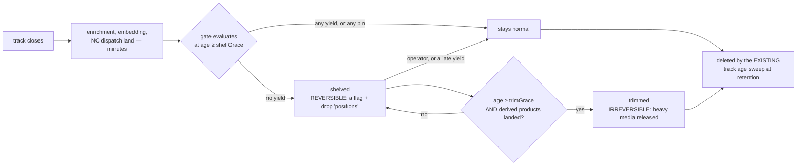

# Track persistence gates

<!-- covers-demotion 2026-09-15 -->
> **2026-09-15 — this page is a DATED MEASUREMENT plus an UNBUILT proposal, so
> it carries `covers:` and no `applies-to`.** §1–§3 are the live hub as it was
> on **2026-08-14**; §4–§7 are a design whose steps 2–4 are still outstanding.
> `applies-to` means *I re-checked this code on `last-verified`* (D145), and
> nobody re-checks eight retention sources against an August census — the page
> would sit suspect on every retention commit, which is how a ratchet gets
> ignored. The globs stay as coverage.
>
> What has moved under §4's referrer census since, so its rows are read as
> history and not as today's mechanics:
>
> - **Media is addressed by its own row id, not by a key that embeds its
>   owner** ([D482](../decisions/adr-0482-a-media-row-is-addressed-by-its-own-id.md)).
>   The census row saying the owner is "encoded in `ownerId`" describes the
>   superseded composite key; the write SLOT is now one function in
>   `media-store.ts`, and the cited `:91` / `:97-105` / `:662` line numbers
>   have all drifted.
> - **The `event` owner kind was split into `motion` / `object` / `audio`**
>   ([D474](../decisions/adr-0474-an-event-id-is-the-rowid-and-a-reference-to-it-keeps-its-own-type.md),
>   D476), because an event id became a per-table rowid and `event:5` stopped
>   naming one row.
> - **Two owner kinds the census predates**: a summary's group shot
>   (`summary`, [D359](../decisions/adr-0359.md)) and the notification summary
>   mosaic ([D480](../decisions/adr-0480-a-bulk-sweep-covers-the-whole-collection-or-it-covers-the-head.md)) — both freed with their owner,
>   both probed by the orphan audit.
> - **The orphan audit covers the whole collection, not its head** (D480).
>
> None of these change a §5 recommendation or a §9 question; they change which
> lines a reader should open.

> **STATUS: the GATE is a proposal; the LEAK it was ranked behind is FIXED.**
> Everything in §1–§3 is a MEASUREMENT of the live hub taken on 2026-08-14;
> §4–§7 are a design that has not been implemented, and §9 is the
> open-questions batch that must be answered before it is. §8's steps 0 and 1
> SHIPPED on 2026-08-15
> ([D161](../decisions/adr-0161-a-track-is-never-forgotten-only-closed.md)) and
> were re-verified against the code on 2026-08-19 — `TrackStore.closeActive`
> persists a stationary-promoted track with `closedReason:
> 'stationary-promotion'` before dropping it from RAM. Steps 2–4 are
> outstanding.
>
> **The measurement changed the proposal.** The brief was "~150 useless tracks a
> night bloat the DB and the media store — gate them". Two of the three premises
> did not survive contact with the data:
>
> - The DB is **not** where the cost is, and the gate is **not** where the win
>   is. The entire candidate cohort is 0.36 GB/day of media. The retention
>   cascade was leaking *1.15 GB/day* — not by deleting track rows and leaving
>   the children behind, which is the hypothesis §2.2 disproved, but by never
>   persisting a promoted track's root row at all — **three times the gate's
>   whole upside, lost every day** (§2). Building the gate first would have
>   shipped a feature on top of a leak and got credit for the wrong thing.
>   **The inflow was stopped on 2026-08-15 (§2.2); the standing 18.9 GB is still
>   there and is reclaimed by hand (§8 step 2).**
> - "Motion without objects" and "objects below threshold" produce **no track
>   rows at all** — the first is a trackless family with its own sweep, the
>   second is refused by the confirmation gate and leaves nothing behind
>   ([D38](../decisions/adr-0038.md)). The residue is a different animal:
>   **confirmed tracks that never yielded an enrichment** (§3).
>
> The recommendation is therefore **shelve, never delete** (§5), riding the
> sweep that already exists (§6), and **behind** a cascade fix (§8).
>
> **2026-08-20/21 — two fixes moved the cohort's boundaries** (the design is
> unaffected; the measured NUMBERS now under-state it):
>
> - **The importance the G4 gate reads was inflated when it was measured.**
>   `computeImportance`'s anti-static demotion exempted any track with a
>   `label` — correct when `label` meant identity, wrong after the 4g tiering
>   split the column: the vehicle-classifier's "Car" reached the gate dressed
>   as an identity and cancelled the 10× demotion on **68 tracks/day** of
>   parked furniture ([D203](../decisions/adr-0203-a-sub-class-is-not-an-identity.md):
>   `ScoringInput.identityLabel`, tier-2 only, is now the sole exemption).
>   Under the fixed scorer those tracks fall under `importance < 0.4`, so
>   today's G4 cohort is LARGER than the measured 1,444 — and they carry a
>   tier-1 `label`, so the §7.1 CANDIDATE predicate (`label IS NULL`) still
>   correctly refuses to shelve them.
> - **The birth-side residue shrinks at its source.** The confirmation gate's
>   bar is per-candidate since
>   [D204](../decisions/adr-0204-a-phantom-cell-outlives-the-tracks-that-made-it.md):
>   a recurrent short-motionless birth cell raises `minConfidence` (ceiling
>   0.9), so part of §3.1's confirmed-but-unenriched population — the
>   recurring 4-second motionless "person" — is increasingly refused before a
>   track row exists at all.

## 0. How to read the evidence markers

Same convention as [the storage table map](./2026-08-03-storage-table-map.md).
An unmarked guess in a document like this reads as fact, so there are none.

| Marker | Means |
| --- | --- |
| **[measured]** | Read off the live hub on **2026-08-14**, container `CamStack`, `/data/addons-data/sqlite-settings/camstack.db`, opened `readonly: true` via `better-sqlite3`. Row counts, `dbstat` page sizes, `ops-log` detail strings, and `fs.existsSync` probes against `/recordings`. |
| **[source]** | Read out of a file at the cited `file:line`. |
| **[undetermined]** | Could not be established. Stated as a hole. |

The install is 14 devices with detections and a 7-day track window. Absolute
counts are *this install*; the growth **rules** are derived from the writers and
are general.

## 1. What is actually there

**[measured]** `pipeline-analytics:tracks` holds **10,532 rows spanning
2026-08-07 21:30 → 2026-08-14 21:02** — a 7-day window, matching
`trackRetentionDays` default 7 (`retention-policy.ts:70`) **[source]**.

| Fact | Value **[measured]** |
| --- | --- |
| Tracks created | **~1,500/day** (2,711 / 1,186 / 1,104 / 1,208 / 1,361 / 1,264 / 1,206 over the seven days) |
| Tracks created 20:00–08:00 | **1,173 / 7 days = ~168 per night** |
| Tracks that ever produced a notification | **93 of 10,532 = 0.88 %** |
| Track-owned media rows | 156,310 rows / **45.59 GB**, i.e. **~6.5 GB/day** |
| `keyFrame` share of those bytes | 26.28 GB = **58 %** of all track media |
| Tracks with zero media | 148 |
| `pipeline-analytics:tracks` on disk | **113 MB** of a 355 MB database — 32 % |
| … of which the `positions` JSON blob | avg **9,096 bytes/row ⇒ ~96 MB**, i.e. **85 % of the track table is the position trail** |
| `object-clip` vectors | 14,653, of which 10,110 map to a live track |

The operator's "~150 a night" is **confirmed at 168/night** once "night" is read
as 20:00–08:00. The 22:00–06:00 window is only 46/night, so the complaint is
about the evening shoulder, not the dead of night.

### 1.1 The definition of "useless" decides everything

**[measured]**, applying candidate definitions cumulatively over all 10,532
tracks:

| Gate | Tracks | Media | In `object-clip` |
| --- | ---: | ---: | ---: |
| G0 — everything | 10,532 | 26.69 GB¹ | 10,110 |
| G1 — no notification | 10,472 (99.4 %) | 26.39 GB | 10,050 |
| G2 — G1 + no face **row** and no plate row | 9,973 (94.7 %) | 24.99 GB | 9,551 |
| G3 — G2 + no `label`, no `subLabel`, `hasFace ≠ 1` | 4,392 (41.7 %) | 8.64 GB | 3,973 |
| G4 — G3 + `importance < 0.4` | 1,444 (13.7 %) | 2.49 GB | 1,289 |
| G5 — G4 + duration < 10 s | 1,222 (11.6 %) | 2.10 GB | 1,093 |
| G6 — G5 + not in the vector index | **129 (1.2 %)** | 0.04 GB | 0 |

¹ the 26.69 GB is the media still owned by a *live* track; the other 18.9 GB is
§2.

Three things fall out of that table, and each one is a design constraint:

- **"No notification" cannot be the gate.** It selects 99.4 % of the fleet's
  tracks. The operator's felt definition of useless *is* this row — which is
  why the complaint is "150 a night" and not "20 a night" — but a gate built on
  it deletes the archive.
- **"Not in the vector index" is not a usefulness signal.** 96 % of all tracks
  carry a CLIP vector, so requiring absence collapses the cohort to 1.2 %. A
  vector means the key frame landed, nothing more.
- **The defensible cohort is G4: 1,439 tracks (13.7 %), 206/day, 2.49 GB/7 days
  = 0.36 GB/day.** That is the entire prize. It is **5.5 % of media bytes** and
  about 15 MB of database.

*(G4b — G4 additionally excluding `debug`/`markForTrain`/`retrainStatus` rows —
is 1,439 vs 1,444: the training exclusions cost five tracks, because §3.3.)*

## 2. The finding that outranks the gate: the cascade leaks

**[measured]** Across the whole media index:

| | Rows | Bytes | Files still on disk |
| --- | ---: | ---: | --- |
| `ownerKind='track'` media whose track row **does not exist** | **74,700** | **18.9 GB** | **40/40 sampled resolved under `/recordings`** |
| … of which `keyFrame` | 9,668 | 10.73 GB | |
| Orphan `object-events` | 23,296 | | |
| Orphan `object-clip` vectors | 4,543 | | |
| Orphan `faces` / `plates` | 100 / 17 | | |

**[measured]** The `pipeline-analytics:ops-log` since it began on
2026-07-29T19:19Z:

```
cascade ops: 3,732   tracks deleted: 8,461   events deleted: 0   media deleted: 0   bytesReclaimed: 0
```

Zero. Every day, including today (1,657 tracks deleted on 2026-08-14 alone).
And 8,461 deleted tracks × the measured ~8.8 media rows per track ≈ 74,500 —
which is the orphan count to within 0.3 %.

**[measured]** The orphans are not a legacy tail. Grouped by media timestamp:
9.21 GB is **younger than 7 days**, and the daily rate of newly-orphaned track
owners is **375–1,125/day, ~1.15 GB/day**. Of the 4,007 orphan owners younger
than 7 days, **4,002 still have their object events, 3,906 still have their CLIP
vector, and 25 even have an outbox row** — these were full-life, fully-enriched
tracks that lost only their root row.

### 2.1 What is NOT the cause

- **Not the ops-log zeros.** `pruneTracksBefore`'s docblock says it plainly:
  "`tracks` is the authoritative count; leaf families are best-effort 0 under
  the void `TrackScopedStore` contract" (`index.ts:9990` region) **[source]**.
  The zeros are a reporting contract. The orphan *census* is the evidence, not
  the zeros — but see §7.2, because a counter that is structurally always 0 is
  why nobody saw 18.9 GB accumulate.
- **Not a stale deploy.** Hub runs `@camstack/addon-post-analysis` **1.2.75**
  against repo `1.2.76` **[measured]**, so the D61 cascade of 2026-08-06
 is live.
- **Not the registry.** `buildTrackCascadeRegistry` (`index.ts:9800-9819`)
  passes `eventStore`, `mediaStore`, `faceStore`, `plateStore`,
  `objectEmbeddingStore` **[source]**, and the leaf implementations read
  correctly (`media-store.ts:844`, `event-store.ts:1101`) **[source]**.

### 2.2 ANSWERED — 2026-08-15, and the hypothesis was wrong

**The write gate is innocent, and so is the cascade.** Recorded here rather than
deleted, because the wrong hypothesis was the plausible one and the next reader
will have it too. Full record: [D161](../decisions/adr-0161-a-track-is-never-forgotten-only-closed.md).

- **Not `this.gated(...)`.** `MediaWriteGate.run` only ever *throws*.
  `cascadeDeleteTracks` runs every leaf **before** the root and
  `runTrackCascadeBatch` counts a track only when nothing threw — so a closed
  gate would have left all 8,461 track rows in place. They are gone.
- **Not the store predicate, and not the page loop.** Driven over a real
  `SqliteSettingsBackend` instead of `makeFakeSettingsStore`, the shipped
  registry removes every media row, every object event and every blob
  (`cascade-over-real-sqlite.spec.ts`). The cascade was never the problem.

**The cascade never RAN on these tracks: they never had a row to cascade from.**
`TrackStore` persists a track at TTL expiry and nowhere else, and the addon
called `trackStore.dropActive(trackId)` — drop the RAM entry, write nothing —
when a track was promoted to a *stationary* (parked) object. By then it owns a
full media set, its object events and its CLIP vector. The persisted row is the
only thing `listIdsBefore` selects and the only thing the cascade descends from,
so every promotion orphaned that footprint permanently. **[measured]** on the
live hub over the tRPC API: tracks whose object events are **six hours old** —
inside every device's window, so retention cannot be involved — already have no
track row and still return 5–9 media rows from `listTrackMedia`.

The fix is `TrackStore.closeActive`: persist, then drop. §1.1's arithmetic is
unaffected; §8's ordering is unaffected; only the CAUSE named in this section
was wrong.

**And the row says WHY it was closed early**
([D172](../decisions/adr-0172-a-track-says-why-it-was-closed-a-digest-is-passages.md)).
Persisting the promoted track fixed the leak and simultaneously exposed every
parked object to the readers of `listTracks` — the operator's nightly summary
digest went from 1-2 tiles to 10 the same night, mostly one car in a car park.
`closeActive(trackId, reason)` writes `closedReason: 'stationary-promotion'` to
the row, and the summary producer is the ONE consumer that filters on it. The
marker lives in the addon (`PersistedTrack`), never on the cap `Track` shape.

## 3. The causes, reclassified

The brief proposed three causes. Measured, two of them cannot produce a track
row at all.

| Proposed cause | What the data says **[measured]** |
| --- | --- |
| **Motion with no objects** | Produces **no track**. `pipeline-analytics:motion-events` is a *trackless* family with its own sweep (272,856 rows/7 days, 25.2 MB) and never joins a track. It is loud in row count and cheap in bytes. |
| **Objects below threshold** | Produces **no track**. The confirmation gate rejects the birth and `trackStore.dropActive` leaves nothing ([D38](../decisions/adr-0038.md)) — this was fixed and the 27 s phantom window closed. Since [D204](../decisions/adr-0204-a-phantom-cell-outlives-the-tracks-that-made-it.md) the gate's bar is also PER-CANDIDATE: a phantom cell with recurring short-motionless closes raises `minConfidence` for births inside it (ceiling 0.9), so the recurring class of this residue is increasingly refused at birth too. |
| **Dedup** | Produces a track. Dedup lives at the *notification* layer (`maxPerTrack:1`, `notification-center:track-groups`), not the track layer, so a deduped subject keeps its row and its media by design. |

What the residue actually is:

**3.1 Confirmed-but-unenriched. [measured]** 1,439 tracks (13.7 %) got through
the confirmation gate, ran their whole life, captured 1.7 MB of media each, and
ended with no label, no sub-label, no face row, no plate, importance < 0.4 and
no notification. `importance` for **1,358 of the 1,438** is **< 0.1**; only 52
are in 0.3–0.4. This is a bimodal population, not a continuum — a threshold at
0.2 and one at 0.4 select almost the same set.

**3.2 One class carries a per-camera signature. [measured]** Of 705 `animal`
tracks, 612 are unlabelled. But the misses are not spread evenly:

| Cameras | animal tracks | labelled |
| --- | ---: | ---: |
| 636, 637, 102 | 112 | **93 (83 %)** |
| 104, 1443, 587, 101, 586, 592, 618, 103 | 593 | **0 (0 %)** |

Where the animal classifier answers at all it answers most of the time; on eight
cameras it has *never once* named an animal. 503 of those 593 (85 %) are on
104/111/112 — the three highest-volume cameras. **[undetermined]** whether that
is IR/insect false positives or a classifier that is not reaching those cameras;
either way it is the sharpest per-camera noise signature in the data, and it is
a *detection* problem the gate would paper over.

**3.3 The training exclusions cost nothing, because they are empty.
[measured]** `markForTrain` is **NULL on every one of the 10,532 rows**;
`retrainStatus` is `'none'` on every row; `retrain-frames` and
`retrain-annotations` are **both empty (0 rows)**; `debug = 1` on 32 rows. The
brief's constraint "never touch tracks marked debug/training" is right and must
be enforced — but today it protects 32 rows, so it cannot be leaned on as
evidence the gate is safe.

**3.4 The cohort concentrates. [measured]** 501 of 1,439 on device 104, 365 on
111, 194 on 112 — **74 % on three cameras** — and 1,193 of 1,439 are **daytime**
(08:00–20:00). The problem is not nocturnal; it is three busy cameras.

**3.5 The class mix is the uncomfortable part. [measured]** The cohort is
**1,037 `person`**, 328 `animal`, 54 `vehicle`, 20 `doorbell`. Any gate with a
meaningful yield is, mostly, a gate on unrecognised people.

## 4. What points at a track — the blast radius of a hard delete

Census as of 2026-08-14 **[source]**, plus what each does when the row vanishes.

| Referrer | Where | Cascade-owned? | On a hard delete |
| --- | --- | --- | --- |
| `pipeline-analytics:object-events` | `event-store.ts:51`, `trackId` NOT NULL `:116` | yes — `deleteByTracks` `:960` | should go; **today survives** (§2) |
| `pipeline-analytics:media` (`ownerKind='track'`, plus `face-<id>`/`plate-<id>`) | `media-store.ts:91`, owner encoded in `ownerId` `:97-105` | yes — `deleteByTracks` `:662` | should go; **today survives** (§2) |
| `pipeline-analytics:faces` / `:plates` | `face-store.ts:35` / `plate-store.ts:32` | yes, **unless `assigned=1`** | enrolled gallery rows exempt by design |
| `object-clip` vector index | `object-embedding-store.ts:36`, **row id = trackId** | yes — `deleteByTracks` → `vectorStore.deleteByIds` | should go; **today 4,543 orphans** |
| `pipeline-analytics:stationary-objects` | `sourceTrackId` column | **no** | dangling `sourceTrackId` |
| `pipeline-analytics:retrain-frames` / `:retrain-annotations` | `trackId` NOT NULL | **no — deliberately** (copies, not references) | dangling by design |
| `notification-center:outbox` | `outbox.ts:52`, nullable `trackId`, used as the dedup key | **no** — own 7-day prune `:47-50` | dedup key points at nothing; a re-created id could re-notify |
| `notification-center:track-groups` | `memberTrackIds` JSON array | **no** — ring-bounded by count | dangling ids inside the JSON array |
| Viewer feed | `useTracksFeed` → `pipelineAnalytics.listRecentTracks` | — | row simply absent |
| Viewer deep link | `useTrackById` → `getTrack`, returns `Track \| null` | — | **see below** |
| Viewer media | `mediaFileUri` / `mediaImageSource` | — | 404 → broken-image glyph, no crash |

**The one real breakage is the deep link.** `EventsScreen.tsx:122-136` reads
`?trackId&deviceId` off the URL and only calls `setSelected` / clears the params
`if (linkedTrack !== null)` **[source]**. On a hard-deleted track the effect
never fires: **the modal silently never opens and the query params are never
cleared**, so the app re-queries an unresolvable link forever with no error
shown. Share links (`track-share.ts:29-44`) mint exactly this URL. A hard delete
of a track someone shared is a permanent, silent dead link — and it is the
repo's own "a branch that DROPS work logs" rule violated on the client.

**No exclusion flag exists today.** `retrainStatus` is a retention *pin*
([D81](../decisions/adr-0081.md)); `debug`, `hasFace`, `hasRider` are
*positive-inclusion* filters; `state` is the motion lifecycle. Nothing hides a
track from a list **[source]**. Shelving needs a new column either way.

## 5. Shelve, not delete — the recommendation

**Recommendation: a two-phase, reversible SHELF, with the actual deletion left
to the age sweep that already owns it.** No new deleter, ever.



### 5.1 Why not delete

Five reasons, in the order they bind:

1. **[D49](../decisions/adr-0049.md) — never destroy work on a fallible read.**
   The predicate reads five things that can each fail independently: an outbox
   lookup, a face-row lookup, a plate-row lookup, a vector-index probe, and the
   track's own enrichment columns. A delete on that conjunction would need
   *two agreeing reads* to be admissible under D49. A shelf destroys nothing, so
   one read is enough — and that difference alone is worth the column.
2. **[D58](../decisions/adr-0060.md) — media a later pass depends on is retained
   until it LANDS.** The rebuild path reads the stored `keyFrame` and has no
   substitute; a track with no key frame is outside the search index
   *permanently*. A delete-at-close gate races the very retries D58 exists to
   guarantee. Phase 2 (§5.3) is the D58-literal form: **the key frame is
   released only once the thing derived from it exists.**
3. **Training.** `markForTrain` is NULL on 100 % of rows today (§3.3). Any
   sample the operator would ever want came from a *past* track, and a shelved
   track can still be promoted; a deleted one cannot. Shelving is the only form
   that keeps the training door open.
4. **The gate cannot be validated without a shadow period,** and shelving *is*
   the shadow period: turn it on, read the shelf, un-shelve what should not be
   there, and the false-positive rate is a number instead of an argument.
5. **The deep link (§4).** A shelved track still resolves by id, so the viewer
   opens it with a banner. A deleted one produces the measured silent failure.

### 5.2 Why "shelved", and not "suppressed"

**Do not call it `suppressed`.** The word already means two other things in this
subsystem: the confirmation gate's three-valued verdict `confirmed | suppressed
| undecided`, and the zero-media close policy's "suppressed". A third meaning on
a persisted column guarantees a future reader will connect the wrong two. Use
one word that is free — `shelved` throughout this document — and a single column
whose states are total:

`shelfState: 'none' | 'shelved' | 'trimmed'` (NOT NULL DEFAULT `'none'`),
mirroring `retrainStatus`, plus `shelfReason TEXT` and `shelvedAt INTEGER`.
Three columns, one authority, no second store.

### 5.3 The two phases, and which one is irreversible

| | Phase 1 — **shelve** | Phase 2 — **trim** |
| --- | --- | --- |
| When | age ≥ `shelfGraceMinutes` (default 60) | age ≥ `shelfTrimHours` (default 24) **and** derived products landed |
| Effect | `shelfState='shelved'`; excluded from `listRecentTracks` and from search results; `positions` blob dropped | the heavy media released through `MediaStore.deleteForOwner` |
| Reversible | **yes** — clear the flag (the position trail does not come back) | **no** |
| Measured win | ~85 % of the track row's bytes: `positions` averages 9,096 B/row | 1.7 MB/track ⇒ **0.36 GB/day** at the measured cohort |

Phase 1 is where the *database* win is and it is nearly free: dropping
`positions` on a shelved track recovers ~9 KB/row against a 113 MB table whose
trail is 85 % of it. Phase 1 is also the only phase the operator can undo, so it
is the one that ships first and alone.

Phase 2's rule, stated so it cannot be softened: **a media kind is trimmable
only when the artefact derived from it already exists.** For `keyFrame` — 58 %
of all media bytes — that is *the `object-clip` vector for this track exists*.
No vector, no trim, however old the track: that is D58's "gate on did it
persist, never on a peak signal" applied literally. **[measured]** 1,283 of the
1,438 cohort tracks have a vector, so the rule costs ~11 % of the phase-2 yield
and buys the whole D58 argument.

`snapshot` (the periodic filmstrip: 43,602 rows, 5.39 GB) and `firstFrame`
(22,890 rows, 2.88 GB) derive nothing and are trimmable at phase 2 without a
condition. `thumbnail` is what the shelf list itself renders — keep one.

## 6. When it runs — on the existing sweep, and it is not a second clock

`scripts/check-age-keyed-retention.ts` refuses more than one age-keyed sweep,
and it exists because ten of them once disagreed on the live fleet
([D61](../decisions/adr-0061.md)) **[source]**. The gate must not become the
eleventh. The same guard cross-checks every `*_COLLECTION` constant against
`retention/collection-classification.ts`, so a new durable store cannot ship
without saying, in writing, what happens to its rows when their owner goes
away — the 2026-08-21 additions (`phantom-cells`
[D204](../decisions/adr-0204-a-phantom-cell-outlives-the-tracks-that-made-it.md),
`package-background`
[D206](../decisions/adr-0206-a-position-that-delivers-itself-is-background.md))
are both classified never-orphaned: scene-owned, self-bounded on write, no age
clock.

**It rides `runTrackRetentionSweep`** (already every 5 minutes, already
per-device, already holding the ops-log handle and the `deviceIds` set and one
`now`) as a pass that runs **before** the cutoff drain, over the same device
list.

The distinction that keeps it legal, and it is the same distinction
`orphan-audit.ts` already makes: **the gate's clock is a GRACE, not a cutoff.**
`shelfGraceMinutes` can only ever *exclude* a track from being touched — a
younger track is never a candidate. Nothing is selected *for being old*; age
only buys immunity. That is the orphan audit's `graceMs` argument verbatim
("can exclusively SAVE a row") **[source]**, and the guard should be extended to
assert it of the gate rather than trusting this paragraph — see §9 Q6.

**Not at track close.** Close is the wrong instant and the reason is measured:
`importance`, the detail-plane label, the face row, the CLIP vector and the NC
dispatch all land *after* `closeExpired`. A close-time verdict judges a
half-finished track, which is precisely the D49 shape — a one-shot decision
gated on a read that has not happened yet. The 60-minute grace is what makes the
five signals meaningful.

## 7. How it is observed

### 7.1 The predicate, split into HELD and CANDIDATE

**HELD — never a candidate, checked first, and every hold is counted:**

| Hold | Today **[measured]** |
| --- | ---: |
| `debug = 1` | 32 |
| `markForTrain = 1` | 0 |
| `retrainStatus <> 'none'` (already pins the sweep, D81) | 0 |
| a row in `retrain-frames` or `retrain-annotations` | 0 |
| an `assigned=1` face or plate | 589 faces / 40 plates total |
| a `notification-center:outbox` row | 93 |
| membership in a `track-groups.memberTrackIds` array | 0 groups |
| is a `stationary-objects.sourceTrackId` | 3 |
| `lastSeen` newer than `shelfGraceMinutes` | — |

**CANDIDATE — all must hold:** no face row, no plate row, `hasFace ≠ 1`,
`label IS NULL`, `subLabel IS NULL`, `importance < shelfMaxImportance`.

Duration is **not** in the predicate: **[measured]** adding `< 10 s` moves 1,444
→ 1,222 (−15 %) while adding a knob that has to be explained per camera.
Vector-absence is **not** in the predicate (§1.1).

### 7.2 Counters, and one lesson from §2

The ops-log gets a **`shelve`** op alongside `prune` and `orphan-audit`, with
`itemsAffected` and — this is the lesson — **a `bytesReclaimed` that is real**.
The cascade has reported `bytesReclaimed: 0` on 3,732 operations since
2026-07-29 **[measured]**, and that structural zero is exactly why 18.9 GB
accumulated in plain sight. **A counter that can only ever be 0 is worse than no
counter: it reads as "nothing to reclaim".** If the gate cannot count its bytes,
it does not ship.

Per device per sweep, one `info` line with `tags: { deviceId }` (the repo's
per-device tagging rule — a fleet-wide number cannot answer "why is 104 worse
than 101?", and §3.4 is the reason that question will be asked):

```
analytics track shelf  tags:{deviceId}
  meta:{ deviceId, evaluated, shelved, unshelved, trimmed, bytesTrimmed,
         heldBy:{ debug, train, retrain, enrolled, notified, grouped,
                  stationary, grace }, mode }
```

And, per the "a branch that DROPS work logs" rule: a candidate refused by a
*failed read* (the outbox query threw, the vector probe threw) is logged
distinctly from a candidate that passed — a fallible read must never be
indistinguishable from a clean verdict, which is D49's whole shape.

### 7.3 The knob, and where it is allowed to live

[D62](../decisions/adr-0062.md): a per-camera switch **stores nothing** and names
the authority that already owned the function. Retention is that authority here,
so the gate's settings go into `RetentionSettings`
(`retention-policy.ts:60-86`) and into `RETENTION_SETTING_KEYS` — which
`scripts/check-retention-settings-consumed.ts` already enforces in both
directions **[source]**. **No new store, no second switch.**

| Knob | Default | Note |
| --- | --- | --- |
| `shelfMode` | **`'observe'`** | `off` / `observe` / `shelve` / `shelve+trim`. Observe counts and logs, touches nothing — the §2 orphan audit's report-first posture, for the same reason. |
| `shelfGraceMinutes` | 60 | can only save a row (§6) |
| `shelfMaxImportance` | 0.2 | **[measured]** 0.2 and 0.4 select nearly the same set (§3.1) |
| `shelfTrimHours` | 24 | phase 2 only |
| `shelfClasses` | `['animal']` | see §9 Q1 |

Per-device, like `trackRetentionDays` — retention is already deliberately
per-device ("measured 1 day on 104 against 7 on 101/102") and §3.4 says the
cohort concentrates on three cameras.

## 8. Order of work — the gate is third

0. ~~**Diagnose §2.**~~ **DONE 2026-08-15 — see §2.2.** Not the write gate, not
   the store predicate: the tracks were never persisted (D161).
1. ~~**Fix the cascade**~~ → **DONE**: `closeActive` at stationary promotion, and
   `bytesReclaimed` is real end-to-end — `deleteByTracks` returns
   `TrackCascadeLeafCount[]` and the ops-log row carries the byte total (§7.2's
   rule, now enforced).
2. **Reclaim the standing 18.9 GB** through the `retention.orphanAudit` custom
   action in `mode: 'reclaim'` — dry-run by default, bounded, resumable, and it
   reports rows AND bytes per collection. Run repeatedly until `totalOrphans`
   is 0. **Still outstanding — it is deliberately manual.**
3. **Ship the gate in `observe` mode**, read the shelf for a week, *then* enable
   `shelve`. `shelve+trim` last, and only with the D58 condition (§5.3).
4. **Fix the viewer deep link** (`EventsScreen.tsx:122-136`) to distinguish
   "loading" from "resolved to nothing" — needed for shelved tracks, and a
   pre-existing bug regardless.

Steps 1 and 2 are worth **~19 GB now and ~1.15 GB/day thereafter**. Step 3 is
worth **0.36 GB/day and ~15 MB of database**. Doing 3 before 1 would be
measuring a leak with a thimble.

## 9. Open questions — batch, each with a recommendation

**Q1 — Does the gate shelve `person` tracks?** 1,037 of the 1,439 cohort are
unrecognised people (§3.5). Shelving them is where the yield is; it is also the
one class an operator may want to scrub retroactively after an incident.
**Recommendation: no, not initially.** Default `shelfClasses: ['animal']` — 328
tracks, the class with a measured per-camera failure signature (§3.2) and no
plausible forensic value when unlabelled. Revisit with the observe-mode
false-positive rate in hand.

**Q2 — Is the animal noise a gate problem or a detection problem?** Eight
cameras have produced **zero** animal labels in 7 days against 593 animal tracks
(§3.2). **Recommendation: treat it as a detection bug first.** If the animal
classifier is simply not reaching 104/1443/587, the gate would permanently hide
the evidence of that — the worst possible outcome, and the repo has shipped a
"fix" that hid its own defect before. Answer Q2 before enabling Q1's default.

**Q3 — Is the gate per-device or fleet-wide?** [D52](../decisions/adr-0052.md)
says one cluster-wide setting for the crop convention; retention says per-device
and gives a measured reason. **Recommendation: per-device**, in
`RetentionSettings` (§7.3) — the gate is retention, not a pipeline convention,
and §3.4 shows 74 % of the cohort on three cameras.

**Q4 — Does a shelved track leave the semantic search index?** It is excluded
from lists by definition; the vector is a separate question. **Recommendation:
yes, exclude it from search results, but do NOT delete the vector at phase 1** —
a deleted vector is unrecoverable without the key frame, and phase 1 must stay
reversible. The vector goes at phase 2, in the same transaction as the key frame
it was derived from.

**Q5 — What happens to a shelved track that later earns a yield?** A late
`plate-ocr`, an operator naming a face, a bulk re-embed. **Recommendation:
auto-unshelve on any yield write**, implemented in the one place that already
decides whether a label reaches a row — `resolveTieredLabelWrite`
(`pipeline/label-tier.ts`) — plus the face/plate assignment paths. Not a second
watcher; a line in the existing writer. A *trimmed* track cannot unshelve to
full, and must say so rather than pretending.

**Q6 — Does the "one age-keyed sweep" guard need widening?** §6 argues the gate
is grace-keyed, not age-keyed, and that argument currently lives in a paragraph.
**Recommendation: widen `scripts/check-age-keyed-retention.ts`** so a delete
under `pipeline-analytics/` reachable from the gate must take a *grace*
parameter and no cutoff. Prefer a guard to a paragraph — this rule was already
broken four times before it was written down.

**Q7 — Should `positions` be trimmed for ALL old tracks, not just shelved
ones?** It is 85 % of a 113 MB table and nothing reads a 7-day-old position
trail. **Recommendation: out of scope here, but raise it** — it is a larger
database win than the entire gate, it is uniform, and it needs no predicate.

**Q8 — Do the two non-cascading NC referrers need cleaning?**
`outbox.trackId` (a dedup key, 7-day self-prune) and `track-groups`
`memberTrackIds` both dangle after a delete (§4). **Recommendation: leave both
alone for shelving** — a shelved track still exists, so neither dangles. Revisit
only if hard deletion is ever reconsidered, at which point the outbox dedup key
pointing at a re-usable id is a genuine correctness question, not a tidiness
one.
